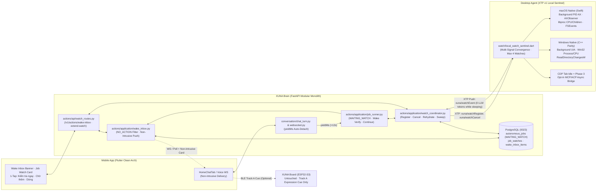
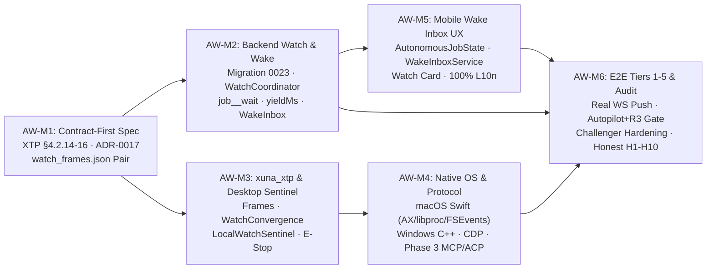

# XUNA Async Watch & Wake — Architecture, Contract Specification & Teamwork Plan

Date: 2026-11-22. **Status: Proposed** (Contract-First specification & phased teamwork plan for Milestones **AW-M1–AW-M6**; companion decision record: [ADR-0017](../decisions/ADR-0017-async-watch-and-wake.md)).

Companion documents:
[ADR-0012 (Host Actions)](../decisions/ADR-0012-host-actions.md) ·
[ADR-0013 (Host Identity & Sessions)](../decisions/ADR-0013-host-identity-and-sessions.md) ·
[ADR-0015 (Commit-Gated Control & Autopilot Amendment 2026-11-22)](../decisions/ADR-0015-commit-gated-control-and-trusted-scopes.md) ·
[ADR-0016 (Spatial Device Mesh)](../decisions/ADR-0016-spatial-device-mesh.md) ·
[ADR-0017 (Async Watch & Wake)](../decisions/ADR-0017-async-watch-and-wake.md) ·
[XUNA Spatial Device Mesh Spec](XUNA_SPATIAL_DEVICE_MESH.md) ·
[XUNA XTP v1 Normative Wire Contract](XUNA_XTP_V1_CONTRACT.md) ·
[XUNA Honest-Code Rules](XUNA_HONEST_CODE_RULES.md) ·
[Backend Rules](../../backend/AGENTS.md) ·
[Desktop Rules](../../desktop/AGENTS.md) ·
[Mobile Rules](../../mobile/AGENTS.md).

---

## 1. Problem Statement & Core Product Vision

Today, XUNA executes multi-step device control either inside a bounded interactive turn (`MAX_TOOL_ROUNDS = 12`, `TURN_BUDGET_SECONDS = 150s`) or inside `AutonomousJobRunner` (`_run_job_loop`, polling tightly at `await self._sleep(0.01)`). Neither path supports **resting while waiting for a slow external process to finish**, then **waking up with real evidence** to report back or continue the next step.

Real-world tasks that require this capability (all served by **one generic, app-agnostic mechanism** — zero app hardcoding per Rule H5):

1. **Delegated AI / Agent / Interactive App Work:** trigger a long prompt/query in any desktop app or IDE, wait until output streaming and background worker processes settle, read the real result, and either report a summary or submit a follow-up step.
2. **Build / Test / CI / Training / Deployment:** kick off or observe a build/test/deploy job, rest while CPU/filesystem/UI are busy, wake immediately on completion or failure, and report real status or trigger the next stage.
3. **Heavy Export / Render / Download:** wait until an export/render/download stops mutating UI and output files, then notify the owner or continue processing.
4. **Web / Dashboard / Long-Running Remote Job:** wait for a browser tab's DOM/network state to settle or change via CDP, then summarize or act.

### Five Non-Negotiable Invariants

1. **Event-Driven Local Sentinel First (0 Token Sleep, <1s Wake Latency):** The Desktop Host Agent monitors OS-generic signals locally (`AXObserver`/background AX digest, `PID`/child CPU idle, `FSEvents`/`ReadDirectoryChangesW`, Chrome CDP DOM/network idle, or opt-in MCP/ACP async events) and pushes a single content-free **`xuna/watchEvent`** notification over XTP v1 when settled/changed/timed out. The Backend sleeps durably in PostgreSQL with **zero LLM calls** and **zero polling loops** while waiting.
2. **Multi-Signal Convergence (Beat Single-Signal False Positives):** Waiting supports composite signals (e.g. `ui_quiescence` + `process_idle`, or `ui_quiescence` + `fs_quiescence`) evaluated deterministically on Desktop so brief UI pauses during heavy background work do not wake the Brain prematurely.
3. **Non-Intrusive Background Observation & `yieldMs` Auto-Detach:** Inspired by OpenClaw's `yieldMs` + `notifyOnExit` + isolated session lanes:
   - Any interactive turn hitting a slow wait (`> yieldMs`, default `12s`) cleanly detaches into a background `AutonomousJob` (`WAITING_WATCH`), releasing the main chat lane so the owner can talk about unrelated topics without blocking.
   - Watching targets a background `PID`/`windowId`/`workspaceAlias`/`tabId` and **soft-releases foreground focus** (`releaseFocus: true`) so the owner can continue working in other windows undisturbed.
   - Results land in a **Wake Inbox** with a silent-by-default `NO_ACTION` contract on false alarms, never interrupting mid-sentence during an active voice/chat turn.
4. **Honest Safety & Autopilot Compatibility (ADR-0015 2026-11-22 + H1–H10):**
   - **Zero `shell.*`** arbitrary execution (`desktop/AGENTS.md` §3 unchanged).
   - **Consent U5 Zero-Retention:** no screenshots, raw window text, or file paths persisted to DB or sent in `xuna/watchEvent` or logs.
   - **Continuation Gate:** under `Autopilot`, ordinary follow-up steps (`R0–R2`, `cu.session_start`, ordinary IDE clicks/typing/`Enter`) continue seamlessly; **high-impact actions** (financial/payment/cards, destructive delete/uninstall/sign-out, external `mail.send`/`Send`/`Gửi`/`Post`/`Đăng bài`) ALWAYS pause at `AWAITING_R3_CHECKPOINT` for P-256 phone signature; `password` fields and hard-denied apps stay blocked.
   - **Fail-Closed Budgets:** hard caps on `maxWaitSeconds` (≤ 900s per watch) and `maxWakeChecks` (≤ 16 per sub-goal). Timeout reports honest observed state + `Chờ thêm` / `Dừng` — never fabricates completion (H1). E-Stop immediately cancels all active watches on both Backend and Desktop.
5. **Strict Architecture & Anti-God-File Discipline:**
   - `orchestrator.py`: **< 50 net LOC**; `workflows.py`: **0 LOC diff**; `firmware/`: **0 B diff**; `.fvmrc` and `pubspec.lock`: untouched.
   - Backend layers strictly obey `backend/tests/test_architecture.py`; Mobile obeys `mobile/AGENTS.md` Clean Architecture + 100% `locales.g.dart` sync.

---

## 2. System Architecture



---

## 3. Normative Wire Contracts (AW-M1 — Contract-First)

### 3.1 XTP v1 Additions (`XUNA_XTP_V1_CONTRACT.md` §4.2.14–§4.2.16)

All schemas are **additive**, `additionalProperties: false`, strictly content-free (no window titles, no raw OS paths, no screen text, no base64 images). Synchronized byte-identical fixture pair:
- `backend/tests/fixtures/xtp/watch_frames.json`
- `desktop/packages/xuna_xtp/test/fixtures/xtp/watch_frames.json`

#### A. `xuna/watchRegister` (Backend → Host JSON-RPC Request)

```json
{
  "jsonrpc": "2.0",
  "id": 701,
  "method": "xuna/watchRegister",
  "params": {
    "schemaVersion": 1,
    "watchId": "f1111111-1111-4111-8111-111111111111",
    "jobId": "a2222222-2222-4222-8222-222222222222",
    "mode": "composite",
    "signals": ["ui_quiescence", "process_idle"],
    "target": {
      "pid": 48210,
      "windowId": 1042,
      "appId": "code",
      "workspaceAlias": "xuna_pet"
    },
    "quiescenceSeconds": 8,
    "minWaitSeconds": 3,
    "maxWaitSeconds": 300,
    "requireInitialChange": true,
    "releaseFocus": true
  }
}
```

- **`mode` enum:** `"ui_quiescence" | "ui_change" | "process_idle" | "fs_quiescence" | "cdp_idle" | "composite" | "timer" | "protocol_async"`.
- **`signals`:** required iff `mode == "composite"` (2–3 distinct primitive modes from `{"ui_quiescence", "process_idle", "fs_quiescence", "cdp_idle"}`); forbidden otherwise.
- **`target` fields (all optional, normalized only):**
  - `pid` (`int`, `1..2147483647`), `windowId` (`int`, `0..2147483647`), `appId` (`^[a-z0-9_.-]{1,64}$`), `workspaceAlias` (`^[a-zA-Z0-9_.-]{1,64}$`, zero `/` or `..`), `tabId` (`1..128` chars), `mcpServerId` (`^[a-z0-9_.-]{1,64}$`), `protocolTaskId` (`1..128` chars).
- **Bounds:** `quiescenceSeconds` `2..120`, `minWaitSeconds` `0..60`, `maxWaitSeconds` `5..900`.
- **Host Response (Success):**
  ```json
  {
    "jsonrpc": "2.0",
    "id": 701,
    "result": {
      "schemaVersion": 1,
      "accepted": true,
      "watchId": "f1111111-1111-4111-8111-111111111111",
      "activeSignals": ["ui_quiescence", "process_idle"],
      "eventDriven": true,
      "fallbackUsed": false
    }
  }
  ```
- **Host Response (Fail-Closed Rejection — Rule H1/H4):**
  ```json
  {
    "jsonrpc": "2.0",
    "id": 701,
    "result": {
      "schemaVersion": 1,
      "accepted": false,
      "watchId": "f1111111-1111-4111-8111-111111111111",
      "errorCode": "target_not_found"
    }
  }
  ```
  Allowed `errorCode` values: `watch_unsupported`, `target_not_found`, `workspace_not_found`, `watch_limit_reached`, `needs_permission`, `policy_blocked`, `stopped`, `invalid_args`.

#### B. `xuna/watchCancel` (Backend → Host JSON-RPC Request)

```json
{
  "jsonrpc": "2.0",
  "id": 702,
  "method": "xuna/watchCancel",
  "params": {
    "schemaVersion": 1,
    "watchId": "f1111111-1111-4111-8111-111111111111",
    "jobId": "a2222222-2222-4222-8222-222222222222",
    "reason": "owner_cancel"
  }
}
```

- At least one of `watchId` or `jobId` must be present (or both omitted only when `reason == "estop"` to cancel all active watches on the host).
- `reason` enum: `"owner_cancel" | "estop" | "job_ended" | "replaced" | "expired"`.
- Host Response: `{"schemaVersion": 1, "cancelledCount": 1}`.

#### C. `xuna/watchEvent` (Host → Backend JSON-RPC Notification — Content-Free Push)

```json
{
  "jsonrpc": "2.0",
  "method": "xuna/watchEvent",
  "params": {
    "schemaVersion": 1,
    "watchId": "f1111111-1111-4111-8111-111111111111",
    "jobId": "a2222222-2222-4222-8222-222222222222",
    "kind": "settled",
    "observedSignals": ["ui_quiescence", "process_idle"],
    "elapsedSeconds": 47,
    "changeCount": 14,
    "digestChanged": true,
    "occurredAt": "2026-11-22T12:45:00Z"
  }
}
```

- `kind` enum: `"settled" | "changed" | "timeout" | "target_lost" | "error"`.
- Optional `errorCode` (`1..64` chars, required when `kind == "error"`).
- **Content-free guarantee:** NEVER carries screen text, file paths, window titles, or screenshots. The Brain performs an explicit, audited, permission-checked read (`ui.inspect` / `ui.observe_hybrid` / `web.snapshot` / `protocol` read) ONLY after waking.

---

## 4. Database Schema & Backend Core (AW-M2)

### 4.1 Alembic Migration `0023_async_watch_and_wake.py`

- `revision: str = "0023"`, `down_revision: str | None = "0022"`.
- Register `JobWatchModel` and `WakeInboxItemModel` in `migrations/env.py`; verify `upgrade -> downgrade -> upgrade` round-trip in `test_migrations.py`.

#### Table `job_watches`

| Column | Type | Notes |
| --- | --- | --- |
| `watch_id` | `UUID`, PK | Matches XTP `watchId` |
| `job_id` | `UUID`, FK `autonomous_jobs.job_id` (`ON DELETE CASCADE`), indexed | Owning job |
| `owner_id` | `UUID`, FK `owners.owner_id` (`ON DELETE CASCADE`), indexed | Owner isolation |
| `host_id` | `UUID`, FK `hosts.host_id` (`ON DELETE CASCADE`), indexed | Target host |
| `mode` | `String(24)`, NOT NULL | Watch mode enum |
| `signals` | `JSONB`, NOT NULL, default `'[]'` | Sub-signals when `composite` |
| `target_spec` | `JSONB`, NOT NULL, default `'{}'` | Normalized content-free target only |
| `done_criteria` | `String(240)`, NOT NULL | Condition verified by LLM on wake |
| `continuation_mode` | `String(24)`, NOT NULL, default `'report_and_ask'` | `report_only \| report_and_ask \| auto_continue` |
| `quiescence_seconds` | `Integer`, NOT NULL, default `8` | Stability window |
| `max_wait_seconds` | `Integer`, NOT NULL, default `300` | Hard TTL cap (≤ 900) |
| `max_wake_checks` | `Integer`, NOT NULL, default `8` | Anti-loop LLM wake cap (≤ 16) |
| `wake_checks_used` | `Integer`, NOT NULL, default `0` | Incremented only on LLM wake verification |
| `status` | `String(24)`, NOT NULL, indexed | `active \| triggered \| expired \| cancelled \| failed` |
| `last_event_kind` | `String(24)`, nullable | Latest `xuna/watchEvent.kind` |
| `expires_at` | `DateTime(tz)`, NOT NULL, indexed | Server-side hard expiry deadline |
| `created_at` / `updated_at` | `DateTime(tz)`, NOT NULL | Timestamps |

#### Table `wake_inbox_items`

| Column | Type | Notes |
| --- | --- | --- |
| `item_id` | `UUID`, PK | Inbox notification ID |
| `owner_id` | `UUID`, FK `owners.owner_id` (`ON DELETE CASCADE`), indexed | Owner isolation |
| `pet_id` | `String(64)`, NOT NULL | Associated pet |
| `job_id` | `UUID`, FK `autonomous_jobs.job_id` (`ON DELETE SET NULL`), nullable | Link to job |
| `host_id` | `UUID`, FK `hosts.host_id` (`ON DELETE SET NULL`), nullable | Link to host |
| `kind` | `String(32)`, NOT NULL | `job_report \| job_needs_decision \| job_timeout \| job_failed \| watch_alert` |
| `title` | `String(120)`, NOT NULL | Concise localized header |
| `summary` | `Text`, NOT NULL | Redacted factual summary (≤ 2000 chars, zero base64 — U5) |
| `suggested_actions` | `JSONB`, NOT NULL, default `'[]'` | 0–3 typed action pills (`extend_watch`, `continue_job`, `open_approval`, `dismiss`) |
| `gesture_cue` | `String(24)`, nullable | Optional Track A board gesture (`look_around`, `bounce_play`, `greet_nuzzle`) |
| `read_at` | `DateTime(tz)`, nullable, indexed | Null while unread |
| `dismissed_at` | `DateTime(tz)`, nullable | Null until dismissed |
| `created_at` | `DateTime(tz)`, NOT NULL, indexed | Creation time |

### 4.2 Backend Domain & Application Modules

| File | Responsibility | Architecture Layer |
| --- | --- | --- |
| `actions/domain/watch.py` | Pure stdlib dataclasses & enums: `WatchMode`, `ContinuationMode`, `WatchTarget`, `JobWatch`, `WatchEvent`, `WakeInboxItem`, validation & transition rules | `domain` |
| `actions/domain/job.py` | Add `AutonomousJobState.WAITING_WATCH = "waiting_watch"` and transitions (`RUNNING ↔ WAITING_WATCH`, `WAITING_WATCH → PAUSED/CANCELLED/FAILED`) | `domain` |
| `actions/application/watch_coordinator.py` | Registers `xuna/watchRegister`, persists `JobWatch`, handles `xuna/watchEvent` push from `host_socket.py`, rehydrates unexpired active watches on host reconnect (`on_host_ready`), runs lightweight 15s expiry sweep (fail-closed on overdue watches), cancels watches on E-Stop & job cancel | `application` |
| `actions/application/wake_inbox.py` | Persists redacted `WakeInboxItem` (running `redact_sensitive_text` + base64 stripping), broadcasts real-time notice to active WS/SSE subscribers without mid-turn interruption, filters `NO_ACTION` false alarms silently | `application` |
| `actions/application/yield_detach.py` | Implements OpenClaw-style `yieldMs` (`DEFAULT_YIELD_MS = 12_000`) auto-detach from `chat_turn.py` / `websocket.py` into `AutonomousJob` + `WAITING_WATCH`, releasing the main chat lane immediately | `application` |
| `actions/application/job_runner.py` | Adds internal **`job__wait`** tool (exposed ONLY inside `OrchestratorJobStepExecutor`, never in raw desktop manifest), handles `outcome.kind == "waiting_watch"`, exits loop cleanly with 0 CPU/tokens during sleep, resumes on `WatchCoordinator.on_watch_event`, supports `NO_ACTION` backoff re-watch, enforces `Autopilot` vs `R3` continuation rules | `application` |
| `actions/infrastructure/watch_repository.py` | `SqlJobWatchRepository`, `InMemoryJobWatchRepository`, `SqlWakeInboxRepository`, `InMemoryWakeInboxRepository` | `infrastructure` |
| `actions/api/watch_routes.py` | REST endpoints: `GET /v1/actions/wake-inbox`, `POST /v1/actions/wake-inbox/{item_id}/ack`, `POST /v1/actions/jobs/{job_id}/extend-watch`, `POST /v1/actions/jobs/{job_id}/wake-now`, `GET /v1/actions/jobs/{job_id}/watch` | `api` |
| `hosts/api/host_socket.py` + `hosts/application/xtp_frames.py` | Parses incoming `xuna/watchEvent` notifications and dispatches asynchronously to `app.state.on_host_watch_event` | `api` / `application` |

### 4.3 `job__wait` Internal Tool Contract (LLM-Facing, Generic & App-Agnostic)

Exposed only when `AutonomousJob` or async-detach is active:

```json
{
  "name": "job__wait",
  "description": "Pause execution while waiting for an ongoing task on the host to settle or complete, then wake up to inspect the real result. Zero tokens are spent while waiting.",
  "parameters": {
    "type": "object",
    "properties": {
      "mode": {
        "type": "string",
        "enum": ["ui_quiescence", "ui_change", "process_idle", "fs_quiescence", "cdp_idle", "composite", "timer", "protocol_async"]
      },
      "signals": {
        "type": "array",
        "items": {"type": "string", "enum": ["ui_quiescence", "process_idle", "fs_quiescence", "cdp_idle"]},
        "minItems": 2,
        "maxItems": 3
      },
      "quiescenceSeconds": {"type": "integer", "minimum": 2, "maximum": 120, "default": 8},
      "maxWaitSeconds": {"type": "integer", "minimum": 10, "maximum": 900, "default": 300},
      "doneCriteria": {"type": "string", "minLength": 1, "maxLength": 240},
      "continuationMode": {"type": "string", "enum": ["report_only", "report_and_ask", "auto_continue"], "default": "report_and_ask"},
      "workspaceAlias": {"type": "string", "maxLength": 64}
    },
    "required": ["mode", "doneCriteria"],
    "additionalProperties": false
  }
}
```

- **Target binding:** `WatchCoordinator` automatically populates `pid`, `windowId`, and `appId` from the active CU session's last observed window (`active_cu.last_window`) or host context — the LLM never invents PIDs or raw OS paths (Rule H3/H5).
- **Backoff on `NO_ACTION` false wake:** If on wake the LLM inspects real state and calls `job__wait` again (task still running), `WatchCoordinator` increments `wake_checks_used` and automatically scales `quiescenceSeconds = min(int(prev * 1.5), 60)` to avoid chatter, emitting **zero** Wake Inbox notifications (OpenClaw `HEARTBEAT_OK` silent contract).
- **CU Session Heartbeat During `WAITING_WATCH`:** While a job is in `WAITING_WATCH` with an attached `session_id`, `WatchCoordinator`'s lightweight sweep (every 10s, 0 LLM calls) keeps the CU session heartbeat alive OR allows soft-release (`releaseFocus: true`) so Desktop does not steal foreground focus while waiting.

---

## 5. Desktop Local Sentinel & Multi-Signal OS Watchers (AW-M3 & AW-M4)

### 5.1 Pure Dart `xuna_xtp` & Desktop Orchestration (AW-M3)

1. **`packages/xuna_xtp`:**
   - Add `WatchRegisterParams`, `WatchCancelParams`, `WatchEventParams`, `XtpResponse.watchRegisterResult`, `XtpResponse.watchCancelResult`, `XtpNotification.watchEvent` in `frames.dart`.
   - Register `"xuna/watchRegister"`, `"xuna/watchCancel"` in `knownXtpRequestMethods` and `"xuna/watchEvent"` in `knownXtpNotificationMethods`.
   - Validate all bounds, enums, and content-free constraints (reject paths containing `/` or `\` or `..` in `workspaceAlias`; reject `maxWaitSeconds > 900`).
   - Add synchronized `watch_frames.json` round-trip + SHA-256 parity test.
2. **`desktop/lib/features/watch/`:**
   - `watch_convergence.dart` (pure Dart, deterministic unit-tested):
     - Tracks per-signal state (`idle`, `active`, `changed`, `settled`, `lost`, `error`).
     - In `composite` mode, requires **all active signals** to reach `settled` simultaneously within the quiescence window (preventing false wakes when UI briefly pauses while CPU/filesystem is still busy!).
     - Enforces `minWaitSeconds`, `quiescenceSeconds`, and `maxWaitSeconds` hard deadline.
   - `local_watch_sentinel.dart`:
     - Max **4 concurrent watches** per host (`watch_limit_reached` fail-closed).
     - Wired into `XtpSessionClient` (handles `xuna/watchRegister` and `xuna/watchCancel`, sends `xuna/watchEvent` notifications) and `EmergencyStopController` (E-Stop cancels all watches immediately and releases all native observers!).
     - Fails closed (`watch_unsupported` / `target_not_found` / `needs_permission`) if OS observer or target is unavailable — never fabricates a `settled` event (H1/H2).

### 5.2 Native OS Watchers & Browser/Protocol Bridges (AW-M4)

All native calls live strictly behind `xuna/host` MethodChannel with strict timeouts, safe thread/queue dispatch, and zero disk writes:

| Signal | macOS (`XunaHostPlugin+Watch.swift`) | Windows (`xuna_win_watch.h` — C++ Parity) | Fallback & Guardrails |
| --- | --- | --- | --- |
| **`ui_quiescence` / `ui_change`** | **Primary:** `AXObserverCreate(pid, ...)` listening for `kAXValueChangedNotification`, `kAXUIElementDestroyedNotification`, `kAXCreatedNotification`, `kAXTitleChangedNotification`, `kAXLayoutChangedNotification` on a dedicated runloop. **Safety Net:** background `AXUIElementCreateApplication(pid)` digest hash (`SHA-256` of node count + role/label lengths — zero text exported!) every 2s **without raising window to foreground**. | **Primary:** UIA `AddStructureChangedEventHandler` / `AddPropertyChangedEventHandler` scoped to target HWND/PID. **Safety Net:** background UIA tree digest every 2s on `HostWorkerQueueState`. | Returns `needs_permission` if Accessibility TCC is off; returns `target_lost` immediately when `pid` exits (`kill(pid, 0) != 0` / `WAIT_OBJECT_0`). |
| **`process_idle`** | `proc_listchildpids` + `proc_pidinfo(PROC_PIDTASKINFO)` sampling aggregate CPU delta (`user + system` ns) of target PID + descendants every 1s (`<1ms`, zero subprocess spawning!). Marks `busy` when CPU > 8% or active worker children exist; marks `settled` when CPU < 3% & no busy children for `quiescenceSeconds`. | `CreateToolhelp32Snapshot(TH32CS_SNAPPROCESS)` + `GetProcessTimes` aggregate CPU delta across PID + child tree. | Fails closed `target_not_found` if PID does not exist. |
| **`fs_quiescence`** | `FSEventStreamCreate` scoped strictly to a validated workspace resolved via `AutoWorkspaceIndexer` under `$HOME` (hard-excluding `.ssh`, `.aws`, `.gnupg`, `.kube`, `.env*`, `Library`, `.git/objects`). Emits only monotonic event timestamp + count (zero paths!). | `ReadDirectoryChangesW` (overlapped async, subtree, `FILE_NOTIFY_CHANGE_LAST_WRITE \| FILE_NAME \| SIZE`) scoped strictly to allowlisted workspace. | Fails closed `workspace_not_found` / `policy_blocked` if outside `$HOME` or sensitive path. |
| **`cdp_idle`** | Pure Dart in `CdpBrowserEngineProvider`: observes target Chrome CDP tab (`DOM.documentUpdated` + `Network.requestWillBeSent`/`loadingFinished` inflight counter == 0 for `quiescenceSeconds`). | Identical pure Dart CDP implementation. | Fails closed `watch_unsupported` if CDP port unavailable. |
| **`protocol_async`** *(Phase 3)* | Extends `mcp_stdio_client.dart` to stream MCP `notifications/progress` and task completion into `LocalWatchSentinel`; adds clean `AcpHarnessAdapter` port (JSON-RPC 2.0 over stdio, **opt-in allowlist in `host-policy.json`**, zero `shell.*`, zero hardcoded tool names). | Identical Dart JSON-RPC transport. | Returns `watch_unsupported` if no allowlisted MCP/ACP task handle is active. |

---

## 6. Mobile Wake Inbox & Watch UX (AW-M5)

Strictly follows `mobile/AGENTS.md` (Clean Architecture, pure Dart domain, use-case-only controllers, zero bloat in `HomeActionsService`, 100% `vi_VN.json` / `en_US.json` / `locales.g.dart` sync):

1. **Domain & Data Updates:**
   - Extend `AutonomousJobState` (`mobile/lib/features/actions/domain/entity/autonomous_job_state.dart`) with `waitingWatch` (`"waiting_watch"`) and `waitingWake` (`"waiting_wake"`), plus fail-safe fallback mapping for future server states.
   - Add pure Dart entities `WakeInboxItem` (`itemId`, `jobId`, `hostId`, `kind`, `title`, `summary`, `suggestedActions`, `gestureCue`, `readAt`, `createdAt`) and `JobWatchSummary` (`mode`, `signals`, `elapsedSeconds`, `maxWaitSeconds`, `wakeChecksUsed`, `doneCriteria`).
   - Add dedicated use cases: `ListWakeInboxUseCase`, `AckWakeInboxItemUseCase`, `ExtendJobWatchUseCase`, `WakeJobNowUseCase`.
2. **Focused Presentation Service (`HomeWakeInboxService`) — NOT bloated into `HomeActionsService`:**
   - Listens for WS `wake_inbox_item` events (and polls `GET /v1/actions/wake-inbox` cleanly when foregrounded / when an active job is in `WAITING_WATCH`).
   - **Non-Intrusive Delivery Guard:** if the owner is actively recording voice or streaming a chat turn, queues the `WakeInboxItem` into an unread pill badge (`1 kết quả mới từ MacBook`) instead of interrupting mid-turn; delivers cleanly as a chat card (and optional TTS + BLE Track A gesture cue if board connected) once the turn settles.
3. **UI Components:**
   - **Job Watch Status Card:** when `job.state == waitingWatch`, renders a calm resting status pill (`"XUNA đang canh chờ..."` + elapsed/max timer + active signals + 1-tap `Kiểm tra ngay` and `Dừng`).
   - **Wake Inbox Result Card (in Chat & Header Pill):** shows factual report summary + 1-tap action chips (`Chờ thêm 5 phút` on timeout, `Tiếp tục` / `Duyệt` when `report_and_ask` or `AWAITING_R3_CHECKPOINT`, `Đã xem`).
   - **100% L10n Parity:** all strings in `vi_VN.json`, `en_US.json`, and `locales.g.dart` verified by `locales_sync_test.dart`.

---

## 7. Phased Delivery & Teamwork Execution DAG (AW-M1–AW-M6)

Designed explicitly for `/teamwork` parallel workers using isolated `share` workspaces with zero file-ownership overlap:



### Worker Ownership & Parallel Sharding Table

| Milestone | Scope / Phase | Owned Paths (Strict — Zero Overlap) | Gate Criteria (Must Pass Before Handoff) |
| --- | --- | --- | --- |
| **AW-M1** | Contract & Golden Fixtures | `docs/architecture/XUNA_XTP_V1_CONTRACT.md`, `backend/tests/fixtures/xtp/watch_frames.json`, `desktop/packages/xuna_xtp/test/fixtures/xtp/watch_frames.json` | `diff -r` fixtures exit `0`; all schemas `additionalProperties: false`, zero content/paths |
| **AW-M2** | Phase 1 Backend Core | `backend/migrations/versions/0023_async_watch_and_wake.py`, `backend/migrations/env.py`, `backend/src/xuna_backend/modules/actions/domain/watch.py`, `job.py`, `actions/application/watch_coordinator.py`, `wake_inbox.py`, `yield_detach.py`, `job_runner.py`, `actions/infrastructure/watch_repository.py`, `models.py`, `actions/api/watch_routes.py`, `hosts/application/xtp_frames.py`, `hosts/api/host_socket.py`, `conversation/application/chat_turn.py` (thin yield hook), `backend/tests/unit/test_async_watch_*.py` | `ruff check`, `mypy --strict` 0 issues, `test_architecture.py` PASS, `test_migrations.py` (`0023` up/down/up) PASS, `orchestrator.py` < 50 net LOC, `workflows.py` 0 diff, full `pytest` PostgreSQL `xuna_test` PASS |
| **AW-M3** | Phase 1 `xuna_xtp` & Desktop Sentinel | `desktop/packages/xuna_xtp/lib/src/frames.dart`, `desktop/packages/xuna_xtp/test/watch_frames_test.dart`, `desktop/lib/features/watch/*`, `desktop/lib/features/session/xtp_session_client.dart`, `desktop/test/watch/*` | `fvm dart analyze --fatal-infos` 0 issues, `fvm dart test` 100% PASS (incl. `watch_frames.json` byte-identity), `fvm flutter analyze --no-pub` 0 issues, `fvm flutter test --no-pub` 100% PASS |
| **AW-M4** | Phase 2 OS Watchers + Phase 3 MCP/ACP Async | `desktop/macos/Runner/XunaHostPlugin+Watch.swift`, `XunaHostPlugin.swift`, `desktop/macos/RunnerTests/*`, `desktop/windows/runner/xuna_win_watch.h`, `xuna_host_plugin.cpp`, `desktop/lib/core/channel/xuna_host_channel.dart`, `desktop/lib/features/browser_bridge/cdp_browser_engine_provider.dart`, `desktop/lib/features/computer_use/mcp_stdio_client.dart`, `desktop/lib/features/watch/acp_harness_adapter.dart` | macOS `xcodebuild test -only-testing:RunnerTests` 100% PASS, `fvm flutter test --no-pub` 100% PASS, `fvm flutter build macos --debug --no-pub` + `codesign --verify --deep --strict` PASS; Windows C++ marked uncompiled on Mac host (H8) |
| **AW-M5** | Mobile Wake Inbox & Watch UX | `mobile/lib/features/actions/domain/entity/autonomous_job_state.dart`, `wake_inbox_item.dart`, `job_watch_summary.dart`, `actions/data/*`, `actions/domain/usecase/*wake*`, `home/presentation/service/home_wake_inbox_service.dart`, `home/presentation/widgets/*wake*`, `mobile/assets/locales/*`, `mobile/lib/generated/locales.g.dart`, `mobile/test/features/actions/*` | `flutter analyze --no-pub` 0 issues, `flutter test --no-pub` 100% PASS (incl. `locales_sync_test.dart` 1:1 key match), `mobile/pubspec.lock` & `.fvmrc` untouched |
| **AW-M6** | E2E Tiers 1–5 + Adversarial Challenger & Victory Audit | `backend/tests/e2e_watch/*` (Tier 1: durable watch & push; Tier 2: multi-signal convergence & false-alarm `NO_ACTION` backoff; Tier 3: `yieldMs` auto-detach + non-intrusive Wake Inbox; Tier 4: Autopilot `auto_continue` vs R3 high-impact checkpoint + E-Stop cancellation; Tier 5: adversarial reconnect/restart rehydration, timeout fail-closed, content-free redaction, H5 anti-hardcode scan) | 100% PASS across `backend` (`xuna_test`), `xuna_xtp`, `desktop`, macOS `RunnerTests`, `mobile`, `diff -r` fixtures `0`; expanded `TestRuleH5GenericLayerCompliance` 0 hits; zero changes in `firmware/`, `.fvmrc`, `pubspec.lock` |

---

## 8. Anti-Hardcode, Anti-God-File & Honest-Code Verification Matrix (H1–H10)

| Rule | Mandatory Verification Gate |
| --- | --- |
| **H1 (Real success only)** | `xuna/watchRegister` fails closed (`target_not_found`, `watch_unsupported`, `needs_permission`, `watch_limit_reached`) when target/observer is unavailable; `timeout` / `target_lost` NEVER marks a sub-goal `COMPLETED`. |
| **H2 (No fabricated data)** | `xuna/watchEvent` reports only real observed signal names, elapsed seconds, and change counts; never fabricates progress or completion summaries. |
| **H3 (Never guess target)** | Missing PID/window/workspace alias fails closed (`target_not_found` / `workspace_not_found`); never falls back to "first window" or "first workspace". |
| **H4 (Errors end-to-end)** | Every Desktop watch error (`target_lost`, `needs_permission`, `policy_blocked`, `stopped`, `timeout`) propagates untouched via `xuna/watchEvent` → `WatchCoordinator` → `AutonomousJob` → `WakeInboxItem` → Mobile UI. |
| **H5 (Zero hardcoding)** | Expand `TestRuleH5GenericLayerCompliance` to scan `watch.py`, `watch_coordinator.py`, `wake_inbox.py`, `yield_detach.py`, `watch_routes.py`, `local_watch_sentinel.dart`, `watch_convergence.dart` — zero hardcoded app names, IDE names, agent names, paths, or phrase tables. |
| **H6 (Names/docs match code)** | `XUNA_XTP_V1_CONTRACT.md` §4.2.14–§4.2.16 + byte-identical `watch_frames.json` in both repos; docstrings accurately distinguish Phase 1/2/3 capabilities. |
| **H7 (Tests can fail)** | Every milestone includes negative fail-closed tests (timeout, target exit mid-watch, E-Stop mid-sleep, backend restart rehydration, R3 high-impact pause after auto-continue wake, sensitive path rejection in `fs_quiescence`). |
| **H8 (Honest reporting)** | Explicitly report what was NOT run on macOS build host: Windows C++ MSVC build/runtime, Flutter `3.47.9` on `macOS >= 14.0`, physical iPhone/Android live push test, and ESP32 board BLE test. |
| **H9 (Clean scope)** | `firmware/`, `mobile/.fvmrc`, `desktop/.fvmrc`, and all `pubspec.lock` files remain 100% untouched; `workflows.py` 0 diff; `orchestrator.py` < 50 net LOC. |
| **H10 (Ask/mark when unsure)** | Any platform-specific quirk (e.g. Electron AX notification gaps on macOS/Windows) is explicitly guarded by the background digest safety net and documented as measured vs assumed. |

---

## 9. Recommended Execution Order for `/teamwork`

1. **Wave 1 (Fastest Real-World Value — Phase 1 + Phase 2 macOS):** Run `AW-M1 → (AW-M2 || AW-M3) → AW-M4 (macOS + CDP) → AW-M5 → AW-M6` first so XUNA immediately gains durable Event-Driven Watch, Multi-Signal Quiescence (`AXObserver` + background PID digest + `libproc` CPU/children + `FSEvents` + CDP), `yieldMs` auto-detach, and Mobile Wake Inbox on Mac + Phone.
2. **Wave 2 (Phase 3 Protocol-First):** Follow with opt-in `MCP` async progress/completion bridging and `ACP` harness adapter (`protocol_async`) — full contract specification & teamwork plan (`AW2-M1–AW2-M5`) in [XUNA_ASYNC_WATCH_WAVE2_PROTOCOL.md](XUNA_ASYNC_WATCH_WAVE2_PROTOCOL.md).
3. **Note on Windows:** Implement C++ parity (`xuna_win_watch.h`) in `AW-M4`, and schedule a dedicated Windows MSVC compile + runtime verification pass afterward (Rule H8).

