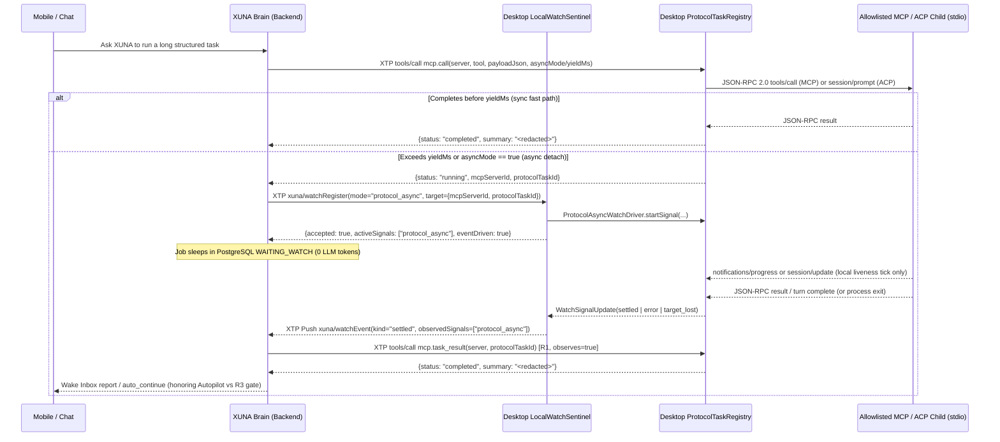
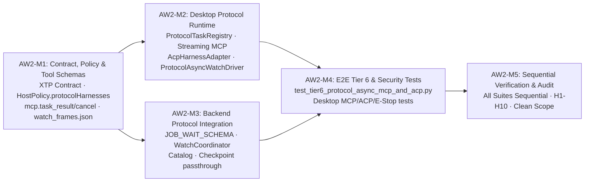

# XUNA Async Watch & Wake — Wave 2 (Phase 3): Protocol-First Async Watch (`MCP` & Opt-In `ACP` Harness Bridge)

Date: 2026-11-23. **Status: Proposed** (Extends [XUNA Async Watch & Wake](XUNA_ASYNC_WATCH_AND_WAKE.md) Wave 1 `AW-M1–AW-M6` and [ADR-0017](../decisions/ADR-0017-async-watch-and-wake.md)).

Companion documents:
[XUNA Async Watch & Wake (Wave 1)](XUNA_ASYNC_WATCH_AND_WAKE.md) ·
[ADR-0017 (Async Watch & Wake)](../decisions/ADR-0017-async-watch-and-wake.md) ·
[ADR-0015 (Commit-Gated Control & Autopilot Amendment 2026-11-22)](../decisions/ADR-0015-commit-gated-control-and-trusted-scopes.md) ·
[XUNA XTP v1 Normative Wire Contract](XUNA_XTP_V1_CONTRACT.md) ·
[XUNA Honest-Code Rules](XUNA_HONEST_CODE_RULES.md) ·
[Root AGENTS.md](../../AGENTS.md) ·
[Backend AGENTS.md](../../backend/AGENTS.md) ·
[Desktop AGENTS.md](../../desktop/AGENTS.md).

---

## 1. Objective & Why Wave 2 Matters

Wave 1 (`AW-M1–AW-M6`, completed 2026-11-23) delivered OS-generic event-driven watching (`AXObserver`, background PID AX digest, `libproc` CPU/process tree, `FSEvents`, Windows C++ parity, Chrome CDP `cdp_idle`), durable PostgreSQL sleep (`WAITING_WATCH`), `yieldMs` auto-detach, and Mobile Wake Inbox UX. It also pre-wired `WatchMode.protocolAsync`, `WatchSignal.protocolAsync`, `WatchTarget.{mcpServerId, protocolTaskId}`, and the Mobile L10n badge `actions_watchSignalProtocolAsync`.

However, today on Desktop:
1. `mcp.call` in `AutoMcpBridge` (`desktop/lib/features/discovery/auto_mcp_bridge.dart`) is strictly synchronous and `McpStdioClient` drops incoming JSON-RPC notifications (`notifications/progress`) without an `id`.
2. No `WatchSignalDriver` is registered for `WatchSignal.protocolAsync`, so `xuna/watchRegister(mode="protocol_async")` fails closed with `watch_unsupported`.
3. There is no opt-in **ACP (Agent Client Protocol)** JSON-RPC 2.0 stdio harness bridge for structured external agent/build/eval harnesses.

**Wave 2 closes this exact gap** so that whenever an owner configures an MCP server or opt-in ACP harness, XUNA gets:
- **Exact protocol-driven completion (`< 50 ms` wake latency, 0 screen scraping, 0 focus stealing, 0 LLM tokens while sleeping).**
- **Automatic `yieldMs` detach for slow MCP/ACP calls:** fast calls return synchronously; slow calls (`> yieldMs`) detach into a tracked `protocolTaskId` that feeds straight into `job__wait(mode="protocol_async")`.
- **Clean Rule H1 verification upon wake:** waking reads the real, U5-redacted completion outcome via `mcp.task_result` (`R1`, `observes: true`), never guessing or fabricating completion.
- **Zero scope bloat:** **0 Alembic migrations**, **0 B diff in `mobile/`**, **0 B diff in `firmware/`**, **0 diff in `redaction.py` and `workflows.py`**, and **`orchestrator.py` < 50 net LOC** (target: `0` LOC diff in `orchestrator.py`).

---

## 2. Five Non-Negotiable Wave 2 Invariants

1. **Zero `shell.*` & Hard-Deny Process Enforcement (`desktop/AGENTS.md` §3):**
   - `protocolHarnesses` in `host-policy.json` is strictly **opt-in** (default empty `[]`).
   - Every harness `executable` MUST pass `isHardDeniedAppOrProcess(executable)` and reject shells/interpreters (`bash`, `zsh`, `sh`, `fish`, `cmd`, `powershell`, `pwsh`, `osascript`, `sudo`, `su`, `python`/`node` inline `-c`/`-e` flags). Only direct, explicit executable + fixed argv list configured locally by the owner in `host-policy.json` is allowed.
   - `executable`, `args`, `workingDir`, and `env` secrets NEVER cross XTP or appear in logs, manifests, `mcp.list_servers`, or `xuna/watchEvent`.
2. **Content-Free Wire & Consent U5 Redaction:**
   - `xuna/watchEvent` for `protocol_async` remains strictly content-free (`observedSignals: ["protocol_async"]`, `changeCount`, `elapsedSeconds`, `errorCode?` — zero progress messages, zero logs, zero paths).
   - `mcp.task_result` redacts output via existing `redactBrowserSnapshot` (Desktop) and `sanitize_wake_text` (Backend Wake Inbox), bounded to `<= 6144 B` UTF-8 (`summary` field capped per schema).
3. **Bounded Resources & Immediate E-Stop Teardown:**
   - `ProtocolTaskRegistry` enforces a hard cap of **`maxConcurrentTasks = 4`** (`protocol_task_limit_reached` fail-closed) and a bounded retention TTL (`5 minutes`, max `16` completed summaries in RAM, zero disk persistence).
   - E-Stop (`EmergencyStopController`) immediately sends JSON-RPC `notifications/cancelled` (MCP) / `session/cancel` (ACP), cancels all `protocol_async` watches, and terminates child stdio processes (`SIGTERM` → 2s → `SIGKILL`).
4. **Zero Hardcoding (Rule H5) & Fail-Closed Honesty (H1–H4):**
   - Zero hardcoded vendor, IDE, agent, or CLI names in generic layers (`backend/src/...`, `desktop/lib/features/watch/...`, `packages/xuna_xtp/...`).
   - Missing harness, missing `protocolTaskId`, crashed stdio child (`target_lost`), or unsupported protocol fails closed with stable error codes (`mcp_server_not_found`, `protocol_task_not_found`, `protocol_harness_disabled`, `protocol_task_limit_reached`, `watch_unsupported`, `policy_blocked`).
5. **Anti-Bloat & Fast Teamwork Convergence (`AGENTS.md` §10, 2026-11-23 lessons):**
   - Every new file MUST stay concise (**<= 450 LOC** per module).
   - **Maximum 2 remediation rounds per milestone.** Challengers MUST distinguish **P0 blocking contract/security bugs** from **P2 synthetic polish** and must NOT invent fuzz spirals.
   - **Zero tight wall-clock timing thresholds (`< 0.20s`)**; use deterministic injected clocks/timers/fake stdio streams in unit tests and run final cross-repo test suites **sequentially**.

---

## 3. Architecture & End-to-End Flow

---

## 4. Contract & Module Specifications (`AW2-M1 → AW2-M5`)

### 4.1 `AW2-M1`: Contract-First Wire & Policy Schema (`docs/`, `xuna_xtp/`, fixtures)

1. **`host-policy.json` (`desktop/packages/xuna_xtp/lib/src/policy/policy_models.dart`):**
   - Add additive optional field `protocolHarnesses: List<ProtocolHarnessConfig>` (default `const []`) to `HostPolicy` (`optionalKeys` expanded without breaking any existing `host-policy.json`).
   - `ProtocolHarnessConfig` (`additionalProperties: false`):
     - `id`: short ID (`^[a-z0-9_.-]{1,64}$`), unique across harnesses
     - `name`: `1..80` chars
     - `protocol`: enum `"mcp_stdio" | "acp_stdio"`
     - `executable`: non-empty string, rejected if `isHardDeniedAppOrProcess(executable)` or shell/interpreter binary
     - `args`: `List<String>` (`0..16` items, each `<= 256` chars, rejecting inline eval flags `-c`, `-e`, `--eval`, `/c`, `-Command`)
     - `risk`: `RiskTier` (`R2` or `R3`, floor `R2`)
   - Note: `xuna/get_policy` & `xuna/set_policy` NEVER expose `executable` or `args` over the wire (only sanitized `id`, `name`, `protocol`, `risk` summary if queried, or keep `protocolHarnesses` local-file-only on Desktop!). **Decision for Wave 2: `protocolHarnesses` is strictly local-file-only in `host-policy.json` (never writable remotely via `xuna/set_policy`, preventing remote command injection even if cloud account is compromised!).**
2. **XTP Tool Schemas (`desktop/packages/xuna_xtp/lib/src/schemas/mvp_devops_catalog.dart` + `tool_arg_validators.dart`):**
   - Extend `mcp.list_servers` output item: allow `transport: "stdio" | "http" | "acp_stdio"`, optional `supportsAsync: bool`.
   - Extend `mcp.call` input (additive optional): `asyncMode: bool`, `yieldMs: int (500..15000)`.
   - Extend `mcp.call` output (additive optional): `status: "completed" | "running"`, `mcpServerId`, `protocolTaskId`.
   - Add **`mcp.task_result`** (`R1`, `observes: true`, `reversible: true`, family `app`):
     - Input (`additionalProperties: false`): `server` (short ID), `protocolTaskId` (`^[a-zA-Z0-9_.-]{1,128}$`).
     - Output (`additionalProperties: false`): `server`, `protocolTaskId`, `status` (`"running" | "completed" | "failed" | "cancelled"`), optional `progressPercent` (`0..100`), `summary` (`maxLength: 6144` or `400` consistent with `mcp.call` — verify `schema_validator_parity_test.dart`!), optional `errorCode`.
   - Add **`mcp.task_cancel`** (`R1`, `observes: false`, `reversible: true`, family `app`):
     - Input (`additionalProperties: false`): `server`, `protocolTaskId`.
     - Output (`additionalProperties: false`): `server`, `protocolTaskId`, `cancelled: bool`.
3. **Wire Contract & Golden Fixtures:**
   - Update `docs/architecture/XUNA_XTP_V1_CONTRACT.md` (document `protocol_async` semantics + `mcp.task_result` / `mcp.task_cancel` + `mcp.call` async handle).
   - Add `protocol_async` golden cases to byte-identical `watch_frames.json` pair (`backend/tests/fixtures/xtp/watch_frames.json` ↔ `desktop/packages/xuna_xtp/test/fixtures/xtp/watch_frames.json`, `diff -r` exit `0`).

### 4.2 `AW2-M2`: Desktop Protocol Task Runtime, Streaming MCP & Opt-In ACP Adapter (`desktop/`)

1. **`desktop/lib/features/watch/protocol_task_registry.dart` (<= 300 LOC):**
   - In-memory registry of active & recently completed protocol tasks (max `4` active, max `16` retained summaries for `5 min`, zero disk persistence).
   - Tracks `ProtocolTaskHandle`: `{taskId, serverId, protocol, status, progressCount, progressPercent?, redactedSummary?, errorCode?, startedAt, updatedAt, completedAt?, cancelCallback}`.
   - Broadcasts content-free `ProtocolTaskEvent` (`progress`, `completed`, `failed`, `cancelled`, `targetLost`) to subscribed watchers.
   - Registers a cancel listener on `EmergencyStopController` so E-Stop cancels and terminates all active tasks immediately.
2. **Streaming MCP Client (`desktop/lib/features/computer_use/mcp_stdio_client.dart` + `desktop/lib/features/discovery/auto_mcp_bridge.dart`):**
   - Extend `McpStdioClient` with an optional `onNotification(String method, Map<String, Object?> params)` callback so JSON-RPC notifications without an `id` (specifically `notifications/progress`) are forwarded instead of dropped, and add `sendNotification(method, params)` for `notifications/cancelled`.
   - Extend `AutoMcpBridge` with `callToolAsync(...)` supporting `asyncMode` and `yieldMs`:
     - Injects `_meta.progressToken` into stdio MCP `tools/call`.
     - If `asyncMode == false` and `yieldMs == null`, behaves 100% identically to Wave 1 sync `callTool`.
     - If `asyncMode == true` or `yieldMs` expires before response arrives, promotes the in-flight stdio session into `ProtocolTaskRegistry`, wires `notifications/progress` → `registry.recordProgress(...)`, and wires completion/error/process-exit → `registry.complete/fail/markLost(...)`, returning `{status: "running", mcpServerId, protocolTaskId}` immediately!
     - On `cancelTask(taskId)`: sends `notifications/cancelled` with matching request ID, then cleanly closes/terminates the stdio session.
3. **Opt-In ACP Harness Adapter (`desktop/lib/features/watch/acp_harness_adapter.dart`, <= 350 LOC):**
   - Pure Dart JSON-RPC 2.0 over newline-delimited stdio adapter implementing standard ACP lifecycle against an owner-configured `ProtocolHarnessConfig(protocol: acpStdio)`:
     - `initialize` → `session/new` → `session/prompt` (with `prompt` text from `payloadJson`)
     - Streams `session/update` notifications into `ProtocolTaskRegistry.recordProgress(...)` (extracting only monotonic tick/progress counts for watch events; buffering bounded redacted final assistant text in RAM only for `mcp.task_result`).
     - Handles `session/cancel` on `mcp.task_cancel` or E-Stop, plus `targetLost` on unexpected process exit.
   - Injectable process/stream transport factory for 100% deterministic unit tests (zero real external binaries needed in CI!).
4. **`ProtocolAsyncWatchDriver` (`desktop/lib/features/watch/protocol_async_watch_driver.dart`, <= 200 LOC):**
   - Implements `WatchSignalDriver` (`supportedSignals = {WatchSignal.protocolAsync}`).
   - Wired into `LocalWatchSentinel` in `desktop/lib/main.dart` / `desktop_agent_controller.dart`.
   - Validates `target.mcpServerId` and `target.protocolTaskId` against `ProtocolTaskRegistry`:
     - Missing task → throws `WatchDriverException(errorCode: 'target_not_found')` (fail-closed H1/H3).
     - Already completed before watch attaches → emits immediate `WatchSignalUpdate(signal: protocolAsync, state: settled)` so no race condition loses completion!
     - Already failed/cancelled/lost → emits immediate `error` / `target_lost`!
     - Active → forwards `progress` (`state: active, digestChanged: true`), `completed` (`settled`), `failed` (`error`), `targetLost` (`lost`).
5. **Tool Handlers (`desktop/lib/features/tools/handlers/workspace_copilot_handlers.dart` & `host_tool_dispatcher.dart`):**
   - Update `McpListServersTool` to include opt-in `protocolHarnesses` (sanitized metadata only).
   - Update `McpCallTool` to support `asyncMode`/`yieldMs` and route `acp_stdio` harnesses to `AcpHarnessAdapter`.
   - Add `McpTaskResultTool` (`mcp.task_result`) and `McpTaskCancelTool` (`mcp.task_cancel`), registered in `HostToolDispatcher`.

### 4.3 `AW2-M3`: Backend `job__wait` & Async Protocol Integration (`backend/`)

Strictly minimal, zero migrations, zero `redaction.py`/`workflows.py`/`orchestrator.py` edits:
1. **`backend/src/xuna_backend/modules/actions/domain/watch.py`:**
   - Extend `JOB_WAIT_SCHEMA` with additive optional properties `mcpServerId` (`^[a-z0-9_.-]{1,64}$`) and `protocolTaskId` (`maxLength: 128`).
2. **`backend/src/xuna_backend/modules/actions/application/watch_coordinator.py`:**
   - When `job__wait` passes explicit `mcpServerId` / `protocolTaskId`, validate and prefer them over checkpoint `last_window` fallback.
   - Ensure `protocol_async` wake prompt clearly instructs the post-wake verifier to call read-only `mcp.task_result` (satisfying Rule H1) before reporting or continuing.
   - Ensure `cancel_watch` / E-Stop leaves zero dangling protocol watches; if a job had an active `protocol_async` watch, best-effort cancel notification reaches Desktop via `xuna/watchCancel` (and E-Stop triggers `EmergencyStopController` on Desktop which cancels both watches and child processes).
3. **`backend/src/xuna_backend/modules/actions/application/catalog.py` & `yield_detach.py`:**
   - Add `"mcp.task_result"` and `"mcp.task_cancel"` to the allowlisted Tier-1/DevOps catalog list while preserving `MAX_CATALOG_TOOLS = 36` (`test_scoped_catalog.py` green).
   - In `yield_detach.py` / `planner_executor.py`: if `mcp.call` returns `{status: "running", mcpServerId, protocolTaskId}`, persist `mcpServerId` + `protocolTaskId` into the job's `last_window` checkpoint so a subsequent `job__wait(mode="protocol_async")` or `yieldMs` detach picks them up automatically!

### 4.4 `AW2-M4`: Cross-Repo E2E Tier 6 & Adversarial Security Tests (`backend/tests/e2e_watch/`, `desktop/test/watch/`)

1. **Desktop Tests (`desktop/test/watch/` & `desktop/packages/xuna_xtp/test/`):**
   - `protocol_policy_test.dart`: `protocolHarnesses` valid parsing, rejection of shell/interpreter binaries (`bash`, `zsh`, `sh`, `cmd`, `powershell`, `osascript`, `-c`, `-e`), rejection of remote `xuna/set_policy` mutation attempts.
   - `protocol_async_watch_driver_test.dart`: MCP `notifications/progress` streaming + completion wake `< 50 ms`, race-free pre-completed task attachment, `yieldMs` sync-vs-async detach, `acp_stdio` full lifecycle (`initialize` → `session/new` → `session/prompt` → `session/update` → complete), unexpected child exit → `target_lost`, `maxConcurrentTasks = 4` fail-closed, E-Stop sends `notifications/cancelled`/`session/cancel` and kills process.
2. **Backend E2E Tier 6 (`backend/tests/e2e_watch/test_tier6_protocol_async_mcp_and_acp.py`):**
   - Full real WebSocket + PostgreSQL round-trip:
     1. `mcp.call(asyncMode=True)` returns `{status: "running", mcpServerId, protocolTaskId}`.
     2. `job__wait(mode="protocol_async")` transitions job to `WAITING_WATCH` (0 LLM tokens while sleeping).
     3. Simulated host pushes `xuna/watchEvent(kind="settled", observedSignals=["protocol_async"])`.
     4. Brain wakes, calls `mcp.task_result` (Rule H1 real verification!), redacts U5 secrets/paths, writes `WakeInboxItem`, completes or continues under Autopilot while pausing R3 high-impact.
     5. Negative fail-closed cases: missing `protocolTaskId`, `target_lost` on harness crash (never marks `COMPLETED`), E-Stop cancels watch cleanly, and Rule H5 scan verifies zero vendor/app hardcoding.

### 4.5 `AW2-M5`: Sequential Verification & Honest Audit (Rule H8/H9)

Run **sequentially** (never parallel heavy suites!) after final edit:
1. `diff -r backend/tests/fixtures/xtp desktop/packages/xuna_xtp/test/fixtures/xtp` → exit `0`.
2. `backend/`: `ruff format --check`, `ruff check`, `mypy --config-file pyproject.toml src`, full `XUNA_TEST_DATABASE_URL=... pytest -q` (incl. `test_architecture.py`, `test_scoped_catalog.py`, `test_hosts_api.py`, `TestRuleH5GenericLayerCompliance`, `tests/e2e_watch/`).
3. `desktop/packages/xuna_xtp/`: `fvm dart analyze --fatal-infos`, `fvm dart test` (incl. `schema_validator_parity_test.dart`).
4. `desktop/`: `fvm flutter analyze --no-pub`, `fvm flutter test --no-pub`, `fvm flutter build macos --debug --no-pub`, stop any `xuna_desktop` → `xcodebuild test -only-testing:RunnerTests`.
5. Clean scope check: `mobile/`, `firmware/`, `workflows.py`, `redaction.py`, `.fvmrc`, `pubspec.lock`: **0 diff**; `orchestrator.py`: **`0` diff** (or `< 50` net LOC); no `git commit`/`push`.

---

## 5. Teamwork Execution DAG & Strict File Ownership (Zero Overlap)

| Milestone | Owned Paths (Strict — Zero Overlap) | Hard Guardrails |
| --- | --- | --- |
| **AW2-M1** | `docs/architecture/XUNA_XTP_V1_CONTRACT.md`, `backend/tests/fixtures/xtp/watch_frames.json`, `desktop/packages/xuna_xtp/test/fixtures/xtp/watch_frames.json`, `desktop/packages/xuna_xtp/lib/src/policy/policy_models.dart`, `desktop/packages/xuna_xtp/lib/src/policy/tool_arg_validators.dart`, `desktop/packages/xuna_xtp/lib/src/schemas/mvp_devops_catalog.dart`, `desktop/packages/xuna_xtp/test/*` | `diff -r` fixtures `0`; `schema_validator_parity_test.dart` PASS; `protocolHarnesses` local-only (not writable via `set_policy`); max 2 rounds |
| **AW2-M2** | `desktop/lib/features/watch/protocol_task_registry.dart`, `protocol_async_watch_driver.dart`, `acp_harness_adapter.dart`, `desktop/lib/features/computer_use/mcp_stdio_client.dart`, `desktop/lib/features/discovery/auto_mcp_bridge.dart`, `desktop/lib/features/tools/handlers/workspace_copilot_handlers.dart`, `desktop/lib/features/tools/host_tool_dispatcher.dart`, `desktop/lib/core/controller/desktop_agent_controller.dart`, `desktop/lib/main.dart`, `desktop/test/watch/*` | Each new file `<= 450 LOC`; zero `shell.*`; hard-deny shells/interpreters; E-Stop cancels & kills children; max 2 rounds |
| **AW2-M3** | `backend/src/xuna_backend/modules/actions/domain/watch.py`, `backend/src/xuna_backend/modules/actions/application/watch_coordinator.py`, `backend/src/xuna_backend/modules/actions/application/catalog.py`, `backend/src/xuna_backend/modules/actions/application/planner_executor.py`, `backend/tests/unit/test_async_watch_protocol_wave2.py` | **0 diff** in `redaction.py`, `workflows.py`, `orchestrator.py`; `MAX_CATALOG_TOOLS = 36` preserved; `test_architecture.py` & `test_scoped_catalog.py` PASS; max 2 rounds |
| **AW2-M4** | `backend/tests/e2e_watch/test_tier6_protocol_async_mcp_and_acp.py`, `backend/tests/e2e_watch/xtp_sim.py`, `backend/tests/unit/test_wave_c_backend.py` (add any new generic backend files to H5 scan) | Real WS + PostgreSQL E2E; zero tight wall-clock thresholds; H1–H10 negative cases; max 2 rounds |
| **AW2-M5** | Read-only audit + handoff updates (`PROCESS.md`, `CHANGELOG.md` only if all gates pass) | Sequential verification only; `mobile/`, `firmware/`, `.fvmrc`, `pubspec.lock` **0 diff**; honest H8 report |

---

## 6. Explicit Non-Goals (Out of Scope for Wave 2)

- No changes to `mobile/` (`0 B` diff — `protocol_async` badge is already implemented and localized in Wave 1).
- No changes to `firmware/` (`0 B` diff).
- No database migrations (`0023` already covers `job_watches` + `wake_inbox_items`).
- No edits to `backend/src/xuna_backend/modules/actions/domain/redaction.py` (Wave 1's clean ~310-line `O(n)` implementation already covers Consent U5).
- No remote editing of `protocolHarnesses` from Mobile/Cloud (`xuna/set_policy` must reject or ignore it — strictly local owner opt-in in `host-policy.json`).
- No `shell.*` or arbitrary CLI command execution.

