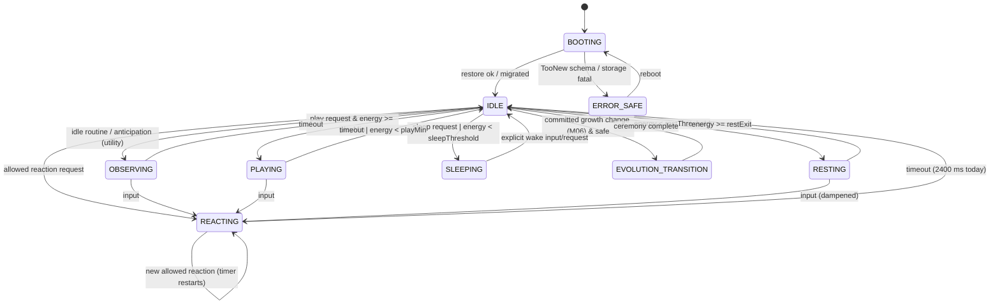
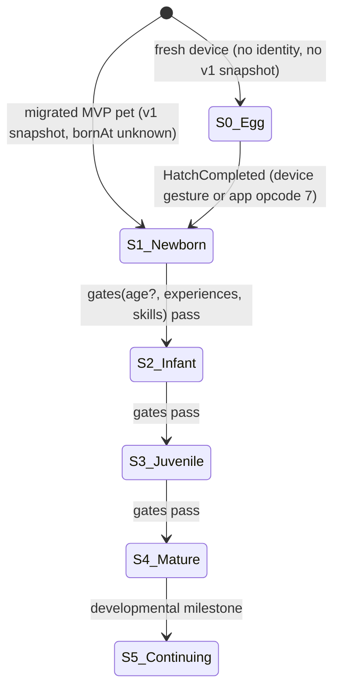

# XUNA — Technical Implementation Plan

**Document ID:** XUNA-TIP-001
**Version:** 0.1.2. Device-first direction update; preserves audit history. D17 was Approved on 2026-10-12; D15 and device voice implementation choices remain Proposed.
**Status:** **Proposed.** Nothing here is Approved unless it cites an existing Approved decision. *(2026-10-16 note: much of M04 and the M05a core is now Implemented on host; production still runs the v1 + `BoardLearner` path. Current status lives in [PROCESS.md](../../PROCESS.md); gate simplifications approved 2026-10-16 are in AGENTS.md §3.)*
**Date:** 2026-10-12
**Inputs:** root [AGENTS.md](../../AGENTS.md) (canonical), [XUNA_DIGITAL_LIFE_SPEC.md](../product/XUNA_DIGITAL_LIFE_SPEC.md) v0.3.0 (Proposed spec), [PROCESS.md](../../PROCESS.md), [PLAN.md](../../PLAN.md), [MVP-local.md](../roadmap/milestones/MVP-local.md), [M02-ble.md](../roadmap/milestones/M02-ble.md), and the source at firmware `be58099`, mobile `3846880`, backend `0032828`.
**Audience:** product owner, coding agents and firmware/mobile engineers who will implement XUNA milestones M04–M07.

> If this plan disagrees with AGENTS.md, AGENTS.md wins. Raise the conflict instead of silently following this plan. Every slice below needs an explicit owner go-ahead before implementation (AGENTS.md §4: "Only work on the requested milestone").

---

## 0. Reading guide and status vocabulary

| Tag | Meaning (AGENTS.md §3) |
|---|---|
| **[A]** Approved | Expressly confirmed by the owner; source cited |
| **[P]** Proposed | This plan's recommendation; needs approval |
| **[E]** Experiment | Must be measured or prototyped before a decision |
| **[F]** Future | Backlog; do not implement in M04–M07 without a priority change |
| **[I]** Implemented / **[V]** Validated | Present in code / measured against agreed criteria |

Numbers in this plan (capacities, rates, thresholds, effort) are **hypotheses or estimates** unless they are labeled as measured with a source. Technique IDs `T1…T19` (Section 6) are referenced from the milestone slices (Section 15).

Section map: 1 summary · 2 decision baseline · 3 inventory · 4 gap analysis · 5 target architecture · 6 ePet/Xiaozhi technique catalog · 7 data model · 8 state machines · 9 learning · 10 memory · 11 conversation · 12 time · 13 growth/evolution/perception · 14 protocol and security · 15 milestone slices · 16 test and experiment plan · 17 resource budget and risks · 18 decision requests · 19 upstream audit record · 20 next actions.

---

## 1. Summary

The owner-approved local MVP already contains the seed of the Digital Life loop. The device learns an idle/happy preference per quiet/play context from explicit feedback, keeps 8 feedback episodes and persists a 96-byte A/B NVS snapshot. Its foundation will not carry Memory, Learning, Conversation or Cognitive Development much further:

- **Format.** The snapshot format has no migration path. Firmware rejects any schema other than v1, so the first format change would wipe every learned preference.
- **Coupling.** Command semantics live inside the Arduino BLE adapter. Time comes straight from `millis()`. No end-to-end host simulation is possible.
- **Learner.** The learner is greedy with no exploration. It cannot discover a better action once the current one is approved.
- **Identity and time.** There is no pet identity, event identity, wall clock or provenance model. Journals, habit prediction, day-part contexts and evidence citations are therefore impossible.
- **Storage.** The default 16 MB partition table gives NVS only 20 KB. A 3.375 MiB `spiffs` partition is unused.

**Recommended direction [P].**

1. **M04: harden the foundation without changing behavior.**
   - Extract a portable `xuna_core` library (ePet-style libc-only core with injected time and seed).
   - Introduce identity, a clock-quality model, typed experience events and a bounded queue.
   - Add snapshot v2 with v1→v2 migration and typed load errors.
   - Add an activity FSM with explicit transitions, bounded and validated like Xiaozhi's device state machine.
   - Build a deterministic **Life Lab** host simulator with golden traces and host↔target parity.
2. **M05a: Learner v2.** Use a fixed-point discounted Beta estimator, hierarchical context with day parts, seeded bounded exploration, reaction-ID credit assignment with an expiry window, and an explanation API. Prove learning against random, static and no-learning baselines over many seeds.
3. **M05b: Memory and Journal.** Add provenance-tagged episodes, facts and journal records, with salience, consolidation and deletion tombstones. Storage is NVS for identity and life, plus LittleFS on the existing `spiffs` partition [E]. Add BLE v2 paging and bonding before personal facts are stored.
4. **Conversation in two layers [A: D17 sequencing; P: implementation details].** This keeps approved decision A6, "Conversation belongs alongside Learning".
   - **Layer A, Conversation Foundation (M05c-A).** It is developed **together with M05a** and needs no MemoryStore, BLE v2 or bonding.
     - A local rule grammar (vi/en, no LLM) produces candidate learning signals: rate the last reaction, state a preference, ask why.
     - The user confirms each candidate.
     - The signals reach the learner through v1-additive commands (§11.6).
   - **Layer B, Conversation + long-term memory (M05c-B).** It follows M05b and covers personal facts, correction, forgetting and grounded recall.
   - **Providers and STT/LLM.** Dart is the initial text adapter; later device voice reuses structured candidate/validation semantics. Optional cloud interpretation stays gated by D11a/D11/D19 and VOICE-01–04 (see §11.0).
5. **M05d: Cognitive gates.** Add a habit predictor with prequential (online held-out) scoring, and skill records whose acquisition is evidence-based. Run a dual-history Life Lab evaluation (spec §23.10). Whether M05d runs before an Evolution MVP is a product checkpoint after M05c-B (D15).
6. **M06/M07** keep the roadmap: growth stages, layered palette-indexed traits with an evidence journal, then sensor events with hysteresis.

---

## 2. Decision baseline

### 2.1 Approved decisions this plan must respect

| ID | Decision | Source |
|---|---|---|
| A1 | Product name XUNA | AGENTS §3 |
| A2 | LILYGO T-Display-S3 LCD prototype; PCB revision still unrecorded | AGENTS §3, PROCESS §5 |
| A3 | VS Code + PlatformIO IDE | AGENTS §3 |
| A4 | Flutter companion; imported Clean/GetX base retained (2026-10-11) | AGENTS §3, §9 |
| A5 | Local MVP through M05 (2026-10-11). The device owns MVP state, memory and preference. It learns idle/happy preference from explicit feedback in quiet/play contexts. Conversation is local template text without an LLM. Voice, evolution and sensors are deferred. | AGENTS §3, MVP-local |
| A6 | Conversation belongs alongside Learning (M05) | AGENTS §3 |
| A7 | Incremental delivery M01→M07 | AGENTS §3–4 |
| A8 | Prototype BLE experiment: bundled Arduino BLE + FlutterBluePlus 1.35.5 + compact binary v1, foreground and unbonded | M02-ble, MVP-local |
| A9 | Pinned toolchain retained **for the local MVP scope**: `espressif32@6.5.0`, Arduino-ESP32 2.0.14, `TFT_eSPI@2.5.43`. It is the current adapter framework, **not** a permanent architecture commitment: Arduino versus ESP-IDF long-term stays open (AGENTS §3 Proposed). | MVP-local "pinned firmware toolchain remain" |
| A10 | HoloCubic prism display, custom PCB and dual-processor hardware are future backlog | AGENTS §3 |
| A11 | Device-first Conversation, Flutter-assisted Experience (2026-10-12). Device owns life; optional app/cloud extend it. Product direction only; A5/D17 scope retained. | Owner request; AGENTS §3; ADR-0006 Proposed |

Arduino is authorized and in use for bring-up. **The long-term choice between Arduino and ESP-IDF is still open** (AGENTS §3 Proposed). This plan stays on Arduino. Xiaozhi needs ESP-IDF ≥ 6.0.1 and ePet uses ESP-IDF v5.5 (Section 19), but neither fact is a reason to migrate.

### 2.2 Still Proposed upstream (do not treat as decided)

- Conflict/reconciliation and backup rules beyond the MVP. Device authority for core life is owner-confirmed in the device-first direction; sync implementation policies remain Proposed.
- FSM + Utility AI as the behavior design.
- Contextual bandit learning.
- Composable trait evolution.
- Push-to-talk and the STT/LLM provider choice.
- Python/FastAPI backend and an AI proxy.
- Growth stage names and thresholds.

This plan refines each of these as **[P]** and lists the decisions it needs in Section 18.

---

## 3. Repository inventory (facts at the commits above)

### 3.1 Firmware (`xuna_firmware`, `0.2.0-mvp`, 737 tracked lines)

| File | Kind | Responsibility | Host-testable |
|---|---|---|---|
| `platformio.ini` | config | One env `xuna_t_display_s3`; 16 MB QIO, OPI PSRAM, `default_16MB.csv`; `TFT_eSPI@2.5.43` with Setup206 | — |
| `include/AppConfig.h` | config | Pins, version, timing constants | yes |
| `include/DebouncedButton.h` | pure C++ | Press-edge debounce with rollover-safe timing | yes (`test_core`) |
| `include/AnimationManager.h` | pure C++ | `PetState {Idle, Happy, Sleep, Curious}`, 2-frame timing; Happy/Curious expire after 2400 ms | yes |
| `include/LifeEngine.h` | pure C++ | Beta(1,1) counts `positive/negative[2 ctx][2 action]`; greedy `choose`; 8-entry episode ring; 96-byte codec, FNV-1a checksum, generation, A/B `recover` | yes (`test_life`) |
| `include/LocalBehavior.h` | pure C++ | After 60 s with no activity, an idle pet plays `life.choose(quiet)` | yes |
| `include/BleProtocol.h` | pure C++ | v1 command parser and 16-entry session dedup cache | yes |
| `include/LifeStorage.h` | Arduino | `Preferences` A/B slots `slot0/slot1`; `clear` writes empty newer generations | no |
| `include/BleManager.h` | Arduino | GATT server and FreeRTOS queue (8 slots). **Also owns command semantics**: suggestion/decision IDs, feedback acceptance, forget, life/memory characteristics | no |
| `include/DisplayManager.h`, `src/DisplayManager.cpp` | Arduino | TFT_eSPI init; 16×16 placeholder scaled ×4 into an 80×80 RGB565 sprite | no |
| `include/InputManager.h`, `src/InputManager.cpp` | Arduino | GPIO0/GPIO14 active-low | no |
| `src/main.cpp` | glue | Loop order, `millis()` time, active-second accounting, 5-minute checkpoint, diagnostics | no |
| `test/test_core.cpp`, `test/test_life.cpp` | tests | `assert`-based executables built by hand with `c++ -std=c++11` | — |

**Measured on the board** (MVP-local, 2026-10-11):

| Measure | Value |
|---|---|
| Static RAM | 47,504 / 327,680 B |
| Firmware size | 964,333 / 6,553,600 B |
| Heap after boot | free 253,056 B, min 252,980 B |
| PSRAM | 8.37 MB free |
| Render time | mean 3.49–3.51 ms, max 3.69 ms |
| Max loop gap | 4.5 ms |
| Idle animation cadence | 2.4–2.6 fps |

These are short smoke runs, not a validated stability record.

**Partition fact (verified 2026-10-12** from Arduino-ESP32 2.0.14 `tools/partitions/default_16MB.csv`):

| Partition | Offset | Size |
|---|---|---|
| `nvs` | 0x9000 | 0x5000 (20 KiB) |
| `otadata` | 0xE000 | 0x2000 |
| `app0`, `app1` | — | 0x640000 each (6.25 MiB) |
| `spiffs` | 0xC90000 | 0x360000 (3.375 MiB), currently unused by XUNA |
| `coredump` | — | 0x10000 |

### 3.2 Mobile (`xuna_mobile`)

- Flutter 3.32.8 / Dart 3.8.1 (recorded), GetX `^4.7.2`, `flutter_blue_plus 1.35.5`. Hive `2.2.3` is in the base but no XUNA feature uses it.
- `features/device`:
  - `DeviceRepository` (domain).
  - `BleDeviceRepository`: scan, connect, capability check, `ResultCorrelator` with one request in flight, 3 s timeouts, no automatic replay.
  - `ProtocolCodec` (v1 binary).
  - `SimulatorDeviceRepository`, which **re-implements the learner in Dart** (`_positive/_negative`, `_choose`).
- `features/conversation/domain/text_intent.dart`: exact-match intents `chơi / yên tĩnh / thích / không thích` (+ EN aliases). Unknown prose is neither stored nor learned [A5].
- `features/home`: GetX controller and page. Text feedback needs a confirmation step, forgetting needs a dialog, and the source is shown.
- Tests: 10 tests in 5 files (protocol, correlation, learning, conversation, widget).

### 3.3 Backend and docs

- `xuna_backend`: README only. Nothing depends on it; this is correct per A5.
- Root docs:
  - The product spec is **untracked** in Git (working tree, 2026-10-12).
  - `docs/roadmap/{M01-bring-up,M02-ble,MVP-local}.md`.
  - No ADRs. No `docs/architecture/` before this file.

### 3.4 Validation state

Software builds and host tests are recorded PASS. Physical iPhone BLE, learning on the board, reboot/power-loss/forget and a long soak are **pending** (PLAN MVP-07, M01 P07). This plan must not start by refactoring code whose physical behavior has not been validated; see slice M04.0.

**Environment observation (2026-10-12):** this Windows session has no `pio` and no host C++ compiler in its PATH. Earlier sessions ran on macOS. A host-test toolchain must be confirmed per machine.

---

## 4. Gap analysis against spec v0.3.0

Risk: **H** blocks a milestone or risks data loss / false claims; **M** causes rework or limits; **L** is polish.

| # | Area (spec §) | Current | Gap | Slice | Risk |
|---|---|---|---|---|---|
| G1 | Portable core (§24.2) | Learner and animation are pure; BLE adapter owns command semantics; `main.cpp` owns time | Cannot replay life end-to-end on the host; business logic is coupled to Bluedroid callbacks | M04.1, M04.3 | H |
| G2 | Time (§12) | `millis()` and `activeSeconds` only | No UTC, clock quality, tz/day part, `bornAt` or boot counter | M04.2 | H |
| G3 | Identity (§13.1) | none | No `petId`/`seed`/hatch; event IDs and the journal cannot be globally unique | M04.2 | M |
| G4 | Events (§6.2, §24.3) | Request IDs are session-local u32 | No envelope, provenance, causation or durable IDs | M04.3 | H |
| G5 | Schema evolution (§7.4) | `decode` rejects `version != 1` | **Any format change resets learned state**; no read-only safe mode for newer schemas after a downgrade | M04.4 | H |
| G6 | Storage capacity (§23.4) | 96 B in 20 KiB NVS | No room for memory, journal or log; wear unmeasured | M04.4 [E] | M |
| G7 | Activity FSM (§4.3) | 4 animation states; remote requests applied unconditionally | No legal-transition table, `ERROR_SAFE` or request rejection by state | M04.5 | M |
| G8 | Needs/mood (§5.1–5.2) | none | energy/stimulation and mood axes with hysteresis are absent | M04.5 | L |
| G9 | Exploration (§8.2) | Greedy argmax; ties go to idle | Untried actions are never explored after an approval; tie bias; no seeded RNG | M05a | H |
| G10 | Non-stationarity (§8.3, Scenario C) | Halves counts at 1000 | Reversal slows with the evidence total; no recency weighting | M05a | M |
| G11 | Credit window (§8.2) | Pending suggestion valid until new decision, direct input or session change | No expiry window; no persisted reaction ID | M05a | M |
| G12 | Contexts (§5.4) | quiet/play requested from the app; buttons are scripted | No day part; local button interactions are not learning contexts | M05a | M |
| G13 | Explainability (§8.3, §16.1) | Life characteristic shows the current choice | No evidence counts, confidence or evidence IDs | M05a | M |
| G14 | Memory (§7, §23.3) | 8 feedback episodes, no IDs or time | No facts, episodes with provenance, salience, consolidation or journal | M05b | H |
| G15 | Phone memory (§23.4) | none | No local journal or fact store; Hive unused | M05b | M |
| G16 | Conversation (§11, §23.9) | 4 exact intents [A5] | No candidate events; no teach/correct/recall; no provider boundary | M05c-A / M05c-B | M |
| G17 | Single source of truth (§15) | Dart simulator duplicates the C++ learner | Silent divergence between UI tests and firmware | M04.6 | M |
| G18 | Security (§17) | Unbonded; any nearby central can send `forget` | Personal facts must not be added before bonding or authorization | M05b [E] | H once facts exist |
| G19 | Test infrastructure (§18) | Manual `c++` command; no CI or native env | No `pio test -e native`; no sanitizer job; no Windows toolchain | M04.1 | M |
| G20 | Protocol (§13.2) | Fixed 20-byte values | No hello/version negotiation, MTU use, paging or fragmentation | M05b | M |
| G21 | Cognitive development (§23.5–23.6) | none | No habit predictor, skill records, competency bands or stage | M05d, M06 | M |
| G22 | Rendering (§24.4) | Per-cell `fillRect`; art embedded in code | No `VisualIntent` boundary, asset pipeline, layers or fallback pose | M04.5, M06 | L |
| G23 | Documentation | Spec untracked; no ADRs | Decisions are not recorded as ADRs | M04.0 | L |

---

## 5. Target architecture [P]

### 5.1 Principles

1. **Pure core, thin adapters.** Everything that decides, learns, remembers or grows lives in `lib/xuna_core`. That library includes only the C/C++ standard library (T1). Arduino, TFT_eSPI, BLE, NVS and LittleFS are adapters.
2. **Step semantics.** `LifeCore::step(input) → output`. Time, randomness and inbound events are inputs; requested visuals, notifications and persistence requests are outputs.
3. **Integer determinism.** Learner and memory math uses fixed-point integers so host and ESP32-S3 produce **bit-identical** snapshots. The Xtensa FPU and the host may fuse or round floats differently (T2).
4. **Requests, not commands.** Every inbound request (button, BLE, conversation) is validated by the FSM, the repertoire, cooldowns and authorization before it becomes an event (T13, T15).
5. **Durable before acknowledged.** A learning or memory change is acknowledged to the phone only after its snapshot or log commit succeeds. This keeps the MVP's current behavior.
6. **Bounded everywhere.** Queues, logs, tables, retries and per-loop work all have fixed limits and drop counters (T3).

### 5.2 Component diagram

```text
┌──────────────────────────── Flutter companion (mobile/, Clean + GetX) ───────────────────────────┐
│ presentation: Home · Teach/Talk · Journal · Memory & Privacy · Life Lab (dev-only)               │
│ domain: DeviceRepository · ConversationPipeline · CandidateEvent · FactNote · JournalProjection  │
│ data:   BleDeviceRepository (v1 + v2 codec) · SimulatorDeviceRepository (conformance-tested)     │
│         LocalStore (Hive boxes) · ConversationProviders: LocalRules [P] | STT/LLM via proxy [E]  │
└─────────────────────────────▲─────────────────────────────────────────────┬──────────────────────┘
          projections, ACKs   │            BLE GATT, versioned (§14)        │ requests (validated on device)
┌─────────────────────────────┴─────────────────────────────────────────────▼──────────────────────┐
│ firmware/src — Arduino adapters (board-specific)                                                 │
│  BoardTDisplayS3 (caps) · ButtonAdapter · DisplayAdapter(TFT_eSPI) · BleTransport(Bluedroid)     │
│  NvsStore (identity, life A/B) · LogStore (LittleFS [E]) · SystemClock(esp_timer) · HwEntropy    │
│        │ bounded inbound queue (FreeRTOS → loop)                         ▲ outputs               │
│        ▼                                                                 │                       │
│ firmware/lib/xuna_core — portable C++ (no Arduino/ESP headers)                                   │
│  RequestValidator → EventFactory(envelope, IDs) → LifeCore::step()                               │
│   ClockModel · Identity · ActivityFsm · Needs/Mood · BehaviorSelector(utility + mask)            │
│   PreferenceLearner · HabitPredictor · SkillBook · MemoryStore · Journal · Growth(M06)           │
│   SnapshotCodec + Migrations · ProtocolCodec · VisualIntent                                      │
└──────────────────────────────────────────────────────────────────────────────────────────────────┘
        ▲ same sources, same fixtures
 firmware/sim — Life Lab: SimClock, seeded RNG, MemStore, scenario runner, metrics export
 backend/ — optional later AI proxy [P/E]: holds provider keys; returns proposals only; never required
```

### 5.3 Firmware layout [P]

```text
firmware/
  platformio.ini        # + [env:native] host tests (T1/T2) + [env:xuna_parity] trace replay on target [E]
  lib/xuna_core/
    library.json        # no framework dependency; "frameworks": "*"
    include/xuna/
      base/     Fixed.h  Ids.h  Clock.h  Random.h  Result.h  RingBuffer.h
      event/    EventTypes.h  Event.h  EventQueue.h  EventCodec.h
      life/     LifeCore.h  ActivityFsm.h  Needs.h  Mood.h  BehaviorSelector.h  Repertoire.h
      learn/    PreferenceLearner.h  HabitPredictor.h  SkillBook.h
      memory/   MemoryStore.h  Journal.h  Consolidator.h  Provenance.h
      persist/  IStore.h  Snapshot.h  SnapshotCodec.h  Migrations.h
      protocol/ CodecV1.h  CodecV2.h  Capabilities.h
      visual/   VisualIntent.h
    src/        # .cpp for the headers above where non-trivial
  src/          # Arduino adapters only: main.cpp, board/, display/, input/, ble/, storage/
  sim/          # lifelab.cpp, scenarios/*.trace, golden/*.json (host only)
  test/         # test_native_*/ suites; existing assert tests migrated first
  tools/        # asset generator (Python stdlib only, host-side), fixture generator
```

Constraints:

- **C++ standard.** Arduino-ESP32 2.0.x compiles with `-std=gnu++11`; existing host tests use `-std=c++11`. **Keep the core within C++11** unless an ADR approves `gnu++17` via `build_unflags`. That would be an experiment with the pinned GCC 8.4 toolchain.
- **Existing headers** move in M04.1 without any behavior change.

### 5.4 Mobile layout [P] (inside the approved Clean/GetX base)

```text
lib/features/
  device/       domain: DeviceRepository, DeviceCapabilities, PetIdentityView, Explanation
                data:   BleDeviceRepository, ProtocolCodecV1/V2, SimulatorDeviceRepository
  conversation/ domain: ConversationTurn, CandidateEvent, interfaces (§11.3), LocalRuleExtractor
                data:   LocalRulesProvider [P], RemoteProvider via proxy [E/F]
  memory/       domain: FactNote, JournalEntryView, Tombstone; data: Hive boxes
  journal/      presentation: timeline, "Why did XUNA do that?"
  lab/          dev-only Life Lab viewer (reads exported Life Lab JSON; no learning logic)
```

**Single source of truth [P].** The Dart simulator stays a **fake transport**. Its learning results are checked against golden vectors that the C++ Life Lab emits (T5). It must never become a second, independently maintained learner.

### 5.5 Loop and threading model [P]

Keep the Arduino single loop. BLE callbacks run on the Bluedroid task and only enqueue into a bounded FreeRTOS queue (MVP behavior, and Xiaozhi's "schedule onto the main task" principle, T12). Each loop iteration does the following:

1. **Drain inputs:** at most N inbound packets plus button edges, in a fixed order with local input last, so that local presses win.
2. **Step the core:** `LifeCore::step`.
3. **Commit:** perform at most one persistence commit if requested, with urgency and rate limits.
4. **Render:** render if dirty.
5. **Publish:** send projections.

A separate storage task is **not** introduced until measurements show flash commits causing visible render hitches (E7).

### 5.6 AI technique taxonomy — what XUNA may claim [P]

The product claims must match the mechanism (AGENTS §6, spec §8.1).

| Technique class | Used in M04–M07? | Where in XUNA | What may be claimed |
|---|---|---|---|
| Rule-based / scripted | Yes | Instincts, request validator, LocalRuleExtractor, idle routines, stage repertoire unlocks | "Instinct" or "rule". **Never** "learning". |
| Finite state machines | Yes | ActivityFsm, lifecycle stage, clock quality, reaction and fact lifecycles | Control and safety only |
| Behavior trees | **No** | — | Not needed for the current small repertoire. Revisit only if multi-step behaviors (C8) or more than ~20 interacting behaviors appear. |
| Utility AI | Yes | `BehaviorSelector` scores allowed actions; the learned preference is one score term | "Decision scoring". Not learning by itself. |
| Adaptive online learning | Yes | `PreferenceLearner` (discounted Beta + bounded exploration; a contextual-bandit family), `HabitPredictor` (decayed frequency) | "Learned from your feedback/routine", **only** with evidence counts and the §9.9 baseline comparison |
| Instructed adaptation | Yes (M05c-A) | Stated preferences (`user_stated` evidence, capped weight, §11.6) | "You told me…". Kept distinct from learned evidence in explanations. |
| Trained ML models (NN, etc.) | **No** on the device | — | None |
| Generative AI / LLM | Optional service via phone or device Wi-Fi after D11/D19; no general-purpose ESP32 inference | `ConversationProvider` phrasing | Wording only. Never a source of facts, traits or actions. |
| AI agents / autonomous tool use | **No** | The `ActionRegistry` (T13) is a validated allowlist, not an agent | "XUNA chose X among allowed actions" |

Stage progression is **scripted progression** (spec §8.1-1) and is labeled as such. Only `SkillAcquired` backed by metrics counts as developmental evidence.

---

## 6. Engineering technique catalog (ePet and Xiaozhi)

Rules applied to every technique:

- **Concepts, not code.** We take engineering concepts, not architecture, gameplay, characters, assets, protocols or server dependencies (spec §24, AGENTS §7).
- **Licenses.** ePet and Xiaozhi are both MIT (Section 19). No source is copied by this plan. If a future slice copies any code, it must keep the MIT notice and record repo, SHA and path in the firmware README.
- **Framework mismatch.** ePet targets ESP-IDF 5.5 in C with `esp_lcd` over SPI and NimBLE. Xiaozhi targets ESP-IDF ≥ 6.0.1 in C++. **Neither builds under PlatformIO + Arduino 2.0.14 (IDF 4.4)**, so every technique is re-implemented.

Card fields: **Source · Purpose · XUNA benefit · Adaptation · ESP32-S3/PlatformIO fit · Dependencies · Data model / interfaces · Tests · Resource risk and validation · Status.**

### 6.1 Techniques from ePet (`pliashkou/epet` @ `347ceaf`)

#### T1 — Libc-only portable core with injected `dt` and seed

- **Source:**
  - `components/epet_core/*` includes only `<stdint.h> <stdbool.h> <stddef.h> <string.h> <stdlib.h> <stdio.h> <stdarg.h>`.
  - `epet.h` states "Platform-independent core: no ESP-IDF, no SDL".
  - Time enters only as `dt_ms` through `epet_update` / `epet_advance`.
  - Platform hooks are function-pointer structs (`epet_store_t`, `epet_link_t`).
- **Purpose:** compile the identical life logic for MCU, simulator and tests.
- **XUNA benefit:** closes G1 and G19. Learning, memory and growth become testable over 100 simulated days in seconds. Prerequisite for every M05 proof.
- **Adaptation:**
  - C++11 `xuna_core` with small interfaces instead of C function pointers.
  - XUNA needs **two** time inputs: monotonic ms and a clock-quality-tagged UTC anchor (ePet has only `dt`).
  - Add a CI include guard: grep fails if `Arduino.h`, `esp_*`, `freertos/` or `TFT_eSPI` appears under `lib/xuna_core`.
- **ESP32-S3/PlatformIO fit:** Good. A PlatformIO `lib/` folder with `library.json` builds for both `xuna_t_display_s3` and `native`. The `native` platform needs a host GCC/Clang. **Windows needs MinGW-w64 or MSYS2 (not present on this machine today).**
- **Dependencies:** none (stdlib). Optional Unity framework (bundled by PlatformIO for `test_framework = unity`).
- **Interfaces:**

  ```cpp
  namespace xuna {
  struct MonoMs { uint64_t v; };                       // ms since boot, adapter-extended from esp_timer
  enum class ClockQuality : uint8_t { Unknown = 0, Approximate = 1, Synced = 2 };
  struct WallSample { int64_t utcMs; ClockQuality quality; int16_t tzOffsetMin; };
  class IRandom { public: virtual uint32_t nextU32() = 0; virtual ~IRandom() {} };
  struct StepInput  { MonoMs now; WallSample wall; const InboundEvent* events; uint8_t eventCount; };
  struct StepOutput { VisualIntent visual; PersistRequest persist; uint8_t notifyMask; };
  class LifeCore { public: StepOutput step(const StepInput& in); /* snapshot()/restore() */ };
  }
  ```

- **Tests:**
  - Native suite runs on every change, under ASan/UBSan where the host supports it.
  - Include-guard check.
  - A "same input → same snapshot bytes" test.
- **Resource risk:** Low. Virtual calls are negligible at the loop rate.
  - Validate firmware size and static RAM deltas after M04.1. Hypothesis: the move alone is under 1 KB.
- **Status:** Guideline in AGENTS §8 (pure C++, host-runnable tests). **Concrete layout [P].**

#### T2 — Deterministic seeded randomness and seed hygiene

- **Source:**
  - xorshift32 `epet_seed_random` / `epet_random` / `epet_random_below` in `epet_state.c`.
  - Firmware seed is `esp_random() ^ esp_timer`, plus a seed rolled forward in NVS (`main.c: boot_seed`), because `esp_random()` repeats when the radio is off.
- **Purpose:** reproducible runs, plus unique seeds per boot on hardware.
- **XUNA benefit:** exploration (M05a), tie-breaking, idle variety and rare variations all become replayable (Scenario E, spec §8.3).
- **Adaptation:**
  - Use **PCG32** (64-bit state, documented test vectors) rather than xorshift32. It has better low-bit quality for the small `below(n)` draws used in exploration.
  - Derive the per-boot stream as `PCG32(seed = pet.seed, stream = bootCounter)`. Rerunning a trace with the same boot boundaries reproduces decisions, and the RNG state does not need to be persisted.
  - Generate `pet.seed` and `petId` at hatch with the hardware RNG **after BLE has started** (radio on).
- **Fit:** Good. `esp_fill_random` is available in IDF 4.4 / Arduino 2.0.14.
- **Dependencies:** T1; Identity (M04.2).
- **Data model:** `Identity.seed u32`, `LifeSnapshot.bootCounter u32`.
- **Tests:** PCG32 reference vectors on host and target; same seed and trace give identical choices; different `bootCounter` gives different streams.
- **Resource risk:** negligible.
- **Status:** [P].

#### T3 — Bounded event bus with deferred dispatch, drop counters and hysteresis

- **Source:** `epet_event.h/.c`.
  - Ring queue `EPET_EVENT_QUEUE_LEN 32`; **drops newest** when full and counts `dropped`.
  - At most 12 subscribers, each with a `uint32` type mask.
  - `epet_bus_dispatch` drains in the main loop under `EPET_DISPATCH_BUDGET 128`.
  - No allocation.
  - Latching thresholds use `cross()` in `epet_state.c` (set at 75, clear at 60).
- **Purpose:** decouple producers from consumers without unbounded work.
- **XUNA benefit:** the backbone of the experience pipeline: input → typed event → learner/memory/journal. Hysteresis is needed for needs, mood and later sensors (G7, G8, M07).
- **Adaptation:**
  - XUNA events are **typed experience events with envelope and provenance** (Section 7.2), not UI notifications.
  - Durable events get monotonically increasing IDs. Non-durable signals (frame ticks) never enter the queue.
  - Use a fixed **ordered subscriber list** (clock → FSM → learner → memory → journal → growth) rather than registration at runtime. Ordering is part of determinism.
  - **Drop policy differs by class:**
    - Explicit feedback and teach commands are **never dropped silently**. They are rejected `busy` with an ACK before entering the queue.
    - Only best-effort signals (e.g. repeated button presses) can be dropped, and the drop is counted as `EventsDropped`.
- **Fit:** Good; pure C++.
- **Dependencies:** T1.
- **Interfaces:**

  ```cpp
  template <typename T, uint8_t N> class RingBuffer;      // no heap
  class EventQueue { public: bool push(const Event&); uint8_t drain(EventSink&, uint8_t budget); uint32_t dropped() const; };
  ```

- **Tests:** overflow counting; dispatch budget prevents re-publish loops; ordered delivery; feedback-class events are rejected rather than dropped when full; hysteresis with no flicker at the boundary.
- **Resource risk:** queue RAM = N × 40 B. Proposed N = 32 → 1.3 KB.
- **Status:** [P].

#### T4 — Bounded-substep catch-up with an equivalence test

- **Source:**
  - `epet_advance()` replays gaps in `EPET_MAX_STEP_MS = 100` steps and applies inputs only on the last step.
  - `tests/test_power.c` asserts that a stepped pet and an advanced pet agree.
  - ePet does no catch-up across power-off ("pet does not age while powered off").
- **Purpose:** handle long loop gaps (flash writes, sleep) without integration error or a "Flash storm".
- **XUNA benefit:** implements spec §12.3 "very large elapsed gap → bounded state catch-up". Needs and mood decay stay correct after a long BLE or flash stall.
- **Adaptation:**
  - XUNA catches up only on **monotonic** time inside one boot.
  - Across power loss nothing is replayed: no invented experiences, needs reset to defined defaults [P].
  - Closed-form decay (fixed-point `x·λ^k`) is preferred where possible. Substeps are kept only for coupled state.
- **Fit:** Good.
- **Dependencies:** T1, Needs (M04.5).
- **Tests:** stepped vs advanced equivalence within a documented tolerance (0 for integer math); gap of `UINT32_MAX` ms is bounded; reboot does not replay.
- **Resource risk:** CPU per catch-up is bounded by a maximum substep count; measure the worst case.
- **Status:** [P].

#### T5 — Headless deterministic simulator ("Life Lab")

- **Source:**
  - `sim/main.c` `run_headless`: fixed `STEP_MS` (33 ms), no wall clock, `--seed`.
  - It dumps BMP frames and stat lines.
  - Built by a plain Makefile from the same `$(CORE)/*.c` list as the firmware component.
  - The interactive mode uses SDL2 with a speed multiplier.
- **Purpose:** fast, repeatable runs and visual review without hardware.
- **XUNA benefit:** the required vehicle for spec §15 and §23.10. Enables Scenarios A–F, proof of learning over many seeds, 100-day stability, and golden vectors for the Dart fake (G17).
- **Adaptation:**
  - Headless CLI only at first. SDL is not needed: XUNA's success criteria are behavioral metrics, not pixels.
  - Scenario input is a **line-based trace DSL**, which needs no JSON library (`@+5000 button A` / `@+0 feedback last positive explicit` / `@day+1` / `@reboot` / `@sync utc=… tz=420`).
  - Outputs: CSV/JSON metrics, a snapshot hash and an explanation dump.
  - Time acceleration exists **only** in Life Lab (spec §24.2-3).
  - Optional later: render `VisualIntent` sequences to images through a host renderer, for art review.
- **Fit:** host-only. Built by `pio test -e native` or a tiny CMake/shell script. **Never linked into firmware.**
- **Dependencies:** T1, T2, M04.3 events, M04.4 codec.
- **Interfaces:** `lifelab run --trace scenarios/B_feedback.trace --seed 1..200 --out out/B.csv`; `lifelab golden --emit golden/learning_v2.json`.
- **Tests:** Life Lab itself has regression tests on its golden outputs. Dart `SimulatorDeviceRepository` tests consume `golden/*.json`.
- **Resource risk:** none on the device. Risk is drift between Life Lab and firmware glue, mitigated by T6 parity runs.
- **Status:** [P]; the Life Lab requirement itself comes from the spec (Proposed).

#### T6 — Store interface, typed load errors, dirty-flag rate-limited autosave

- **Source:**
  - `epet_store.h` is a blob read/write/erase interface. Firmware implements it on NVS; the simulator on files; tests in memory.
  - `epet_save.c`: header magic/version/size, FNV-1a, **typed results `NONE / CORRUPT / VERSION / NO_SPECIES`**.
  - References are by **name**, not index.
  - `epet_autosave_t`: dirty flag from events, writes rate-limited to 30 s, plus a flush before sleep.
  - There are **no A/B slots and no migration**; any version mismatch is rejected.
- **Purpose:** reliable saves that are testable without hardware.
- **XUNA benefit:** XUNA already does better on atomicity (A/B generations). Typed load errors fix G5's silent "start clean" and enable a **read-only safe mode** when the snapshot's schema is newer than the firmware. Name/ID-based references keep content stable across firmware versions (action IDs, trait IDs).
- **Adaptation:**
  - Add `Migrations` (v1 → v2 → …) on top of A/B.
  - Replace FNV-1a with CRC-32 (IEEE) for snapshots and CRC-16/CCITT for log records [P].
  - Split urgency classes (Section 7.6) instead of a single 30 s autosave.
- **Fit:** Good. `Preferences` (NVS) and `LittleFS` both exist in Arduino 2.0.14. LittleFS uses the existing `spiffs` partition [E].
- **Dependencies:** T1; storage ADR (M04.4).
- **Interfaces:**

  ```cpp
  enum class LoadResult : uint8_t { Ok, Missing, Corrupt, TooNew, Migrated, MigrationFailed };
  class IStore { public: virtual bool read(const char* key, uint8_t* buf, size_t cap, size_t& len) = 0;
                         virtual bool write(const char* key, const uint8_t* buf, size_t len) = 0; virtual ~IStore() {} };
  ```

- **Tests:** v1 96-byte fixtures migrate to v2 preserving counts, episodes and active seconds; truncated/corrupt/too-new inputs; power-cut rig on hardware (E5).
- **Resource risk:** each commit rewrites the snapshot. Wear and latency must be measured (E4, E7).
- **Status:** [P]; storage medium [E].

#### T7 — Palette-indexed sprites, named poses, fallback chain and generator assertions

- **Source:**
  - `epet_sprite.h`: `epet_frame_t {w, h, px}` 8 bpp palette-indexed, 16-entry RGB565 palette, index 0 transparent.
  - `epet_pose_t` holds `{frame, hold_ms}` keys and a loop flag.
  - Name lookup falls back stage pose → species pose → `idle` → `poses[0]` (`epet_species_pose_or_idle`).
  - `tools/gen_sprites.py` has build-time `assert_not_clipped` / `assert_fits_panel`.
  - "Panel-ready" pre-swapped RGB565 saved 9.5 ms/frame in ePet's measurements (upstream notes; **not a XUNA measurement**).
- **Purpose:** compact, data-driven animation that tolerates missing art.
- **XUNA benefit:** the `VisualIntent → AnimationState → Renderer` boundary (spec §24.4), layered evolution traits (M06), and safe behavior when a stage or trait lacks a frame.
- **Adaptation:**
  - XUNA's art is original. ePet generates its art procedurally; we convert **PNG** → indexed arrays with a stdlib-only Python tool.
  - **4 bpp** packing: ePet's 8 bpp data is 444,000 B for 16 colors, so 4 bpp roughly halves it.
  - Anchors and z-order for layers.
  - Rendering stays on TFT_eSPI (`setSwapBytes` / `pushImage` paths) into the existing 80×80 sprite [E].
- **Fit:** Good. TFT_eSPI supports 4/8/16-bit sprites and palette sprites. A full 320×170 RGB565 framebuffer would be 108,800 B in internal RAM or PSRAM [E].
- **Dependencies:** M04.5 `VisualIntent`; M06 traits.
- **Data model:**
  - `FrameRef {u16 id}`, `Pose {nameId u8, frames[], holdMs[], loop}`.
  - `Layer {traitId u8, anchor (x, y) i8, z u8, paletteId u8}`.
  - Asset manifest with `assetVersion`.
- **Tests:**
  - Generator assertions (clip, fit, palette size).
  - Host test that every `VisualIntent × stage × traitSet` resolves to a frame through the fallback chain.
  - On-board frame time p50/p99.
- **Resource risk:** Flash is ample (app 6.25 MiB). Watch render time against the 3.5 ms baseline, and PSRAM bandwidth if a framebuffer moves there.
- **Status:** [P] for M04.5 (boundary) and M06 (layers).

#### T8 — Chunked transfer with sequence numbers and checksums

- **Source:** `epet_link.h` (UART/BLE `#`-line protocol): base64 chunks, sequence numbers, Fletcher-16 per chunk; `EPMOD` pack header with version and FNV-1a.
- **Purpose:** move payloads larger than one transport frame reliably.
- **XUNA benefit:** BLE v2 paging of journal, facts and explanations (G20) without depending on a large MTU.
- **Adaptation:**
  - Binary framing (no base64) on a notify characteristic.
  - CRC-16 per fragment and an end-to-end CRC-32.
  - Request/cursor-based paging, so the phone can resume after a disconnect.
  - No executable content: XUNA never ships the module packs these frames carry in ePet.
- **Fit:** Good with Arduino Bluedroid notify. MTU negotiation is [E].
- **Dependencies:** M05b protocol v2.
- **Tests:** fragment loss, reordering and duplication; resume from cursor; oversize rejection.
- **Resource risk:** notify buffers. Measure heap with MTU 185/247 [E].
- **Status:** [P].

#### T9 — Verify-before-run bytecode VM (deferred)

- **Source:** `epet_vm.h/.c`, `tools/vmasm.py`.
  - Load-time validator: jump targets, stack depth on all paths, syscall arity, 4 KB code cap.
  - 20,000-instruction budget per hook.
  - Syscall-only I/O.
  - The auditor noted unguarded C integer-overflow UB.
- **XUNA position:** **[F] Defer.** No user-installed executable content in M04–M07 (spec §24.1). If it is ever needed, reuse the *verification principles*, not the VM.

### 6.2 Techniques from Xiaozhi (`78/xiaozhi-esp32`)

Audited at `aef2ab0` (firmware) and `4576e39` (server).

Build facts:

- Xiaozhi needs ESP-IDF ≥ 6.0.1 (6.1 recommended).
- It compiles with `-std=gnu++23`, uses `std::expected`, and has exceptions and RTTI off.
- It depends on LVGL 9.5 and ESP-SR 2.4.7.
- There is no PlatformIO or Arduino support and no plain T-Display-S3 board directory.

**Only patterns transfer.**

#### T10 — Board capability interface with null-object defaults

- **Source:**
  - `main/boards/common/board.h/.cc`: a `Board` singleton created through `DECLARE_BOARD(CLASS)`.
  - Optional peripherals return null objects: `GetDisplay()` → `NoDisplay`, `GetLed()` → `NoLed`; camera and backlight return `nullptr`.
  - Board selection chain: `boards/<dir>/config.json` → `scripts/build.py` → Kconfig `CONFIG_BOARD_TYPE_*` → CMake `BOARD_DIR` → `config.h` pins.
  - Closest panel match: `bread-compact-wifi-lcd` (ST7789 170×320, but SPI). Parallel i80 example: `alientek/atk-dnesp32s3-box`.
- **Purpose:** one codebase for many boards; missing peripherals are safe.
- **XUNA benefit:**
  - Prepares for the future PCB, the HoloCubic display and sensor docks (A10, M07) without touching the core.
  - The capability bitmap drives the core's action masks (no mic → no voice actions) and the phone's feature flags (`Hello`).
- **Adaptation:**
  - No singleton or global. `BoardTDisplayS3` in `src/board/` is constructed in `main.cpp`.
  - A plain `BoardCapabilities` struct is passed into the core.
  - A PlatformIO env per board instead of Kconfig/`build.py`.
  - Pins stay in `AppConfig.h`/Setup206 (verified for the LCD variant).
  - Null objects: `NoAudio`, `NoSensors`.
  - The display stays on TFT_eSPI (A9). Xiaozhi's i80 path uses IDF `esp_lcd` and is not adopted.
- **Fit:** Good; plain C++.
- **Dependencies:** T1.
- **Data model:**

  ```cpp
  struct BoardCapabilities {
    uint16_t boardId; uint8_t boardRev;            // boardRev 0 = unknown (PCB revision still open)
    uint16_t displayW, displayH; uint8_t colorDepth; uint8_t buttons;
    bool psram, mic, speaker, imu, lightSensor;
  };
  ```

- **Tests:**
  - With `mic=false` the core masks voice-dependent actions.
  - `Hello` encodes the capabilities.
  - An unknown revision is handled.
- **Resource risk:** negligible.
- **Status:** [P].

#### T11 — Explicitly validated state machine with ordered observers

- **Source:**
  - `main/device_state.h`, `main/device_state_machine.{h,cc}`.
  - `DeviceState` values: Unknown, Starting, WifiConfiguring, Idle, Connecting, Listening, Speaking, Notifying, Upgrading, Activating, AudioTesting, FatalError.
  - `IsValidTransition()` is a switch allow-list. `FatalError` is terminal.
  - An illegal transition logs and returns false.
  - Listeners are copied under a mutex and called outside it.
  - `HandleStateChangedEvent` maps each state to display status/emotion, LED and audio.
- **Purpose:** make illegal states unrepresentable; keep the side effects of state changes in one place.
- **XUNA benefit:**
  - The Activity FSM (G7, §8.1) gets an explicit invalid-transition list.
  - `ERROR_SAFE` exits only by reboot.
  - The `VisualIntent` mapping becomes an observer.
- **Adaptation:**
  - XUNA states are life activities, not network or audio phases.
  - A **const transition table** replaces the switch, so tests can enumerate every pair.
  - Guards (energy, stage, cooldown) are evaluated in the core.
  - No atomics are needed because the loop is the only owner.
  - Observers are a fixed, ordered list.
- **Fit:** Good.
- **Dependencies:** T1, T3.
- **Interfaces:**

  ```cpp
  enum class Activity : uint8_t { Booting, Idle, Observing, Reacting, Playing, Resting, Sleeping, EvolutionTransition, ErrorSafe };
  struct TransitionResult { bool ok; uint8_t reason; };      // reason: illegal, guard_energy, guard_stage, busy, ...
  class ActivityFsm { public: TransitionResult request(Activity to, const Guards& g, MonoMs now);
                              void tick(MonoMs now); Activity state() const; };
  ```

- **Tests:**
  - An exhaustive 9×9 pair test against the table.
  - Every state times out to its exit.
  - `ErrorSafe` exits only through `Booting`.
- **Resource risk:** negligible.
- **Status:** [P]; the FSM direction itself is still Proposed in the spec.

#### T12 — Single-owner main loop; cross-task work marshalled through a queue

- **Source:**
  - `main/application.{h,cc}`: `Application::Run()` blocks on 14 `MAIN_EVENT_*` bits.
  - `Schedule(std::function)` pushes onto a mutex-guarded `std::deque` and sets `MAIN_EVENT_SCHEDULE`. **The deque is unbounded.**
  - Upstream `AGENTS.md` rule: callbacks outside the main task mutate state only through `Schedule()` or event bits.
  - In MQTT, a `shared_ptr<atomic<bool>> alive_` guard protects scheduled callbacks after teardown.
- **Purpose:** thread safety without locks inside business logic.
- **XUNA benefit:**
  - Formalizes what `BleManager` already does (8-slot FreeRTOS queue drained by the loop).
  - Extends the same rule to future sensor or storage tasks.
- **Adaptation:**
  - A **bounded queue of fixed-size typed packets** replaces `std::function` closures. This avoids the heap and keeps inputs replayable in Life Lab.
  - A per-loop drain budget.
  - Overflow returns an explicit `busy` result where an ACK path exists.
  - The packet's session epoch (already in the MVP) plays the role of the `alive_` guard.
- **Fit:** Good; FreeRTOS queues are available under Arduino.
- **Dependencies:** T3.
- **Interfaces:** `struct InboundPacket { uint8_t kind, len; uint8_t bytes[kMaxFrame]; uint32_t sessionEpoch; };`, with `tryPush` on the producer task and `drain(budget)` in the loop.
- **Tests:**
  - Host: overflow → busy; a stale epoch is discarded; ordering is preserved.
  - Board: a BLE write flood keeps heap and loop gap stable.
- **Resource risk:** N × frame size. 8 × 24 B today; v2 frames are larger and are measured in E8.
- **Status:** partly [I] in the MVP; the generalization is [P].

#### T13 — Declarative, typed, range-checked action registry (MCP concept)

- **Source:** `main/mcp_server.{h,cc}`.
  - `McpServer::AddTool(name, description, PropertyList, callback)`. A `Property` is boolean, integer (min/max) or string (maxLength), with a default.
  - JSON-RPC 2.0: `initialize`, `tools/list` (paginated by cursor above 8,000 B), `tools/call`.
  - `DoToolCall` checks existence, types, ranges and required arguments (error −32602), then runs the callback on the main task through `Schedule()`.
  - **Caution:** `user_only` only hides a tool from listing; **`DoToolCall` does not enforce it**, and there is no permission tier.
- **Purpose:** let a remote party discover and invoke device capabilities safely.
- **XUNA benefit:** a single gate for every action request: app, conversation proposal, or future dock. This is spec §24.6's tool/action safety contract and the `ActionDescriptor` of §14.3.
- **Adaptation:**
  - A **compile-time const table**: no runtime registration and no JSON-RPC on the device (BLE stays binary).
  - **Permission tiers enforced at dispatch:** `public_read`, `owner_bonded`, `owner_bonded_button_confirm`, `never_from_ai`.
  - Stage, FSM, cooldown and energy guards apply. Deny by default.
  - Every accepted or rejected call produces an audit event or counter.
  - An AI-sourced proposal can at most request expressions or reactions in the current repertoire.
- **Fit:** Good.
- **Dependencies:** T11, T12, bonding (E9).
- **Data model:** `ActionDescriptor` (§14.3) + `ParamSpec {type u8, min i16, max i16, maxLen u8}` + `PermissionTier u8`.
- **Tests:** table-driven cases: unknown action, wrong type, out of range, missing parameter, insufficient tier (an unbonded `ForgetAll`), an AI-source attempt at a privileged action, cooldown. Also Scenario F.
- **Resource risk:** the table is under 1 KB of flash.
- **Status:** [P]. The basic validator comes in M04.5, tiers in M05b, and the AI source tier in M05c-B V2.

#### T14 — On-device audio pipeline (deferred)

- **Source:** `main/audio/`.
  - Opus at 16 kHz mono with 60 ms frames, DTX/VBR, complexity 0.
  - Fixed-size queues in `fixed_queue.h`: encode 2, playback 2, decode 20, send 40 packets.
  - Tasks: `audio_input` (prio 8, pinned to core 0), `audio_output` (prio 4), `opus_codec` (24 KB stack).
  - On S3: `AfeAudioEngine` (ESP-SR AFE with AEC FD low-cost, VADNet, WakeNet), allocated in PSRAM.
  - A 2 s / 64 KB wake-word ring in PSRAM; a 15 s audio power timeout.
- **XUNA position: [F].**
  - The T-Display-S3 has no microphone or speaker, and M05 voice goes through the phone (AGENTS §7).
  - Keep a `NoAudio` capability (T10) and an engine interface slot.
  - Research questions for later:
    - ESP-SR license and availability outside IDF 6.
    - PSRAM and CPU budget alongside rendering and BLE.
    - Codec hardware.
    - Wake-word privacy UX.
- **Already adopted:** the fixed-capacity queue pattern, through T3/T12.

#### T15 — Closed expression vocabulary mapped to assets by a data table with fallback

- **Source:**
  - Server: `core/utils/textUtils.py:get_emotion` takes the first emoji in the LLM text, looks it up in `EMOJI_MAP` (21 entries, default `happy`), and sends `{"type":"llm","emotion",...}`.
  - Device: `Display::SetEmotion(const char*)`. `LcdDisplay::SetEmotion` (`lcd_display.cc`) falls back from the theme emoji image to the emoji font glyph to an icon.
  - Per-board tables: `esp-vocat/.../emote.json` (name → asset, loop, fps) and `esp-hi/emoji_display.cc`.
- **Purpose:** decouple *what* to express from *how* each board draws it.
- **XUNA benefit:**
  - The behavior engine and any conversation provider emit `VisualIntent` IDs; the renderer resolves them with fallbacks (with T7).
  - Provider text cannot inject arbitrary visuals.
- **Adaptation:**
  - A **closed enum** with intensity instead of free strings.
  - The mapping table lives in the asset manifest per board/stage/trait.
  - Providers send `expressionHint` IDs from the allowlist, validated by T13.
  - The device decides whether to show the hint (FSM/stage).
  - No emoji parsing of LLM text on the device.
- **Fit:** Good.
- **Dependencies:** T7, T11, T13.
- **Data model:** `struct ExpressionMap { VisualIntent intent; uint8_t minStage; uint8_t poseId; VisualIntent fallback; };`
- **Tests:**
  - Every intent resolves for every stage.
  - An unknown hint is rejected and counted, then falls back to idle.
  - A hint cannot exceed the stage repertoire.
- **Resource risk:** tiny.
- **Status:** [P].

#### T16 — Hello/capability handshake, versioned framing and sequence dedup

- **Source:**
  - `main/protocols/protocol.{h,cc}`: a transport-neutral `Protocol` base with `IsTimeout()` (120 s).
  - `websocket_protocol.cc`:
    - The client hello carries `{version, features{aec,mcp}, transport, audio_params}`.
    - The device waits 10 s for the server hello, takes `session_id` from it, and rejects a wrong transport.
    - Headers: `Protocol-Version`, `Device-Id`, `Client-Id`.
    - Binary framing versions: v1 raw, v2 `BinaryProtocol2 {u16 version, u16 type, u32 reserved, u32 timestamp, u32 payload_size}`, v3 `{u8 type, u8 reserved, u16 size}`.
  - `mqtt_protocol.cc` drops duplicate or old sequence numbers.
  - Incoming JSON fields are type-checked (`cJSON_Is*`).
  - **Caution:** outgoing JSON is built by string concatenation without escaping (`protocol.cc`).
- **Purpose:** let the device↔peer protocol evolve robustly.
- **XUNA benefit:** BLE v2 (G20).
  - A `Hello` with the protocol range, capabilities and schema versions.
  - An explicit-size frame header.
  - A session epoch.
  - Sequence-based duplicate drop.
  - Typed validation of every field.
- **Adaptation:**
  - Binary over GATT, **little-endian** to match v1 (Xiaozhi uses network order).
  - No JSON on the device. v1 is kept alongside v2.
  - `ProtocolCodec` lives in the core, so a future Wi-Fi/WebSocket transport could reuse it.
  - Any JSON on the phone or proxy uses a real serializer.
- **Fit:** Good.
- **Dependencies:** T8, T12.
- **Data model:** §14.1.
- **Tests:**
  - Version negotiation both ways (old app with new firmware, new app with old firmware).
  - A missing capability disables a feature rather than crashing.
  - Malformed sizes and duplicate sequences.
  - Timeouts.
  - Host fuzzing of the codec (optional libFuzzer on macOS/Linux).
- **Resource risk:** buffers per MTU (E8).
- **Status:** [P].

#### T17 — Pluggable provider modules selected by configuration (server pattern)

- **Source:** `xiaozhi-esp32-server` at `main/xiaozhi-server/core/providers/{asr,vad,llm,vllm,tts,memory,intent,tools}`.
  - Abstract bases: `LLMProviderBase.response/response_with_functions`, `MemoryProviderBase.save_memory/query_memory`, `IntentProviderBase.detect_intent`.
  - `importlib` instantiation from the `config.yaml` `selected_module` block.
  - `mem_local_short` asks an LLM to summarize memory into a YAML file.
- **Purpose:** swap ASR/LLM/TTS vendors without touching the pipeline.
- **XUNA benefit:**
  - The §11.3 Dart interfaces: a local rule provider now and remote providers later.
  - A future optional proxy (backend) would expose the same contract.
- **Adaptation:**
  - The interfaces live in the Flutter domain layer, selected by GetX bindings.
  - **Memory is not a provider.** XUNA's memory truth is device-confirmed facts (§10). An LLM summary is `generated_summary` and is never stored as a device fact, which is the opposite of `mem_local_short`.
  - Intent output is an untrusted `CandidateEvent`.
- **Fit:** not applicable to firmware; idiomatic in Flutter.
- **Dependencies:** M05c-A (interfaces, local provider); M05b facts for Layer B.
- **Tests:**
  - One contract-test suite runs against every provider implementation (local plus a fake remote).
  - A provider failure falls back to local rules.
  - A static check verifies no API keys are present in the app.
- **Resource risk:** phone-side only; network cost and latency are measured in E12.
- **Status:** interfaces [P]; remote providers [E]/[F].

#### T18 — Storage keys as a persistent API; health-checked upgrades; separate content partition

- **Source:**
  - `main/settings.{h,cc}`: an RAII `Settings(ns, rw)` with typed get/set, a dirty flag, and `nvs_commit` in the destructor. Upstream `AGENTS.md` says NVS keys are a persistent API and need migrations.
  - `main/ota.{h,cc}`: `MarkCurrentVersionValid()` → `esp_ota_mark_app_valid_cancel_rollback` after a successful check, with `CONFIG_BOOTLOADER_APP_ROLLBACK_ENABLE`.
  - `main/assets.{h,cc}`: a separate memory-mapped `assets` partition with an index and checksum.
- **Purpose:** upgrades that survive.
- **XUNA benefit:**
  - A documented, versioned key registry (`ident`, `life0/1`, legacy `slot0/1`) closes part of G5.
  - Later, an OTA image could be marked valid only **after** the core has restored or migrated the snapshot, so a migration crash rolls back automatically.
  - Sprites could later live outside the app image.
- **Adaptation:**
  - One header defines every key, with a `static_assert` that NVS key names are ≤ 15 characters.
  - The storage adapter commits **explicitly** before the ACK, not in a destructor.
  - OTA and an assets partition are [F].
  - Arduino-ESP32 2.0.14 is already prepared for health-checked rollback (verified 2026-10-12):
    - its ESP32-S3 SDK config sets `CONFIG_BOOTLOADER_APP_ROLLBACK_ENABLE=y`;
    - `initArduino()` exposes the weak hooks `verifyRollbackLater()` / `verifyOta()`.
  - A future OTA could therefore delay `esp_ota_mark_app_valid_cancel_rollback()` until snapshot restore or migration succeeds. That remains to be tested on the board.
  - An assets partition changes the partition table, so it is considered only with a D2 repartition.
- **Fit:** the key registry is trivial; OTA rollback is [E] later.
- **Tests:** key-registry uniqueness and length; per-key migration fixtures.
- **Status:** key registry [P] in M04.4; OTA/assets [F].

#### T19 — Host-compiled protocol and dispatch tests; CI that builds only what changed

- **Source:**
  - `.github/workflows/test-mcp.yml` compiles the real `main/mcp_server.cc` on Linux g++ (`-std=c++23 -fno-exceptions`) against stubbed ESP/Application headers generated by `scripts/tests/test_mcp_server.py`. It tests error round-trips, unknown methods/tools and missing arguments.
  - `build.yml` builds an IDF v6.1 container matrix limited to affected variants (`scripts/ci/representative-variants.json`).
  - There are no on-target unit tests.
- **Purpose:** catch protocol regressions without hardware.
- **XUNA benefit:** the v1 regression transcript (M04.3), codec fuzzing, and CI for both submodules.
- **Adaptation:**
  - The XUNA core needs **no stubs** because of T1. Only adapters remain board-tested.
  - Proposed CI (GitHub Actions; needs owner approval for repository settings):
    - firmware: `pio test -e native` + `pio run -e xuna_t_display_s3`;
    - mobile: `flutter analyze` + `flutter test`.
- **Fit:** Good; the PlatformIO CLI runs in CI containers.
- **Status:** [P]: local in M04.1, CI optional in M04.6.

### 6.3 Adopt / adapt / defer summary

This table is the input for ADR-0001 in slice M04.0.

**Reuse mode is "re-implement" for every row.** No upstream code compiles under XUNA's toolchain (A9), and copying would import its framework assumptions.

| ID | Technique | Source | Decision | First slice |
|---|---|---|---|---|
| T1 | Libc-only core, injected time/seed | ePet | **Adopt principle** | M04.1 |
| T2 | Seeded RNG and seed hygiene | ePet | Adapt (PCG32 per boot stream) | M04.2 |
| T3 | Bounded event bus, budgets, hysteresis | ePet | Adapt (typed experience events, ordered sinks, never-drop feedback) | M04.3 |
| T4 | Bounded catch-up and its equivalence test | ePet | Adapt (monotonic only; nothing replayed across power-off) | M04.5 |
| T5 | Headless deterministic simulator | ePet | **Adopt principle**; own Life Lab | M04.6 |
| T6 | Store interface, typed load errors, rate-limited saves | ePet | Adapt (+A/B, migrations, CRC) | M04.4 |
| T7 | Palette sprites, named poses, fallback, generator checks | ePet | Adapt (PNG→4 bpp, layers) | M04.5 / M06 |
| T8 | Chunked transfer with sequence numbers and checksums | ePet | Adapt (binary BLE paging) | M05b |
| T9 | Verify-before-run VM | ePet | **Defer [F]** | — |
| T10 | Board capabilities with null objects | Xiaozhi | Adapt (no singleton) | M04.2 / M07 |
| T11 | Validated state machine with observers | Xiaozhi | Adapt (table-driven activity FSM) | M04.5 |
| T12 | Single-owner loop, marshalled callbacks | Xiaozhi | **Adopt, bounded** | M04.3 |
| T13 | Typed tool registry (MCP concept) | Xiaozhi | Adapt (+ permission tiers enforced at dispatch) | M04.5 / M05b |
| T14 | Audio, VAD, wake-word pipeline | Xiaozhi | Audio research [P/E] via VOICE-01–04; wake-word deferred [F] | Separate voice workstream |
| T15 | Closed expression vocabulary with fallback | Xiaozhi (fw + server) | Adapt (enum, allowlisted hints) | M04.5 / M05c-A |
| T16 | Hello, versioned framing, sequence dedup | Xiaozhi | Adapt (binary LE over GATT) | M05b |
| T17 | Pluggable ASR/LLM/TTS providers | Xiaozhi server | Adapt (Dart interfaces; memory stays on the device) | M05c-A |
| T18 | Keys as API, health-checked OTA, assets partition | Xiaozhi | Key registry: adopt; OTA/assets: **[F]** | M04.4 |
| T19 | Host-compiled protocol tests, change-scoped CI | Xiaozhi | Adopt (no stubs needed) | M04.1 |

**Explicitly not adopted:**

- From ePet:
  - hunger/hygiene/health/poop/death care loops and float stat decay tuned to a 2.5-minute life (contradicts spec §5.1 and §16.3);
  - the species growth tree;
  - 240×240 hard-coded blitters.
- From Xiaozhi:
  - IDF 6 / C++23 / LVGL migration;
  - Wi-Fi, MQTT/UDP and WebSocket stacks;
  - the unbounded `Schedule` deque;
  - string-built JSON;
  - "hide-only" `user_only` permissions;
  - eFuse activation/server coupling;
  - the server's LLM-summarized memory as a source of truth.

---

## 7. Data model [P]

All multi-byte integers are little-endian. Codecs serialize field by field and never `memcpy` structs. Fixed-point notation: `Q0.16` = `uint16_t` value/65536 in [0,1); `Q16.16` = `uint32_t` value/65536.

### 7.1 Identifiers and time

| Name | Type | Rule |
|---|---|---|
| `petId` | 16 bytes (UUIDv4 layout) | Hardware RNG at hatch, after radio start; immutable |
| `seed` | u32 | Hardware RNG at hatch; immutable; feeds PCG32 (T2) |
| `bootCounter` | u32 | Incremented and **committed** at boot, before the first durable event, in its own NVS key `bootc` (one 4-byte write per boot; independent of snapshot commits) |
| `EventId` | u64 | `(bootCounter << 32) \| perBootSeq`; unique per pet without an RTC; ordered within a pet |
| `ReactionId` | u64 | The `EventId` of `BehaviorChosen`; the feedback referent |
| `CommandId` | u64 | Phone-generated random; deduplicated on the device for durable commands (16-entry persistent ring) |
| `FactId`, `JournalId` | u64 | The `EventId` of the creating event (`FactConfirmed`, journal-producing event) |
| `MonoMs` | u64 | Adapter-extended `esp_timer_get_time()/1000`; per boot |
| `activeSeconds` | u32 | Cumulative pet runtime; checkpointed |
| `utcMinute` | u32 | Minutes since 2020-01-01T00:00Z; `0` = unknown; set only when `clockQuality ≥ Approximate` |
| `ClockQuality` | u8 | `0 Unknown, 1 Approximate, 2 Synced` (spec §12.2) |
| `ClockSource` | u8 | `0 none, 1 phone_ble, 2 ntp [F], 3 rtc [F]` |

S06 pure identity codec uses a 64-byte schema-1 layout recorded in [S06 core evidence](../roadmap/sessions/S06-identity-core.md). Storage and hardware entropy/boot-counter wiring remain pending; this record does not change storage-layout decision D2.

### 7.2 Experience event envelope (device binary, 40 bytes)

| Offset | Size | Field | Notes |
|---|---|---|---|
| 0 | 8 | `eventId` | §7.1 |
| 8 | 8 | `causationId` | ReactionId / CommandId / 0 |
| 16 | 4 | `activeSecond` | at occurrence |
| 20 | 4 | `utcMinute` | 0 when unknown; never back-filled |
| 24 | 1 | `type` | registry §7.3 |
| 25 | 1 | `source` | `0 device_input, 1 device_core, 2 mobile_app, 3 mobile_text, 4 ai_service [F], 5 sensor [F], 6 simulator` |
| 26 | 1 | `provenance` | §10.3 |
| 27 | 1 | `clockQuality` | §7.1 |
| 28 | 1 | `confidence` | Q0.8 (255 = 1.0); evidence strength, not truth |
| 29 | 1 | `privacyClass` | `0 local_device, 1 local_phone, 2 shareable [F]` |
| 30 | 8 | `payload` | type-specific, zero-padded |
| 38 | 2 | `crc16` | CRC-16/CCITT-FALSE over bytes 0..37 |

The schema version lives in each log segment header (Section 7.6), not in each record. The **JSON fixture form** used by Life Lab and documentation mirrors spec §24.3 with snake_case keys (`event_id: "dev:12:345"`, `schema_version: 2`, …).

### 7.3 Event type registry (initial)

| Code | Type | Category | Persisted | Payload (8 B) |
|---|---|---|---|---|
| 0x01 | `BootStarted` | Device | log | fw version (u16), reset reason (u8) |
| 0x02 | `TimeSynchronized` | Time | log | source, Δ vs previous (i32 s, saturated) |
| 0x03 | `ClockRejected` | Time | log | reason (rollback/implausible) |
| 0x04 | `DayPartChanged` | Time | no (RAM) | dayPart |
| 0x10 | `InteractionSessionStarted` | Input | log | channel (button/app), gap bucket |
| 0x11 | `ButtonInteraction` | Input | aggregate only | button, press kind |
| 0x20 | `BehaviorChosen` | Behavior | RAM; log only if rated | contextKey, actionId, policyVersion, explore flag |
| 0x21 | `RequestRejected` | Behavior | counter | reason (fsm/cooldown/stage/auth) |
| 0x30 | `FeedbackApplied` | Feedback | log + snapshot | contextKey, actionId, rating, feedback kind |
| 0x31 | `FeedbackRejected` | Feedback | counter | reason (unknown/expired/consumed/invalidated) |
| 0x40 | `PreferenceShifted` | Learning | log + journal candidate | contextKey, old/new greedy action |
| 0x41 | `HabitPredictionScored` | Learning | aggregate | slot, log-loss bucket |
| 0x50 | `FactConfirmed` | Memory | memory store | predicate, value ref |
| 0x51 | `FactSuperseded` | Memory | memory store | old FactId low 32 bits |
| 0x52 | `FactDeleted` | Memory | tombstone | — |
| 0x53 | `MemoryForgotten` | Memory | log | scope |
| 0x54 | `PatternConsolidated` | Memory | memory store | kind, count |
| 0x60 | `GrowthEligibilityReached` | Growth | log | from/to stage, gate mask |
| 0x61 | `GrowthStageChanged` | Growth | snapshot + journal | from/to stage |
| 0x62 | `SkillAcquired` | Growth | snapshot + journal | skillId, metric |
| 0x70 | `TraitUnlocked` | Evolution [M06] | snapshot + journal | traitId |
| 0x80 | `ConversationSessionEnded` | Conversation | aggregate | turn count, accepted candidates |
| 0x90–0x9F | reserved | Perception [M07] | — | — |
| 0xF0 | `StorageError` | Safety | counter + diag | store, code |
| 0xF1 | `EventsDropped` | Safety | counter | count |
| 0xF2 | `SafeModeEntered` | Safety | log | reason |

**Event semantics.** Animation frames, renders and raw GPIO samples are **never** events. Repeated button presses inside one interaction session become one `InteractionSessionStarted` plus counters. That keeps reward spam and log churn bounded.

### 7.4 Persistent aggregates and ownership

| Store | Medium [E] | Owner | Content | Size target (hypothesis) |
|---|---|---|---|---|
| `IdentityRecord` | NVS key `ident` | Device | magic `XI`, schema, `petId`, `seed`, `hatchBootCounter`, `hatchActiveSecond`, `bornAtUtcMs` i64 (0 = unknown), `bornAtQuality`, `hatchContentVersion`, CRC-32 | ≤ 64 B |
| `LifeSnapshot` v2 | NVS `life0`/`life1` (A/B) | Device | Section 7.5 | ≤ 1,536 B per slot |
| Experience log | LittleFS `log/NNNN.seg` | Device | 4 KiB segments × 40-byte records, segment header `{magic, schema, segSeq, firstEventId}` | ≤ 64 KiB ring (≈1,600 events) |
| Memory store | LittleFS `mem.bin` (temp + rename) | Device | Episodes, facts, patterns, journal (Section 10) | ≤ 16 KiB |
| Phone memory | Hive boxes | Phone | Rich `FactNote` text, journal views, conversation summaries (no transcripts by default), candidates, tombstones | bounded by user controls |

**Authority [P, extending A5].**

- The device is authoritative for identity, life state, learner/habit/skill statistics, fact *status*, and journal IDs.
- The phone holds rich, human-readable detail linked by `FactId` / `JournalId`.
- **The phone never overwrites device state.** It sends requests, and the device answers with events.
- Reconciliation on reconnect: the phone pulls device pages after its last seen `EventId` and applies device tombstones to its own boxes.

### 7.5 `LifeSnapshot` v2 fields

**Snapshot v2 is sectioned [P]:** a header followed by typed sections `{sectionId u8, sectionVersion u8, length u16, data}` and a single CRC-32 trailer. Each core module owns the codec for its section. A later milestone can add or resize a section, for example M05a's learner cells, with a per-section migration instead of a new top-level schema. A missing optional section loads its defaults. An unknown section marked *required* yields `TooNew`. Exact offsets are frozen in session S12a of the [session plan](../roadmap/XUNA_SESSION_PLAN.md).

| Group | Field | Type | Bounds / rule |
|---|---|---|---|
| Header | `magic 'XU'`, `schemaVersion=2`, `size u16`, `generation u32` | | CRC-32 trailer |
| Counters | `bootCounter` (copy of key `bootc`, consistency check), `activeSeconds`, `eventSeqCommitted` | u32 | monotonic |
| Clock | `lastTrustedUtcMinute u32`, `tzOffsetMin i16` | | rollback detection only |
| Lifecycle | `stage u8`, `stageSinceActiveSecond u32`, `stageEventId u64` | | stage only increments (§8.2) |
| Needs | `energy`, `stimulation` | Q0.16 | clamped; reset policy on cold boot [P] |
| Personality | 6 × i16 | Q1.14 | zero until M06; rate-limited |
| Learner | `policyVersion u8`, `cells[C][A]` of `{alpha, beta: Q16.16 u32; nRated: u16}` (10 B) | | C ≤ 20 context keys (4 interactions × [coarse + 4 day parts]), A ≤ 4 actions → ≤ 800 B. The last evidence ID per cell is looked up in the experience log, because `FeedbackApplied` carries ctx/action. **Sizing [E]** |
| Habit | `slots[48] u16` (24 h × weekday/weekend), `lastDecayDay u16`, `nEff u16` | Q8.8 | §9.4 |
| Skills | 8 × `{skillId u8, state u8, metric Q0.16, evidenceEventId u64}` | | §9.6 |
| Dedup | 16 × `CommandId u64` ring + head | | durable command idempotency |
| Pointers | `logHeadSeg u16`, `memGeneration u32`, `lastJournalId u64` | | consistency check with LittleFS |

The 8 episodes in the current v1 snapshot migrate to v2 memory-store episodes with provenance `user_feedback` and `utcMinute = 0` (unknown). v1 counts migrate into the coarse learner cells as `alpha = 1 + positive`, `beta = 1 + negative` in Q16.16.

**Approved amendment (E10-C, owner 2026-10-15):** cap the migrated mass per cell at the learner's effective memory 1/(1 − γ) while keeping the positive:negative ratio, and keep the raw count in `nRated`. Uncapped v1 counts (up to 1,000 per cell) would make the discounted learner as slow to adapt as v1, which failed every reversal in Life Lab. Implemented in `LearnerV3Codec::migrateFromV1` (lab only); see the [learner v3 record](../roadmap/learning/learner-v3-phase1-2026-10-15.md) slice 3.

**Frozen layout (S12a, 2026-10-15; host codec, not yet wired):** header 12 B = `'X' 'U'`, `schema u8 = 2`, `flags u8 = 0`, `size u16` (incl. CRC), reserved `u16 = 0`, `generation u32`; then sections `{u8 id, u8 version, u16 length, data}`; then the CRC-32 trailer. Id bit 7 = required. Ids: 1 Counters (required, 16 B: `bootCounter`, `activeSeconds`, `eventSeqCommitted`, `feedbackCount` = v1 `eventCount`), 2 Clock, 3 Lifecycle, 4 Needs (4 B), 5 Personality, 6 Learner (required, `LearnerV3Codec` payload, 458 B for 3 × 5 × 3), 7 Habit, 8 Skills, 9 Dedup, 10 Pointers, 11 Episodes (34 B, the v1 ring until M05b), 12 StatedPreference. Ids 3, 5, 7–10 and 12 are reserved until their code exists. Id 2 Clock (6 B: `lastTrustedUtcMinute` u32, `tzOffsetMin` i16) is written after the first accepted sync (S10 host part, [record](../roadmap/sessions/S10-host-trusted-time-2026-10-15.md)). Product snapshot: 536 B, 544 B with needs, 554 B with needs and clock. Recovery and A/B rules: [S12 record](../roadmap/sessions/S12-snapshot-v2-2026-10-15.md). Done before D2 by owner choice; D2 still decides the medium and keys (S13).

### 7.6 Commit policy

| Class | Examples | When committed | Expected frequency (hypothesis) |
|---|---|---|---|
| Urgent | Feedback applied, fact confirmed/deleted, forget, stage/skill change | Before the ACK; one A/B write, plus a log append if applicable | Human-paced; ≤ 1 per explicit action |
| Boot | `bootCounter` increment | Once per boot, before the first event | 1 per boot |
| Lazy | `activeSeconds`, needs, habit decay | Every 5 min (current) or on safe idle | ≤ 12/h |
| Never | Frames, raw inputs, transient mood | — | 0 |

A **commit budget monitor** counts writes per hour and raises `StorageError(budget)` when a rate guard is exceeded. That catches regressions such as a write inside a loop.

---

## 8. State machines [P]

### 8.1 Live activity FSM (core, orthogonal to the lifecycle stage)



| Rule | Behavior |
|---|---|
| Requests, not commands | Remote `RequestAnimation` / `RequestReaction` are validated against the current state. They are rejected with `busy (5)` or a new `invalid_state` result in v2. |
| Invalid examples | `SLEEPING → PLAYING` (must wake first); `EVOLUTION_TRANSITION → REACTING` (not interruptible); `BOOTING → REACTING`; any transition out of `ERROR_SAFE` except reboot |
| Timeouts | Every non-idle state has a maximum dwell time, so nothing is stuck (spec §4.3) |
| Local priority | GPIO input is processed after the remote queue in the same loop and therefore wins (MVP behavior retained) |
| Mapping | `VisualIntent` comes from `(activity, actionId, stage, traits)`. Today's `PetState` maps `IDLE→Idle`, `REACTING(happy)→Happy`, `REACTING(curious)→Curious`, `SLEEPING→Sleep`. |
| ERROR_SAFE | Shows a safe face plus an error code; never mutates the stored snapshot; BLE status is readable |

### 8.2 Lifecycle stage FSM (two-phase, idempotent)



The flow follows spec §3.2:

1. Gates are evaluated in the slow loop.
2. `GrowthEligibilityReached` is emitted with the gate mask and evidence IDs.
3. When the activity is `IDLE`, the snapshot commits `stage+1` together with `stageEventId`.
4. After the commit, the ceremony plays and a journal entry is written.

Recovery: on boot, if `stageEventId` exists but no journal entry references it, the journal entry is written. There is never a second stage increment. Stage gates and thresholds live in a versioned `GrowthConfig` table, not in behavior classes.

**MVP pets** (v1 snapshots) migrate to `S1_Newborn` with `bornAt` unknown (D7).

### 8.3 Clock-quality FSM

| From | Event | To | Notes |
|---|---|---|---|
| any (boot) | power-on / reset | `Unknown` | no RTC; never infer offline duration |
| `Unknown` / `Approximate` / `Synced` | `TimeSync` accepted | `Synced` | anchor `(utcMs, monoMs, tzOffset, source)` in RAM; `lastTrustedUtcMinute` persisted |
| `Synced` | > `syncValidity` (24 h [P]) since anchor without resync | `Approximate` | crystal drift; day parts still usable |
| any | `TimeSync` with `utc < lastTrustedUtc − tolerance` (5 min [P]) | unchanged | `ClockRejected(rollback)`; no negative age; no repeated milestones |
| any | forward jump | `Synced` | accepted, gap flagged "unknown activity"; **no** fabricated events or rewards |

S05 pure ClockModel implementation contract is recorded in [S05 evidence](../roadmap/sessions/S05-foundation-primitives.md): tolerated small rollback clamps the UTC anchor; large forward jumps use the tolerance as gap threshold; unknown/overflow time yields no day part. Firmware wiring/time wire format remain deferred to S10; tuning values above remain [P].

### 8.4 Reaction and feedback lifecycle

`Chosen(pending)` ends in exactly one terminal state:

| Terminal state | Trigger |
|---|---|
| `Rated` | Feedback consumed |
| `Expired` | `now − chosenAt > feedbackWindow` |
| `Invalidated` | Direct input, a new decision or a session change (MVP rule) |

The pending table lives in RAM (4 entries); the **rating** is durable. After a reboot all pending reactions are gone, so old feedback is rejected `unknown_reaction`.

### 8.5 Fact lifecycle (conversation)

1. **Conversation adapter (phone initially; device voice after validation):**
   - `Candidate → Rejected` (user said no) or `Expired`.
   - `Candidate → ConfirmRequested → validated command (BLE initially; local device adapter later) → Confirmed` on the device.
2. **Device:**
   - `Confirmed → Superseded` (a newer fact with the same `(subject, predicate)`).
   - `Confirmed → Deleted` (tombstone: the value is zeroed and the ID is kept).
   - `Deleted` is terminal and propagates to the phone on the next sync.

---

## 9. Learning design (M05a, M05d) [P]

### 9.1 Problem statement (spec §8.2)

> Given a context, XUNA learns which **allowed** action the owner prefers. It chooses that action more often later, keeps safe bounded exploration, works offline after learning, and can explain its choice with evidence counts.

### 9.2 Context

`ContextKey u8 = interaction (high nibble) | dayPart (low nibble)`.

- **Interactions:**
  - `0 quiet_request`, `1 play_request`: existing app contexts [A5].
  - `2 button_greeting`: GPIO0 press when a reaction is allowed. Today this is a scripted happy; turning it into a learning context is a decision (D5).
  - `3 idle_routine`: the existing 60 s quiet routine.
- **Day parts** [P]: `0 unknown`, `1 morning 05–11`, `2 afternoon 11–17`, `3 evening 17–22`, `4 night 22–05` (local time = UTC + tzOffset). Boundaries are [P].
- **Coarse cells** (`dayPart = unknown`) always exist. Fine cells are allocated only when the clock is trusted.

### 9.3 Estimator — fixed-point discounted Beta with hierarchical prior

For each rated `(context, action)`, where `r ∈ {0,1}` is explicit feedback and `γ ∈ [0.90, 0.99]` (default 0.95 [P], effective memory ≈ 1/(1−γ) = 20 ratings):

```text
coarse cell (interaction, unknown):
    α_c ← 1 + γ·(α_c − 1) + r
    β_c ← 1 + γ·(β_c − 1) + (1 − r)
fine cell (interaction, dayPart), prior from coarse with strength k ∈ [1, 4] (default 2):
    α0 = k·p_c ; β0 = k·(1 − p_c)          where p_c = α_c / (α_c + β_c)
    α_f ← α0 + γ·(α_f − α0) + r
    β_f ← β0 + γ·(β_f − β0) + (1 − r)
estimate   p(a | ctx) = α/(α+β)          (fine if nEff_f ≥ m (default 3), else coarse)
confidence nEff = α + β − (α0 + β0)
```

- **Discount only the rated cell.** Silence and the passage of time never change estimates. This satisfies spec §5.4: "lack of interaction is not negative".
- **Hierarchical prior** gives designed, measurable generalization: a new day part starts from the interaction's general preference (§23.1 "Generalization").
- **Arithmetic** is Q16.16 integers with explicit rounding, for host/target parity (T1, T2).
- **Weak implicit feedback** (a repeat interaction within a window) is **disabled by default**. If enabled, its weight w ∈ [0, 0.3] [P] (D6).

### 9.4 Policy — masked, seeded, confidence-scaled exploration

```text
allowed = repertoire(stage) ∩ fsmAllowed(activity) ∩ notInCooldown ∩ energyOk
greedy  = argmax_{a∈allowed} p(a|ctx); ties broken by PCG32 (no fixed-index bias)
ε       = clamp(ε_stage · c / (c + nEff_ctx), ε_min, ε_max)
          ε_max ∈ [0.15, 0.35], ε_min ∈ [0.02, 0.05], c ∈ [3, 10]   (defaults 0.30 / 0.03 / 5) [P]
explore with probability ε: choose the least-rated allowed non-greedy action (ties by RNG)
emit BehaviorChosen{reactionId, ctx, action, policyVersion, explore}
```

- **Alternative B [E, optional]:** Thompson sampling from Beta. It needs float gamma sampling, which breaks the bit-exact parity principle. Run it in Life Lab only if ε-greedy and UCB both show a regret problem. **It is not required for E10.**
- **Alternative C [E]:** UCB1-style bonus. Deterministic and integer-friendly; compare in the same benchmark.
- **Alternative D [E; added to E10 by L-D2, approved 2026-10-15]:** learning-progress curiosity (Oudeyer IAC). Per context, the exploration budget follows the recent drop in prequential Brier loss: high while predictions are improving, low once learned or when nothing is learnable. Integer-only, reuses `PrequentialEvaluator`. It wins E10 only if it is within the 5% regret rule **and** improves drift recovery or visible behaviour. See [competitive upgrade plan](XUNA_LEARNING_COMPETITIVE_UPGRADE.md).
- **Current code note (2026-10-15):** `PreferenceLearnerV2` implements undiscounted cells with a UCB-like bonus (Alternative C without §9.3 discounting or the hierarchical prior). It is a shadow candidate, not the §9.3 estimator.
- **Preliminary E10 evidence (2026-10-15, lab only):** `PreferenceLearnerV3` implements §9.3 with policies A/C/D. In the closed-loop bench (200 seeds), C (UCB) is best or within CIs in oracle, reversal, drift, noisy, sparse and 4-action scenarios; A and D pay for exploring on unrated trials; the hierarchical prior (k = 2, m = 3) learns slower than flat contexts when day parts disagree. Not E10 acceptance. See [learner v3 record](../roadmap/learning/learner-v3-phase1-2026-10-15.md).
- **Sweep result (2026-10-15, lab only):** across 137 configurations and 8 scenarios, C with γ 0.90, k 1, m 1 and bonus 0.15 ranks best (averaged regret ratio 1.11 against 1.27 for the §9.3/§9.4 defaults; best A 2.42, best D 3.18). **Owner-approved 2026-10-15 (E10-A/B):** policy C with these values replaces the defaults above (γ 0.95, k 2, m 3) as the M05a learner; re-check on the board. Feedback-aware ε scaling fixes A/D in sparse rating but not their overall exploration cost.
- **Stage-scaled `ε_stage`** (young XUNA explores more) is **gameplay design** and is labeled as such. It is not evidence of learning (D4).

### 9.5 Credit assignment and safety

- Feedback must carry `reactionId` (v2) or the pending decision ID (v1 compatibility).
- **Rejection reasons:**
  - unknown, expired (window 120 s, D3 approved 2026-10-15), already consumed, invalidated by direct input (MVP rule kept), action not in the current repertoire;
  - **unauthorized source** after bonding (M05b).
- **Atomic apply:** learner update + `FeedbackApplied` log + reaction marked consumed, all in one urgent commit, then the ACK. If the commit fails, the ACK reports `not_ready` and RAM is not mutated (MVP behavior).
- Duplicate `CommandId`s return the cached result and never train twice. Explicit feedback is human-paced and one per reaction; reactions requested from the app have a cooldown ([P] ≥ 1.5 s).

### 9.6 Explanation API

`Explanation{ctx, greedyAction, ε, cells[A]{action, p Q0.16, nEff Q8.8, posMass, negMass, lastEvidenceEventId}}`, where `lastEvidenceEventId` is resolved from the experience log. It is `0` if the record has been compacted away; the counts remain.

The phone renders "XUNA chọn *vẫy tay* vì bạn đã thích 12/15 lần buổi tối". The text is built **only** from these fields.

Each cell also reports `statedMass` separately from rated mass. The explanation can then say "bạn đã nói với mình…" (instructed) apart from "bạn đã thích…" (learned from feedback) (§5.6, §11.6).

### 9.7 Habit predictor (C3, M05d)

| Aspect | Design |
|---|---|
| Input | `InteractionSessionStarted` with `utcMinute ≠ 0` and `clockQuality ≥ Approximate`; local hour from tzOffset; weekday/weekend |
| Model | 48 decayed counts `h[slot]` in Q8.8. On a new trusted day `d`, multiply all by `λ^(d − lastDecayDay)`, with λ ∈ [0.90, 0.98]/day (default 0.95 [P]). Unknown gaps are not decayed until the next trusted sync tells the true day count. |
| Prediction | `P(slot) = (h[slot] + κ) / Σ(h + κ)`, with κ = 0.5 [P]; `nEff = Σh` |
| Online evaluation | **Prequential:** before each update, score the observed slot (log-loss, Brier) against a uniform baseline and a "global most-common-slot so far" baseline. Store rolling averages. |
| Gate for behavior | Clock trusted ∧ `nEff ≥ N_min` ([P] 10) ∧ prequential gain > margin over the last W sessions ∧ the user has proactive behavior enabled |
| Use | `OBSERVING` "anticipation" poses near likely windows. **Never** guilt messages or notifications. |
| Drift test | Life Lab shifts the routine at day 30; measure days until the prequential gain recovers and verify no collapse from one anomaly |

### 9.8 Skills and the competency ladder (C6)

A **skill** is a measured competence with evidence, distinct from the stage repertoire (spec §8.5, §23.5).

| Skill | Available from | Acquisition metric (thresholds [P]/[E]) | Visible behavior | Ladder band |
|---|---|---|---|---|
| `associateReactionFeedback` | S1 | In some context with `nEff ≥ 5`, the greedy action's p exceeds the next action by ≥ 0.2, **and** at least 70% of the last 10 choices in that context are greedy | Favors rewarded action | Association |
| `predictInteractionWindow` | S2 | Prequential log-loss gain ≥ 0.1 nats vs uniform over the last 14 sessions | Anticipation pose | Prediction |
| `selectContextualGreeting` | S2/S3 | ≥ 2 fine contexts with different greedy actions, each with `nEff ≥ 5` and a margin ≥ 0.2 | Different greetings by day part | Contextual choice |
| `respondToTaughtNickname` | S2 | A confirmed nickname fact exists | Shows or uses the nickname | **Knowledge-gated, not learning** (labeled) |
| `shortHorizonPlan` | — | Life Lab only (C8) | — | Planning [F/R&D] |

Rules:

- A skill can revert to `practicing` if its metric falls below a lower hysteresis threshold. For example, after a preference reversal the skill is not "unlearned"; the metric re-qualifies it.
- `SkillAcquired` is emitted once per acquisition episode and journaled.
- **Stage alone never confers a skill.** The test: a Life Lab pet with age gates satisfied but no feedback has zero acquired learning skills.

### 9.9 Proof-of-learning protocol (acceptance for M05a/M05d)

| Scenario | Setup | Metrics | Pass hypothesis (to confirm with data) |
|---|---|---|---|
| B (spec §15.1) | Oracle owner: P(approve \| preferred) = 0.9, others 0.2; 60 reactions; 200 seeds | Share of greedy = preferred in the last 20 trials; cumulative regret | Learner beats random, static (always idle) and no-learning baselines, with non-overlapping 95% bootstrap CIs |
| C reversal | Switch the oracle at trial 60 | Trials to regain the greedy target (median, p90); greedy flip count | Recovers within O(1/(1−γ)) ratings; ≤ 2 flips after recovery |
| D no feedback | 100 virtual days, interactions but no ratings | Learner cells bit-identical to fresh; choice distribution = policy prior | Exact equality |
| Isolation | Rate only `quiet/evening` | Fine cells of other interactions unchanged; coarse transfer measured separately | Exact for other interactions; documented transfer |
| E reboot parity | Same trace with 10 reboots, host vs target | Snapshot hashes and decisions | Bit-identical |
| Spam | 1,000 feedback attempts in 60 s | Applied count, commits/hour | ≤ 1 per reaction; commit guard holds |
| Stated vs rated (M05c-A) | Owner states "like wave in the evening" 20 times, then rates wave negatively 10 times | Stated mass, greedy action over time | Stated mass stays within its cap; explicit ratings can override it; the explanation separates the two kinds |
| Gradual drift [P, added 2026-10-15] | Oracle preference moves linearly from action a to b over 100 trials | Trials until greedy follows; regret during drift | Reported per γ; no pass value claimed before data |
| Noisy / sparse owner [P, added 2026-10-15] | P(approve\|preferred) = 0.6, or ratings on only 10% of reactions | Brier vs uniform; greedy stability | Learner not worse than uniform beyond a margin set from data (open-loop lab showed 0.279 vs 0.25 on pure noise) |

The report lists the parameter set, seeds, CIs and CPU time per `step`. **No target accuracy is claimed before the experiment runs** (spec §8.3).

### 9.10 Teachable tricks [A L-D3 2026-10-15: capability; all parameters P]

Owner teaching, offline. Details and rationale: [competitive upgrade plan](XUNA_LEARNING_COMPETITIVE_UPGRADE.md) §5 Phase 3.

| Aspect | Design [P] |
|---|---|
| Cue | Button pattern, app command; later a spoken command if VOICE is approved |
| Model | Bounded `w[cue][action]` Q16.16, delta-rule update toward explicit reward only; step size decays with evidence; masked by `ActionGate` |
| Retention | Per-trick stability (FSRS-inspired integer table): practice raises it, disuse lowers readiness; evidence is never deleted by time |
| Skill | `learnedTrick` when cue→action accuracy ≥ threshold over the last N trials (thresholds from Life Lab) |
| Budget | ≤ 8 cues × ≤ 8 actions × 4 B ≈ 256 B plus stability bytes, inside the learner section budget review |
| Explanation | "Mình học được: khi bạn bấm X, mình làm Y — đúng 9/10 lần gần đây", built only from counters |
| Not | Not a neural network, not implicit feedback, not stage-granted |

---

## 10. Memory design (M05b) [P]

### 10.1 Classes and placement

| Class | Where | Capacity [P] | Eviction |
|---|---|---|---|
| Working | RAM ring | 16 events | overwrite oldest |
| Experience log | LittleFS segments [E] | 16 × 4 KiB (≈1,600 records) | drop the oldest segment after consolidation |
| Episodic | memory store | 64 × 32 B | lowest salience, unprotected first |
| Semantic facts | memory store | 32 × 48 B | user deletion only; capacity reached → refuse new facts with an explicit reason |
| Patterns | memory store | 16 × 24 B | merge or replace the lowest |
| Journal | memory store (device) + Hive (phone) | 32 protected + 32 rolling on the device | rolling entries evicted; protected never |
| Rich notes | phone (Hive) | user-controlled | user deletion |

### 10.2 Salience and consolidation

The salience is an integer, deterministic score:

```text
salience (0..255) = 64·novelty + 48·|feedbackStrength| + 64·lifecycle + 48·userImportance + 16·log2(1+recurrence) − agePenalty
```

The weights are [P], to be tuned in Life Lab.

- **Novelty:** first event of a kind in a context.
- **Lifecycle:** first feedback, first skill, stage change.
- **Promotion:** an event becomes an episode if `salience ≥ θ` ([P] 96) or its kind is protected. Otherwise it only updates aggregates.
- **Consolidation** runs in the slow loop when `IDLE` and at least 60 s have passed since the last run, or when a log segment fills:
  - Merge same-kind episodes in the same context into a `Pattern{kind, ctx, count, firstEventId, lastEventId}`. Example: "100 evening taps → one pattern" (spec §7.2).
  - Evict the lowest salience.
  - **Never evict:** identity, stage transitions, skill acquisitions, confirmed facts, protected journal entries.

### 10.3 Provenance (truth contract, spec §7.3 / §23.9)

| Value | Meaning | Allowed sources |
|---|---|---|
| `device_observed` | Physical button/BLE interaction the device witnessed | device input |
| `sensor_observed` | Filtered sensor experience | M07 adapters only |
| `user_feedback` | Explicit rating of a specific reaction | app button, confirmed text; authorized confirmed voice only after its gate |
| `user_stated` | Owner told XUNA a fact | confirmed conversation candidate |
| `inferred` | Derived by learner, predictor or consolidation | core only |
| `generated_summary` | Template/LLM wording | **phone only; never stored as a device fact** |
| `simulated` | Life Lab | rejected by production firmware |

Phrasing rule: a `user_stated` memory is rendered as "Bạn đã kể với mình…", never as an observation.

### 10.4 Records

- **`EpisodeRecord` (32 B):** `id u32` (local), `kind u8`, `provenance u8`, `salience u8`, `flags u8` (protected / superseded / deleted / simulated), `ctx u8`, `actionId u8`, `outcome i8`, `count u16`, `firstEventId u64`, `lastEventId u64`, `utcMinute u32` (0 = unknown).
- **`FactRecord` (48 B):**
  - Identity and status: `factId u64`, `subject u8` (`owner`, `xuna`), `predicate u8` (allowlist), `provenance u8`, `status u8`, `confidence u8`, `supersedes u64`, `sourceEventId u64`.
  - Value: `valueType u8`, `value[16]` (short UTF-8 ≤ 16 bytes or an enum code).
  - Initial predicate allowlist [P]: `xuna_nickname`, `owner_call_name`, `likes_action_in_context`, `prefers_quiet_period`. `favorite_color` appears only as a spec example and is not proposed for the device.
- **`JournalRecord` (48 B):** `journalId u64`, `kind u8` (learning / skill / growth / evolution / memory / correction / forget), `reasonCodes[4] u8`, `evidence[3] u64`, `moreEvidence u8`, `createdActiveSecond u32`, `utcMinute u32`, `contentVersion u16`.

### 10.5 Privacy, deletion and recovery

- **Consent:** facts exist only after explicit confirmation through an authorized interaction adapter (phone initially; device confirmation UX gated by D20). Sensitive categories are not in the allowlist. Transcripts are not stored by default.
- **`ForgetFact(factId)`:** device tombstone (value zeroed), then the phone deletes the note. The tombstone is kept so a stale phone cache cannot resurrect the fact.
- **`ForgetAll`** (existing opcode 4) clears learner, episodes, facts, patterns and rolling journal entries. It keeps identity and active lifetime, as the MVP does today. Whether stage, skills and protected milestones reset is D9.
- **Recovery:**
  - Log segments are append-only, with a CRC per record. On boot, the last segment is truncated at the first bad CRC.
  - The memory store is written with temp file + `rename` (atomic in LittleFS [E]) and a generation number cross-checked with `LifeSnapshot.memGeneration`. On a mismatch, the newer valid copy is kept and a `StorageError` is reported.
  - Derived aggregates can be rebuilt from the log where it still exists.

---

## 11. Conversation design (M05c-A with M05a, M05c-B after M05b) [P]

### 11.0 Device-first direction and shared Foundation

The long-term primary experience is direct interaction/conversation with the physical device (A11). Flutter text remains the accepted first implementation of Layer A under D17. Shared candidate semantics, confirmation, validation and authoritative learning are input-independent; Dart interfaces below describe the first mobile adapter, not the whole product boundary. Audio/network adapters stay outside C++11 `xuna_core`. See [device voice architecture](XUNA_DEVICE_VOICE_ARCHITECTURE.md) for responsibilities, offline/connected paths, trust boundaries, failure contracts and evidence gates; [ADR-0006](../decisions/ADR-0006-device-first-conversation.md) remains Proposed.

VOICE-01–04 are a separate Proposed workstream, not M04/M05a prerequisites. Device voice needs no open Flutter app once validated; limited offline commands are conditional and natural Vietnamese offline is unproven. No pin/protocol/provider/framework choices are frozen here.

### 11.1 Staged capability

Conversation is a **learning input channel** (A6, spec §23.9). It is split by dependency, not by importance.

| Stage | Scope | Depends on | Status |
|---|---|---|---|
| V1 | Exact local intents: play/quiet/approve/reject; text feedback needs confirmation; no storage of prose | — | **[A5] Implemented** |
| **Layer A, Conversation Foundation (M05c-A)** | Local rule grammar (vi + en), **no network, no LLM**. Learning intents only (`RateLastReaction`, `StatePreference`, `AskWhy`, context requests) → `CandidateEvent` → confirmation → v1-additive commands (§11.6) → learner → behavior. Works offline once learned. | M05a learner + explanation; **not** MemoryStore, BLE v2 or bonding | [A: D17 sequencing; P: implementation]; developed together with M05a |
| Layer A voice (optional) | Push-to-talk using the phone mic and **on-device** platform STT for the same intents; phone TTS optional | E13 (vi-VN on-device STT availability), **D16** | [P/E]; outside the approved local MVP until D16 (A5 deferred voice) |
| **Layer B, Conversation + long-term memory (M05c-B)** | Personal facts: `TeachFact` / `SupersedeFact` / `ForgetFact` / `ReadFacts` / `Recall`, provenance, grounded replies, privacy and sync | M05b (MemoryStore, BLE v2, bonding D10) | [P] |
| V2 | Cloud STT and/or an LLM `ConversationProvider` behind an authenticated proxy; proposals only | D11a (authorize the research spike), E12, then D11 | [E] |

### 11.2 Intent allowlist by layer

| Intent | Layer | Example (vi) | Candidate → device command | Confirmation |
|---|---|---|---|---|
| `RateLastReaction` | V1 / A | "thích" / "không thích" | `SubmitFeedback(reactionId)` (opcode 3, source 2 = confirmed text) | required (V1) |
| `StatePreference` | **A** | "Mình thích khi bạn vẫy tay buổi tối" | `StatedPreference(ctx=evening, action=wave, like)` (opcode 6, §11.6): `user_stated` evidence with a capped weight | required; must map to the action and context vocabulary (D5) |
| `RequestContext` | V1 / A | "chơi nhé", "yên tĩnh" | `RequestReaction(ctx)` (opcode 2) | none |
| `AskWhy` | **A** | "Sao bạn chọn vẫy tay?" | Read the explanation (§9.6) → grounded template | none (read-only) |
| `TeachNickname` | B | "Gọi bạn là Mây nhé" | `TeachFact(xuna_nickname, "Mây")` | required |
| `TeachCallName` | B | "Hãy gọi mình là Thảo" | `TeachFact(owner_call_name, …)` | required |
| `Correct` | B | "Không phải Mây, là Mưa" | `SupersedeFact(old, new)` | required |
| `Recall` | B | "Bạn nhớ gì về mình?" | `ReadFacts` + `ReadJournal` → grounded template | none (read-only) |
| `Forget` | B | "Quên tên đó đi" | `ForgetFact(factId)` | required, destructive |
| unknown | — | anything else | none; nothing stored | — |

In Layer A, Layer-B phrases are recognized but answered with "mình chưa ghi nhớ được điều này". **Nothing is stored.**

**S22 (owner-approved 2026-10-15):** Layer A is Vietnamese first (English keeps the V1 words only); XUNA replies as "mình – bạn"; a `StatePreference` without a context gets one follow-up question with quick replies and nothing is sent until it is answered; the starting phrase table, vocabulary, negative cases and reply templates are in the [S22 packet](../roadmap/sessions/S22-decision-packet-2026-10-15.md). Action words map to D5 (idle/happy/curious); "wave" in the examples above is illustrative only.

Hypotheticals, quotes and jokes ("giả sử…", "nếu…", quoted text) are rejected by the rules. The tests include prompt-injection strings.

### 11.3 Dart interfaces (replaceable providers, T17)

```dart
abstract interface class SpeechInput { Stream<Transcript> listen(PushToTalkSession session); }
abstract interface class ConversationProvider {
  Future<ProviderReply> respond(ConversationTurn turn, GroundingContext grounding);
}
abstract interface class ConversationEventExtractor {
  List<CandidateEvent> extract(ConversationTurn turn, GroundingContext grounding); // untrusted output
}
abstract interface class ConversationMemoryRetriever { Future<GroundingContext> retrieve(ConversationTurn turn); }
abstract interface class ActionProposalValidator {
  ValidationResult validate(ActionProposal proposal, DeviceCapabilities caps); // allowlist + stage + params
}
abstract interface class SpeechOutput { Future<void> speak(String text); }

final class CandidateEvent {
  final String candidateId; final CandidateType type;   // allowlisted enum
  final Map<String, Object> slots;                         // schema-validated per type
  final int? reactionId;                                   // referent when rating
  final Provenance provenance;                             // user_stated / user_feedback
  final double confidence; final bool requiresConfirmation;
  final DateTime createdAt; CandidateStatus status;
}
```

### 11.4 Pipeline and truth contract

```text
text or (V2) push-to-talk → Transcript (not retained by default)
  → LocalRuleExtractor (V1.5) | provider extractor (V2, untrusted)
  → CandidateEvent schema validation (type allowlist, slot bounds, referent exists)
  → UI confirmation (shows exactly what will be remembered and its provenance)
  → BLE request with CommandId → device validation (§9.5, §14) → event → ACK {eventId}
  → phone stores FactNote linked by FactId → grounded reply from device-confirmed data only
```

- `GroundingContext` contains only device-confirmed facts, explanations and journal entries.
- An LLM may phrase a reply. It may not invent facts, change traits or actuate anything (spec §23.8).
- `expressionHint` from any provider maps through an allowlist to a `VisualIntent` (T15).

### 11.5 Tests

- Extractor table tests (vi/en), negative and injection cases.
- Unconfirmed candidates never reach the device.
- Correction supersedes without losing history.
- Forget propagates to both stores.
- Offline: provider unavailable → the local rule layer still works.

### 11.6 Layer A minimum command contract [P, D17]

This is the smallest safe addition that lets conversation change learned behavior **without** MemoryStore, BLE v2 or bonding.

| Item | Contract |
|---|---|
| Existing | Opcode 3 feedback with `source = 2` (confirmed text) is already the conversation-derived rating path [A5] |
| New: opcode 6 `StatedPreference`, 12 bytes | Header: version, opcode 6, `requestId` u32, `arg` = polarity (0 dislike / 1 like), `source` (2 confirmed text; 3 confirmed voice only after D16). Payload: `contextKey u8 @8`, `actionId u8 @9`, `reserved u16 @10 = 0`. |
| Capability | Command-mask bit 5 (`0x20`). The app enables `StatePreference` only when the bit is present. Old firmware simply lacks it. |
| Device validation | The context and action exist in the current repertoire, the source is allowed, and per-session dedup applies (v1 cache). Otherwise the result is 4. |
| Learning effect | Add `w_s` ∈ [0.25, 1.0] (default 0.5 [P]) of a positive or negative rating to the fine and coarse cells as **`user_stated` evidence**. **Cap** the stated mass per cell at the equivalent of 2 explicit ratings [P]. It decays with γ like other evidence, so explicit feedback can always override it. |
| Provenance | `FeedbackApplied`-like event with provenance `user_stated` and an `instructed` flag. The explanation reports `statedMass` separately (§9.6). |
| Retry safety | No automatic resend after a timeout (existing v1 rule). After a timeout the app reads the explanation to see whether `statedMass` changed before offering to resend. The durable `CommandId` ring (§7.5) is used once snapshot v2 exists. |
| Trust level | Same as opcode 3 under the approved unbonded prototype (A8). A behavioral preference is **not** a personal fact. Personal facts stay in Layer B behind bonding (G18). |
| Data minimization | Only typed codes cross BLE. No text, transcript or audio leaves the phone. |
| Implementation (S24a, 2026-10-15) | Core done on host: parse behind a flag, `PreferenceLearnerV3::state`, snapshot section 12, explanation `Told`. Proposed detail: an opposite statement withdraws the cell's earlier stated mass first ("latest statement wins"). [S24a record](../roadmap/sessions/S24a-stated-preference-2026-10-15.md) |
- Scenario F: no `sensor_observed` from text, no actuation.

---

## 12. Time design [P]

- **Three measures (spec §12.1):**
  - `chronologicalAge = nowUtc − bornAtUtc`, only when both are trusted.
  - `activeLifetime = activeSeconds`.
  - `developmentProgress` = stage + skills, independent of time.
- **TimeSync request** (v1-additive opcode 5 [P], 16 bytes: header 8 + `utcSeconds` u32 + `tzOffsetMin` i16 + `source` u8 + reserved) or the v2 equivalent. The phone sends it after connect and every 6 h while connected [P].
- **Hatch and `bornAt` policy ([A] D7, 2026-10-12; mechanics [P]):**
  - **Egg.** A fresh device (no identity, no v1 snapshot) starts as an **Egg**. It shows a placeholder egg visual until real art exists.
  - **Hatch on the device**, with no phone needed: a deliberate local gesture.
    - Proposed: hold GPIO14 for 3 s while in the Egg state. The gesture is frozen in S06.
    - The gesture must be distinct from normal presses and from BOOT/GPIO0, which is the download-mode pin at reset.
  - **Hatch via the app:** the v1-additive opcode 7 `Hatch` (8 bytes, `arg = 0`, capability bit 6, only valid in the Egg state; frozen in S10). The app sends `TimeSync` first.
  - **`bornAt` is exact** when trusted time exists in the **same boot session** as the hatch:
    - either the clock was already Synced at hatch time,
    - or a sync arrives later in that boot. Then `bornAt = syncUtc − (syncMono − hatchMono)`, using the monotonic anchor.
  - **Otherwise `bornAt = unknown` permanently.** The UI shows active lifetime instead. A later sync never back-fills it, because offline time between boots is unknown.
  - **The existing MVP pet** (v1 snapshot present) migrates as Newborn (`origin = migratedFromV1`) with `bornAt = unknown`, keeping its learned preferences.
- **Day part** requires `clockQuality ≥ Approximate`. Otherwise `dayPart = unknown` and the coarse learner cells are used.
- **Time zone and DST:** the phone sends the current offset with each sync; storage stays UTC (spec §12.3).
- **No penalties:** downtime never reduces needs below defaults or creates negative events (spec §16.3).

---

## 13. Growth, evolution and perception (M06–M07) [P, outline only]

- **M06 Growth:**
  - `GrowthConfig` (versioned table): `minActiveHours`, `minDistinctInteractionDays` (trusted days only), `requiredSkills[]` and a safe-state condition per transition.
  - Two-phase commit (§8.2).
  - New *repertoire* unlocks; learned policy does not.
  - Stage names and numbers stay [P] until Life Lab balancing and owner review (spec §21.10).
- **M06 Evolution:**
  - Trait lifecycle `Candidate → Eligible → Selected → Unlocked → Expressed → Journaled` (spec §10.3).
  - Eligibility is computed from aggregates (preferences, habit slots, skills; sensor summaries in M07).
  - Layered renderer (T7) with a compatibility table and fallbacks.
  - `TraitUnlocked` is idempotent by `EventId`.
  - Sensor-less tests use `simulated` provenance, which production firmware rejects.
- **M07 Perception:**
  - Each sensor is a board capability (T10) behind an adapter: filter → threshold with hysteresis (T3) → dwell → rate limit → semantic event or summary (`LightExposureSummary`, `MovementSession`).
  - Sample streams are never stored; false-positive rates are measured (spec §24.7).
- **Two-histories acceptance:** Life Lab Scenario A must produce differences traceable to evidence IDs. Different sprites alone are not enough (spec §23.10).

---

## 14. Protocol evolution and security [P]

### 14.1 Compatibility

v1 (20-byte values, opcodes 1–4) stays working until the mobile app requires v2. New features are added **additively**:

- **v1-compatible additions:**
  - opcode 5 `TimeSync` (capability bit 4);
  - opcode 6 `StatedPreference` (capability bit 5, §11.6, M05c-A);
  - opcode 7 `Hatch` (capability bit 6, Egg state only, §12, M04.2).
- **New characteristics:**

  | UUID | Properties | Purpose |
  |---|---|---|
  | `7a6e0008` | Read | `Hello`: `protocolMin/Max`, `coreSchema`, `snapshotSchema`, `contentVersion`, board capability bitmap (T10), `petIdHash u32`, `stage`, `clockQuality`, `maxPayload` |
  | `7a6e0009` | Write | v2 request frames |
  | `7a6e000A` | Notify | v2 response and fragment stream (T8) |

- **v2 frame header (8 B):**

  | Field | Type |
  |---|---|
  | `ver` | u8 |
  | `type` | u8 |
  | `flags` | u8 (frag/last/error) |
  | `fragIndex` | u8 |
  | `requestId` | u32 |

  Body: `len u16` + payload. The final fragment carries a CRC-32.
- **v2 requests:** `Hatch`, `TimeSync`, `RequestReaction(ctx)`, `SubmitFeedback(reactionId u64, rating, kind)`, `TeachFact`, `SupersedeFact`, `ForgetFact`, `ForgetAll`, `ReadExplanation(ctx)`, `ReadJournal(afterId, max)`, `ReadFacts(afterId, max)`, `ReadEvents(afterId, max)` (dev only), `SetSettings(proactive, quietHours)`.
- **MTU:** design for the 20-byte worst case, then use the negotiated MTU [E]. Record the iOS-negotiated value on the owner's phone and the heap cost of larger buffers.

### 14.2 Authorization [P, changes the A8 prototype model → needs D10]

- **Bonding:** LE Secure Connections with a passkey **displayed on the LCD** (`ESP_IO_CAP_OUT`) and entered on the phone. Arduino Bluedroid `BLESecurity` [E].
- **Owner list:** bonded owners only (one owner initially).
- **Before bonding:** the device allows only `Hello`, status and life reads.
- **Destructive operations** (`ForgetAll`, `ForgetFact`, reset) require a bonded link **plus** a physical button confirmation within 10 s [P].
- **Facts** are personal data. **No `TeachFact` until bonding is validated** (G18).
- **Every inbound request** gets size/version validation, a per-connection rate limit and a `CommandId` dedup check.

### 14.3 Device action registry (T13, T15)

`ActionDescriptor{actionId, nameId, paramsSchema, minStage, cooldownMs, energyCost, requiresBond, visualIntent}`:

- Compiled into firmware as a const table.
- Its IDs are published in `Hello` and `ReadCapabilities`.
- Every request (app, conversation proposal, future dock) is checked against it. **Deny by default.**

---

## 15. Milestone slices (independently testable) [P]

How to read the slices:

- **Mapping:** spec slices C0–C8 and §19 milestones map to existing roadmap IDs.
- **Effort:** focused developer-days, as an **estimate** only.
- **Status:** every slice is **Proposed** and needs owner approval before it starts.
- **Rollback:** reverting the child-repo commits, plus snapshot compatibility where noted.

### 15.1 Overview and dependencies

```text
M04.0 ─► M04.1 ─► M04.2 ─► M04.3 ─► M04.4 ─► M04.5 ─► M04.6 ─┬─► [ M05a learner ⇄ M05c-A conversation foundation ] ─┐
 (MVP acceptance,  core     clock/   events/  persist  FSM/     Life Lab │      one joint acceptance (S28)                 │
  ADR scaffolding) extract  identity command  v2       needs    parity   └─► M05b memory, BLE v2, bonding ─► M05c-B ──┤
                                                                                                                       ▼
                                                              product checkpoint S42a (D15): M05d first  OR  M06 Evolution MVP first
                                                                                                                       ▼
                                                                                         the other one ─► M06 (rest) ─► M07
```

Dependencies:

- M05c-A is developed **together with** M05a and shares its acceptance. It needs only M05a's learner and explanation plus two v1-additive opcodes.
- M05b can run in parallel with M05a after M04.6.
- M05c-B needs M05b (facts, bonding).
- M05d needs M05a and M04.2.
- An Evolution MVP needs M05a evidence plus a minimal `associateReactionFeedback` skill, pulled forward from M05d if D15 picks it first.

All sequencing changes in this diagram are **Proposed (D17, D15)**.

### 15.2 Slices

#### M04.0 — Close MVP acceptance and record decisions (prerequisite)

- **Goal:** do not refactor unvalidated behavior.
- **Scope:**
  - Complete PLAN MVP-07 physical checks (iPhone BLE, learning, reboot, forget). M01 P07 stays the owner's call.
  - ~~Commit the spec to Git~~. Done in root commit `e3d3485` (2026-10-12).
  - Create `docs/decisions/` with ADR-0001 "Reference reuse policy (ePet/Xiaozhi)", turning Section 6.3 into a decision record per spec §24.8-4.
- **Acceptance:** MVP physical matrix recorded (pass/fail with evidence); ADR merged.
- **Effort:** 1–2 days plus the owner's physical time.
- **Rollback:** n/a.

#### M04.1 — Portable core extraction and native tests (C0 part; T1, T19)

- **Scope:**
  - Move the pure headers into `lib/xuna_core` unchanged.
  - Add `[env:native]` (Unity) or a documented host script.
  - Add the include-guard check, plus sanitizer runs on macOS/Linux.
  - Document the Windows toolchain (MSYS2/MinGW) [E].
- **Acceptance:**
  - All existing tests pass on the host.
  - The firmware builds with the identical v1 behavior.
  - A v1 snapshot byte fixture still decodes identically.
  - Static RAM / firmware size delta reported.
- **Effort:** 1–2 days.
- **Rollback:** revert the move; no data impact.

#### M04.2 — Clock, randomness and identity (C0; T2, T10)

- **Scope:**
  - `ClockModel` (§8.3), PCG32, `IdentityRecord`, `bootCounter`.
  - TimeSync opcode 5; the phone sends TimeSync after connect.
  - Hatch path for new pets; migration path for MVP pets (D7).
  - **Ordering note:** the TimeSync *wire* path is implemented after M04.3 (session S10), once command semantics have moved into the core. This avoids adding new logic to `BleManager` that would be moved again immediately.
- **Acceptance:**
  - Host tests: unknown/synced/approximate, rollback rejection, forward jump without fabricated events, tz/DST, `petId` stable across save/load.
  - On board: `petId` survives a reboot; the clock is Unknown after a reset until sync.
- **Depends:** M04.1.
- **Effort:** 3–4 days (firmware + mobile).
- **Rollback:** opcode 5 is additive; identity is written under a new key, so v1 snapshot slots are untouched.

#### M04.3 — Experience events, bounded queue and core command handling (C0; T3, T12)

- **Scope:**
  - In-RAM event struct with the §7.2 fields, and the registry (§7.3).
  - The persisted 40-byte binary codec and CRC-16 arrive with the experience log in M05b (session S32). The log format then follows the storage decision D2 and is not frozen early.
  - `EventQueue` with drop counters.
  - Move the opcode semantics (suggest/feedback/forget/decision tracking) from `BleManager` into the core's `RequestValidator`/`LifeCore`. `BleManager` becomes transport-only.
- **Acceptance:**
  - A **v1 protocol regression transcript**: a recorded sequence of v1 commands gives byte-identical status/life/memory outputs before and after the refactor (fake transport on the host).
  - Overflow and dispatch-budget tests.
- **Depends:** M04.2.
- **Effort:** 3–5 days.
- **Rollback:** revert; the protocol is unchanged.

#### M04.4 — Persistence v2, migration and storage experiment (C1; T6, T18)

- **Scope:**
  - ADR-0002 storage layout, after experiments E4/E5:
    - Option (b), recommended: NVS for identity and life A/B; LittleFS on the existing `spiffs` partition for the log and memory. No partition change.
    - Option (c): a larger custom NVS partition.
    - Option (d): raw partition A/B.
  - Snapshot v2 codec + v1→v2 migration.
  - Typed `LoadResult`; `ERROR_SAFE` read-only mode for a `TooNew` schema.
  - Commit classes and the budget monitor (§7.6).
- **Acceptance:**
  - Host tests: migration fixtures from the real v1 encoder; corrupt/truncated/too-new handling; idempotent boot recovery.
  - Board: 50 power cuts during commits with no identity loss and no duplicate stage or reward (E5).
  - Write latency p50/p99 recorded.
- **Depends:** M04.3.
- **Effort:** 4–6 days.
- **Rollback point:** **keep v1 slots readable for one release**. Write v2 under new keys (`life0/life1`) and leave `slot0/slot1` until v2 is validated. A downgrade can then still read v1, though without learning done after the upgrade (documented).

#### M04.5 — Activity FSM, needs/mood, behavior selector and visual boundary (T3, T4, T7, T11, T13, T15)

- **Scope:**
  - FSM (§8.1).
  - energy/stimulation (Q0.16) with hysteresis.
  - Mood axes, derived only and not persisted.
  - Utility selector for idle micro-behaviors (weights [P], tuned in Life Lab).
  - `VisualIntent` mapping; renderer fallback chain.
  - Remote requests validated by the FSM.
- **Acceptance:**
  - Every invalid transition in §8.1 is rejected with a reason.
  - No state exceeds its maximum dwell time across 30 simulated days.
  - On board, render p99 is within +20% of the 3.69 ms baseline [hypothesis].
- **Depends:** M04.3.
- **Effort:** 4–6 days.
- **Rollback:** revert; the snapshot needs fields are optional (defaults).

#### M04.6 — Life Lab v1, golden traces and parity (C0 proof; T5)

- **Scope:**
  - Life Lab CLI and trace DSL; Scenarios D and E plus 100-day/10-reboot stability.
  - `golden/*.json` consumed by Dart tests, with `SimulatorDeviceRepository` reduced to a fake checked against the vectors (G17).
  - `[env:xuna_parity]` replays an embedded trace on the board and prints the snapshot hash [E].
- **Acceptance:**
  - Host and target hashes are identical for at least 3 traces.
  - Dart conformance tests pass.
  - The 100-day run has no invariant violations: no lost identity, duplicate milestone, negative age or unbounded storage.
- **Depends:** M04.4, M04.5.
- **Effort:** 4–6 days.
- **Rollback:** tooling only.

#### M05a — Learner v2 (C2) — prioritized learning slice

- **Scope:**
  - §9.2–9.6: contexts with day part, discounted hierarchical Beta in fixed point, masked seeded exploration, reaction IDs and expiry window, explanation read.
  - Mobile "Why?" view.
  - Action vocabulary per D5.
- **Acceptance:**
  - The §9.9 proof-of-learning report (B, C, D, isolation, E, spam) committed under `docs/research/` with seeds and CIs.
  - Board demo: quiet/evening preference changes after feedback, persists across a reboot, and is used offline.
- **Depends:** M04.6 (+ M04.2 for day parts).
- **Effort:** 5–8 days.
- **Rollback:** `policyVersion` lets the device keep v1 counts as coarse cells. Reverting firmware reads v2 snapshots only through the M04.4 keep-v1 rule.

#### M05b — Memory store, journal, BLE v2 and bonding (C1 + C4; T6, T8, T16)

- **Scope:**
  - §10 records, salience, consolidation, provenance, tombstones.
  - Journal on the device and phone (Hive).
  - BLE v2 hello/paging (§14.1).
  - Bonding experiment E9 → ADR-0005.
  - Memory & Privacy screen: view, delete, forget all.
- **Acceptance:**
  - Bounded storage under a 10,000-event Life Lab run; protected records survive.
  - Deletion propagates both ways with no resurrection after a stale phone cache.
  - Journal entries cite valid evidence IDs.
  - Paging survives a disconnect mid-transfer.
  - An unbonded central cannot forget anything.
- **Depends:** M04.6 (storage ADR).
- **Effort:** 7–10 days.
- **Rollback:** the memory store is a separate file; deleting it restores the M05a state.

#### M05c-A — Conversation Foundation, developed with M05a (C5 part; T15, T17) [P, D17]

- **Scope:**
  - Input-independent candidate/preference/confirmation contracts; Dart domain/provider interfaces (§11.3) are the initial local adapter. Simulation fixtures exercise the same device validation; no audio dependency.
  - Dart conversation domain and provider interfaces (§11.3), with the local implementation only.
  - `LocalRuleExtractor` (vi/en) for the Layer A intents (§11.2).
  - `CandidateEvent` + confirmation UI.
  - Opcode 6 `StatedPreference` (§11.6) in the core and firmware.
  - `AskWhy` via the explanation.
  - Optional push-to-talk with on-device STT, only after E13 and D16.
- **Acceptance (joint with M05a, session S28):**
  - "Mình thích khi bạn vẫy tay buổi tối" → candidate → confirm → the explanation shows `statedMass` → the evening choice shifts.
  - The shift persists after a reboot and is used with the phone off.
  - Explicit ratings can override a stated preference (cap).
  - Unknown, hypothetical and injection inputs store nothing.
  - No text leaves the phone.
- **Depends:** M05a learner + explanation (S23–S26), D5 vocabulary. **Not** M05b.
- **Effort:** 4–6 days (estimate).

#### M05c-B — Conversation with long-term memory (C5 rest; T15, T17)

- **Scope:**
  - `TeachFact` / `SupersedeFact` / `ForgetFact` / `ReadFacts`.
  - `Recall` with grounded replies.
  - Privacy controls and sync, reusing the M05c-A confirmation and extractor.
- **Acceptance:**
  - A taught nickname is shown by the device after a reboot.
  - A correction supersedes the old fact.
  - Forget propagates to both stores.
  - Personal facts are refused over an unbonded link.
  - Offline operation works.
  - Scenario F passes.
- **Depends:** M05b (facts, BLE v2, bonding D10), M05c-A.
- **Effort:** 4–6 days.
- **V2 spike [E]:** runs only after **D11a** (authorization to run a research spike with test data; cost and privacy). It compares on-device vs cloud STT and an optional LLM proxy. No keys in the app (spec §17). The final D11 is taken **after** E12.

#### Product checkpoint after M05c-B — D15

Choose the next step:

- **Option A:** M05d (cognitive gates) → M06.
- **Option B:** an **Evolution MVP** first → M05d. The Evolution MVP is one stage transition, two traits and journal entries, with gates built on M05a evidence, interaction days and a minimal `associateReactionFeedback` skill.

The trade-offs are in [XUNA_PLAN_AUDIT.md](XUNA_PLAN_AUDIT.md) §E. Inputs to the decision: the S28/S38/S42 acceptance records and art readiness.

#### M05d — Cognitive development gates (C3 + C6)

- **Scope:**
  - Habit predictor with prequential scoring (§9.7).
  - `SkillBook` with the §9.8 skills.
  - Competency band projection in the app.
  - Life Lab dual-history evaluation (spec §23.10).
- **Acceptance:**
  - Prediction beats the uniform and global baselines on held-out simulated weeks (reported, with variance).
  - Drift adaptation is measured.
  - Dual histories from the same seed give different predictions and skills, traceable to evidence.
  - A pet with age but no feedback acquires no learning skill.
- **Depends:** M05a, M04.2.
- **Effort:** 5–7 days.

#### M06 — Growth and evolution (C7; T7)

- **Scope:** stage FSM + `GrowthConfig`; trait eligibility; palette-indexed layered assets and the generator; journal.
- **Acceptance:** Scenario A with justified differences; exactly one transition under repeated reboots.
- **Depends:** checkpoint D15 (M05d first, or an Evolution MVP first), art decisions (spec §21.9).
- **Effort:** estimate after art scope (≥ 10 days).

#### M07 — Physical perception (T3, T10)

- **Scope:** sensor capability flags; filtered semantic events; summaries. Voice-originated reports remain `user_stated`, separate from actual sensor observations; both may become permitted evidence for later Journal/evolution.
- **Acceptance:** false-positive/negative rates measured on hardware.
- **Depends:** sensor purchase/selection (Future).

#### Future / research (C8, Xiaozhi audio, T9)

Short-horizon planning in Life Lab only and a VM for user content (T9) remain [F]. Direct-device audio is a separately gated [P/E] workstream VOICE-01–04 (T14), not part of A5 or a prerequisite for M04/M05a.

---

## 16. Test and experiment plan

### 16.1 Test layers

| Layer | Runs where | Tooling [P] | Gate |
|---|---|---|---|
| Core unit | host | Unity via `pio test -e native` (or the existing assert runners) + ASan/UBSan where supported | every change |
| Life Lab scenarios | host | `lifelab` + golden files | every core change |
| Parity | board | `[env:xuna_parity]` hash print | each milestone |
| Adapter/component | board | serial-scripted checks (NVS, LittleFS, BLE, display timing) | each milestone |
| Mobile | host | `flutter test` (codec, correlation, candidates, conformance with golden vectors, widgets) | every change |
| End-to-end physical | board + phone | checklists in `docs/roadmap/*` | milestone acceptance |

### 16.2 Experiment register

| ID | Experiment | Method | Hypothesis (to confirm) | Slice |
|---|---|---|---|---|
| E1 | Windows/macOS host toolchain | Install and verify `pio test -e native` | Both OSes run identical suites | M04.1 |
| E2 | Fixed-point parity | Same trace host vs target | Bit-identical hashes | M04.6 |
| E3 | Snapshot size | Codec size report | ≤ 1,536 B per slot | M04.4 |
| E4 | NVS vs LittleFS write cost | 10k commits each; latency, heap, mount time, wear counters | LittleFS log + NVS snapshot keeps the loop gap < 50 ms p99 | M04.4 |
| E5 | Power-cut recovery | Relay or manual cuts during commits, 50+ cycles | No identity loss; newest-valid or previous state | M04.4 |
| E6 | `step()` cost | `micros()` histogram on the board | p99 ≤ 1 ms without I/O | M04.6 |
| E7 | Commit-induced hitches | Render/loop gap during commits | No visible animation stall; else consider a storage task | M04.4 |
| E8 | BLE MTU on the owner's iPhone | Negotiated MTU + heap | ≥ 185 B with tolerable heap | M05b |
| E9 | Bonding with LCD passkey (Bluedroid) | Pair, reconnect, forget-bond, unbonded rejection | Works on iOS; recoverable UX | M05b |
| E10 | Learner alternatives | Beta-greedy-ε vs UCB in Life Lab (Thompson only if both show a regret problem) | Pick the simplest within 5% regret. **Selection done 2026-10-15 (host): C UCB, owner-approved E10-A/B/C**; target parity (E2) and board check pending | M05a |
| E11 | Palette sprite render | 4 bpp layered vs current per-cell fill | ≤ current render time | M06 |
| E12 | Cloud STT/LLM research spike (after D11a; test data only) | Latency, cost, privacy review | Decision input for D11 only | M05c-B (V2) |
| E13 | On-device speech recognition for vi-VN and en | Check iOS (and Android if used) on-device recognition support for Vietnamese, accuracy on the Layer A phrases, latency, offline behavior | Feasible on the owner's phone without network; otherwise voice stays deferred | M05c-A (optional, before D16) |
| E14 | Wi-Fi + MQTT/TLS + BLE coexistence on the board (added 2026-10-15, §22) | Isolated firmware experiment: connect, publish/subscribe, reconnect storms, BLE active; heap/min heap, loop gap, render time, power | Free heap and loop-gap budgets (§17.1) still hold; otherwise Stage 2 stays phone-gateway only | §22 Stage 2 |
| E15 | Cloud consolidation benefit (added 2026-10-15, §22) | Life Lab: per-owner parameters tuned offline from history vs fixed on-device defaults, same owner zoo and seeds | Lower regret or faster drift recovery with non-overlapping CIs; otherwise O1 is not built | §22 O1 |

---

## 17. Resource budget and risks

### 17.1 Budget (hypotheses; measured baseline from MVP-local)

| Resource | Baseline 0.2.0-mvp (measured) | Budget at end of M05 [P] | Measurement |
|---|---|---|---|
| Static RAM | 47,504 B | ≤ 72 KB | linker report |
| Free heap after boot | 253,056 B | ≥ 180 KB | diagnostics log |
| Core state in RAM | ~0.2 KB | ≤ 16 KB | `sizeof` report in tests |
| Snapshot per slot | 96 B | ≤ 1.5 KB | codec test |
| Flash for log + memory | 0 | ≤ 128 KiB of 3.375 MiB | LittleFS stats |
| Firmware image | 964,333 B | ≤ 2 MB of 6.25 MiB | build |
| Render mean / max | 3.49–3.51 / 3.69 ms | ≤ +20% | diagnostics |
| Loop gap max | 4.5 ms | report commits separately; ≤ 50 ms p99 including commits | diagnostics |
| Flash commits | feedback + 5-min checkpoint | ≤ 1 per explicit action + ≤ 12/h background | commit counter |

### 17.2 Risk register

| # | Risk | Impact | Mitigation | Owner/slice |
|---|---|---|---|---|
| R1 | Format change without migration wipes learned state | H | Migration before any format change; keep v1 keys for one release | M04.4 |
| R2 | 20 KiB NVS too small and wears with larger snapshots | M/H | E4; LittleFS on the existing partition; decide **before** real pets accumulate data | M04.4 |
| R3 | Float divergence host vs target | M | Fixed-point; parity test | M04.6 |
| R4 | Heap pressure from BLE + LittleFS + MTU buffers | M | Measure E4/E8; budget §17.1 | M04.4, M05b |
| R5 | Synchronous flash writes stall animation or BLE | M | Commit classes; E7; storage task only if measured | M04.4 |
| R6 | Refactoring unvalidated MVP behavior hides regressions | M | M04.0 first; v1 regression transcript | M04.0/3 |
| R7 | Host toolchain missing on Windows | M | E1, setup docs | M04.1 |
| R8 | Overclaiming learning or intelligence | H (product trust) | §9.9 protocol; labeling of gameplay vs learning | M05a/d |
| R9 | Personal facts over an unbonded link | H | No TeachFact before bonding (E9, D10) | M05b |
| R10 | Copying upstream code or licenses carelessly | M | Concepts only; ADR-0001; MIT notices if any copy | M04.0 |
| R11 | Scope creep into voice, VM or cloud | M | [F] tags; owner approval per slice | all |
| R12 | Dart and C++ learners diverge | M | Golden-vector conformance | M04.6 |
| R13 | Stated preferences (conversation) overwhelm learned feedback, or are mistaken for learning | M (product trust) | Capped `user_stated` mass, decay, separate `statedMass` in explanations, "Stated vs rated" scenario (§9.9) | M05c-A |
| R14 | Validation not reproducible (manual power cuts miss the write window; transcript derived from code reading only) | M | Write-storm test build with sequence logging; host torn-write simulation at every byte offset; S01 captures real characteristic bytes | M04.3–M04.4 |

---

## 18. Decision requests for the owner

Safe engineering defaults that need no product decision once a slice is approved: fixed-point math, typed load errors, bounded queues, CRC choices, Life Lab, test layers, ADR files.

The following need the owner:

| ID | Decision | Recommendation | Needed before |
|---|---|---|---|
| D1 | **[A] 2026-10-12: complete M04 first.** Approve the M04 foundation sequence (M04.0–M04.6) before new M05 features | Approved | M04.1 |
| D2 | Storage layout. **D2a [A] 2026-10-16:** LifeSnapshot v2 in NVS A/B `life0/life1`, v1 `slot0/slot1` kept as rollback; no partition change (ADR-0002). The log/memory medium is decided at S32 with E4/E5 | Hypothesis for the rest: LittleFS on the existing `spiffs` partition | D2a: S13; rest: S32 |
| D3 | **[A] 2026-10-15:** feedback window **120 s** after the reaction is shown; a later rating is rejected as expired. Keep "direct input invalidates pending reaction" | Approved | M05a |
| D4 | **[A] 2026-10-15:** exploration is the E10 UCB policy (bonus 0.15, replaces the ε range); exploratory choices are labelled in the "Why?" explanation; no age dependence until M06 | Approved | M05a |
| D5 | **[A] 2026-10-15 (actions and GPIO0):** learnable actions are idle, happy and curious (existing art; learner index 0/1/2 → ActionId 0/1/3); the GPIO0 press becomes the learnable `button_greeting` context. Day parts stay as recommended and need trusted time (S10); a fourth action (e.g. greet) needs new art | Approved (actions, GPIO0); day parts per S10 | M05a |
| D6 | **[A] 2026-10-15:** implicit feedback **off**; only explicit ratings and confirmed statements teach preferences (L-D4 drive reduction stays separate) | Approved | M05a |
| D7 | **[A] 2026-10-12: hatch on the device or via the app.** Exact `bornAt` only with trusted time in the hatch boot session; otherwise unknown. The existing MVP pet migrates as Newborn with `bornAt` unknown (§12) | Approved (owner chose the local-first variant over app-only hatch) | M04.2 |
| D8 | Facts on the device: predicate allowlist, nickname ≤ 16 bytes on the device, capacity 32 | Approve the allowlist in §10.4 | M05b |
| D9 | `ForgetAll` scope: reset skills, stage and protected journal? | Reset learner/memory/skills; keep identity, active lifetime and stage | M05b |
| D10 | BLE security model (bonding method, owner list, destructive-action confirmation; replaces the unbonded prototype model A8) — decided **after** experiment E9 and ADR-0005 (session S35) | Pending evidence; hypothesis: LE Secure Connections with an LCD passkey + button confirmation for destructive actions | M05b (S36) |
| D11a | Authorize a cloud STT/LLM **research spike** (E12) with test data only: cost, accounts, privacy | Optional; only if the owner wants V2 evaluated | E12 |
| D11 | Conversation V2: if and when cloud STT/LLM; which data may leave the phone or device; is a proxy (first backend use case) acceptable? Decided **after** E12 | Stay on the local rule layers for now | M05c-B V2 |
| D12 | **[A] 2026-10-12: keep C++11.** Core language standard (vs an ADR for `gnu++14/17`) | Approved | M04.1 |
| D13 | ~~Growth gates, stage names and trait art~~ **[A] 2026-10-27: superseded.** No visual growth stages after hatch; M06 becomes owner-chosen knowledge domains whose levels the device derives from owner-confirmed evidence ([knowledge plan](../roadmap/knowledge/knowledge-domains-plan-2026-10-27.md), K-D1/K-D2) | Open, owner-named domains with XUNA suggestions (option A, 2026-10-27); numbers, consent and level names decided 2026-10-27 (plan §12) | M06 |
| D14 | **[A] 2026-10-12: pin Flutter 3.32.8 via `mobile/.fvmrc`.** Flutter toolchain: pin the SDK for reproducible builds. Evidence: no `.fvmrc`; `pubspec.lock` requires Flutter ≥ 3.27.0 / Dart ≥ 3.7.0; validation is recorded only on 3.32.8 (macOS); this Windows machine has 3.41.1 | Pin **3.32.8** via `mobile/.fvmrc` (matches recorded evidence); any upgrade (e.g. 3.41.x) becomes its own validated session | S00 (mobile work) |
| D15 | Order after M05c-B: M05d first (A) or an Evolution MVP first (B) | Decide at checkpoint S42a with acceptance evidence and art readiness; lean B if art for one stage change + two traits is ready and S28 shows stable learning | S42a |
| D16 | Voice in Conversation Foundation: push-to-talk with **on-device** STT (phone mic), optional phone TTS. This changes the A5 MVP scope, which deferred voice. **Owner 2026-10-15: deferred — text first, E13 later** | Text first; voice only if E13 shows vi-VN on-device recognition works offline | S27b |
| D17 | **[A] 2026-10-12: approved, text-first; voice stays with D16; `w_s` and cap values remain [P] until S25.** Approve the Conversation Layer A/B restructure (M05c-A with M05a; M05c-B after M05b) and the opcode 6 contract (§11.6) | Approve; it aligns sequencing with A6 without new infrastructure | S22 |

---

Additional open device-voice decisions (all **Proposed**, independent of D16 phone voice):

| ID | Decision | Evidence / gate |
|---|---|---|
| D18 | External mic/amp/speaker or codec, pins, power/enclosure and authorize audio prototype | VOICE-01 report before VOICE-02; no purchase assumed |
| D19 | Device authentication/provisioning/revocation, TLS, service/provider/transport, retention and spending limit | Research authorization before VOICE-03 (D11a for cloud); final architecture after measurements; D11 where cloud product adoption is involved |
| D20 | Device voice product/MVP scope, confirmation/owner identity UX, offline limits and rollout | VOICE-03 evidence before VOICE-04; no expansion of A5/D17 by implication |

Learning upgrade decisions (2026-10-15; [competitive upgrade plan](XUNA_LEARNING_COMPETITIVE_UPGRADE.md) §6). **L-D1–L-D5 owner-approved 2026-10-15** (AGENTS.md §3); L-D5 approved as research for touch, IMU and microphone:

| ID | Decision | Recommendation | Needed before |
|---|---|---|---|
| L-D1 | Adopt the competitive upgrade plan as an amendment to §9–§10 | Yes | S19a planning |
| L-D2 | Add learning-progress curiosity (§9.4 Alternative D) to E10 | Yes | E10 |
| L-D3 | Add teachable tricks (§9.10) as a new capability | Yes; scheduled after M05a acceptance | M05a exit |
| L-D4 | Drive-reduction learning as `device_observed` evidence, separate from owner ratings | Yes | M05b |
| L-D5 | Hardware R&D track for touch first, then IMU/mic (with D18) | Research only; no purchase or wiring implied | Any sensor work |

Hybrid online decisions (status per row; §22, [ADR-0007](../decisions/ADR-0007-hybrid-offline-online-learning.md)). The architecture direction is owner-approved (AGENTS.md §3):

| ID | Decision | Recommendation | Needed before |
|---|---|---|---|
| D21 | **[A] 2026-10-15: adopted.** The §22.1 contract H1–H8 is a design rule | Approved | Any online code |
| D22 | **[A] 2026-10-15: order approved.** Phone gateway first; device MQTT/TLS only after E14; broker/provider still chosen after E14 and a cost review | Approved (order); broker/provider open | §22 Stage 1 / Stage 2 |
| D23 | Upload classes, consent defaults, retention, region, deletion propagation; legal review | **Partially Approved 2026-10-16:** U0 default; U1–U3 separate opt-ins; no raw-audio storage; conversation text not retained by default; confirmed facts retained until corrected/deleted; export/deletion+tombstones required. Region/age/guardian/legal details remain open before commercial launch. | O1–O4 |
| D24 | Business model for recurring online cost (subscription vs one-time) | Decide before any public online service | Public launch |

## 19. Upstream audit record (read-only, 2026-10-12)

| Repo | Commit | Date | License | Build | Notes |
|---|---|---|---|---|---|
| `pliashkou/epet` | `347ceafcb6cbefdf94e019f1d5ae98bea9247e27` | 2026-09-20 | MIT (© 2026 Yury Pliashkou) | ESP-IDF v5.5 (CMake/Kconfig), C11; target ESP32-S3 Waveshare 240×240 SPI ST7789, NimBLE, 512 KB NVS | Core `components/epet_core` libc-only; `sim/` SDL2 + headless; `tests/` 8 hand-rolled suites; no CI; no dependency pins beyond IDF |

| `78/xiaozhi-esp32` | `aef2ab0ce373b74e534c85150eca48c6bdcbb62e` | 2026-10-12 | MIT (© 2025 Shenzhen Xinzhi Future Technology Co., Ltd. and contributors) | ESP-IDF ≥ 6.0.1 (6.1 recommended), `-std=gnu++23`, LVGL 9.5, ESP-SR 2.4.7; firmware 2.5.2 | No PlatformIO/Arduino; no plain T-Display-S3 board; CI builds affected variants in an IDF 6.1 container and host-tests `mcp_server.cc` with stubs |
| `xinnan-tech/xiaozhi-esp32-server` | `4576e391bb1f45be514a3bdf358d7dbfac37643e` | 2026-10-12 | MIT (© 2025 xinnan-tech) | Python server + Java manager API + Vue web; Docker | Provider bases under `core/providers/*`, `config.yaml` `selected_module`; pytest suite |

Method:

- Shallow clones were made into the session scratchpad and read only. Nothing was built or executed.
- Paths and symbols above come from source reading. Upstream performance figures are the upstreams' own notes, **not XUNA measurements**.
- Before any code reuse, re-audit at the then-current commit, including transitive licenses (spec §24.8-2).

---

## 20. Next actions

0. Execution is broken into small sessions in [XUNA_SESSION_PLAN.md](../roadmap/XUNA_SESSION_PLAN.md) (S00–S46 plus suffixed sub-sessions).
1. Owner reviews this plan and answers the decision requests (§18). To start M04 only D1, D7 and D14 are needed (D12 has a safe default). D2 is decided after experiment S11; D10 after S35; D11 after E12.
2. Execute M04.0: physical MVP acceptance and ADR-0001 reference reuse policy (the spec was committed in `e3d3485`).
3. On approval, start M04.1 and update PROCESS.md, PLAN.md (new task IDs `M04.x`, `M05x`) and CHANGELOG.md per the session procedure.

## 21. Device voice workstream [P/E]

VOICE-01 hardware feasibility → D18 → VOICE-02 real audio I/O → research authorization/D19 → VOICE-03 end-to-end device conversation → D19 final/D11 where applicable + D20 → VOICE-04 shared learning integration. VOICE-04 additionally requires S28; fact integration requires S42. See [session plan §9](../roadmap/XUNA_SESSION_PLAN.md) and [architecture feasibility matrix](XUNA_DEVICE_VOICE_ARCHITECTURE.md). All sessions are not started. None blocks M04, text M05a or text M05c acceptance. Existing E12/E13 keep their IDs and scope; E13 is phone STT, not device STT.

## 22. Hybrid offline + online learning [A architecture; implementation gated]

Combines the offline learning in §9–§10 with an optional online layer. Rationale and options: [ADR-0007](../decisions/ADR-0007-hybrid-offline-online-learning.md). The detailed approved baseline and phases are in [XUNA_CLOUD_IMPLEMENTATION_PLAN.md](XUNA_CLOUD_IMPLEMENTATION_PLAN.md), [ADR-0008](../decisions/ADR-0008-cloud-brain-authority-and-identity.md) and [ADR-0009](../decisions/ADR-0009-cloud-platform-sequencing-and-privacy.md). Nothing here changes D1 sequencing or approves a provider, broker, hosting vendor or cost model.

### 22.1 Contract

| ID | Rule |
|---|---|
| H1 | **Offline-complete.** Every capability of learning Phases 1–4 works with no network. Online only adds. |
| H2 | **Device authority.** Cloud never writes device state. It sends `CloudSuggestion` messages; the device validates, applies, journals and can revert them. |
| H3 | **Bounded suggestions.** `CloudSuggestion{id, kind, target, delta, bounds, provenance, expiresAt, evidenceRef}`. Kinds: learner parameter (γ, ε, curiosity gain), prior (cell, habit slot), content (trick/action pack metadata). Per-kind range and daily rate limits; expired or out-of-range suggestions are rejected with a reason. |
| H4 | **Owner evidence wins.** Suggestions may change priors and parameters only. They never override `user_feedback`/`user_stated` mass, never create facts and never change traits directly (§5.6). |
| H5 | **Provenance.** New provenance values `cloud_inferred` (per-owner batch) and `population` (aggregated fleet). Explanations show them separately, like stated vs rated (§9.6). |
| H6 | **Opt-in data classes.** U0 nothing (default); U1 aggregates (cell counts, habit histogram, metrics); U2 typed experience events; U3 conversation text sent only for an LLM call and not stored by default. Each class is opt-in, exportable and deletable; deletion propagates with tombstones. |
| H7 | **Graceful degradation and exit.** Network loss or service end leaves all learned state on the device. Upload queues are bounded and dropped first. A local export works without the service. |
| H8 | **Security.** No shared secrets in firmware or app; per-device credentials and TLS (D19); suggestions authenticated and replay-protected (reuse `CommandId` dedup). |

### 22.2 Online capabilities

| ID | Capability | Data | Attaches to | Gate |
|---|---|---|---|---|
| O1 | Cloud consolidation ("sleep learning"): batch over the owner's history; tunes γ/ε/curiosity, habit priors, detects drift; returns H3 suggestions | U1, optionally U2 | Phases 1–2 | E15 must show benefit over on-device defaults |
| O2 | Population priors and content packs: aggregated across opt-in pets; better starting priors, new tricks/actions | U1 only, minimum-group threshold | Phases 1, 3 | D23; aggregation threshold set before launch |
| O3 | Conversation LLM: wording and candidate extraction into the existing confirm flow (§11) | U3 per call | Phase 5 | D11/D11a, E12 |
| O4 | Encrypted backup, restore to a new board, multi-phone sync | Snapshot | Phase 4 | D23, D19 |
| O5 | Remote presence: interact while away through the same `ActionGate` | Commands | Any | D19 |
| O6 | Perception offload (STT, later vision) | Audio/images per call | Phase 6, VOICE | D11, D18–D20 |

### 22.3 Transport

- **Stage 1 — phone gateway.** BLE ↔ app ↔ HTTPS backend. No network stack in firmware. First choice for O1–O4.
- **Stage 2 — device direct.** Wi-Fi + MQTT over TLS, for device-first use without a phone. **Amended (owner 2026-10-27):** the first Stage 2 slice uses WebSocket over TLS to the backend instead of MQTT, still gated by E14 ([device-direct plan](../roadmap/cloud/device-direct-plan-2026-10-27.md)); the MQTT details below stay for reference.
  - Topics `xuna/v1/{deviceId}/up/events`, `up/state`, `down/cmd`, `down/suggest`; LWT on `status`.
  - QoS 1 with idempotent IDs for events, commands and suggestions; retained messages only for status.
  - Audio is not carried over MQTT (WebSocket/HTTP per VOICE work).
  - Broker (self-hosted EMQX/Mosquitto or a managed service) chosen after E14 and cost review (D22).

### 22.4 Sequencing

- **Now (no network code):** persistence v2 and the experience log carry typed codes and provenance so they can be exported later. E15 can run in Life Lab at any time (host only).
- **After the Cloud gate (owner revision 2026-10-16: snapshot v2 on the board, durable `PetId` readable over BLE, local export):** Stage 1 text projection may begin. O1 remains separately gated by E15.
- **After D19/D22 and E14:** Stage 2 MQTT.
- The online layer never blocks offline acceptance of any phase.
