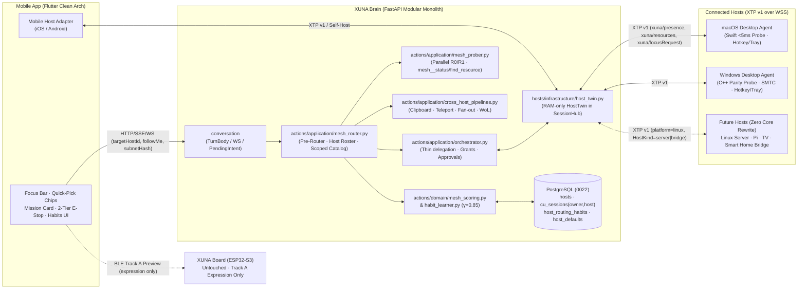

# XUNA Spatial Device Mesh & Adaptive Multi-Host Control — Architecture & Contract Specification

Date: 2026-11-20. **Status: Proposed** (Contract-First specification for Milestones M1–M6; awaits owner acceptance per [ADR-0016](../decisions/ADR-0016-spatial-device-mesh.md)).

Companion documents:
[ADR-0012 (Host Actions)](../decisions/ADR-0012-host-actions.md) ·
[ADR-0013 (Host Identity & Sessions)](../decisions/ADR-0013-host-identity-and-sessions.md) ·
[ADR-0014 (Standing Approvals & Sessions)](../decisions/ADR-0014-standing-approvals-and-phone-sessions.md) ·
[ADR-0015 (Commit-Gated Control)](../decisions/ADR-0015-commit-gated-control-and-trusted-scopes.md) ·
[ADR-0016 (Spatial Device Mesh)](../decisions/ADR-0016-spatial-device-mesh.md) ·
[XUNA Universal Device Control Architecture](XUNA_UNIVERSAL_DEVICE_CONTROL_ARCHITECTURE.md) ·
[XUNA XTP v1 Normative Wire Contract](XUNA_XTP_V1_CONTRACT.md) ·
[XUNA Honest-Code Rules](XUNA_HONEST_CODE_RULES.md) ·
[Backend Rules](../../backend/AGENTS.md) ·
[Mobile Rules](../../mobile/AGENTS.md).

---

## 1. Executive Summary & Design Principles

XUNA connects to multiple owner devices across operating systems. Prior to this specification, multi-host routing relied on bare alias lookup, a single global 5-minute `last_target`, an unscoped multi-host tool catalog, and a single global Computer-Use (CU) lane per owner. That breaks down when an owner uses a Mac, a Windows PC, and an iOS/Android phone simultaneously — and cannot scale cleanly to future Linux servers, Raspberry Pis, TVs, or Smart Home bridges.

**XUNA Spatial Device Mesh** upgrades multi-host control around five invariants:

1. **Contract-First, 100% Backwards-Compatible:** Wire schemas (XTP v1, HTTP JSON, SSE, Voice WS) are additive and strict (`extra="forbid"`). Existing clients and golden fixtures (`sample_frames.json`, `golden_vectors.json`) remain unbroken.
2. **Ephemeral Device Twin (`HostTwin`), Durable Identity & Habits:** Live presence (`idleSeconds`, `screenLocked`, `mediaPlaying`, `batteryPercent`, `subnetHash`, `foregroundAppId`) and normalized resources (`installedApps`, `workspaces`) live **RAM-only** inside `InMemoryHostSessionHub` and vanish immediately on disconnect (content-free, never logged). Spatial metadata (`host_kind`, `place`, `nicknames`, `wol_mac`) and learned routing habits (`host_routing_habits`, decay $\gamma = 0.85$) persist in PostgreSQL.
3. **Deterministic Pre-Router + Risk-Tiered Scorer Before LLM:** Explicit pins (`targetHostId`, `/may`, `/follow`, `@alias`, `@place`, `PendingIntent` repair, `job_runner` `pinned_host_id`) resolve deterministically before the LLM runs and scope the LLM tool catalog to the pinned host (preventing cross-OS `inputSchema` collisions). Unpinned requests pass through a risk-tiered Evidence Confidence Scorer (`R0 < R1 < R2 < R3`) that distinguishes `host_offline` and `grant_denied` before ever falling back to `ask_target`.
4. **Capability-Driven, Zero Hardcoding (H5):** Routing, scoring, prompts, and UI never hardcode app names, host names, OS paths, or keyword-intent tables. All capability and resource matching is driven by host-advertised manifests (`ToolDescriptor`, `xuna/policy`, `xuna/resources`) and `HostKind`/`HostPlatform` metadata.
5. **Board Authority Preserved (ADR-0008 / ADR-0012):** The ESP32-S3 XUNA Board (`DeviceId`) remains untouched and authoritative for life state; hosts (`HostId`) never touch pet life state.

---

## 2. Vocabulary

| Term | Definition |
| --- | --- |
| **Host (`HostId`)** | An owner-enrolled computer, phone, server, or bridge running a XUNA Host Agent ([ADR-0013](../decisions/ADR-0013-host-identity-and-sessions.md)). Distinct from `DeviceId` (the XUNA board). |
| **HostKind** | Architectural device category (`desktop \| mobile \| server \| bridge`) enabling capability-appropriate defaults and future expansion without core rewrites. |
| **HostTwin** | Ephemeral, RAM-only, content-free live projection of an online host inside `InMemoryHostSessionHub` (presence + normalized resources + focus/lane state). Cleared immediately on disconnect. |
| **Host Roster** | Dynamic, per-turn summary of active hosts (alias, platform, kind, place, online/locked/playing state, focused flag) injected into the LLM system prompt. Zero hardcoded host/app names. |
| **Pre-Router** | Deterministic routing layer (`mesh_router.py`) running before LLM tool selection (`targetHostId`, `/may`, `/follow`, `@alias`/`@place`, `PendingIntent`, `job_runner` hard pin). |
| **Evidence Confidence Scorer** | Pure deterministic scorer (`mesh_scoring.py`) combining Resource Match, Live Presence, Contextual Habit ($\gamma = 0.85$), and Session Continuity against risk-tiered thresholds (`R0`–`R3`). |
| **Contextual Habit Learner** | Persistent exponential-decay preference learner (`habit_learner.py`, $\gamma = 0.85$) stored in `host_routing_habits`; updates on both positive confirmations and negative corrections. |
| **Follow Me** | Session focus mode where the Brain follows the most recently active unlocked host (or hotkey/tray focus request) until manually pinned or disabled. |
| **Per-Host Execution Lane** | Independent Computer-Use session in `cu_sessions` keyed by `(owner_id, host_id)` so two hosts can run isolated CU sessions concurrently. |
| **Scoped Tool Catalog** | Tool catalog filtered to a single `pinned_host_id` when pinned, preventing cross-OS `inputSchema` collisions. |
| **PendingIntent** | Short-TTL (120 s) in-memory state after an `ask_target` prompt allowing a 1-word voice/chat host repair (e.g., `"Mac"`) to resume the interrupted request. |
| **MissionEnvelope** | Grouping metadata linking multi-step or cross-host actions into a single unified Mission Card on Mobile. |
| **`subnetHash`** | Privacy-preserving truncated SHA-256 digest of the local network prefix + per-owner/session salt (zero raw IP/SSID). |
| **`targetReason`** | Structured reason code + concise human-readable explanation (`"Vì sao chọn máy này"`) attached to routing outcomes, approvals, and results. |

---

## 3. System Architecture



---

## 4. Device Taxonomy & Future Extensibility

### 4.1 `HostPlatform` & `HostKind`

Near-term delivery optimizes for **macOS, Windows, iOS, and Android** (plus `"linux"` XTP/platform parity). Future **Linux Servers, Raspberry Pis, TVs, and Smart Home bridges** attach through the same `HostKind` + capability manifest contracts with zero changes to `mesh_router.py`, `mesh_scoring.py`, or `orchestrator.py`.

```python
class HostPlatform(StrEnum):  # Already includes LINUX in backend & xuna_xtp
    WINDOWS = "windows"
    MACOS = "macos"
    ANDROID = "android"
    IOS = "ios"
    LINUX = "linux"

class HostKind(StrEnum):
    DESKTOP = "desktop"   # Interactive workstation/laptop (macos, windows, linux desktop)
    MOBILE = "mobile"     # Phone/tablet companion (ios, android)
    SERVER = "server"     # Headless Linux server / Raspberry Pi (no GUI/battery)
    BRIDGE = "bridge"     # TV / Smart Home gateway exposing typed tv.* / smarthome.* tools
```

### 4.2 Capability-Driven Extensibility Guarantees

1. **No platform assumptions in scoring:** Battery checks apply only when `HostTwin.presence.battery_percent is not None` (`server`, `bridge`, and desktop PCs omit battery without penalty). Screen lock and `idleSeconds` apply to interactive kinds (`desktop`, `mobile`); `server`/`bridge` hosts report `screenLocked = false, idleSeconds = 0` or omit interactive penalties via `HostKind` capability rules.
2. **Dynamic manifest discovery:** New tool families or tools on a Linux server or Smart Home bridge appear automatically via `tools/list` + `xuna/resources` and become searchable via `mesh__find_resource` and `tool_search` with zero router edits.
3. **Shared Dart parity:** `packages/xuna_shared` already exposes `SharedHostPlatform.linux`, `.isDesktop`, and `.isMobile`. Mobile `HostPlatform` adopts `linux` and `HostKind` in M5.

---

## 5. Phase 1 — Brain Mesh Core (`backend/`)

### 5.1 Database Migration `0022_spatial_device_mesh.py`

- **Revision header:** `revision: str = "0022"`, `down_revision: str | None = "0021"`.
- **`migrations/env.py`:** Register new ORM models (`HostRoutingHabitModel`, `HostDefaultModel`) so `test_migrations.py` (`upgrade -> downgrade -> upgrade`, single-head) passes cleanly.
- **`downgrade()`:** Must cleanly revert all new tables, indexes, and columns, and recreate `uq_cu_sessions_owner_active`.

#### 5.1.1 `hosts` Table Additions

| Column / Index | Type & Constraint | Migration / Backfill Rule |
| --- | --- | --- |
| `host_kind` | `String(16)`, `NOT NULL`, `server_default="desktop"` | Backfill `platform IN ('android', 'ios')` → `'mobile'`; all others → `'desktop'`. |
| `place` | `String(32)`, `nullable=True` | Owner-assigned room/location label (e.g. `"office"`, `"living_room"`). |
| `nicknames` | `JSONB` (`sa.JSON().with_variant(postgresql.JSONB, "postgresql")`), `NOT NULL`, `server_default=sa.text("'[]'::jsonb")` | Up to 10 short aliases (`1..24` chars each). |
| `alias_folded` | `String(32)`, `NOT NULL`, `server_default=""` | Backfilled in Python/SQL using canonical `_fold_text(alias)[:32]`. **Collision guard:** process `status = 'active'` rows deterministically per `owner_id` (`ORDER BY created_at ASC, host_id ASC`) with a tracked set `used_folded: set[str]`; if `candidate in used_folded`, increment `n = 2, 3, ...` with `candidate = f"{base[:32 - len(f'_{n}')]}_{n}"` until `candidate not in used_folded`, then add to `used_folded` before index creation. |
| `wol_mac` | `String(17)`, `nullable=True` | Closes existing gap where `Host.wol_mac` existed in domain/workflows without DB column or repository mapping. Format `^([0-9A-Fa-f]{2}:){5}[0-9A-Fa-f]{2}$`. |
| `uq_hosts_owner_alias_folded_active` | `UNIQUE INDEX` on `(owner_id, alias_folded) WHERE status = 'active'` | Prevents ambiguous duplicate folded aliases among active hosts of one owner while preserving revoked tombstones. |

> **Enrollment collision guard (`hosts/application/use_cases.py`):** `confirm_enrollment` and `self_enroll_host` MUST populate `alias_folded = _fold_text(alias.value)` and check for an existing `status = 'active'` host of the same `owner_id` (excluding the re-enrolling host matched by `public_key` in `self_enroll_host`) with the same `alias_folded`, raising `HostError("conflict", ...)` (`409 conflict`), and catch any concurrent `IntegrityError` on `uq_hosts_owner_alias_folded_active` as `409 conflict`.

#### 5.1.2 `cu_sessions` Per-Host Execution Lanes

- Drop `uq_cu_sessions_owner_active` (`UNIQUE (owner_id) WHERE active`).
- Create `uq_cu_sessions_owner_host_active` (`UNIQUE` on `(owner_id, host_id) WHERE active`).
- Create `ix_cu_sessions_owner_host` on `(owner_id, host_id)`.
- Update `CuSessionModel.__table_args__` (`backend/src/xuna_backend/modules/actions/infrastructure/models.py`) to match (`uq_cu_sessions_owner_host_active` + `ix_cu_sessions_owner_host`) so SQLAlchemy metadata matches `0022` for `test_migrations.py`.
- Update both `SqlComputerUseSessionStore` (`actions/infrastructure/cu_session_store.py`) and `InMemoryComputerUseSessionStore` (`actions/application/computer_use.py`) to key active sessions by `(owner_id, host_id)` rather than `owner_id` alone. Stop/disconnect on `host_id` ends only that host's lane unless a global E-Stop (`host_id=None`) is issued.

#### 5.1.3 `host_routing_habits` Table

| Column | Type | Notes |
| --- | --- | --- |
| `habit_id` | `UUID` PK | Primary key. |
| `owner_id` | `UUID` FK `owners.owner_id` `ON DELETE CASCADE`, `NOT NULL` | Indexed (`ix_host_routing_habits_owner_id`). |
| `pet_id` | `String(64)`, `NOT NULL` | Scoped per pet identity. |
| `context_key` | `String(128)`, `NOT NULL` | Normalized deterministic bucket (see §5.4.1 #3). |
| `host_id` | `UUID` FK `hosts.host_id` `ON DELETE CASCADE`, `NOT NULL` | Target host. |
| `positive_score` | `Float`, `NOT NULL`, `server_default="0"` | Decayed positive evidence $P$. |
| `negative_score` | `Float`, `NOT NULL`, `server_default="0"` | Decayed negative correction $N$. |
| `sample_count` | `Integer`, `NOT NULL`, `server_default="0"` | Total observations recorded. |
| `decay_gamma` | `Float`, `NOT NULL`, `server_default="0.85"` | Exponential decay factor $\gamma \in (0, 1)$. |
| `last_reason_code` | `String(64)`, `nullable=True` | Short code explaining last update (`confirmed_pick`, `redirect_penalty`, `execution_ok`). |
| `created_at` | `DateTime(timezone=True)`, `NOT NULL` | UTC. |
| `updated_at` | `DateTime(timezone=True)`, `NOT NULL` | UTC. |
| **Unique** | `uq_host_routing_habits_key` | `UNIQUE (owner_id, pet_id, context_key, host_id)`. |

#### 5.1.4 `host_defaults` Table (Distinct from UDC-10 Phone-Local Defaults)

| Column | Type | Notes |
| --- | --- | --- |
| `default_id` | `UUID` PK | Primary key. |
| `owner_id` | `UUID` FK `owners.owner_id` `ON DELETE CASCADE`, `NOT NULL` | Indexed. |
| `pet_id` | `String(64)`, `NOT NULL` | Pet scope. |
| `scope_key` | `String(64)`, `NOT NULL` | Normalized capability/tool-family scope (e.g. `"media"`, `"cu"`, `"*"`). |
| `host_id` | `UUID` FK `hosts.host_id` `ON DELETE CASCADE`, `NOT NULL` | Default host for `scope_key`. |
| `source` | `String(24)`, `NOT NULL`, `server_default="confirmed"` | `"confirmed"` \| `"slash_cmd"` \| `"migrated"`. |
| `created_at` | `DateTime(timezone=True)`, `NOT NULL` | UTC. |
| `updated_at` | `DateTime(timezone=True)`, `NOT NULL` | UTC. |
| **Unique** | `uq_host_defaults_owner_pet_scope` | `UNIQUE (owner_id, pet_id, scope_key)`. |

> **Separation from UDC-10:** Mobile UDC-10 stores phone-local `HostDefaultConvention` and `HostPickTracker` in Hive box `xuna_host_defaults_v1` for local UI hints. Server-side `host_defaults` and `host_routing_habits` live in PostgreSQL, govern Brain routing across all surfaces (voice, chat, desktop hotkeys, autonomous jobs), and are exposed via `/v1/actions/habits`. Neither silently overwrites the other.

### 5.2 Ephemeral `HostTwin` & Dynamic `Host Roster`

#### 5.2.1 `HostTwin` (`hosts/infrastructure/host_twin.py`)

Stored strictly in RAM inside `InMemoryHostSessionHub` (never persisted to PostgreSQL, never serialized to audit logs):

- `host_id: HostId`
- `presence: HostPresence | None` (`idle_seconds`, `screen_locked`, `media_playing`, `battery_percent`, `is_charging`, `subnet_hash`, `foreground_app_id`, `updated_at`)
- `resources: HostResources | None` (`installed_apps: tuple[str, ...]`, `workspaces: tuple[str, ...]`, `capabilities_version: str | None`, `updated_at`)
- `focus_state` keyed strictly by `owner_id`: `focused_host_id: HostId | None`, `follow_me: bool`, `updated_at: datetime`, `source: str` (locking to `owner_id` ensures petless Desktop XTP `xuna/focusRequest` and Mobile `POST /v1/actions/focus` always read/write the exact same focus pin)
- **Lifecycle invariant:** On `close_session` / WebSocket disconnect / `revoke_host`, `HostTwin` for that `host_id` is immediately evicted. An offline host always has `presence = None` and `resources = None` (H1/H2: no stale presence pretending to be live).

#### 5.2.2 Dynamic `Host Roster` Prompt Contract (`prompts.py` + `mesh_router.py`)

When `tools` is non-empty for a turn, `build_request()` / `tool_system_prompt()` appends a compact, dynamically generated `[HOST_ROSTER]` block built solely from the owner's `Host` records + live `HostTwin` state + current focus state. It **never** contains hardcoded host names, OS assumptions, or app names:

```text
[HOST_ROSTER]
focusMode: auto | follow_me | pinned(<alias>)
- <alias> (platform=<platform>, kind=<host_kind>, place=<place|none>, nicknames=[...], state=<online|offline>, locked=<true|false|unknown>, mediaPlaying=<true|false|unknown>, idleS=<int|unknown>, battery=<pct|unknown>, appsCount=<n>, workspacesCount=<n>)
[/HOST_ROSTER]
```

If `pinned_host_id` is active, the prompt states the active pin and the tool catalog contains **only** that host's tools.

### 5.3 Deterministic Pre-Router & Per-Host Scoped Tool Catalog (`mesh_router.py`)

Before calling the LLM on any conversation/voice turn, `MeshPreRouter.route(...)` runs deterministically in priority order:

1. **Explicit API Target (`targetHostId`):**
   - If `TurnBody.targetHostId` (or WS `turn.commit.targetHostId`) is provided: validate ownership (`404 not_found` if unknown/other owner). If that host is offline, emit `host_offline` immediately (do not silently reroute to another host — H3). Otherwise set `pinned_host_id = targetHostId`.
2. **Slash Commands (`/may <alias|auto>` and `/follow <on|off>`):**
   - `/may auto` clears the focus pin for the conversation/owner and emits `host_focus_changed(hostId=null, followMe=current, source="slash_cmd")`.
   - `/may <query>` resolves `<query>` across active hosts (`alias`, `nicknames`, `place`) using safe unique-only matching (§5.4.4). On unique match, updates focus pin, emits `host_focus_changed(..., source="slash_cmd")`, and sets `pinned_host_id`. On ambiguity, returns `action_target_required` (`ask_target`) with bounded candidates.
   - `/follow on` / `/follow off` toggles `follow_me` and emits `host_focus_changed(..., source="slash_cmd")`.
3. **Inline `@alias` / `@place` / `@nickname` Tags:**
   - Extracts explicit `@token` tokens (supporting quoted `@"PC Nha"` or single-token `@mac` / `@office`) and resolves uniquely across `alias`, `nicknames`, and `place` via `_fold_text` + safe fuzzy match (§5.4.4).
   - If uniquely matched to an offline host → `host_offline` (never silent fallback). If ambiguous → `ask_target` with bounded candidates.
4. **`PendingIntent` 1-Word Voice/Chat Repair (`TTL = 120 s`):**
   - Whenever an action turn terminates with `action_target_required` (`ask_target`), `PendingIntentStore` (in-memory, keyed by `(owner_id, pet_id)`) records `{original_tool, original_arguments, original_text, candidate_host_ids, created_at}` for 120 seconds.
   - If the next user turn within 120 s is a short host-selection utterance (e.g. matches one of `candidate_host_ids` by `alias`/`nickname`/`place` with <= 4 tokens and no new verb/tool intent), Pre-Router pins that `host_id`, records a positive habit confirmation (+ negative penalty for bypassed candidates if explicitly redirected, §5.4.2), clears `PendingIntent`, and re-dispatches cleanly.
5. **Hard `pinned_host_id` on `ActionContext`, `load_tool_catalog_for_owner`, and `job_runner.py`:**
   - Add `pinned_host_id: HostId | None = None` to `ActionContext` and `load_tool_catalog_for_owner(..., pinned_host_id=...)`.
   - `OrchestratorJobStepExecutor.__call__` (`job_runner.py`) MUST pass `pinned_host_id=job.host_id` to both `load_tool_catalog_for_owner` and `ActionContext` (replacing the soft `host_defaults` workaround).
   - **Per-Host Scoped Tool Catalog (`catalog.py`):** When `pinned_host_id` is set, `build_tool_catalog()` includes tools **only** from that host's manifest, eliminating cross-OS `inputSchema` collisions (e.g. macOS vs Windows parameter differences on the same tool name) and shrinking prompt token footprint.

### 5.4 Evidence Confidence Scorer (`mesh_scoring.py`) & Contextual Habit Learner (`habit_learner.py`)

All scoring logic lives in pure-stdlib `actions/domain/mesh_scoring.py` and `actions/domain/habit_learner.py` (no I/O, no `pydantic`, no hardcoded app/host/keyword lists).

#### 5.4.1 Component Evidence Scores (Each Normalized to $[0.0, 1.0]$)

Given candidate active host $h$, requested tool $t$ (with `family` $f$ and optional normalized resource query $q$ extracted from tool arguments such as `app.launch.id`, `workspace.capture_capsule.project`, or `mesh__find_resource`), and client context $c = (\text{client\_subnet\_hash}, \text{day\_part}, \text{now})$:

1. **Resource Match $M_{\text{res}}(h, t, q) \in [0.0, 1.0]$ & Tool Eligibility:**
   - Base tool eligibility: $h$ is **ineligible** if $t$ is absent from $h$'s manifest, `descriptor.permission in {denied, unsupported}`, `not is_tool_granted(descriptor, grants, now, host_screen_consent=ctx.host_screen_consent)` (checks active `HostGrant`, `grant.max_risk.allows(descriptor.risk)`, and `U5` screen consent when `observes` or in `{cu, screen, ui, input}`), or host is `policy_blocked`. Ineligible online capable hosts are tracked separately for `grant_denied` / `u5_consent_required` / `policy_blocked` classification (§5.4.3 #3).
   - If $q$ is `None` (no app/workspace ID argument): $M_{\text{res}} = 0.70$ if $t$ is granted & ready, $0.30$ if `not_determined`.
   - If $q$ is present (normalized ID):
     - Exact match in `HostTwin.resources.installed_apps` or `workspaces`, OR `foreground_app_id == q`: $M_{\text{res}} = 1.00$.
     - Prefix/substring unique match in `installed_apps` / `workspaces` (e.g. `q` matches normalized ID cleanly): $M_{\text{res}} = 0.85$.
     - Host supports tool $t$ generically (`HostTwin.resources` present) without $q$ listed: $M_{\text{res}} = 0.25$ (penalized so a host that actually has the app/workspace wins decisively).
     - `HostTwin.resources` not yet reported: $M_{\text{res}} = 0.50$ (neutral unknown).

2. **Live Presence $M_{\text{pres}}(h, f, c) \in [0.0, 1.0]$:**
   - If $h$ is offline: $M_{\text{pres}} = 0.0$ (excluded from online scoring; tracked for `host_offline`).
   - For online $h$ with `HostTwin.presence = p`:
     - If `p` is `None`: $M_{\text{pres}} = 0.40$ (online, telemetry pending).
     - Otherwise compute weighted presence sub-score:
       - Lock factor: $L = 0.15$ if `p.screen_locked` else $1.0$ (interactive families `ui`/`input`/`screen`/`app`/`cu` further apply a $0.35\times$ multiplier on $M_{\text{pres}}$ when `screen_locked == True`).
       - Recency factor: $R_{\text{idle}} = \exp(-\text{idle\_seconds} / 300.0) \in (0, 1]$ (where `idle_seconds = 0` gives `1.0`, `300s` gives `~0.37`, `900s` gives `~0.05`).
       - Locality factor: $R_{\text{net}} = 1.0$ if (`c.client_subnet_hash` and `p.subnet_hash` and `c.client_subnet_hash == p.subnet_hash`), else $0.5$ if either is absent, else $0.2$.
       - Media activity factor (applied **only** when $f == \text{ToolFamily.MEDIA}$): $R_{\text{media}} = 1.0$ if `p.media_playing` else $0.0$.
       - Combine:
         - For `media` family:
           $$M_{\text{pres}} = 0.60 R_{\text{media}} + 0.20 L + 0.10 R_{\text{idle}} + 0.10 R_{\text{net}}$$
         - For all other families:
           $$M_{\text{pres}} = 0.35 L + 0.40 R_{\text{idle}} + 0.25 R_{\text{net}}$$

3. **Contextual Habit $M_{\text{hab}}(h, k) \in [0.0, 1.0]$ ($\gamma = 0.85$):**
   - Context key $k$ is a deterministic string `f"{family}:{resource_id_or_dash}:{day_part}"` (max 128 chars, content-free), where `resource_id_or_dash` is the normalized resource ID $q$ when present or **`-`** when $q$ is `None` (never `*`).
   - **Dual-bucket update & fallback:** Whenever a resource-specific habit (`q is not None`) is updated, **also** apply the same positive/negative update to the family-wildcard bucket `f"{family}:-:{day_part}"`. When scoring, look up `f"{family}:{q}:{day_part}"` first; if no row exists (`sample_count == 0`), fall back to `f"{family}:-:{day_part}"`.
   - **Audit safety:** `contextKey` (up to 128 chars, may contain `:`) is **never** passed raw into `AuditEvent.metadata` (keep audit metadata strictly to `hostId`, `habitId`, `deletedCount`, `fieldsCount` per `AuditEvent._VALUE`).
   - Stored in `host_routing_habits` with decay $\gamma = 0.85$:
     - **On positive confirmation** (tool succeeds without redirect, user picks $h$ in `ask_target`, or user runs `/may <h>` / `POST /v1/actions/focus` for $h$):
       $$P_{\text{new}} = \gamma \cdot P_{\text{old}} + 1.0, \qquad N_{\text{new}} = \gamma \cdot N_{\text{old}}$$
     - **On negative correction** (user cancels/redirects away from auto-selected $h$ within the turn or chooses a different host $h' \ne h$ after XUNA suggested $h$):
       $$N_{\text{new}} = \gamma \cdot N_{\text{old}} + 1.0, \qquad P_{\text{new}} = \gamma \cdot P_{\text{old}}$$
     - **Normalized Habit Score:** with negative correction weight $\lambda_{\text{neg}} = 1.25$ and Laplace prior $\alpha_0 = 2.0$:
       $$M_{\text{hab}}(h, k) = \text{clamp}\!\left(0.5 + \frac{P - \lambda_{\text{neg}} N}{2\,(P + \lambda_{\text{neg}} N + \alpha_0)},\; 0.0,\; 1.0\right)$$
     - Properties:
       - Cold start ($P = 0, N = 0$) $\implies M_{\text{hab}} = 0.50$ (strictly neutral).
       - Steady confirmations ($P \to \frac{1}{1-\gamma} \approx 6.67, N=0$) $\implies M_{\text{hab}} \to 0.885$.
       - Repeated negative corrections ($N > P$) override a steady-state positive habit ($0.885$) below $0.50$ within $4$ steps ($\approx 0.473$), reach $\approx 0.413$ after $5$ steps and $\approx 0.123$ after $20$ steps, approaching the steady-state asymptote $\approx 0.097$ ($N \to 6.67, P = 0$).

4. **Session Continuity $M_{\text{cont}}(h) \in [0.0, 1.0]$:**
   - $1.00$ if $h$ has an active Per-Host CU lane or is the active `focused_host_id`.
   - $0.80$ if $h$ matches `last_target` within `LAST_TARGET_TTL` (5 min).
   - $0.65$ if $h$ matches durable `host_defaults` for `(owner_id, pet_id, family)` or `"*"`.
   - $0.30$ otherwise.

#### 5.4.2 Combined Confidence Score & Risk-Tiered Thresholds

$$C(h) = 0.35\,M_{\text{res}}(h, t, q) + 0.30\,M_{\text{pres}}(h, f, c) + 0.20\,M_{\text{hab}}(h, k) + 0.15\,M_{\text{cont}}(h)$$

(When `follow_me == True` and no explicit pin is set, add a bounded tie-breaking presence boost by re-weighting `presence` to `0.40` and `continuity` to `0.05` so the actively unlocked host naturally leads.)

Sort eligible online hosts descending by $C(h)$: $h_1, h_2, \dots$. Every `(len(eligible), risk_tier, C, screenLocked)` tuple resolves exhaustively as follows:

- **`len(eligible) == 0`:** Handled exhaustively by §5.4.3 #1–#3 (`no_host` / `host_offline` / `grant_denied`).
- **`len(eligible) == 1` (single eligible online host $h_1$, unpinned):** Always compute $C(h_1)$ for `TargetReason` diagnostics.
  - If `risk_tier in {R2, R3}` **and** `h_1.host_kind in {desktop, mobile}` **and** `h_1.presence is not None` **and** `h_1.presence.screen_locked is True`: do **not** silently dispatch into a locked interactive host — emit a **1-candidate `action_target_required`** (`reasonCode = "ask_target"`, `candidates = [h_1]` with `eligible = True`).
  - Otherwise (`risk_tier in {R0, R1}`, or `screen_locked` is `False`/`None`/unknown, or `host_kind in {server, bridge}`): **auto-resolve directly** to $h_1$ with `TargetReason.reasonCode = "unique_capable_host"` (matching existing `TargetResolver` rule 4; note that `R2`/`R3` calls still pass through the mandatory owner/phone-signed `action_pending` approval gate before execution). This ensures single-host `R2`/`R3` turns with `q=None` or missing `clientSubnetHash` (e.g. cellular 5G) resolve cleanly without dead-end.
- **`len(eligible) >= 2`:** Auto-routing is allowed **only** when BOTH the risk-tier confidence floor $\theta_{\text{tier}}$ AND the winner margin $\Delta_{\text{tier}}$ hold ($C(h_1) \ge \theta_{\text{tier}}$ and $C(h_1) - C(h_2) \ge \Delta_{\text{tier}}$); otherwise emit `action_target_required` (`reasonCode = "ask_target"`):

| Risk Tier | Confidence Floor $\theta_{\text{tier}}$ (`len >= 2`) | Minimum Winner Margin $\Delta_{\text{tier}}$ (`len >= 2`) | Notes |
| --- | --- | --- | --- |
| **`R0`** (read-only/observe) | `0.45` | `0.08` | Lowest friction; still asks if two hosts are nearly tied. |
| **`R1`** (reversible side effect, e.g. media) | `0.58` | `0.12` | Requires meaningful evidence lead (e.g. `mediaPlaying` or habit). |
| **`R2`** (launch, open URL, write clipboard) | `0.72` | `0.18` | High bar; asks owner when ambiguous. |
| **`R3`** (commit / destructive / file / UI commit) | `0.85` | `0.25` | Highest bar + mandatory phone-signed approval. |

*(Strict inequality ordering $\theta_{R0} < \theta_{R1} < \theta_{R2} < \theta_{R3}$ and $\Delta_{R0} < \Delta_{R1} < \Delta_{R2} < \Delta_{R3}$.)*

#### 5.4.3 Pre-`ask_target` Classification (`host_offline` & `grant_denied` First — H1/H3/H4)

Let `capable` be all active enrolled hosts where tool $t$ is present in the manifest with `permission != unsupported`, and let `online_capable_count` be the number of `capable` hosts currently online (`hub.is_online`). Before returning `ask_target`, the scorer and router **must** classify failure causes exhaustively in order:

1. **`no_host`:** Owner has zero active enrolled hosts, OR `len(capable) == 0` (zero active enrolled hosts advertise the requested tool with `permission != unsupported`).
2. **`host_offline`:** An explicitly requested/pinned host (by `targetHostId`, `@alias`, `@place`, or unique fuzzy match) is offline (`!hub.is_online`), **OR** `len(eligible) == 0` and `online_capable_count == 0` (all capable enrolled hosts — whether `1` or `>= 2` — are offline). Emits `action_target_required` with `reasonCode = "host_offline"` and capable offline candidates carrying `unavailableReason = "host_offline"`, `wolMac`, and `wolAvailable`.
3. **`grant_denied`:** An explicitly requested host is blocked, **OR** `len(eligible) == 0` and `online_capable_count >= 1` (all online capable hosts — whether `1` or `>= 2` — are blocked by missing/expired/suspended `HostGrant`, `grant.max_risk`, `u5_consent_required`, host `policy_blocked`, or `permission == "denied"`). Emits `action_target_required` with `reasonCode = "grant_denied"` and exact per-candidate `unavailableReason` (`"grant_denied" | "u5_consent_required" | "policy_blocked" | "host_offline" | "unsupported"`, plus `wolMac`/`wolAvailable` for any offline candidate).
4. **`ask_target` (`action_target_required`):** `len(eligible) >= 2` with confidence/margin thresholds unmet, OR `len(eligible) == 1` with `risk_tier in {R2, R3}` on a `screenLocked == True` interactive host, OR explicit target (`@place`, `nicknames`, fuzzy match) is ambiguous across multiple hosts. Returns ranked candidates (`<= 5`) with `score`, `eligible`, `unavailableReason`, `wolMac`, `wolAvailable`, and `reason`.

#### 5.4.4 Safe Unique-Only Fuzzy & Phonetic Matching (H3)

When matching an explicit `@tag`, `/may <query>`, or `PendingIntent` reply against `{alias, nicknames..., place}` of the owner's active hosts:

1. Normalize via `_fold_text(s)` (lowercase, `đ`→`d`, NFD accent strip, collapse whitespace).
2. Exact folded match wins immediately if unique (active index guarantees `alias_folded` uniqueness; `nicknames`/`place` may match multiple hosts, e.g., two hosts in `@office` → return `ask_target` filtered to those hosts!).
3. If no exact folded match exists, compute per-label similarity $\text{sim}(q, c) = 0.7 \cdot \text{levenshtein\_ratio}(q, c) + 0.3 \cdot \text{phonetic\_bigram\_sim}(q, c)$ using pure stdlib Vietnamese-safe consonant normalization (`f/ph`, `k/c/q`, `d/gi/r`, `s/x`, `tr/ch` folded in phonetic projection `pa, pb`):
   - `phonetic_bigram_sim(pa, pb)` uses Dice bigram similarity (`2 * |bigrams(pa) & bigrams(pb)| / (|bigrams(pa)| + |bigrams(pb)|)`), guarded by **`1.0 if pa == pb else 0.0` whenever `len(pa) < 2 or len(pb) < 2`** (avoiding `ZeroDivisionError` on 0/1-character queries).
4. For each active host $h$, take $s(h) = \max_{c \in \{h.\text{alias}, *h.\text{nicknames}, h.\text{place}\}} \text{sim}(q, c)$, and sort distinct hosts descending ($h_1, h_2, \dots$). Resolve **only** if `s(h_1) >= 0.82 and (len(distinct_hosts) == 1 or (s(h_1) - s(h_2)) >= 0.10)`. Otherwise **never guess (H3)** — return `ask_target` with the close candidates.

#### 5.4.5 `targetReason` Contract (`"Vì sao chọn máy này"`)

Every resolved, pending, or `ask_target` response includes a structured `TargetReason`:
- `reasonCode`: closed `StrEnum`: `pinned_host | explicit_alias | place_tag | follow_me_active | unique_capable_host | resource_and_presence_match | high_confidence_habit_and_presence | session_continuity | host_offline | grant_denied | ambiguous_candidates | no_host`. (Note: on the `action_target_required` SSE/WS wire event §5.6.7, `TargetReason.reasonCode == "ambiguous_candidates"` and single-host `R2`/`R3` locked-screen confirmation map to coarse wire classification `action_target_required.reasonCode = "ask_target"`.)
- `targetReason`: short, content-free English/Vietnamese-neutral or locale-rendered summary string (e.g., `"Focused host · unlocked, active 12s ago"` / `"Đang được ghim · mở khoá, hoạt động 12 giây trước"`), never fabricated (H2) and never citing unmeasured hardware metrics (H6).

### 5.5 Parallel R0/R1 Scatter-Gather Prober (`mesh_prober.py`) & Meta-Tools

- **Bounded Scatter-Gather (`MeshProber`):** Sends concurrent read-only/observing `tools/call` probes (`R0`–`R1` per each tool's declared `xuna/policy.risk`: e.g. `R0` `host.status`, `media.now_playing`, `app.list_allowed`; `R1` observing `system.vitals`, `workspace.git_summary(project=...)`) across eligible online hosts **after checking each host's actual `HostGrant` (`host.R1` / `app.R1`) and `U5` (`host_screen_consent`) via `is_tool_granted(...)`**, using `asyncio.gather(..., return_exceptions=True)` with a strict per-host deadline (default `2,000 ms`). Individual host timeouts/errors or ungranted hosts return `{hostId, alias, status: "timeout" | "error" | "denied", errorCode}` without failing healthy hosts (H4).
- **Meta-Tools (`META_FUNCTION_NAMES` expansion):**
  - Register `mesh__status` and `mesh__find_resource` alongside `tool_search`, `tool_describe`, `tool_invoke` in `actions/application/tool_discovery.py` and `Orchestrator.handle_call()`.
  - `mesh__status`: `{hostIds?: list[uuid], includeVitals?: bool}` → returns live `HostTwin` presence + optional parallel `R0`/`R1` probes (`host.status`/`media.now_playing` [`R0`] and granted `system.vitals` [`R1`]) per host.
  - `mesh__find_resource`: `{query: str (1..64), kind?: "app"|"workspace"|"tool"}` → searches `HostTwin.resources` (`installedApps`, `workspaces`) + live `tools/list` manifests across all online hosts (falling back to `R0` `app.list_allowed` probe if a host's `HostTwin.resources` is empty). Zero hardcoded app/workspace names (H5).

### 5.6 HTTP / SSE / WS Contracts (100% Backwards-Compatible, camelCase JSON)

All new request models use `ConfigDict(extra="forbid", frozen=True)` and all new fields on existing payloads are **optional** with backwards-compatible defaults.

#### 5.6.1 `PATCH /v1/hosts/{host_id}` (`hosts/api/routes.py`)

- **Headers:** `Idempotency-Key` required (enforced via `core.idempotency.run_once`).
- **Request Body:**
  ```json
  {
    "schemaVersion": 1,
    "alias": "Mac Studio",
    "place": "office",
    "nicknames": ["mac nha", "workstation"],
    "hostKind": "desktop",
    "wolMac": "AA:BB:CC:DD:EE:FF"
  }
  ```
  - All fields except `schemaVersion: Literal[1] = 1` are optional (`None` = unchanged). String inputs are stripped/validated so whitespace-only values never slip through:
  - `alias`: trimmed `1..24` chars (`HostAlias` rules; whitespace-only rejected with `422 validation_failed`); updates `alias_folded`.
  - `place`: exact `""` clears to `null`; whitespace-only strings (`"   "`) are rejected with `422 validation_failed`; otherwise trimmed `1..32` chars.
  - `nicknames`: `list[str]` (`max_length=10`); each entry is stripped and must be `1..24` non-whitespace chars (whitespace-only entries rejected with `422 validation_failed`).
  - `hostKind`: `"desktop" | "mobile" | "server" | "bridge"`.
  - `wolMac`: `^([0-9A-Fa-f]{2}:){5}[0-9A-Fa-f]{2}$` or `""` to clear to `null`.
- **Responses:**
  - `200 OK`: updated host object (same canonical shape as `GET /v1/hosts` item).
  - `404 not_found`: missing host, revoked host, or owned by another owner.
  - `409 conflict`: `alias_folded` collides with another active host of the same owner.
  - `422 validation_failed`: invalid MAC, alias, place, or nickname length.
- **Audit:** Records `AuditAction.HOST_UPDATED` (`"host.updated"`) with content-free metadata (`hostId`, `fieldsCount`).

#### 5.6.2 `GET /v1/hosts` Canonical Additive Shape (`hosts/api/routes.py`)

Preserves all existing keys (`hostId`, `alias`, `platform`, `hostname`, `osVersion`, `agentVersion`, `status`, `online`, `keyFingerprint`, `publicKey`, `lanFingerprint`, `lanPort`, `createdAt`, `lastSeenAt`, `grants`, `tools`) and adds ONE canonical shape:

```json
{
  "items": [
    {
      "...existingFields": "...",
      "hostKind": "desktop",
      "place": "office",
      "nicknames": ["mac nha"],
      "wolMac": "AA:BB:CC:DD:EE:FF",
      "focused": true,
      "presence": {
        "idleSeconds": 12,
        "screenLocked": false,
        "mediaPlaying": true,
        "batteryPercent": 78,
        "isCharging": true,
        "foregroundAppId": "vscode",
        "subnetHash": "a1b2c3d4e5f60718293a4b5c6d7e8f90",
        "updatedAt": "2026-11-20T16:00:00+00:00"
      }
    }
  ]
}
```

- When the host is offline or has not yet sent `xuna/presence`, `"presence": null` (never fabricated — H2).

#### 5.6.3 `GET /v1/actions/habits` & `DELETE /v1/actions/habits` (`actions/api/mesh_routes.py`)

- **`GET /v1/actions/habits?petId=<optional>`:**
  - `200 OK`:
    ```json
    {
      "items": [
        {
          "habitId": "uuid",
          "petId": "pet-1",
          "contextKey": "media:music:evening",
          "hostId": "uuid",
          "hostAlias": "Mac",
          "hostPlatform": "macos",
          "positiveScore": 3.21,
          "negativeScore": 0.0,
          "netScore": 0.78,
          "sampleCount": 5,
          "gamma": 0.85,
          "lastReasonCode": "confirmed_pick",
          "why": "Picked 5 times for media in evening; active confidence 0.78",
          "updatedAt": "2026-11-20T16:00:00+00:00"
        }
      ]
    }
    ```
- **`DELETE /v1/actions/habits/{habit_id}`:**
  - Owner-scoped (`404 not_found` if missing or owned by another owner).
  - `200 OK`: `{"habitId": "<uuid>", "deleted": true}` (matches `DELETE /v1/standing-approvals/{id}` convention).
- **`DELETE /v1/actions/habits?petId=<optional>`:**
  - Clears all habits for the owner (optionally filtered by `petId`).
  - `200 OK`: `{"deletedCount": 4}`.
- **Audit:** Records `AuditAction.HOST_HABIT_DELETED` (`"host.habit_deleted"`) with strictly content-free metadata (`habitId` for single delete or `deletedCount` for bulk reset — never passing raw `contextKey` into `AuditEvent.metadata`).

#### 5.6.4 `POST /v1/actions/focus` (`actions/api/mesh_routes.py`)

- **Request Body:**
  ```json
  {
    "schemaVersion": 1,
    "hostId": "uuid-or-null",
    "followMe": true,
    "petId": "optional-pet-id"
  }
  ```
  - `hostId = null` returns focus to Auto; `hostId = <uuid>` pins that active host (`404 not_found` if missing/other owner/revoked).
  - `followMe`: optional `bool`; omitted leaves current `followMe` state unchanged.
  - `petId`: optional backwards-compatible context field; `HostTwin.focus_state` is keyed strictly by `owner_id` so Mobile `POST /v1/actions/focus` and petless Desktop XTP `xuna/focusRequest` always share one pin.
- **Response (`200 OK`):**
  ```json
  {
    "focusedHostId": "uuid-or-null",
    "focusedAlias": "Mac",
    "followMe": true,
    "source": "app",
    "updatedAt": "2026-11-20T16:00:00+00:00"
  }
  ```

#### 5.6.5 `POST /v1/actions/stop` (2-Tier E-Stop, `actions/api/routes.py` & WS `action.stop`)

- `EmergencyStopBody` adds `hostId: uuid.UUID | None = None` (`Idempotency-Key` remains optional for backwards compatibility).
- **When `hostId` is `null` / omitted (Tier 2 — Stop All):** existing global E-Stop across all online hosts, all owner CU lanes, all pending approvals, all R2+ grants, and all active autonomous jobs.
- **When `hostId` is provided (Tier 1 — Stop This Host):** validates host ownership (`404 not_found` if invalid), sends `xuna/stop` only to `hostId`, closes only CU lane `(owner_id, host_id)`, cancels only pending approvals for `hostId`, suspends R2+ grants only on `hostId`, and cancels active jobs pinned to `hostId`.
- **Response (`200 OK`):** preserves `stopped`, `hostsNotified`, `approvalsCancelled`, `grantsSuspended` and adds `"hostId": "<uuid>" | null`.
- WS inbound `action.stop` accepts optional `hostId?: str` and emits `action_stopped` with optional `hostId`.

#### 5.6.6 `TurnBody` & WS `turn.commit` / `hello` Additive Fields

Add optional fields to `TurnBody` (`conversation/api/routes.py`), WS `hello`, and WS `turn.commit` (`conversation/api/websocket.py`), and serialize identically in Mobile `CloudRepositoryImpl.contextJson` and `VoiceTurnContextMapper.toJson`:

- `targetHostId: uuid.UUID | None = None`
- `followMe: bool | None = None`
- `clientSubnetHash: str | None = Field(default=None, max_length=64, pattern=r"^[0-9a-f]{16,64}$")`

#### 5.6.7 Additive SSE & WS Events (`ActionStreamEvent` & `TurnEvent`)

1. **`action_pending` (additive optional fields & `MissionEnvelope` parity):**
   - Add `targetReason?: str | null` and `targetPlatform?: "windows"|"macos"|"android"|"ios"|"linux"|null`.
   - Extend `missionEnvelope` additively while **preserving all existing UDC-18 fields** (`goal`: non-empty `str` required by existing `ActionEventMapper`, populated from `title` when omitted; `apps`: `list[str]`, `domains`: `list[str]`, `maxSteps`: `int`, `maxMinutes`: `int`, `planSteps`: `list[str]`) and adding optional spatial fields:
     - `missionId?: str`
     - `title?: str`
     - `steps?: list[{hostId: str, hostAlias: str, platform: "windows"|"macos"|"android"|"ios"|"linux", tool: str, summary: str, risk: "r0"|"r1"|"r2"|"r3", status?: "pending"|"ok"|"failed"|"deferred_wake"|"denied"}]`
2. **`action_result` (additive optional fields + consistent `hostId` + `MissionEnvelope`):**
   - Extend `ActionResultEvent` (`backend/src/xuna_backend/modules/actions/domain/entities.py`) with optional `target_reason: str | None = None`, `target_platform: str | None = None`, and `mission_envelope: dict[str, object] | None = None`.
   - Populate `hostId` consistently on both `"ok"` and error outcomes whenever a host was resolved.
   - Emit `targetReason?: str | null`, `targetPlatform?: str | null`, and `missionEnvelope?: MissionEnvelope | null` (using the same backwards-compatible schema above with `goal` preserved + optional `missionId`, `title`, and `steps` with `status`).
3. **`action_target_required` (new SSE `event: action_target_required` / WS `type: "action_target_required"`):**
   ```json
   {
     "invocationId": "uuid",
     "tool": "media.play_pause",
     "reasonCode": "ask_target",
     "targetReason": "Multiple eligible hosts are active with similar confidence.",
     "candidates": [
       {
         "hostId": "uuid",
         "alias": "Mac",
         "platform": "macos",
         "hostKind": "desktop",
         "online": true,
         "score": 0.64,
         "eligible": true,
         "unavailableReason": null,
         "wolMac": null,
         "wolAvailable": false,
         "reason": "Unlocked, active 12s ago"
       }
     ]
   }
   ```
   - `reasonCode`: `"ask_target" | "host_offline" | "grant_denied" | "no_host"` (note: internal `TargetReason.reasonCode == "ambiguous_candidates"` and single-host `R2`/`R3` screen-locked confirmation map to `"ask_target"` on this wire event).
   - `unavailableReason` per candidate: `null | "host_offline" | "grant_denied" | "u5_consent_required" | "policy_blocked" | "unsupported"`.
   - `wolMac?: str | null` and `wolAvailable?: bool` per candidate: `wolAvailable` is `true` iff `host.wol_mac` is configured (populated alongside `wolMac` so Mobile `host_offline` banners render a direct Wake-on-LAN action without guessing).
4. **`host_focus_changed` (new SSE `event: host_focus_changed` / WS `type: "host_focus_changed"`):**
   ```json
   {
     "hostId": "uuid-or-null",
     "alias": "Mac",
     "platform": "macos",
     "followMe": true,
     "source": "app"
   }
   ```
   - `source`: `"app" | "slash_cmd" | "hotkey" | "tray" | "follow_me"`.

---

## 6. Phase 2 — Live Presence, Resource Digest & Hotkey (`xuna_xtp/`, `desktop/`, `backend/`)

### 6.1 XTP v1 Extensions (`xuna_xtp` & `backend/xtp_frames.py`)

- Align `EnrollHelloPayload.platform` (`"windows" | "macos" | "linux"`) and `HelloReconnectParamsModel.platform` (`"windows" | "macos" | "android" | "ios" | "linux"`) in `backend` (M2; `xuna_xtp` already supports `"linux"`).
- Register `"xuna/presence"`, `"xuna/resources"`, `"xuna/focusRequest"` in `knownXtpNotificationMethods` (`xuna_xtp` M3) and `_parse_agent_notification` (`backend` M2), with strict `additionalProperties: false` per [XUNA_XTP_V1_CONTRACT.md](XUNA_XTP_V1_CONTRACT.md) §4.2.10–§4.2.12.
- **Fixture rollout rule:** `mesh_frames.json` is introduced in M1 in both `backend/tests/fixtures/xtp/` and `desktop/packages/xuna_xtp/test/fixtures/xtp/`. M2 adds `mesh_frames.json` parsing assertions to `backend/tests/modules/hosts/test_hosts_domain.py`; M3 adds `mesh_frames.json` to `desktop/packages/xuna_xtp/test/xuna_xtp_test.dart` (both parsing round-trip AND SHA-256 byte-identity check).

### 6.2 `xuna/host` `presenceProbe` Channel Contract (`<5 ms` Target, Zero AX)

MethodChannel `xuna/host` adds `presenceProbe` returning:

```json
{
  "idleSeconds": 12,
  "screenLocked": false,
  "mediaPlaying": true,
  "batteryPercent": 78,
  "isCharging": true,
  "foregroundAppId": "vscode"
}
```

- **macOS (`XunaHostPlugin.swift`):**
  - Dispatched safely without scanning AXUIElement trees.
  - `NSWorkspace.shared.frontmostApplication` read on main thread (`onMainThread` helper) and normalized via `AutoAppScanner.normalizeId` rules (never window title).
  - `CGEventSource.secondsSinceLastEventType(.combinedSessionState, eventType: .null)` for `idleSeconds`.
  - `CGSessionCopyCurrentDictionary()` (`CGSSessionScreenIsLocked`) for `screenLocked`.
  - `IOPSCopyPowerSourcesInfo()` / `IOPSGetPowerSourceDescription()` for `batteryPercent` & `isCharging` (omitted/`null` on battery-less Macs such as Mac mini/Studio — H1/H2).
  - Fast non-blocking `mediaPlaying` check (CoreAudio active output stream / `MediaRemote` or running media session state without blocking AppleEvents).
  - Unit tested via `RunnerTests.swift` (`desktop/macos/RunnerTests/`).
- **Windows (`xuna_host_plugin.cpp` + `xuna_win_presence.h`):**
  - Executed on `HostWorkerQueueState` (`ScopedComInitializer`):
  - `GetLastInputInfo` + `GetTickCount64` for `idleSeconds`.
  - `OpenInputDesktop(0, FALSE, DESKTOP_SWITCHDESKTOP)` / `WTSQuerySessionInformationW(WTS_CURRENT_SERVER_HANDLE, WTS_CURRENT_SESSION, WTSSessionInfoEx, ...)` for `screenLocked`.
  - `GlobalSystemMediaTransportControlsSessionManager` (WinRT SMTC) `PlaybackStatus == Playing` for `mediaPlaying`.
  - `GetSystemPowerStatus` (`BatteryLifePercent != 255`, `ACLineStatus == 1`) for `batteryPercent` & `isCharging` (omitted/`null` when `BatteryFlag == 128` / no battery).
  - `GetForegroundWindow` → `GetWindowThreadProcessId` → `QueryFullProcessImageNameW` stem normalized (`^[a-z0-9_.-]{1,64}$`).
- **Linux fallback (`xuna_host_channel.dart`):** Reads non-blocking best-effort state where available (`null`/omitted for unmeasured fields per H1/H2). `FakeXunaHostChannel` supports deterministic test injection.
- **Dart `subnetHash`:** Computed in Dart from active local non-loopback IPv4/IPv6 interface prefix (`/24` IPv4 or `/64` IPv6) hashed with `SHA-256` and truncated to 32 hex chars (`^[0-9a-f]{32}$`). Raw IP addresses and Wi-Fi SSIDs never leave the host.

### 6.3 Normalized `xuna/resources`, Global Hotkey & Tray Menu

- **Normalized `xuna/resources`:** `Desktop` reuses `AutoAppScanner.discoverApps()` (emitting `app.id` ONLY, never `DiscoveredApp.target`) and `AutoWorkspaceIndexer.discoverWorkspaces()` (emitting `workspace.alias` ONLY via `sanitizeAlias`, never `workspace.path`). Sent on `xuna/ready` and debounced on change.
- **Global Focus Hotkey & Tray (`DesktopTrayService`):**
  - Keep `Ctrl+Alt+Shift+X` reserved exclusively for Emergency Stop.
  - Register a distinct global shortcut `Ctrl+Alt+Shift+F` (`Cmd+Alt+Shift+F` on macOS) sending `xuna/focusRequest` (`source: "hotkey"`).
  - Add tray menu items `focus_here` (`"Gọi XUNA sang máy này"`) and `toggle_follow_me` (`"Follow Me"`) emitting `xuna/focusRequest` (`source: "tray"`, `followMe`).

---

## 7. Phase 3 — Cross-Machine Superpowers (`backend/`, `desktop/`)

Implemented in dedicated `actions/application/cross_host_pipelines.py` (never bloated into `workflows.py` or `orchestrator.py`) + existing/extended desktop handlers:

| Capability | Flow & Tools | Guardrails & Risk |
| --- | --- | --- |
| **Universal Clipboard** (`Mac ↔ Windows ↔ Phone`) | Source host `selection.read` (`R1`, observing, redacted, max `1,200` chars matching `xuna_xtp` `inputSchema.maxChars.maximum = 1200` and `outputSchema.text.maxLength = 1200`) → target host `clipboard.write` (`R2`, routed cleanly through `XunaHostChannel` or tested clipboard writer, redacted again on write) — or Phone local action request. | Secret redaction (`redactSensitiveSelectionText`) at both ends; `R2` owner approval unless standing/trusted policy applies; rejects oversized/binary payloads cleanly (`invalid_args`). |
| **Tab & Workspace Teleport** | Source host `browser.current_url` (`R2`, observing) / `workspace.capture_capsule` (`R1`, observing) → target host `url.open` (`R2`, public HTTPS validation) / `app.launch` (`R2`, allowlisted ID) + optional capsule hint toast. | Reuses existing `browser.current_url` (adding Edge support on macOS alongside Safari/Chrome) and `workspace.capture_capsule`; validates `https://` target before dispatching `url.open`. |
| **Smart Fan-out** | Parallel `mesh_prober` fan-out across eligible online hosts: `smart_pause_media` (pauses only hosts where `HostTwin.presence.media_playing == True` via `media.play_pause`), `fleet_vitals` (`R1` observing `system.vitals`, checking active `host.R1` grant + `U5`), `fleet_git_status` (`R1` observing `workspace.git_summary(project=...)` across discovered workspaces on hosts with active `app.R1` grant + `U5`). | `media.play_pause` respects `xuna/policy.idempotent = false` (H5) and checks `mediaPlaying` first so already-paused hosts are not toggled into playing; ungranted hosts report `denied` without failing granted hosts. |
| **Wake-and-Run (WoL) Deferred Queue** | When target host is offline and `host.wol_mac` is configured: emit `host_wake_request` (board/LAN WoL trigger) and enqueue bounded `DeferredWakeStep` (`TTL = 180 s`, max 3 steps per owner). When `host` transitions `xuna/ready` within TTL, resume via `PendingIntent`/confirmation (never silent R2+ execution without valid unexpired approval). | Fails closed if `wol_mac` is missing (`host_offline`, no fake wake) or TTL expires. |
| **Capability & Battery Advisor** | Reads `HostTwin.presence.battery_percent` (`is_charging`) and tool permissions before long CU/media jobs: surfaces advisory warning or suggests plugged-in/capable alternative host when `battery_percent <= 15 && !is_charging`. | Never fabricates battery when `battery_percent is null` (H2). |
| **Unified Mission Card (`MissionEnvelope`)** | Cross-host pipelines group related steps under the backwards-compatible `MissionEnvelope` preserving all existing UDC-18 fields (`goal` non-empty required, `apps`, `domains`, `maxSteps`, `maxMinutes`, `planSteps`) plus optional spatial fields (`missionId?: str`, `title?: str`, `steps?: list[{hostId, hostAlias, platform, tool, summary, risk, status?}]`) on both `action_pending` and `action_result`. | Highest risk tier among grouped steps governs approval (`R3` step requires phone signature). |

---

## 8. Phase 4 — Mobile Spatial Focus UX (`mobile/`)

All Phase 4 work strictly follows `mobile/AGENTS.md` (Clean Architecture `presentation -> domain <- data`, use-case-only controllers, pure Dart domain with zero `Color`/`IconData`/`fromJson`, 100% localized via `vi_VN.json` + `en_US.json` + `locales.g.dart`).

### 8.1 `HostPlatform.linux` & Domain Extensions

- **6 `HostPlatform` sites to update:**
  1. `mobile/lib/features/hosts/domain/entity/host.dart` (add `HostPlatform.linux`, remove `SharedHostPlatform.linux => fallback` in `fromShared`, add `HostKind`, `HostPresence`, `place`, `nicknames`, `wolMac`, `focused`).
  2. `mobile/lib/features/hosts/data/mapper/host_mapper.dart` (map `'linux'`, `hostKind`, `place`, `nicknames`, `wolMac`, `focused`, `presence`).
  3. `mobile/lib/features/hosts/presentation/extension/host_labels.dart` (localized labels via `LocaleKeys`).
  4. `mobile/lib/features/hosts/presentation/widgets/host_list_card.dart` (OS icon switch including Linux).
  5. `mobile/lib/features/hosts/domain/usecase/parse_host_enrollment_qr_use_case.dart` + `mobile/test/features/hosts/data/mapper/host_mapper_test.dart` (support `os=linux` QR enrollment).
  6. `mobile/lib/features/hosts/presentation/controller/hosts_controller.dart` & `host_detail_sheet.dart` (use `platform.isDesktop` / `hostKind == HostKind.desktop` instead of `macos || windows`).
- **Actions & Conversation parity:**
  - `CloudTurnContext`: add `targetHostId`, `followMe`, `clientSubnetHash`, serialized identically in both `CloudRepositoryImpl.contextJson` and `VoiceTurnContextMapper.toJson` (plus `selfHostId` / `cuTemplate` parity).
  - `CloudReplyEvent`, `VoiceWebSocketEvent`, `ActionEventMapper`: handle `action_target_required` (incl. `wolMac` / `wolAvailable` per candidate), `host_focus_changed`, nullable `targetReason` / `targetPlatform` on `PendingAction` & `ActionResult` (fail-safe: unknown `targetPlatform` string maps to `null`, never crashing an active approval card), and `MissionEnvelope` parity: extend Mobile `MissionEnvelope` entity (`missionId`, `title`, `steps`) + `ActionResult.missionEnvelope` + `ActionEventMapper.parsePendingAction` / `parseActionResult` (preserving required `goal` backwards-compatibly alongside backend `ActionResultEvent.mission_envelope`).
  - New use cases (injected cleanly into a focused `SpatialFocusController` / service, **NOT** bloated into `HomeActionsService`):
    - `PatchHostUseCase` (`PATCH /v1/hosts/{hostId}`)
    - `SetHostFocusUseCase` (`POST /v1/actions/focus`)
    - `ListRoutingHabitsUseCase` (`GET /v1/actions/habits`)
    - `DeleteRoutingHabitUseCase` (`DELETE /v1/actions/habits/{habitId}` / reset all)
    - Update `StopActionsUseCase` to accept `StopActionsParams(reason: ..., hostId: ...)` for 2-tier E-Stop.

### 8.2 Spatial UX Components (`home/` & `hosts/`)

1. **Chat Focus Bar (inside `HomeChatTab` 4-slot `_ChatTabLayout`):**
   - Compact horizontal pill strip inside the `composer` or `header` accessory band (preserving UDC-18 vertical budget): `Auto` · `Follow Me` · per-host chips (`OS icon` + `alias` + online/locked/mediaPlaying indicator dot).
   - Tapping a chip sends `POST /v1/actions/focus` and attaches `targetHostId`/`followMe` to subsequent turns.
2. **1-Tap Ranked Quick-Pick Chips (`action_target_required`):**
   - Renders inside `HomeChatTab` panel above composer: displays `targetReason` (or localized `host_offline` / `grant_denied` banner with direct WoL/grant hint) + ranked 1-tap chips (`OS icon` + `alias` + `reason`). Tapping a chip submits the host selection immediately as a 1-tap repair turn.
3. **Approval & Mission Cards (`HomeActionApprovalSheet`, `HomeMissionApprovalCard`):**
   - Displays `OS icon` + deterministic `AppColors` host accent token (computed in `presentation/`, never in `domain/`) + `"Vì sao chọn máy này"` (`targetReason` via `LocaleKeys`).
   - 2-tier E-Stop bar (`Dừng máy này` passing `hostId`, vs `Dừng tất cả` with `hostId: null`).
4. **`HostDetailSheet` Metadata Editor & Habits View:**
   - Editable `alias`, `place`, `nicknames` (chip editor), `wolMac` via `PatchHostUseCase` (handling `409` active alias conflict with localized feedback).
   - Dedicated Habits bottom sheet / section listing `GET /v1/actions/habits` with `"Tại sao?"` (`why` + score + sample count) and 1-tap delete/reset (`DELETE /v1/actions/habits/{habitId}`).

---

## 9. Anti-Hardcode, Anti-God-File & Honest-Code Enforcement

1. **Module Split & LOC Guardrails (Non-Negotiable):**
   - `orchestrator.py` (3,053 LOC) and `workflows.py` (5,118 LOC): **strictly < 50 net new lines** (thin delegation hooks only).
   - `actions/api/routes.py` (830 LOC): new focus/habits endpoints live in `actions/api/mesh_routes.py`.
   - `HomeActionsService`: **no new spatial focus/habits state bloated into it**; extract dedicated clean use cases and focused controller/service.
   - All new backend modules strictly obey `backend/tests/test_architecture.py` (`domain/` = stdlib only; `application/` = stdlib + pydantic + domain/app only; `api/` = no `infrastructure/` or SQLAlchemy).
2. **Anti-Hardcode Enforcement (`TestRuleH5GenericLayerCompliance`):**
   - Expand `TestRuleH5GenericLayerCompliance` (`backend/tests/unit/test_wave_c_backend.py`) to regex-scan ALL new files in `actions/application/`, `actions/domain/`, `hosts/application/`, and `conversation/application/` for hardcoded app names (`spotify|chrome|safari|zalo|figma|slack|notion|telegram|vscode|obsidian`), host names, filesystem paths, or keyword-intent lookup tables.
   - No static synonym/keyword routing dictionaries in `mesh_router.py` or `mesh_scoring.py`.
3. **100% Localization Sync (`mobile/`):**
   - Every new user-facing string in Phase 4 uses `LocaleKeys` with 1:1 entries in `vi_VN.json`, `en_US.json`, and `locales.g.dart`, enforced by `locales_sync_test.dart`.

---

## 10. Verification Matrix (H1–H10)

| Rule | Verification Target | Automated / Manual Evidence Required |
| --- | --- | --- |
| **H1 (Real success only)** | `presenceProbe` (no fake battery on Mac mini/desktop), WoL missing MAC fails closed (`host_offline`), clipboard/teleport fail closed on missing permission/grant | Negative unit tests on Mac Swift `RunnerTests`, Dart `desktop`, Python `backend` asserting error status when probe/permission/MAC absent |
| **H2 (No fabricated data)** | Offline hosts have `HostTwin = None` (`GET /v1/hosts` `"presence": null`), `batteryPercent`/`foregroundAppId` omitted/`null` when unmeasurable | Unit & API tests verifying offline host returns `presence: null` and never retains stale `HostTwin` after WS disconnect |
| **H3 (Never guess target)** | Fuzzy/phonetic tie, multiple `@place` matches, offline pinned host, low-margin scorer tie all return `action_target_required` (`host_offline` / `grant_denied` / `ask_target`), never picking "first host" | Table-driven tests in `test_mesh_scoring.py`, `test_mesh_router.py`, and E2E Tiers 1–4 |
| **H4 (Errors end-to-end)** | `host_offline`, `grant_denied`, `u5_consent_required`, `policy_blocked`, and parallel probe timeouts propagate untouched through XTP → Orchestrator → SSE/WS → Mobile UI | Integration & API tests asserting exact `reasonCode`, `unavailableReason`, and `errorCode` end-to-end |
| **H5 (Zero hardcoding)** | Generic layers (`mesh_router.py`, `mesh_scoring.py`, `mesh_prober.py`, `prompts.py`, `catalog.py`, Mobile domain/UI) contain zero app names, host names, OS paths, or phrase tables | `test_architecture.py` + expanded `TestRuleH5GenericLayerCompliance` + `rg` scans from `XUNA_HONEST_CODE_RULES.md` |
| **H6 (Names/docs match code)** | `XUNA_XTP_V1_CONTRACT.md` aligned (`512 KiB`, `linux`, `xuna/lanPeer`, mesh notifications); byte-identical `mesh_frames.json` | `diff -r backend/tests/fixtures/xtp desktop/packages/xuna_xtp/test/fixtures/xtp` (exit 0) + M2 `pytest` + M3 `dart test` |
| **H7 (Tests can fail)** | Every new feature includes fail-closed negative tests, DB migration round-trip (`upgrade -> downgrade -> upgrade`), and opaque-box E2E Tiers 1–5 | `scripts/check.sh` against PostgreSQL `xuna_test`, `fvm dart test`, `fvm flutter test`, `xcodebuild test` (`RunnerTests`) |
| **H8 (Honest reporting)** | Separate verified Mac runs from unverified targets | Explicitly report as **not run on this Mac**: native Windows C++ MSVC compile/SMTC runtime on real Windows PC, real iOS/Android physical phone runtime, and ESP32 board upload |
| **H9 (Clean scope)** | Untouchables preserved | `git status` confirms zero edits in `firmware/`, `mobile/.fvmrc`, `desktop/.fvmrc`, `pubspec.lock`, and zero commits/pushes |
| **H10 (Ask/mark when unsure)** | Unverified assumptions explicitly flagged | Any Windows/iOS hardware-specific behavior marked `Assumption` / `Unverified` until tested on physical target |
