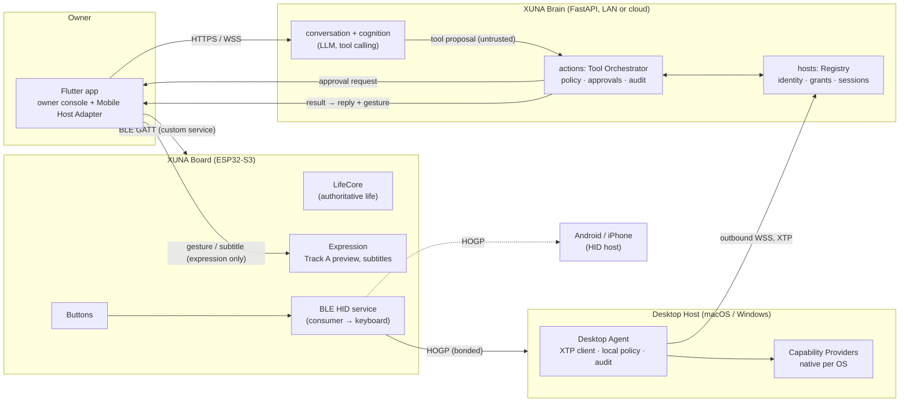
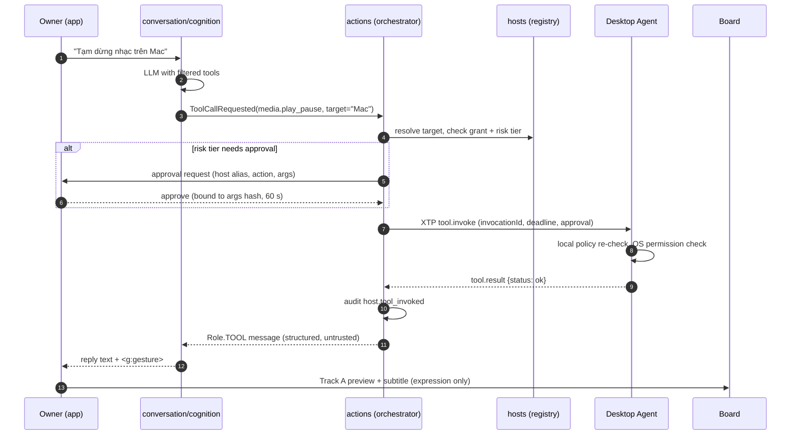
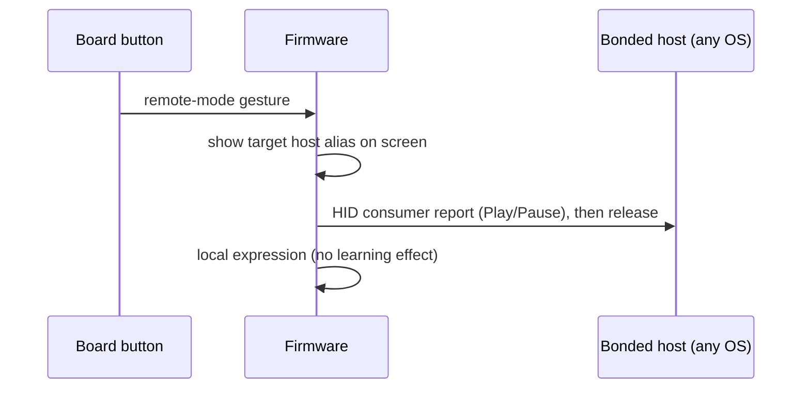
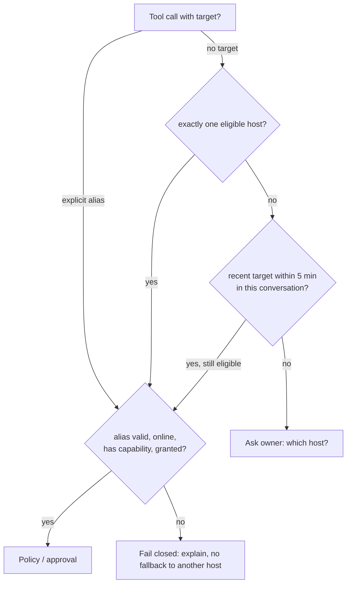

# XUNA Universal Device Control — Architecture (Proposed)

Date: 2026-10-30. **Status: decisions R1–R8 and UDC-D1…D11 Approved by the owner 2026-10-30 ([roadmap §3](../roadmap/XUNA_UNIVERSAL_DEVICE_CONTROL_ROADMAP.md#3-owner-decisions-2026-10-30)); nothing is Implemented.** Only UDC-0 and UDC-1 may start; code, dependencies and board uploads keep their normal gates.

Companion documents: [research](../research/XUNA_UNIVERSAL_DEVICE_CONTROL_RESEARCH.md) · [capability matrix](../research/XUNA_PLATFORM_CAPABILITY_MATRIX.md) · [open-source review](../research/XUNA_DEVICE_CONTROL_OPEN_SOURCE_REVIEW.md) · [security](XUNA_DEVICE_CONTROL_SECURITY.md) · [roadmap](../roadmap/XUNA_UNIVERSAL_DEVICE_CONTROL_ROADMAP.md).

## 0. Summary

XUNA keeps **one Brain** (the existing backend `conversation` + `cognition` modules) and gains the ability to act on the owner's computers and phones through **two physically different paths**:

1. **The XUNA board as a Bluetooth HID peripheral** (media keys first, keyboard later). It needs no software on the target, works on macOS, Windows, Android and iPhone, works offline, and is literally XUNA "pressing the button". Its limit: it is blind (no screen, no result).
2. **A Host Agent** on the target (Desktop Agent on macOS/Windows; the Flutter companion app as a narrow adapter on Android/iOS). It exposes typed tools over the **XUNA Tool Protocol (XTP)**, enforces its own local policy and returns structured results.

The model proposes; it never decides. Every action passes **schema validation → target resolution → grant check → (approval) → host-side re-validation → execution → audit**, and the result returns to the Brain, the app and the board's expression layer.

MCP is **not** required for the MVP. XTP tool descriptors are MCP-shaped so an MCP bridge can be added later without redesign (§6).

## 1. Starting point (verified 2026-10-30)

| Area | What exists | Status | Relevance |
|---|---|---|---|
| Brain | `cognition` port with `ToolSpec`, `ToolCall`, `ToolCallRequested`, `Role.TOOL`; `openai_compatible` adapter sends `tools` and parses streamed `tool_calls` | **Implemented at adapter level, unused**: no use case passes tools | Tool calling does not need a new provider integration |
| Brain rules | backend AGENTS §1.3 (tool arguments are untrusted), §1.4 (no device actuation from the cloud; "a device action is never a model tool"; reply-gesture exception) | Approved | Must be amended in scope before host tools exist (§9, R1) |
| Expression | Closed `ReplyGesture` set → app plays Track A preview "chỉ diễn"; speech subtitles `7a6e0010` | Implemented | Reusable for action feedback without touching life state |
| Transport | `transport` module: device WSS gateway (`/v1/devices/connect`), strict typed frames, session hub, online status, ECDSA P-256 session proof | DC-2+ host-tested; E14 **not run** | Pattern and code to reuse for Host Agent sessions |
| Identity | `UserId`, `PetId`, `BrainId`, `DeviceId` kept distinct (ADR-0008); `ProofPurpose` 1–3 | Approved/Implemented | A new `HostId` principal is needed |
| Audit / consent | Append-only `AuditEvent` with code-only metadata; consent classes U0–U4, U3V | Implemented | New actions and consent classes are additive |
| Firmware BLE | Arduino Bluedroid (`BLEDevice.h`), one custom service, **no pairing/bonding/encryption**, single connection (advertising stops while connected) | Implemented | HID needs bonding + a second concurrent connection (experiment) |
| Firmware inputs | GPIO0/GPIO14: short press = pet/shoo learning (D6 revised), holds = status card/scene, both 3 s = pairing QR, GPIO14 3 s in Egg = hatch | Implemented | No free gesture for "run workflow" or emergency stop |
| Firmware budget | RAM 18.1 %, Flash 59.9 % (`xuna_t_display_s3`, 2026-10-29) | Measured | HID fits in Flash; RAM/BLE coexistence must be measured |
| Mobile | Flutter 3.32.8, `flutter_blue_plus`, `mobile_scanner` (QR), Firebase Auth; **no custom native code, no platform channels**; iOS has no background modes; Android id `com.example.xuna_mobile` | Implemented | Android/iOS adapters are new native work |
| Prior research | No "Apple Device Control" document exists in the repository | — | This set is the first device-control research |

## 2. Vocabulary (avoids collisions with existing IDs)

| Term | Meaning |
|---|---|
| **Board** | The XUNA pet hardware (`DeviceId`). Authoritative for life, learning and personality. Never a "host". |
| **Host** | A computer or phone the owner lets XUNA act on (`HostId`, new). |
| **Host Agent** | XUNA software running on a host: Desktop Agent (macOS/Windows), Mobile Host Adapter (inside the Flutter app on Android/iOS). |
| **Capability Provider** | A native module inside a Host Agent implementing one tool family (media, apps, input, screen…). |
| **HID link** | A Bluetooth LE HID bond between the board and a host. A host can be reachable by HID, by agent, or both. |
| **XTP** | XUNA Tool Protocol: tool descriptors, invocation, results, cancellation, approvals (§5). |
| **Grant** | Owner-issued, revocable permission: host × capability × risk tier (× expiry). |
| **Approval** | One-shot owner confirmation of one invocation, bound to the exact arguments. |
| **Workflow** | An owner-registered, named, fixed sequence on a host (e.g. a macOS Shortcut). Never model-authored code. |

Using "host" for the owner's computers keeps backend invariant §1.4 meaningful: "device" continues to mean the board.

## 3. Component architecture



### 3.1 XUNA Brain (existing modules + two new ones)

- **Natural-language understanding and tool selection** stay in `conversation`/`cognition`. A turn is offered at most a small, filtered tool set: only tools that exist on an online, granted host and fit the turn mode. Tool names are generic (`media.play_pause`) with a `target` argument whose enum lists only eligible host aliases.
- **`hosts` module (new)**: host identity, enrollment, revocation, capability manifests, grants, online status (reusing the `transport` session hub pattern).
- **`actions` module (new)**: Tool Orchestrator. Validates the model's call against the host's published schema, resolves the target (§7), checks grants and risk tier, requests approvals, dispatches via XTP, applies timeouts/cancellation, records audit events and returns a structured result as a `Role.TOOL` message.
- **Memory and learning** integration is limited and explicit (§8).

The orchestrator is deterministic code. The LLM never sees credentials, never sees grant internals, and cannot raise its own permissions.

### 3.2 XUNA Device Registry (`hosts`)

| Field | Notes |
|---|---|
| `HostId` | Server-issued UUID at enrollment; separate type from `DeviceId` |
| Owner | `UserId`; a host belongs to exactly one owner |
| Alias | Owner-chosen short name ("Mac", "PC phòng làm việc"); unique per owner; used in targeting and confirmations |
| Platform | `macos` · `windows` · `android` · `ios` · (`linux` later) + OS version |
| Agent key | Public key pinned at enrollment (ECDSA P-256, reusing the existing verifier) |
| Reachability | `agent` (online/offline/last seen), `hid` (bonded to board: yes/no, last connected) |
| Capability manifest | Tool descriptors + OS permission state (granted / denied / not determined), hashed and versioned |
| Grants | Per capability family and risk tier; optional expiry; revocable |
| Status | `active` · `revoked`; revoked keys are tombstoned and never re-accepted |

The registry is **not life state**. It lives in the backend (with a read-only cache in the app). The board only knows its own HID bonds.

### 3.3 XUNA Desktop Agent

- A **per-user, interactive-session process** started at login (tray icon), never a Windows service or macOS LaunchDaemon: services run in Windows Session 0 and cannot drive the user's desktop; macOS privacy permissions (TCC) attach to the signed app bundle the user approved.
- **Dials out** to the Brain over WSS (same pattern as ADR-0010); no listening port in the MVP. A LAN-direct mode for offline use is a later milestone.
- **Shared core** (protocol client, local policy, local audit log, consent UI, emergency stop, update check) + **native providers**:
  - macOS: Swift — `NSWorkspace` (apps/URLs), `shortcuts run` (owner workflows), CGEvent system-defined media keys / `NSAppleScript` where owner-allowed, AXUIElement (UI tree), ScreenCaptureKit (screen).
  - Windows: C++/WinRT or C# — `ShellExecuteEx` / AppsFolder AUMID (apps/URLs), Global System Media Transport Controls (media sessions), `SendInput` (keys/mouse), UI Automation (UI tree), Windows.Graphics.Capture (screen).
- Local configuration is edited **on the host only** (allowlisted apps, workflows, URL domains). The Brain can read it, never write it.

### 3.4 XUNA Mobile Companion (Flutter)

Two roles in the same app:

1. **Owner console** for every host: enrollment (scan the agent's QR with the existing `mobile_scanner`), grants, approvals, revocation, emergency stop, audit view.
2. **Mobile Host Adapter** for the phone it runs on, through platform channels:
   - Android (Kotlin): MediaSession control via `NotificationListenerService` access (the documented way to get other apps' `MediaController`s), intents/deep links, `CompanionDeviceManager` association with the board (background-start exemption and presence wake-up — to be verified in UDC-5), `connectedDevice` foreground service type on Android 14+. Accessibility only in a **separate non-Play/dev flavour**: Play policy explicitly prohibits Accessibility functionality that lets an app "autonomously initiate, plan, and execute actions", which is exactly LLM-driven phone control.
   - iOS (Swift): App Intents/Shortcuts exposure, URL schemes/universal links, CoreBluetooth background mode, `retrieveConnectedPeripherals` to attach to the board while iOS holds its HID link. No control of other apps' UI, notifications or playback beyond Apple Music.

On iPhone, the **board is more capable than the app**: HID (media keys, keyboard, pointer with AssistiveTouch) plus AMS/ANCS. The iOS adapter is mostly about Shortcuts and confirmations.

### 3.5 XUNA Firmware

| Function | Proposal |
|---|---|
| BLE HID | Add a HID-over-GATT service (consumer control report first; keyboard report later behind authentication). **PoC on the current stack:** Bluedroid with the Arduino core's bundled `BLEHIDDevice`/`BLESecurity` (no new library) and XUNA's own report map taken from the CC0 ESP-IDF `esp_hid_device` example. **Separate decision:** migrate the whole BLE layer to NimBLE-Arduino 2.5.x (claimed large RAM/Flash savings, relevant to E14; but every custom characteristic moves and core 2.0.14 compatibility is unverified). The two stacks cannot coexist. |
| Pairing | HOGP requires bonding and encrypted HID characteristics. Use **LE Secure Connections with numeric comparison**: the board shows the 6 digits and the owner confirms with a button (IO capability DisplayYesNo); passkey display is the fallback. Never Just Works. One active HID host at a time; switching is explicit and shown on screen. Report XUNA's own PnP vendor ID, never another company's. |
| iPhone media / notifications | The board, as a GATT client over a bonded link, can use Apple's **AMS** (control media apps, read playing state) and **ANCS** (notifications) — accessory-only services an iOS app cannot use. AMS is a strong iPhone media path; ANCS content falls under consent U6. Research item, not MVP. |
| Concurrency | App (custom service) and one HID host connected at the same time — must be proven in an experiment (RAM, Wi-Fi/E14 coexistence, reconnect). |
| Inputs | A new, unambiguous gesture for "remote mode" or "workflow slot" (owner decision; must not collide with D6 pet/shoo learning). |
| Feedback | Action results arrive as the existing reply-gesture / subtitle path: expression only, no change to needs, drives, personality, learning or snapshot. |
| Discovery | Board does not discover hosts on the network; hosts are known via the app/registry. |

## 4. End-to-end flows

### 4.1 Voice/text request → desktop action



### 4.2 Offline: board button → media key on the bonded host



No Brain, no network, no app. This is the only path that works for all four platforms without installing anything, and it is the first proof of concept.

### 4.3 Routing rule

For a resolved target and capability, the orchestrator prefers **agent** (has results and policy) over **HID** (blind). **UDC-D6 (owner 2026-10-30):** the model may route a **media key** to the board's HID link, but every single press needs owner confirmation; the route is orchestrator → app → authenticated BLE (UDC-2) → board, and the board re-validates the opcode. Keyboard text and pointer reports stay outside model reach.

## 5. XUNA Tool Protocol (XTP) v1 — summary (normative contract: [XUNA_XTP_V1_CONTRACT.md](XUNA_XTP_V1_CONTRACT.md))

> **Normative specification:** [XUNA_XTP_V1_CONTRACT.md](XUNA_XTP_V1_CONTRACT.md) defines the authoritative wire frames, handshake (`xuna/hello`, `xuna/challenge`, `xuna/proof`, `xuna/enrollPending`, `xuna/enrolled`, `xuna/ready`), MCP-shaped session methods (`tools/list`, `tools/call`, `notifications/cancelled`, `notifications/progress`, `notifications/tools/list_changed`, `xuna/stop`, `ping`), error/close codes, size limits (≤ 64 KiB frame, ≤ 16 KiB `structuredContent`), timeouts (10 s handshake, 10 s default call, 30 s heartbeat × 2), canonical JSON `argsSha256`, and MVP tool schemas. Fix changes in `XUNA_XTP_V1_CONTRACT.md` rather than duplicating them here.

Envelope: **JSON-RPC 2.0** over WSS (agent → Brain, outbound), strict schemas, `xtp/1` negotiated in the handshake. Frame size limit and unknown-field rejection follow the device-gateway rules.

| Message | Direction | Content |
|---|---|---|
| `session.hello` | agent → brain | `hostId`, agent version, platform, OS version, `protocols: ["xtp/1"]`, manifest hash |
| `session.challenge` / `session.proof` | both | 32-byte nonce; signature over `xuna.host.proof.v1` domain (same construction as `ProofPurpose.SESSION`) |
| `host.manifest` | agent → brain | Tool descriptors (below) + OS permission state |
| `tool.invoke` | brain → agent | `invocationId`, `tool`, `toolVersion`, `args`, `deadlineMs`, `idempotencyKey`, `approval?` |
| `tool.progress` | agent → brain | Optional step/percent, never screen content unless consented |
| `tool.result` | agent → brain | `status` (`ok` · `denied` · `needs_permission` · `invalid_args` · `failed` · `timeout` · `cancelled`), `output` (schema-bound), `durationMs`, `errorCode` |
| `tool.cancel` | brain → agent | `invocationId`; agent stops at the next safe point |
| `host.stop` | brain → agent (also local) | Emergency stop: cancel all, release held keys/buttons, end computer-use sessions |
| `ping` / `pong` | both | Heartbeat; a lost heartbeat aborts any interactive session |

Tool descriptor (MCP-compatible fields plus XUNA policy fields):

```json
{
  "name": "media.play_pause",
  "version": 1,
  "description": "Toggle playback of the active media session.",
  "inputSchema": {"type": "object", "properties": {}, "additionalProperties": false},
  "outputSchema": {"type": "object", "properties": {"state": {"enum": ["playing", "paused", "unknown"]}}},
  "xuna": {"risk": "R1", "family": "media", "observes": false, "reversible": true, "permission": "granted"}
}
```

Rules: `invocationId` is unique; repeated `idempotencyKey` returns the first result; every invocation has a deadline (default 10 s, computer-use steps 30 s); an approval is bound to `(invocationId, tool, sha256(canonical args), hostId, expiresAt)` so arguments cannot change after the owner confirms. Risk tiers are defined in the [security document](XUNA_DEVICE_CONTROL_SECURITY.md) §3.

Initial tool families (MVP in bold):

| Family | Tools | Risk |
|---|---|---|
| **media** | `play_pause`, `next`, `previous`, `volume_set`, `now_playing` | R0–R1 |
| **app** | `launch` (allowlisted app id), `focus`, `list_allowed` | R1–R2 |
| **url** | `open` (https only, domain policy) | R2 |
| **workflow** | `run` (owner-registered name), `list` | R2–R3 per workflow |
| **host** | `status`, `notify` (show a local notification) | R0–R1 |
| screen / ui | `capture`, `inspect` (consent U5) | R2 |
| input | `key`, `type_text`, `click`, `scroll` (computer-use sessions only) | R2–R3 |
| files | `reveal`, `open` within owner-chosen folders | R3 |

There is **no `shell.exec`, `powershell`, `osascript` source, `eval` or arbitrary command tool** at any milestone.

## 6. Protocol and transport comparison

| Option | Strengths | Weaknesses for XUNA | Verdict |
|---|---|---|---|
| **MCP** (JSON-RPC 2.0; stdio or Streamable HTTP; OAuth for HTTP) | Ecosystem, tool schema and annotation conventions, many ready servers | Designed for an AI client calling servers it launches or reaches; remote MCP means the host **listens** and needs OAuth; tool annotations are hints, not enforcement; no notion of owner approval bound to args, multi-host targeting or emergency stop | **Optional bridge**, not the core |
| **Custom JSON-RPC 2.0 (XTP)** | Request/response IDs, notifications, cancellation idiom; same envelope as MCP so descriptors map 1:1 | We own the spec and its tests | **Core envelope** |
| HTTP REST | Simple, cacheable | Host would need inbound reachability (NAT, firewall), polling for results | Enrollment/registry APIs only |
| **WebSocket (WSS)** | Outbound from host, full duplex, already used by voice and the device gateway | Long-lived sockets per host | **Transport for XTP** |
| BLE GATT | Local, offline, already used board ↔ app | Short range, low throughput, the board is not a router for host traffic | Board ↔ app only; HID via standard HOGP |

**Where MCP fits:**

1. **Inside the Brain — no (MVP).** `cognition` already speaks native function calling; adding an MCP client adds a hop and moves policy into a generic layer.
2. **Inside the Desktop Agent — yes, as an internal provider interface (UDC-8).** For computer use the agent can run a vetted driver (Cua Driver, MIT) as a **child process over MCP stdio** and expose only the driver tools that XUNA's policy allows. MCP stdio needs no network auth (the spec says stdio servers take credentials from the environment), and the driver never faces the Brain directly.
3. **Optional later:** expose the agent as a *local stdio MCP server* so the owner's other AI tools reuse XUNA's policy-guarded tools (Idea).
4. **Never** an inbound network MCP endpoint on a host: MCP Streamable HTTP would need OAuth 2.1, Origin validation and NAT traversal, and the reviewed servers that offer it (e.g. Windows-MCP) also enable PowerShell/registry tools by default.

**XTP versus "MCP framing over outbound WSS".** The current MCP revision (2026-07-28) removed protocol-level sessions and allows custom transports that reuse stdio framing, so an alternative is to make XTP *literally* MCP (`tools/list`, `tools/call`, `notifications/cancelled`, progress) over the agent's outbound WSS, with XUNA-specific data (approval token, risk tier, `hostId`) in `_meta` and XUNA-only methods (`session.proof`, `host.stop`) alongside. This is decision UDC-D10; recommendation: **use MCP method names and result shapes wherever they fit**, keep XUNA's own handshake and stop methods, and do not depend on an MCP SDK in the backend until it is needed.

## 7. Multi-host targeting and orchestration



- **No implicit fallback** to another host and **no broadcast** except `host.stop`.
- Every approval prompt and every board subtitle names the host alias ("Mac") and the action.
- Owner-confirmed defaults ("nhạc thì mở trên Mac") are stored as conventions (§8) and used only as a tie-breaker, never to skip confirmation for R2+.
- Capability-based choice: if only one host can do the action (e.g. only Windows has the "Spotify" app allowlisted), it is chosen and named in the reply.
- HID ambiguity: only one HID host is connected at a time; the board screen shows which.

Cross-device workflows are composed by the orchestrator from single-host steps, each with its own target, deadline and approval. Feasible hand-offs: a URL (desktop browser → phone deep link/notification), "continue media on X" (pause here, open the same URI there). Arbitrary app-state transfer between operating systems is **not** feasible and not promised.

## 8. Brain, Memory and Learning integration

| Integration | Rule |
|---|---|
| Action results | Structured `Role.TOOL` messages to the model, then a reply with an optional reply gesture. Deterministic mapping of `status` → gesture (e.g. `ok` → `bounce_play`, failure → `look_around`) is a proposal. |
| Board expression | Expression only (Track A preview, subtitles). **No** needs, drives, personality, learning or snapshot change from host actions. Making task outcomes affect mood is a separate decision (open). |
| Memory | Host aliases, owner defaults and confirmed workflows are **owner-confirmed conventions** (reuse KX-4 working conventions), correctable and deletable. Action logs are audit records, not memories, and are content-free. |
| Learning | Routine learning (`HabitPredictor`) may later produce **suggestions** ("Đến giờ nhạc tối, mở trên Mac nhé?") that the owner confirms. A suggestion never executes by itself. |
| Bond level | May change **how often XUNA offers** help with digital tasks. It **never widens permissions**: grants are explicit owner actions only. |
| Personality | Personality may shape wording and expression of results; never whether an action runs. |

## 9. Existing decisions revised (owner 2026-10-30: all Approved as proposed; R1 amended by UDC-D6)

| ID | Current rule | Why it conflicts | Proposed revision |
|---|---|---|---|
| R1 | backend AGENTS §1.4 "No device actuation from the cloud… a device action is never a model tool" | Host tools are model tools that cause real-world effects; HID output is board actuation | **Approved 2026-10-30:** **host actions** are a separate class allowed only through the `actions` orchestrator + host-side re-validation. **Second exception (UDC-D6):** board HID media keys, one owner confirmation per press. Nothing that changes board life state joins this |
| R2 | AGENTS §4 roadmap M01–M07; "Later: only after validation and explicit priority change" | Device control is not on the roadmap | Owner decides whether a UDC track runs in parallel and from which milestone |
| R3 | ADR-0008 identity set (`UserId`, `PetId`, `BrainId`, `DeviceId`) | Hosts are a new principal | Add `HostId`; never derive authority from it alone |
| R4 | ADR-0010 "up only (H2)" for the board session | Host agents receive downlink commands | New ADR for host sessions; board session stays up-only |
| R5 | Consent classes U0–U4, U3V | Screen/UI content and phone notifications would go to the LLM | Add **U5 `host_screen`** and **U6 `host_notifications`**, default off, never stored |
| R6 | Custom BLE service has no authentication | Adding keyboard HID would let anyone in BLE range type into a bonded PC via the board | Authenticate the app ↔ board channel before any keyboard report or button-triggered workflow |
| R7 | Button map (D6 revised: short press within 10 s = pet/shoo) | Remote/workflow/e-stop gestures need inputs | Owner chooses a gesture or a "remote mode" scene |
| R8 | Repository topology (firmware/mobile/backend) | Desktop Agent needs a home | New submodule (proposed `desktop/` → `xthao28/xuna_desktop`) |

## 10. Shared versus platform-specific

| Shared (one implementation) | Platform-specific (must be native) |
|---|---|
| XTP schemas, conformance fixtures, golden vectors | Input injection (CGEvent / SendInput / Android gestures / none on iOS) |
| Tool catalog and risk tiers | Screen capture (ScreenCaptureKit / Windows.Graphics.Capture / MediaProjection / none) |
| Orchestrator, registry, approvals, audit (backend) | UI inspection (AXUIElement / UI Automation / AccessibilityNodeInfo / none) |
| Agent core: session, policy, local audit, e-stop, consent UI (one codebase for desktop; Dart shared with mobile where practical) | Media control (CGEvent media keys or AppleScript / GSMTC / MediaController / Apple Music only) |
| Targeting and confirmation UX in the app | App launch, packaging, signing, autostart, OS permission onboarding |
| Board HID descriptor and pairing UX | OS permission state detection (TCC, UIPI, Play policy) |

## 11. Recommended implementation strategy (summary; details in the research document §7)

- **MVP:** Strategy **E (hybrid)**: shared protocol + backend orchestrator + a Desktop Agent with a thin shared core and native providers, plus board BLE HID. Proposed agent shell: **Flutter desktop** (reuses the team's Dart/Clean Architecture and the mobile protocol code) with Swift (macOS) and C++/WinRT (Windows) providers via platform channels for the small MVP tool set (media, apps, URLs, workflows). Windows first (the development machine), macOS second. The agent is a **signed app** that owns the OS permissions (TCC grants attach to the responsible app identity, not to a script path).
- **Long term:** keep E and add **D only as a provider**: for computer use, embed a pinned **Cua Driver** (MIT; avoid its AGPL perception extension) as an MCP-stdio child process behind XUNA's policy, using its "bounded" permission mode and the embedding guidance for TCC identity. Borrow munim-computer-use's fail-closed allow/ask/block policy file and zavora's one-shot approval ledger as design patterns. Add the LAN-direct offline mode and a Linux agent later.
- **Not recommended as a base:** taking any computer-use MCP server as the whole agent (they expose shell/PowerShell/registry tools, telemetry or unauthenticated HTTP in their defaults, and most are single-maintainer; see the open-source review), or a Python/Node agent for distribution (TCC attribution to an interpreter, packaging, antivirus false positives). Python remains fine for throwaway protocol experiments on the dev machine.
