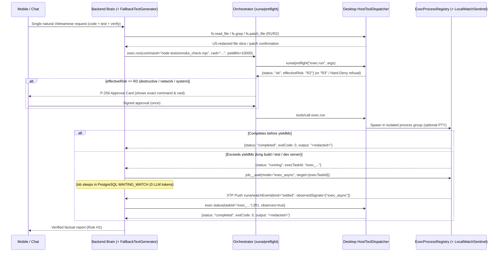

# XUNA Wave 3 — Power-User Shell (`exec.*`), Direct File I/O (`fs.*`) & Brain Fluency

Date: 2026-11-25. **Status: Approved (owner 2026-11-25); W3-M0–W3-M4 Implemented 2026-11-25 (automated suites on Windows; see PROCESS.md); W3-M5 live macOS verified 2026-11-25; live Windows desktop verified 2026-11-26 (exec/fs/mcp/E-Stop; `fs.*` default-policy gap open) — see PROCESS.md.**

Companion documents:
[ADR-0018 (Power-User Shell & Direct File I/O)](../decisions/ADR-0018-power-user-shell-and-direct-fs.md) ·
[ADR-0017 (Async Watch & Wake)](../decisions/ADR-0017-async-watch-and-wake.md) ·
[ADR-0015 (Commit-Gated Control & Autopilot Amendment 2026-11-22)](../decisions/ADR-0015-commit-gated-control-and-trusted-scopes.md) ·
[XUNA Async Watch & Wake Wave 1](XUNA_ASYNC_WATCH_AND_WAKE.md) ·
[XUNA Async Watch & Wake Wave 2](XUNA_ASYNC_WATCH_WAVE2_PROTOCOL.md) ·
[XUNA XTP v1 Normative Wire Contract](XUNA_XTP_V1_CONTRACT.md) ·
[XUNA Honest-Code Rules](XUNA_HONEST_CODE_RULES.md) ·
[Root AGENTS.md](../../AGENTS.md) ·
[Backend AGENTS.md](../../backend/AGENTS.md) ·
[Desktop AGENTS.md](../../desktop/AGENTS.md) ·
[Mobile AGENTS.md](../../mobile/AGENTS.md).

---

## 1. Objective & Owner Decisions (2026-11-25)

Wave 1 (`AW-M1–AW-M6`) and Wave 2 (`AW2-M1–AW2-M5`) gave XUNA native event-driven OS watchers (`FSEvents`/`AXObserver`/`libproc`/CDP), `WAITING_WATCH` 0-token sleep, opt-in MCP/ACP stdio harnesses, and reliable macOS native IDE prompt delivery (`deliverMacIdePromptNative`).

Live multi-step testing on `2026-11-24`–`2026-11-25` against `/Users/xthao28/Projects/physical-ai-venture` exposed two remaining practical gaps behind **OpenClaw (Clawbot)**:
1. **No direct local execution loop:** XUNA had to route all coding/verification indirectly through GUI clipboard/AX injection into an external IDE (`workspace.coding_agent`) and could neither read file contents nor run test suites (`node`, `pytest`, `flutter test`) directly.
2. **Brain & tool friction:** `mcp.list_servers` hid inner `tools/list` schemas (forcing LLM tool-name guessing), `workspace.coding_agent` sat at catalog slot 141 (burning 3 cold-start discovery turns), `prompts.py` lacked concise `autonomous_job` escalation guidance, and cognition had no secondary-model failover when hitting a provider's daily RPD cap.

On `2026-11-25`, the project owner approved **Wave 3 (`ADR-0018`)** with three explicit decisions:
- **Decision A1 — Full Power-User Shell + Direct File I/O:** Support whole-machine shell/PTY execution (including pipes/scripts) and direct filesystem inspection/editing, while keeping **Hard-Deny** (`sudo`, Keychain/Password Manager, `~/.ssh`/secret vaults, catastrophic commands) and **`R3` phone-signed approval** (destructive mutations, outbound network, system/dotfile changes, obfuscated execution) strictly enforced even under `autopilot`.
- **Decision A2 — Two Bundled Pillars:** Ship **Pillar 2 (Brain & Tool Fluency)** and **Pillar 1 (Direct Dev Loop: `fs.*` + `exec.*` + PTY/Watch)** together in Wave 3.
- **Decision A3 — Strict Local-Only Opt-In:** Enabling/configuring `shellControl` is **strictly local** on the desktop machine (`host-policy.json` / Desktop UI), mirroring Wave 2's `protocolHarnesses` boundary. Remote `PUT /v1/hosts/{id}/policy` and `xuna/set_policy` MUST NEVER enable or weaken `shellControl`.

---

## 2. Six Non-Negotiable Wave 3 Invariants

1. **Legacy Raw-Shell Ban Preserved (`ADR-0018` §1):**
   - `FORBIDDEN_TOOLS` and `FORBIDDEN_TOOL_PREFIXES` (`shell.*`, `powershell.*`, `osascript.*`, `eval.*`, `script.*`, `cmd.*`, `bash.*`, `keyboard.*`, `pointer.*`) remain strictly rejected everywhere.
   - All new execution goes exclusively through audited, schema-strict **`exec.*`** (`ToolFamily.exec`) and **`fs.*`** (`ToolFamily.files`) with mandatory host-side `xuna/preflight`.
2. **Dual Gate for `exec.*` (Local Opt-In + Explicit Grant):**
   - `HostPolicy.shellControl.enabled` defaults to **`false`** on every host.
   - Remote policy writes (`PUT /v1/hosts/{id}/policy`, `xuna/set_policy`) reject payloads containing `shellControl` (`422` / `policy_blocked`) and preserve existing local `shellControl` verbatim when saving other policy fields.
   - `ToolFamily.exec` is **NOT granted by default**; a host can execute `exec.*` ONLY when BOTH `shellControl.enabled == true` locally AND an active `exec` grant covers the effective risk returned by `xuna/preflight`.
3. **Host Authority on Classification (Rule H5 — Fail-Closed):**
   - Risk classification (`Hard-Deny` / `R3` / `R2` / `R1`) lives in `xuna_xtp` (`ExecCommandClassifier`, `FsPathGuard`) and runs inside Desktop `xuna/preflight` AND again inside tool execution (`HostToolDispatcher` re-validates on execution so TOCTOU or modified args cannot bypass preflight).
   - Backend Orchestrator MUST NEVER lower a risk returned by `xuna/preflight`. Unparseable, ambiguous, or obfuscated shell commands fail closed to **`R3`** (or Hard-Deny if matching elevation/secret/catastrophic rules).
4. **Bounded Resources, Process-Group Isolation & Immediate E-Stop:**
   - `ExecProcessRegistry` enforces `maxConcurrentExecTasks = 4` (`exec_task_limit_reached`), RAM-only rolling output buffer (`<= 64 KiB` internal, `<= 16 KiB` U5-redacted per tool response), completed retention TTL `5 minutes` (max `16` entries, zero disk persistence).
   - Every child runs in its own process group (POSIX `setsid`/pgid wrapper + optional PTY; Windows process tree kill `taskkill /T /F`). E-Stop kills every active process group within `< 500 ms` (`0` orphan PIDs) and cancels all `exec_async` watches.
5. **Consent `U5`, Zero Retention & Zero Hardcoding (Rules H1–H6):**
   - All `fs.read_file`, `fs.grep`, `exec.run`, `exec.status`, and `mcp.list_servers` outputs pass through U5 secret redaction (`redactSensitiveText` / `redactBrowserSnapshot`) and strict UTF-8 byte caps (`<= 16 KiB` per call).
   - `xuna/watchEvent` for `exec_async` remains 100% content-free (`observedSignals: ["exec_async"]`, `changeCount`, `elapsedSeconds`, `errorCode?` — zero stdout/stderr/paths).
   - Zero hardcoded app/repo/vendor names or Vietnamese intent keyword tables in generic layers (`prompts.py`, `catalog.py`, `orchestrator.py`, `watch_coordinator.py`).
6. **Zero Scope Bloat & Clean Boundaries (Rules H7–H10):**
   - **0 new Alembic migrations** (`host_grants.family` is already `VARCHAR(16)`).
   - **0 B diff** in `firmware/`, `mobile/.fvmrc`, `desktop/.fvmrc`, and all `pubspec.lock` files.
   - Keep `backend/src/xuna_backend/modules/actions/application/workflows.py` at **`0` diff**, `redaction.py` untouched (reuse existing redactors), and every new module **`<= 450 LOC`**.
   - `mobile/` changes are strictly scoped to `HostToolFamily.exec` enum/mapper + synchronized L10n (`vi_VN.json`, `en_US.json`, `locales.g.dart`).

---

## 3. End-to-End Architecture & Async `exec` Flow



---

## 4. Detailed Technical Specifications

### 4.1 Local-Only `HostPolicy.shellControl` (`xuna_xtp` + `desktop` + `backend`)

Add additive optional field `shellControl` to `HostPolicy` in `desktop/packages/xuna_xtp/lib/src/policy/policy_models.dart`:

```json
{
  "shellControl": {
    "enabled": false,
    "allowPty": true,
    "defaultTimeoutSeconds": 30,
    "maxTimeoutSeconds": 300,
    "maxConcurrentTasks": 4,
    "workspaceRoots": []
  }
}
```

- **Strict validation (`additionalProperties: false`):**
  - `enabled`: `bool` (default `false`).
  - `allowPty`: `bool` (default `true`).
  - `defaultTimeoutSeconds`: `int`, `5..120` (default `30`).
  - `maxTimeoutSeconds`: `int`, `30..900` (default `300`, must be `>= defaultTimeoutSeconds`).
  - `maxConcurrentTasks`: `int`, `1..4` (default `4`).
  - `workspaceRoots`: `List<String>` (optional local roots used ONLY to classify whether a write/patch/command is inside a known workspace (`R2`) vs outside workspace (`R3`); never serialized to remote wire `xuna/get_policy` or logs!).
- **Wire visibility (`xuna/get_policy`):** expose ONLY the sanitized boolean summary `shellEnabled: bool` (never `workspaceRoots` or local paths).
- **Remote write rejection:**
  - `PUT /v1/hosts/{id}/policy` (`backend/src/xuna_backend/modules/hosts/api/routes.py`) rejects any body containing `shellControl` / `shell_control` with HTTP `422`.
  - `HostToolDispatcher` (`xuna/set_policy`) preserves `currentPolicy?.shellControl ?? const ShellControlPolicy.disabled()` verbatim and rejects unknown/forbidden keys.

### 4.2 Direct File I/O Tool Contracts (`ToolFamily.files`)

All 5 tools enforce `additionalProperties: false`, normalize real paths via symlink resolution (`File.resolveSymbolicLinksSync` where existing, plus parent resolution for new files), and run `FsPathGuard` BEFORE touching disk:

- **Hard-Deny path rules (`FsPathGuard`):**
  - Reject any path resolving inside or pointing to: `~/.ssh`, `~/.gnupg`, `~/.aws`, `~/.kube`, `~/.netrc`, `~/.docker/config.json`, `~/Library/Keychains`, `~/Library/Application Support/1Password`, `~/Library/Application Support/Bitwarden`, `~/Library/Application Support/KeePassXC`, `/etc/shadow`, `/etc/sudoers`, `/etc/sudoers.d`, `C:\Windows\System32\config\SAM`, or `.git/config` credential helpers.
  - For `.env`, `.env.*`, `*.pem`, `*.key`, `*.p12`, `id_rsa*`, `id_ed25519*`: Hard-Deny on `fs.read_file`/`fs.grep` unless explicitly allowed (default Hard-Deny in Wave 3 so prompt injection can never exfiltrate API keys!).
  - `fs.write_file` / `fs.patch_file` targeting dotfiles (`~/.zshrc`, `~/.bashrc`, `~/.profile`, `~/.gitconfig`, `/etc/*`) or paths outside `workspaceRoots` (when configured, or outside user-indexed workspaces) are elevated to **`R3`** by `xuna/preflight` (or Hard-Deny if matching Hard-Deny paths).

| Tool | Risk / Observes | Input Schema (exact keys) | Output Schema (exact keys) |
| --- | --- | --- | --- |
| `fs.list_files` | `R1`, `observes: true` | `path` (req, 1..512), `glob?` (1..128), `maxDepth?` (1..6, default 3), `maxEntries?` (1..200, default 100) | `entries` (`[{path, kind: "file"\|"dir", sizeBytes?}]`), `truncated` (`bool`), `totalReturned` (`int`) |
| `fs.read_file` | `R1`, `observes: true` | `path` (req, 1..512), `startLine?` (>=1, default 1), `endLine?` (>=1, max window 400 lines) | `content` (U5-redacted, `<= 16384 B`), `startLine`, `endLine`, `totalLines`, `truncated` (`bool`) |
| `fs.grep` | `R1`, `observes: true` | `path` (req, 1..512), `pattern` (req, 1..256), `isRegex?` (`bool`, default `false`), `glob?` (1..128), `maxMatches?` (1..100, default 50) | `matches` (`[{path, line, text}]`, redacted), `truncated` (`bool`), `totalReturned` (`int`) |
| `fs.write_file` | `R2` (preflight `R3` outside workspace / dotfiles), `reversible: false` | `path` (req, 1..512), `content` (req, `<= 262144 B`), `createParents?` (`bool`, default `true`), `overwrite?` (`bool`, default `true`) | `bytesWritten` (`int`), `created` (`bool`), `sha256` (64-hex) |
| `fs.patch_file` | `R2` (preflight `R3` outside workspace / dotfiles), `reversible: false` | `path` (req, 1..512), `target` (req, 1..65536), `replacement` (req, 0..65536), `replaceAll?` (`bool`, default `false`) | `replacements` (`int`), `bytesWritten` (`int`), `sha256` (64-hex) |

- **Rule H3 honesty on `fs.patch_file`:** if `target` occurs `0` times → fail with `patch_target_not_found`; if `target` occurs `> 1` times and `replaceAll != true` → fail with `patch_target_ambiguous` (never silently replace the first match!).
- **Atomic writes:** `fs.write_file` and `fs.patch_file` write to a sibling temp file and rename atomically, refusing symlinks pointing into Hard-Deny paths.

### 4.3 Power-User Shell & Background PTY Tool Contracts (`ToolFamily.exec`)

| Tool | Risk / Observes | Input Schema (exact keys) | Output Schema (exact keys) |
| --- | --- | --- | --- |
| `exec.run` | Manifest `R2` (preflight elevates to `R3` or refuses Hard-Deny), `observes: true`, `reversible: false` | `command` (req, 1..4096), `cwd?` (1..512), `timeoutMs?` (1000..300000, default 30000), `yieldMs?` (500..60000, default 10000), `pty?` (`bool`, default `false`) | `status` (`"completed"\|"running"\|"failed"\|"timed_out"\|"cancelled"`), `execTaskId?`, `exitCode?`, `output` (U5-redacted `<= 16384 B`), `truncated` (`bool`), `durationMs` (`int`) |
| `exec.status` | `R1`, `observes: true` | `taskId` (req, `^exec_[a-zA-Z0-9_-]{1,64}$`), `tailBytes?` (256..16384, default 8192) | `taskId`, `status`, `exitCode?`, `output` (U5-redacted), `truncated`, `elapsedMs` |
| `exec.write_stdin` | Manifest `R2` (preflight `R3` if parent task was `R3`), `reversible: false` | `taskId` (req), `input` (req, 0..2048), `appendNewline?` (`bool`, default `false`), `eof?` (`bool`, default `false`) | `taskId`, `status`, `bytesWritten` (`int`) |
| `exec.cancel` | `R1`, `reversible: false` | `taskId` (req) | `taskId`, `status` (`"cancelled"\|"already_finished"`), `signalSent` (`bool`) |

#### `ExecCommandClassifier` (`desktop/packages/xuna_xtp/lib/src/policy/exec_command_classifier.dart`)
Pure, deterministic, unit-tested command lexer/classifier (never uses regex-only superficial matching; strips quotes/escapes properly and inspects every pipeline/chained segment split by `|`, `&&`, `||`, `;`, newline, and subshells `$(...)` / `` `...` ``):
1. **Hard-Deny (`status: "denied"`, `errorCode: "exec_hard_denied"`):**
   - Any segment invoking privilege escalation: `sudo`, `su`, `doas`, `pkexec`, `runas`, `osascript` containing `administrator privileges`, `chmod` setting `+s`/`4755`/`2755`.
   - Any segment referencing Keychain/credential commands or Hard-Deny paths: `security` (`find-generic-password`, `find-internet-password`, `dump-keychain`, `export`), `op` (1Password CLI), `bw` (Bitwarden CLI), `keepassxc-cli`, or paths matching `~/.ssh`, `~/.gnupg`, `~/.aws/credentials`, `~/.kube`, `~/Library/Keychains`, `/etc/shadow`, `/etc/sudoers`.
   - Catastrophic commands: `rm` with recursive+force targeting `/`, `/*`, `~`, `$HOME`, `$USER`, `..`; `mkfs*`; `dd` with `of=/dev/`; `diskutil eraseDisk`/`eraseVolume`; `shutdown`/`reboot`/`halt`/`poweroff`; fork bomb signatures.
2. **`R3` Phone-Signed Approval (`effectiveRisk: RiskTier.r3`):**
   - Destructive file/process/system ops: `rm`, `rmdir`, `unlink`, `shred`, `chmod`, `chown`, `chgrp`, `mv` overwriting or targeting outside workspace, `kill`, `pkill`, `killall`, `launchctl`, `systemctl`, `sc`, `net stop`, `diskutil`, `defaults write`, `git push`, `git reset --hard`, `git clean`, `git checkout --`, `git branch -D`, `docker rm`/`rmi`/`system prune`, `brew`/`npm`/`pnpm`/`yarn`/`pip`/`cargo` `uninstall`/`remove`.
   - Outbound network & remote publishing: `curl`, `wget`, `http`, `ssh`, `scp`, `sftp`, `rsync`, `nc`, `ncat`, `netcat`, `telnet`, `ftp`, `dig`, `nmap`, `gh` (mutating subcommands `pr create`/`merge`/`issue`/`release`/`repo`), `npm publish`, `twine upload`, `docker push`, `aws`, `gcloud`, `az`, `firebase deploy`.
   - Package installation / global environment mutation: `brew install`, `npm install -g`, `pip install` (outside active venv), `apt`/`yum`/`winget`/`choco` install.
   - Obfuscation / dynamic execution / remote pipe: `eval`, `source` remote, `base64 -d` piped into any shell/interpreter, `curl`/`wget` piped to `sh`/`bash`/`zsh`/`python`/`node`, inline interpreter `-c`/`-e` containing network/delete/env-dump tokens, or any command containing `$(...)` / `` `...` `` subshells that cannot be positively classified as read-only/local.
   - Any command whose `cwd` is outside configured `workspaceRoots` AND performs writes (`>`, `>>`, `tee`, `sed -i`, `perl -i`, `touch`, `mkdir`, `cp`).
3. **`R2` (auto-run under `autopilot`; prompted under `standard`/`strict`):**
   - Clean local dev/inspection/build/test commands passing (1) and not triggering (2): e.g., `node`, `npm`/`pnpm`/`yarn`/`bun` (`test`, `run`, `build`, `lint`, `typecheck`, `--version`), `pytest`, `ruff`, `mypy`, `python3 <local_script>`, `flutter`/`dart` (`test`, `analyze`, `build`, `format`), `cargo` (`test`, `check`, `build`, `clippy`), `go` (`test`, `build`, `vet`), `make`, `cmake`, `xcodebuild test`, `git` (`status`, `diff`, `log`, `show`, `branch`, `add`, `commit`, `stash`), `ls`, `pwd`, `find`, `rg`, `grep`, `cat`, `head`, `tail`, `wc`, `sort`, `uniq`, `diff`, `jq`, `sed` (without `-i`), `awk`, `env` (WAIT: `env`/`printenv`/`set` MUST be **Hard-Deny or R3 + U5 redacted** because printing all env vars dumps API keys! Classify bare `env`/`printenv`/`export -p` as **Hard-Deny (`exec_env_dump_forbidden`)**!).
   - **Critical security note:** `exec.run` spawns child processes with a **sanitized environment allowlist** (`PATH`, `HOME`, `USER`, `LANG`, `LC_ALL`, `TERM`, `TMPDIR`, `PWD`, `SHELL`, toolchain vars like `NVM_DIR`/`FVM_CACHE_PATH`/`VIRTUAL_ENV`/`GOPATH`/`CARGO_HOME`) — stripping `XUNA_*`, `OPENAI_*`, `GEMINI_*`, `GROQ_*`, `AWS_*`, `ANTHROPIC_*`, `GITHUB_TOKEN`, `FIREBASE_*` from the child process environment by default so even an accidental `echo $GEMINI_API_KEY` returns empty!

#### Process-Group Isolation & PTY (`desktop/lib/features/exec/exec_process_registry.dart`)
- **macOS / Linux:**
  - Non-PTY (`pty: false`): launch via `Process.start('/bin/zsh', ['-lc', command], workingDirectory: cwd, environment: sanitizedEnv)` wrapped in its own process group (using a tiny native Swift/C `posix_spawn` with `POSIX_SPAWN_SETPGROUP` via `XunaHostChannel` or `/usr/bin/python3` / native Swift helper in `XunaHostPlugin+Exec.swift` — prefer **native Swift `XunaHostPlugin+Exec.swift`** on macOS so we get real `forkpty()`/`openpty()` + `setsid()` + `kill(-pgid, SIGTERM/SIGKILL)` with zero Python dependency!).
  - PTY (`pty: true`): native `openpty()`/`forkpty()` in Swift (`XunaHostPlugin+Exec.swift`) streaming output chunks back into Dart `ExecProcessRegistry` (UTF-8 safe, rolling 64 KiB buffer).
- **Windows:** `Process.start('cmd.exe', ['/c', command], ...)` (or ConPTY if implemented later; if `pty: true` on Windows before ConPTY, fail closed `pty_unsupported_on_platform` per Rule H1!) with `taskkill /PID <pid> /T /F` on cancel/E-Stop.
- **Wave 1/2 Watch Integration (`ExecAsyncWatchDriver`):**
  - Extend `WatchMode` and `WatchSignal` in `xuna_xtp` + `backend/actions/domain/watch.py` with additive value `exec_async` (and `WatchTarget.execTaskId`).
  - `JOB_WAIT_SCHEMA` gains optional `execTaskId`; `watch_coordinator.py` binds `exec_async` (`requireInitialChange = false`) and instructs the waking LLM to call `exec__status` to verify exit code and redacted output (Rule H1).

### 4.4 Pillar 2 — Brain & Tool Fluency (`desktop/` + `backend/`)

1. **`mcp.list_servers` `tools/list` Introspection (`desktop/`):**
   - Extend `mcp.list_servers` input schema with optional `includeTools` (`bool`, default `true`) and optional `serverId` (`string`, filter a single server).
   - For each discovered/configured `mcp_stdio` server, call `McpStdioClient.listTools()` (`tools/list`, timeout `2,000 ms`, RAM cache TTL `60s`, invalidate on policy reload or server restart).
   - Return compact tool metadata per server: `tools: [{name, description (<=160 chars), requiredArgs: [str], optionalArgs: [str]}]`, U5-redacted and bounded so the whole `mcp.list_servers` response fits within `16 KiB` (with `toolsTruncated: bool` if capped).
   - On server failure/timeout, fail honestly per server (`toolsError: "timeout" | "spawn_failed"`) without breaking the rest of the server list (Rule H4).
2. **`catalog.py` Priority Rebalancing (`backend/`):**
   - Place `fs.list_files`, `fs.read_file`, `fs.grep`, `fs.write_file`, `fs.patch_file`, `exec.run`, `exec.status`, `exec.cancel`, and `workspace.coding_agent` inside the top direct slots of `_PRIORITY_ORDER` (Slots `0..29` when granted on the target host — note that `exec.*` only enters a host's eligible tools when `shellControl.enabled == true` AND the host has an active `exec` grant, so non-power-user hosts lose ZERO direct catalog slots!).
   - Keep `MAX_CATALOG_TOOLS` bounded (target `<= 40`; verify all existing `test_scoped_catalog.py` adjacency invariants for `cu`/`ui`/`input` remain intact).
3. **`prompts.py` Capability Modules (`backend/`):**
   - Add two concise, Rule-H5-clean capability blocks activated dynamically ONLY when the corresponding tools are present in the turn's tool list:
     - **Autonomous Job Escalation block** (when `autonomous_job` is available): if the owner asks for `>= 2` distinct sequential deliverables, long builds/tests, or background watches, start an `autonomous_job(action="start", ...)` with clear numbered steps rather than burning an interactive turn synchronously.
     - **Direct Dev Loop block** (when `fs.*` or `exec.*` is available): prefer direct `fs.read_file`/`fs.grep`/`fs.patch_file` + `exec.run` (with `job__wait(mode="exec_async")` if detached) to edit and verify real test results; inspect MCP server tools via `mcp.list_servers` before `mcp.call`; use `workspace.coding_agent` only when explicitly delegating to an IDE agent or when `exec.*` is unavailable.
4. **Multi-Model Auto-Failover (`backend/`):**
   - Add env settings in `backend/src/xuna_backend/core/config.py`:
     - `XUNA_TEXT_FALLBACK_MODELS`: comma-separated model names reusing the primary provider's `base_url`/`api_key` (e.g. `gemini-2.5-flash,gemini-2.5-flash-lite`).
     - `XUNA_TEXT_FALLBACK_PROVIDERS`: optional JSON array of `{provider, base_url, api_key, model, api_key_header?}` for cross-provider failover (e.g. Gemini → Groq → OpenRouter → Ollama).
   - Implement `FallbackTextGenerator` (`backend/src/xuna_backend/modules/cognition/infrastructure/fallback_text_generator.py`, `<= 250 LOC`) wrapping an ordered list of `TextGenerator` instances:
     - Tracks per-candidate cooldown state (reading existing `_parse_quota_cooldown_s` / `ProviderUnavailableError`).
     - On pre-stream failure (`429`, `cooldown active`, `503`, connection/timeout error) BEFORE any chunk is emitted, skips to the next non-cooling candidate automatically and logs structured telemetry (`primary_failed_over`, never logging API keys or user text).
     - Fail-fast on auth/config bugs (`401` on all candidates) and raises `ProviderUnavailableError` only when every candidate is exhausted.
5. **Mobile Grant Parity (`mobile/`):**
   - Add `HostToolFamily.exec` in `mobile/lib/features/hosts/domain/entities/` and `mobile/lib/features/hosts/data/mapper/host_grant_mapper.dart`.
   - Add synchronized localization keys in `vi_VN.json`, `en_US.json`, and `locales.g.dart` (verified by `locales_sync_test.dart`).

---

## 5. Implementation Milestones & Verification Gates (`W3-M0 → W3-M5`)

| Milestone | Scope | Key Deliverables | Gate / Verification |
| --- | --- | --- | --- |
| **`W3-M0`** | Contract & Fixtures | Update `XUNA_XTP_V1_CONTRACT.md`; add byte-identical golden fixtures (`exec_fs_frames.json` + updated `watch_frames.json` + `policy_frames.json`) in `backend/tests/fixtures/xtp/` and `desktop/packages/xuna_xtp/test/fixtures/xtp/` | `diff -r backend/tests/fixtures/xtp desktop/packages/xuna_xtp/test/fixtures/xtp` → exit `0` |
| **`W3-M1`** | Pillar 2: Brain & Tool Fluency | `mcp.list_servers` `tools/list` introspection (`desktop/`); `FallbackTextGenerator` + config (`backend/`); `catalog.py` priority rebalance + `prompts.py` capability blocks (`backend/`) | Unit tests for MCP `tools/list` + timeout/redaction; failover chain tests (429 RPD → backup model succeeds); `ruff` + `mypy` + `dart test` |
| **`W3-M2`** | `xuna_xtp` Policy, Classifiers & Schemas | `ToolFamily.exec`, `ShellControlPolicy`, `ExecCommandClassifier`, `FsPathGuard`, `fs.*` + `exec.*` descriptors & arg validators, `WatchMode.execAsync` / `WatchSignal.execAsync` | `fvm dart analyze --fatal-infos` 0 issues; `fvm dart test` 100% PASS (including comprehensive Hard-Deny/R3/R2/symlink/obfuscation test matrix); `schema_validator_parity_test.dart` PASS |
| **`W3-M3`** | Desktop Execution Runtime & UI | `FsTools`, `ExecProcessRegistry`, native macOS `XunaHostPlugin+Exec.swift` (pgid + PTY + kill `-pgid`), Windows `taskkill /T /F` runner, `ExecTools`, `ExecAsyncWatchDriver`, `xuna/preflight` wiring, local-only Desktop Settings toggle for `shellControl` | `fvm flutter analyze --no-pub` 0 issues; `fvm flutter test --no-pub` 100% PASS; signed macOS Debug build (`NSD762MWV7`); `xcodebuild test -only-testing:RunnerTests` 100% PASS (including real pgid kill & PTY tests) |
| **`W3-M4`** | Backend Integration & Mobile Parity | `ToolFamily.EXEC` + `fs.*`/`exec.*` in `entities.py`/`tool_names.py`/`orchestrator.py` (mandatory `xuna/preflight`), `watch_coordinator.py` (`exec_async`), `PUT /policy` rejecting remote `shellControl` (`422`); `mobile/` `HostToolFamily.exec` + L10n sync | `backend` `ruff` + `mypy` (`0` issues) + `pytest` (`test_architecture.py`, Tier 7 security/E2E tests, full suite); `mobile` `flutter analyze --no-pub` + `flutter test --no-pub` (`locales_sync_test.dart` PASS, `pubspec.lock` clean) |
| **`W3-M5`** | Adversarial Audit & Live macOS Proof | Honest-Code H1–H10 scan; live 1-turn Vietnamese test on `/Users/xthao28/Projects/physical-ai-venture` exercising `fs.*` edit + `exec.run` (`node tests/smoke_check.mjs`) + `mcp.list_servers`→`mcp.call` + Hard-Deny (`sudo`, `~/.ssh`, `env`) + `R3` prompt (`curl`, `rm`) + E-Stop killing detached process (`0` orphan PIDs) | `0` false successes; `0` secret leaks; `0` orphan PIDs on E-Stop; clean teardown (`host-policy.json` restored, `host-state.json` intact) |

---

## 6. Adversarial Security Test Matrix (Required in `W3-M2` & `W3-M4`)

Every test below MUST be written so it fails if the protection breaks (Rule H7):
1. **Remote Enable Blocked:** `PUT /v1/hosts/{id}/policy` and `xuna/set_policy` with `{"shellControl": {"enabled": true}}` → rejected (`422` / `policy_blocked`); existing local `shellControl` preserved when updating `trustPreset` or `allowApps`.
2. **Default Fail-Closed:** Fresh `HostPolicy` has `shellControl.enabled == false`; `exec.run` fails closed (`shell_not_enabled`) on both `xuna/preflight` and `tools/call`; manifest marks `exec.*` `denied`.
3. **Hard-Deny Unbypassable (even under `autopilot`):** `sudo ls`, `su -`, `security find-generic-password -s foo`, `cat ~/.ssh/id_rsa`, `cat .env`, `env`, `printenv`, `rm -rf /`, `rm -rf ~`, `osascript -e '... with administrator privileges'`, symlink pointing from workspace into `~/.ssh` → ALL denied with stable error codes.
4. **`R3` Elevation (even under `autopilot`):** `rm temp.txt`, `git push origin dev`, `git reset --hard`, `curl https://example.com`, `bash -c "echo a | base64 -d | sh"`, `fs.write_file("~/.zshrc", ...)` → `xuna/preflight` returns `effectiveRisk: "R3"` and Orchestrator pauses for P-256 phone approval.
5. **Env Sanitization & U5 Redaction:** Child process spawned by `exec.run` does NOT inherit `GEMINI_API_KEY`, `OPENAI_API_KEY`, `XUNA_*`, `AWS_SECRET_ACCESS_KEY`; any secret-like string printed to stdout (`sk-...`, `Bearer ...`, `AKIA...`) is redacted before leaving Desktop.
6. **E-Stop Process-Group Kill:** Detached background command spawning a child sub-process (`sh -c 'sleep 60 & wait'`) is terminated completely on E-Stop — BOTH parent and child PIDs exit cleanly (`0` survivors).
7. **Concurrent Cap & Detach:** 5th concurrent `exec.run` fails closed with `exec_task_limit_reached`; slow command exceeding `yieldMs` detaches cleanly into `WAITING_WATCH` and wakes `AutonomousJob` on exit.

---

## 7. Baseline & Handoff Notes for the Implementing Team

- **Superproject branch:** `dev` (`xthao28/xuna_pet`). Always read `AGENTS.md`, `backend/AGENTS.md`, `desktop/AGENTS.md`, `mobile/AGENTS.md`, and [XUNA_HONEST_CODE_RULES.md](XUNA_HONEST_CODE_RULES.md) before coding.
- **Submodule discipline:** Commit inside each modified child repo (`backend/`, `desktop/`, `mobile/`) before updating submodule pointers in `xuna_pet`.
- **Important test environment note (macOS):** Never run `backend` `pytest` against `xuna_test` while a live `XUNA.app` is connected to a server backed by `xuna_test` (test DB teardown triggers WS close `4002` and wipes `host-state.json`). Stop `XUNA.app` before running backend test suites, and run cross-repo test suites sequentially.
- **Baseline backend reliability fixes (included in `backend` `64e7524` on `origin/dev`):** 4 reliability fixes from live deep testing are already landed on `origin/dev` (`planner_executor.py` inline sequential step splitting, `job_runner.py` sub-goal `job__wait` scoping + transient 429 RPM backoff with fail-fast on `per day`/`cooldown active`, `openai_compatible.py` prioritizing minute-quota markers over generic `"billing"`, and 4 regression unit tests in `test_planner_compactor.py`; verified `ruff` + `mypy` 0 issues + `150` targeted pytest).

