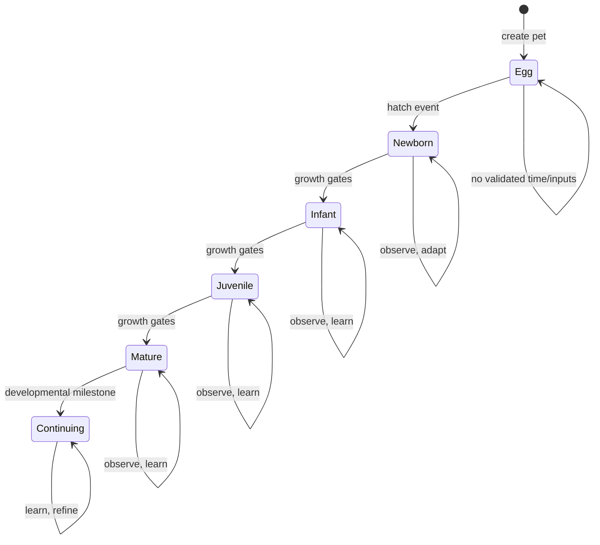

# XUNA — Digital Life & Pet Lifecycle Specification

**Document ID:** XUNA-DLS-001  
**Version:** 0.3.0 — Engineering reference integration (ePet / Xiaozhi)  
**Status:** Proposed / requires product validation; **not** an approved implementation design  
**Updated:** 2026-10-12  
**Audience:** Claude Code, Codex, Cursor, other coding agents; product, game, embedded and mobile engineers  
**Companion document:** Root `AGENTS.md` is authoritative for approved decisions and development process. If this spec disagrees with an approved decision in `AGENTS.md`, stop and flag the conflict.

> **Vision:** Every experience shapes who XUNA becomes.  
> **Core promise:** XUNA starts with limited instincts, accumulates experiences, forms learned preferences and memories, becomes more capable, and evolves its behavior and appearance. Two XUNAs with different histories should grow into **recognizably different individuals**.

## 0. Read this first — how an AI coding agent must use this document

This is a **product/game/AI-system specification for planning**, not an instruction to implement everything at once. An agent MUST:

1. Read this file **and** root `AGENTS.md`; inspect the actual code in `firmware/`, `mobile/`, `backend/` before making a plan.
2. Distinguish **Approved**, **Proposed**, **Experiment**, and **Future**. Detailed values and algorithms in this document are **starting hypotheses** unless explicitly approved.
3. Identify missing design decisions. Offer a concrete default, describe alternatives and validation, but do not silently elevate proposals into decisions.
4. Produce a phased technical implementation plan, with interfaces, state transitions, data schema, simulations, tests, and dependencies. **Do not implement the whole document** without further milestone approval.
5. Keep XUNA's essential life locally functional without phone, cloud, subscription or LLM. Conversation is integrated into Learning, but core gameplay is not dependent on conversation availability.
6. Distinguish actual learning (policy/prediction updated from evidence) from hand-authored progression or dialogue generated by an LLM.
7. Do not equate simulated baby-like development with a human child, consciousness or general intelligence.
8. Discuss planning and decisions with owner in Vietnamese; use English code symbols and schema names.

### Decision ledger

| Item | Status | Current direction |
|---|---|---|
| Product name | **Approved** | XUNA (formerly MOCHI) |
| Hardware currently owned | **Approved for prototype** | LILYGO T-Display-S3 LCD; verify exact revision |
| IDE | **Approved** | VS Code + PlatformIO IDE |
| Mobile framework | **Direction established** | Flutter companion app |
| Delivery sequence | **Approved direction** | M01 display/input → M02 BLE Flutter → M03 expressive pet → M04 life core → M05 learning/memory/conversation → M06 evolution → M07 sensor experience |
| Conversation participates in learning | **Owner-confirmed** | Flutter voice/text initially; learning events influence pet over time |
| Digital Life state authority | **Proposed** | Device authoritative; Flutter projects state and stores permitted history/cache |
| Behavioral AI | **Proposed** | FSM for mode constraints + Utility AI for choices |
| Learning | **Proposed** | Online preference estimator/contextual bandit; benchmark offline |
| Evolution renderer | **Proposed** | Composable pixel traits; no giant fixed evolution tree |
| Backend | **Deferred** | No mandatory BE in first playable loop; AI proxy when needed for secure provider keys |
| Future optical hardware | **Future backlog** | HoloCubic beam-splitter prism display (priority over flat-sheet Pepper's Ghost) |
| Future compute hardware | **Future backlog** | Custom PCB, alternative MCU or dual-processor only after measured limits |

---

## 1. Product fantasy and reality boundaries

**Fantasy:** XUNA is born naive and curious; each encounter contributes to its history. It may come to prefer morning play, recognize the owner's preferred reactions, grow calmer or more exploratory, remember important events, and acquire new modes of expression. The owner can understand **why** it changed.

**Reality:** We implement a bounded **artificial developmental system** with prebuilt capabilities, configurable growth gates, durable memory, online adaptation and explicit evidence. A static LLM queried with more chat history is not itself a model that has learned new weights. Do not claim this is equivalent to raising a human child.

**Primary user-visible outcomes:**

- XUNA feels **alive** when idle; it initiates appropriate micro-actions without a command.
- XUNA remains **recognizably the same individual** across restarts and software updates.
- XUNA **learns a preference** through feedback and applies it later in a similar context.
- XUNA exhibits **different routines/personality** across different histories without the owner choosing a predefined class.
- XUNA visibly **develops**: new expressions/skills/traits emerge as evidence-based milestones are reached.
- Every notable transformation has a **Journal explanation** rooted in real logged events, not fabricated backstory.
- The device remains useful and emotionally appealing **offline**; downtime is not punished.

**Non-goals for initial milestones:** open-ended autonomous general intelligence, human-level language learning, unrestricted home automation, always-on listening, self-modifying firmware, training a large model on ESP32, hundreds of handcrafted forms, multiplayer, cloud-required gameplay.

## 2. Core mental model — distinguish the dimensions

Do not conflate these systems:

| Dimension | Description | Change rate | Example |
|---|---|---|---|
| `identity` | Stable pet ID, birth metadata, initial seed | Immutable or rare | `petId`, `bornAt` |
| `instincts` | Built-in action repertoire and guardrails | By firmware/content version | Sleep when depleted |
| `needs` | Maintenance/regulation state; not a punitive death system | Minutes–hours | Energy, stimulation |
| `mood` | Short-lived affect-like display signals | Seconds–minutes | Calm, excited, sleepy |
| `personality` | Slowly evolving behavioral tendencies | Days–weeks | Curious, social, bold |
| `preferences` | Learned liking for context/action choices | Per feedback; smoothed | Prefers `wave` after evening interaction |
| `knowledge` | Facts/patterns with provenance/confidence | Evidence-driven | Interaction usually happens in evenings |
| `memory` | Episodes, aggregate patterns and journal entries | Event-driven | First successful interaction |
| `skill` | Repertoire/capability and measured competence | Developmental | Can select between 3 greetings |
| `growth` | Age, active lifetime, developmental capability state | Hours–days | Newborn → Infant |
| `evolution` | Observable visual/behavioral trait changes | Rare milestones | Luminous markings |
| `expression` | Animation, text, sound generated from current state | Frames–seconds | Tilt, blink, jump |

**Rule:** `age != intelligence`; `mood != personality`; `memory != learning`; `growth != evolution`; `LLM fluency != pet competence`.

## 3. Complete lifecycle — developmental stages

### 3.1 Proposed stages, not fixed level numbers

| Stage | Narrative role | Available core behavior | What can genuinely be learned | Conversation / expression | Evolution |
|---|---|---|---|---|---|
| **S0 Seed/Egg** | Identity is created, onboarding | Pulse/idle, respond to basic touch | Baseline logging only | Icon, movement | None |
| **S1 Newborn** | Primarily instincts | Idle, look, sleep, startled, simple happy reaction | Early association between context-action-feedback | Chirps/short phrases; no complex claims | Small growth/animation change |
| **S2 Infant** | Recognition of recurring patterns | Chooses among a few gestures; anticipates common contexts | Short-term preferences; first repeatable routine predictions | Familiar cues, greetings, nickname if taught | First simple trait variants |
| **S3 Juvenile** | Exploration and autonomy | Initiates more varied play/exploration, constrained decisions | Context-dependent choices; corrected preferences; simple event grouping | Brief contextual dialogue with actual memories | More visible modular traits / behavior style |
| **S4 Mature** | Distinctive individual | Richer autonomous behavior, short goal sequences | Stable learned routines, transfer across sufficiently similar contexts (experimental) | More contextual communication; admits uncertainty | Mature configuration and hybrid traits |
| **S5 Continuing Life** | Maturity is not endgame | New habits, seasons, skills, rare refinements | Continual updates with safeguards against forgetting | Long-term memory references | Cosmetic/behavioral refinement, no infinite stat inflation |

Stage S0–S5 names and exact thresholds are **Proposed**. Stages represent **capability envelopes**. They do not manufacture learning; a capability is activated only if it is implemented and, where applicable, the measured prerequisites are satisfied.

### 3.2 Growth gates: time + experience + demonstrated competence

A stage transition may be evaluated when all required gates pass:

```text
eligible(stage k→k+1) =
    minChronologicalAgeSatisfied
    AND minimumDistinctMeaningfulExperiencesSatisfied
    AND capabilityPrerequisitesSatisfied
    AND safeStateForTransition
```

The numeric gate parameters are **tunable experiment inputs**, not product facts. Use external configuration under version control; do not bury magic constants in behavior classes. Time and experience must not be monotonically inflated by repetitive low-quality input.

**Stage transition flow:**

1. Compute candidate progression from durable state and validated history.
2. Emit `GrowthEligibilityReached` with exact criteria and evidence IDs.
3. If safe, commit `GrowthStageChanged` once, idempotently.
4. Activate the new **available repertoire**, not an automatically learned policy.
5. Trigger a small visible ceremony or animation that can be replayed.
6. Record a Journal entry listing observable causes.

**Important:** If a pet sits untouched for weeks, chronological age can advance when trustworthy time is known, but it does **not** magically accumulate interactions or new skill competence. Also, no death, shame or irreversible punishment for infrequent use.

### 3.3 Conceptual lifecycle state machine



**Separate orthogonal state machines:** lifecycle stage does not directly equal live activity (`Idle`, `Sleeping`, `Playing`, `Observing`, `Reacting`, `Transitioning`). Growth transitions must never leave the pet in an impossible activity state.

## 4. End-to-end daily behavior and pet experience

### 4.1 Two timescales

**Fast loop (device, seconds or shorter):** input → update transient world/needs/mood → choose behavior → animation. **Slow loop (minutes/hours/days or events):** aggregate experiences → update learning/memory → evaluate growth/evolution → persist. Different update rates prevent accidental per-frame Flash writes and policy noise.

### 4.2 A normal day (illustrative user story, not deterministic script)

- **Morning:** after a trusted time source establishes the daypart, XUNA may wake/observe. If morning play has repeatedly been positively reinforced, it may choose a learned greeting. Otherwise use an instinctual idle pattern.
- **Interaction:** button/touch or BLE command produces a typed input event. XUNA chooses an allowed reaction, exposes that reaction, and opens a bounded feedback window.
- **Feedback:** owner explicitly approves/disapproves or provides another clearly defined feedback cue; learner updates behavior choice probability without instantly overriding personality.
- **Calm period:** idle behaviors vary according to energy, mood, current context and learned preferences. The pet does not require constant tapping to remain healthy.
- **Conversation (when Flutter available):** owner speaks or types; AI response can reference **validated** local memory, while conversation is also a candidate source of corrected preferences/milestones. Text/voice events are safely transported back to the device.
- **Evening:** may settle into quiet behavior, influenced by actual schedule preferences; if time is uncertain, avoid firm claims that it is evening.
- **After power-off:** pet resumes identity and last committed state. Trusted wall-clock recovery can advance calendar age, but cannot retroactively fabricate sensor events or training rewards.

### 4.3 Activity control (proposed FSM)

`BOOTING`, `IDLE`, `OBSERVING`, `PLAYING`, `RESTING`, `SLEEPING`, `REACTING`, `EVOLUTION_TRANSITION`, `ERROR_SAFE`.

- Inputs to modes are **requests**, not unconditional commands.
- Safety, current growth-stage capability, cooldowns and energy bounds may reject requests.
- Every mode has explicit enter/exit conditions and timeout; avoid permanent stuck animations.
- A reaction may interrupt idle, but not a Flash transaction or another critical operation.
- Emergency/invalid state falls back to safe idle/error display; never hang the device loop.

## 5. Needs, mood, personality and preference model

### 5.1 Needs — proposed limited V1 model

Start with `energy` and `stimulation` only. Values in a bounded domain (suggestion `[0,1]`), updated at a **slow** cadence based on elapsed **monotonic active time** and meaningful events. These are internal scheduling controls, not a punitive Tamagotchi starvation/death model.

Do not add hunger/hygiene/health solely because conventional pet games have them. Evaluate each new need against unique XUNA experience and product burden.

### 5.2 Mood

Candidate mood signals: `calm`, `excited`, `sleepy`, `curious`, `overwhelmed`. A mood can be represented as a few bounded numerical axes rather than mutually exclusive labels, with a visual label derived for expression. Use smoothing/hysteresis to avoid rapid flicker.

**Example:** positive feedback may raise short-lived engagement, not permanently set `Sociability = 1.0`.

### 5.3 Personality

Candidate slow traits: `curiosity`, `sociability`, `energyStyle`, `boldness`, `sensitivity`, `routineAffinity`. This candidate set must be validated for overlap and observable gameplay effects before freezing. `creativity`, `independence`, `adaptability` from early ideation are not approved baseline axes.

A personality trait needs all of:

1. Meaning in terms of **observable behavior**.
2. Clear input experiences that may shift it slowly.
3. A rate limit preventing extreme movement from one event.
4. Distinction from transient mood and learned preference.
5. Simulation tests for diversity and collapse.

**Proposed rule:** personality shifts only from **aggregated patterns of evidence**, never a single button press. Keep baseline/initial temperament small enough for experiences to matter; initial seed supplies variation but should not determine destiny.

### 5.4 Preferences and confidence

Use a contextual preference record rather than one global `likesJump` boolean.

Proposed key: `(contextBucket, actionId)`; fields: reward estimate, observation count, confidence, lastUpdated, provenance. Example context bucket can include `dayPart` and `interactionType`, but avoid high-dimensional combinations until sample count allows it.

**Feedback types:**

- Explicit positive/negative rating (`high confidence` if the user intentionally supplies it).
- Explicit spoken/text correction (candidate until confirmed or validated by controlled extraction).
- Repeated interaction after a reaction (`weak implicit evidence`, vulnerable to ambiguity).
- Lack of interaction is **not automatically negative**.

Do not overlearn from one uncertain cue. Preferences can decay in confidence, be overridden by direct corrections, or become context-specific.

## 6. Perception and experience events

### 6.1 Sources by milestone

| Source | First useful milestone | Raw data | Semantic event |
|---|---|---|---|
| Onboard button | M01/M04 | GPIO press/release | `InteractionStarted`, `ButtonPressed` |
| BLE Flutter | M02/M04 | command/transport packets | `UserInteraction`, `FeedbackReceived`, time sync |
| Conversation in app | M05 | utterance/transcript | validated `UserTaughtPreference`, `UserCorrection`, `ConversationMilestone` |
| Device clock | M04 | trusted UTC + monotonic elapsed | `DayPartChanged`, eligible age milestones |
| Ambient light module | M07 | lux samples | `BrightEnvironmentObserved`, recurring morning light |
| IMU module | M07 | motion samples | `PickedUp`, `Carried`, `Rested` |
| Future docks | Future | hardware capability/status | authorized `DockConnected`, `LightInteraction` |

A raw sensor measurement is not itself a memory or experience. Implement filters, thresholds, dwell time, rate limits and deduplication. Data quality and device capabilities must be reflected in event metadata.

### 6.2 Canonical event envelope (draft schema)

```json
{
  "schemaVersion": 1,
  "eventId": "evt_unique_id",
  "petId": "pet_uuid",
  "type": "BehaviorFeedbackReceived",
  "source": "mobile_explicit_feedback",
  "occurredAtUtcMs": 1790000000000,
  "clockQuality": "synced",
  "uptimeMs": 620000,
  "sequence": 144,
  "correlationId": "reaction_042",
  "payload": {
    "actionId": "wave",
    "context": {"interactionType": "button", "dayPart": "evening"},
    "feedback": "positive"
  },
  "confidence": 1.0
}
```

**Schema principles:** versioned, bounded payload, explicit provenance, meaningful ordering, idempotent event IDs, optional clock when unknown, avoid storing raw intimate conversation unless needed and consented. Treat timestamp above as illustrative only.

**Event categories:** `Device`, `Time`, `Input`, `Perception`, `Behavior`, `Feedback`, `Learning`, `Memory`, `Growth`, `Evolution`, `Conversation`, `Safety`.

### 6.3 Event lifecycle and validation

```text
input/raw sample
  → source adapter
  → threshold/debounce/permission validation
  → typed event with provenance
  → reducer / episodic candidate queue
  → optional learner update
  → derived effect + journal decision
  → bounded persistence
  → UI projection/telemetry
```

Data must not travel from an LLM prompt straight to privileged hardware actions. Command validation occurs at firmware boundary.

## 7. Memory architecture — what XUNA remembers

### 7.1 Memory classes

| Memory kind | Purpose | Proposed storage | Example |
|---|---|---|---|
| Working/short term | Recent context for current behavior | RAM ring buffer | Last interaction |
| Episodic | Meaningful, bounded historical event | Local compact events | First long interaction |
| Semantic/knowledge | Generalized fact with source | Local key-value/aggregates; app for rich text | Owner prefers quiet greetings |
| Preference | Learned choice statistics/policy | Device local durable state | Evening `wave` favored |
| Development | Permanent lifecycle milestones | Device journal metadata | First acquired prediction skill |
| Conversational detail | Rich user-authorized note/summary | Flutter secure local or optional service | Nickname taught to pet |

### 7.2 Promotion and consolidation

Not everything becomes a long-term memory. Candidate event salience can consider: novelty, recurrence, feedback strength, lifecycle relevance and explicit user importance. Use **bounded** storage with deterministic eviction/aggregation policy. Preserve identity, learning parameters and milestone evidence before low-value raw events.

**Example:** 100 similar evening button taps → one aggregate pattern, not 100 verbose journal paragraphs. “First time XUNA recognized a preferred greeting” → durable milestone referencing summary/evidence.

### 7.3 Truth and provenance

Memory record must include whether it is **observed**, **user-reported**, **inferred** or **AI-generated interpretation**. A user saying “we visited a forest” does not prove the device sensor saw a forest. XUNA may remember “the owner told me we visited a forest,” not “I saw trees” unless relevant perception exists.

Conversational facts should be correctable/deletable. Sensitive content should not be automatically memorized; default to minimal necessary data, consent for saving facts and transparent controls in Flutter. Never expose other people's private information through a pet response.

### 7.4 Durability

- Snapshot `PetState` using versioned schema + checksum/CRC and recoverable commit strategy (e.g. double slot/journal; exact method to benchmark).
- Persist important learning updates and milestones safely but avoid every-frame writes.
- Recover after power loss without duplicating stage transitions/rewards.
- Define schema migration strategy for firmware upgrades.
- Support export/import or backup **later**; do not require backend initially.

## 8. Learning Engine — the critical differentiator

### 8.1 Three different mechanisms (do not mislabel)

1. **Scripted progression:** predefined stage unlocks/visuals. Useful game design, **not learning**.
2. **Online adaptation:** local model parameters/policy updated from observed outcomes. This is the **minimum real learning target for V1**.
3. **Advanced ML/LLM:** optional provider for conversation understanding, memory summarization, richer prediction. Does not automatically replace or train core pet policy.

### 8.2 First bounded learning problem (must build/test first)

**Question:** Given context `button press during evening`, can XUNA learn which of `wave`, `jump`, `tilt` the owner prefers and later choose that action more often than initially, while still exploring safely?

**Inputs:** context features, candidate allowed actions, explicit feedback tied to a specific reaction, optional weak implicit feedback.  
**Outputs:** per-context action value estimates, confidence/sample counts, selected action, explanation metrics.  
**Offline requirement:** after learning has happened, selection works disconnected from the phone/cloud.  
**Safety:** learning cannot choose unavailable or blocked actions.

**Candidate algorithm A:** exponentially weighted reward estimator per `(context, action)` with bounded exploration.  
**Candidate algorithm B:** small contextual multi-armed bandit (epsilon-greedy or UCB) with explicit feedback credit assignment.  
**Recommendation for first experiment:** start A for transparency; compare B only if evidence warrants. A static rules-only system is insufficient for Learning acceptance.

Pseudocode (deliberately abstract; no magic parameter approval):

```text
onReaction(context, allowedActions):
    choose allowed action via policy(estimates[context], explorationBudget)
    emit BehaviorChosen(action, reactionId, policyVersion)

onExplicitFeedback(reactionId, rating):
    if alreadyConsumed(reactionId): return
    record = pendingReaction[reactionId]
    if missing / expired / unauthorized: reject
    update reward estimate for record.context and record.action
    mark feedback consumed
    persist compact changed parameters
```

**Credit assignment:** feedback must identify the **reaction that was rated**, not arbitrarily modify the latest action. Repeated feedback IDs must not train twice. Do not infer dislike from silence.

### 8.3 Measured success (proposed validation)

- In a fixed simulation with positively reinforced `wave`, later action distribution shifts toward `wave` relative to baseline.
- Changing feedback to prefer `tilt` causes gradual adaptation, without uncontrolled oscillation.
- Fresh pet with same seed and no feedback retains baseline (no phantom learning).
- Reboot/reload preserves learned statistics and produces equivalent future decisions under same deterministic RNG seed.
- Unrelated context remains substantially unaffected unless explicitly designed as generalization.
- Explaining selection can cite learned evidence (`wave: positive feedback 12/15`) rather than making up a narrative.

Use held-out events or repeatable simulations to verify improvement versus no-learning baseline. Report statistical variability over multiple seeds. Do not invent target accuracy without experiments.

### 8.4 Habit learning and prediction (second experiment)

Input: coarse, privacy-preserving interaction occurrences by daypart and day-of-week; source reliability. Compute **observed frequency**, confidence, minimum sample size and drift. Output: a tentative prediction of likely interaction windows, not absolute statements (“you always visit at 8 PM”). Use decay/rolling windows to adapt to schedule changes. If clock is unreliable, suppress wall-clock predictions.

### 8.5 Skill development is not just UI gating

Define each skill with:

- `skillId` and purpose;
- capability prerequisites;
- measurable evidence/competence metric;
- unlock rule and graceful fallback;
- visible behavior demonstrating competence;
- tests to distinguish genuine learning from automatic level unlock.

Examples: `associateReactionFeedback`, `recognizePreferredDayPart`, `respondToTaughtNickname`, `selectContextualGreeting`, and future `shortHorizonActionSequence` (R&D). The system never needs to intentionally fail easy questions to appear baby-like.

### 8.6 Continual learning constraints

Prevent policy saturation, feedback loops, spurious correlations, malicious/repeated reward spam, runaway personality drift and unbounded memory. Include rate limits, confidence, change limits, minimum exposure, replay simulation and user correction/reset controls.

## 9. Behavior engine — making XUNA feel alive

Use a **hybrid decision design (Proposed)**:

- **FSM:** activity safety and legal transitions.
- **Utility scoring:** among allowed candidate behaviors, select based on needs, mood, personality, context, preference, novelty, cooldown and exploration.
- **Animation controller:** maps behavior IDs to visual expressions, independent from decision logic.

One possible score decomposition (illustrative):

```text
score(action, state, context) =
   baselineInstinct(action)
 + contextFit(action, context)
 + learnedPreference(action, context)
 + personalityBias(action)
 + currentNeedBias(action)
 + explorationBonus(action)
 - repetitionPenalty(action)
 - energyCost(action)
```

This is **not** a numeric formula to ship as written; weights need profiling, simulation and balancing.

**Autonomy principles:** enough idle variation to appear present, not constant noise; respect quiet mode and battery budget; avoid interruptions to user tasks; reaction cooldown; fail safely without BLE/cloud. Never claim XUNA emotionally needs the owner or penalize disengagement.

## 10. Evolution — appearance shaped by history

### 10.1 Difference between Growth and Evolution

**Growth:** stage/capability progression. **Evolution:** which visual/behavioral traits emerge because of particular accumulated evidence. A mature pet does not have to look the same across users.

### 10.2 Proposed modular renderer

Base body plus composable pixel layers: `eyes`, `ears`, `tail`, `pattern`, `aura`, `accessory`, motion signature. Start with **very few** compatible traits rather than combinatorial explosion. Sprite layers need anchor points, z-order, palette rules, size budget, collision/overlap constraints, support for multiple poses and a stable `traitSetVersion`.

Forest, Sky, Mystic, Mecha are **mood-board ideas**, not a mandatory four-branch evolution tree. HoloCubic is a future display adapter, **not** an early evolution requirement.

### 10.3 Trait eligibility

A trait should be selected based on aggregated signals such as sustained light exposure, movement, chosen activities, observed preferences, learned competencies, personality trajectory and existing trait compatibility. Sensor-less prototypes may use **simulated contexts for testing**, clearly marked as simulated; do not label them real-world experience.

**Trait lifecycle:** `Candidate → Eligible → Selected → Unlocked → Expressed → Journaled`. Unlock once, using event idempotency. Prefer gradual visual transformation with readable causes; allow hybrid traits if render compatibility rules permit. Do not use arbitrary hidden dice as the primary cause; rare variations may incorporate seeded randomness under constrained eligibility.

### 10.4 Evolution Journal format

```json
{
  "entryId": "journal_unique_id",
  "petId": "pet_uuid",
  "kind": "evolution",
  "fromTraitSet": ["base"],
  "toTraitSet": ["base", "sun_pattern"],
  "reasonCodes": ["sustained_bright_experience", "daytime_activity_preference"],
  "evidenceEventIds": ["evt_a", "evt_b"],
  "createdAtUtcMs": 1790000000000,
  "clockQuality": "synced",
  "contentVersion": 1
}
```

Flutter can later render natural language explanation. Never allow a creative LLM to invent the evidence or silently alter underlying traits.

## 11. Conversation and voice integrated with Learning

### 11.1 Product approach

Conversation is **an input channel to Memory and Learning**, plus an output channel for personality/behavior. It is not the complete XUNA brain. Owner-requested direction: develop basic conversation alongside M05 Learning, using the **phone microphone/speaker or text first**, without assuming direct ESP32 audio hardware.

### 11.2 Proposed data flow

```text
Flutter push-to-talk / text
 → explicit mic/privacy consent
 → STT if voice input
 → response engine (optional LLM, preferably behind secure key proxy)
 → text + expressive intent for Flutter
 → candidate learning/memory events extracted with provenance
 → validation & optional owner confirmation for durable facts
 → BLE typed event to device
 → local learner/state update
 → behavior/animation + journal projection
 → TTS on phone (optional)
```

**Transport failure:** queue a bounded event with unique ID for retry; no duplicate learning on reconnect. If phone/server absent, local interactions and learning continue.

### 11.3 Communication developmental design

- Newborn: limited chirps/emotes/brief phrases, no false claims of perception.
- Infant: short cues, named reactions, owner-taught nickname if consented.
- Juvenile: brief context-based dialogue referring to verified events and preferences.
- Mature: richer continuity and explanatory answers grounded in memory; admits unknowns.

**Do not imply an underlying LLM trains itself per conversation.** The developmental difference may come from exposed vocabulary/repertoire, memory, explicit skill competence, verified facts and response policy. Clearly separate capability gating from actual learning in documentation and tests.

### 11.4 Conversation event categories and rules

`NicknameTaught`, `PreferenceStated`, `CorrectionProvided`, `BehaviorFeedbackGiven`, `MemoryRecallRequested`, `ConversationSessionStarted/Ended`.

An extraction model's output is always **untrusted candidate data**. Implement schema validation, allowlist event types, bounds, source tags, confidence thresholds, user correction, and explicit consent for storing information. Never treat playful hypotheticals, jokes or quoted text as automatically factual. Minimize transcript retention; offer deletion/export controls at the appropriate milestone.

**Example:** “I like when you wave at night” → candidate contextual positive preference. Confirmation or repeated validated signals promote it into durable learning. **Not:** LLM mutates personality to maximum Sociability immediately.

### 11.5 Relationship to Xiaozhi

Technical research references: `78/xiaozhi-esp32` voice device transport, wake word, codecs, server orchestration; `xinnan-tech/xiaozhi-esp32-server` provider architecture. Learn concepts; do not import their architecture or firmware wholesale. Verify licensing, hardware requirements, ESP-IDF/Arduino compatibility before reuse. On-device voice remains future R&D.

## 12. Time, offline progression and interruptions

### 12.1 Three distinct time measurements

- `chronologicalAge`: duration between trustworthy `bornAtUtc` and current reliable UTC. Use 24-hour duration for age-days; local day boundary separately for daypart rituals.
- `activeLifetime`: monotonic cumulative time device executed pet runtime; checkpoints account for resets without double-count.
- `developmentProgress`: competence/evidence based, not time alone.

### 12.2 Clock quality

Possible states: `unknown`, `approximate`, `synced`. Specify how the clock transitions after boot, after BLE time sync, and after NTP; record source and sync time. On a hard power loss, without RTC backup or network/phone time, do **not** infer how many calendar days passed. Device can still use runtime monotonic durations for immediate behavior.

### 12.3 Edge cases and policy

| Case | Expected policy |
|---|---|
| Reboot after 3 days unplugged, clock unknown | Restore state; defer calendar age milestone until trusted sync |
| Reconnect to phone, clock jumps forward | Validate plausibility, advance age carefully, **no invented experiences** |
| Clock moves backward | Avoid negative ages and repeated milestone awards; emit diagnostic |
| Cross timezone | Store UTC; daypart display may use explicit user/device timezone setting |
| Leap day / daylight-saving time | Duration-based age in UTC; don't use local midnight count as chronological age |
| Repeated reboot during stage transition | Atomic/idempotent transaction; exactly one stage change |
| Device idle 30 days | No irreversible punishments, death, or fabricated learning |
| Very large elapsed gap | Bounded state catch-up, not N-per-minute replay or Flash storm |

## 13. State, persistence and synchronization

### 13.1 Proposed aggregate (`PetState`) — conceptual fields

```text
PetState
  schemaVersion
  petId, seed, bornAtUtc?, clockMetadata
  stage, stageTransitionHistoryIds
  activeLifetimeSeconds, lastCommittedUptime
  currentActivity, mood, needs
  personalityVector
  preferencePolicyVersion, preferenceStatistics
  skills{availability, confidence, evidence}
  visualTraits{ids, version}
  memorySummaryPointers / bounded evidence summaries
  lastProcessedEventSequence, recentEventIds
  lastJournalEntryId
  rngState / deterministic simulation seed where required
```

**Do not put full speech transcripts, large embeddings or image/audio buffers into MCU pet state.** Device state owner and backup/sync are proposed until an explicit ADR is approved.

### 13.2 Command versus event versus projection

- **Command:** an authorized request (`RequestReaction`, `SyncTime`, `SubmitFeedback`). Can be rejected; has `commandId` and bounded payload.
- **Event:** immutable fact after validation (`BehaviorChosen`, `TimeSynchronized`, `FeedbackApplied`). Suitable for replay/aggregation as feasible.
- **Projection:** read model for Flutter UI (`PetStatus`, `JournalSummary`). Does not directly mutate pet truth.

Protocol should specify `protocolVersion`, characteristic/message size, acknowledgements, retry, deduplication, ordering and capability negotiation. Avoid making Bluetooth packet layout and business models inseparable.

### 13.3 Crash consistency

Define checkpointing policy, checksum, slot fallback, schema migration, interrupted-write test and persisted learner parameters. Avoid Flash write per animation frame or per sensor sample. Make state updates deterministic and isolated from rendering hardware for host testing.

## 14. Hardware allocation and resource contracts

### 14.1 Current hardware

LILYGO T-Display-S3 LCD (standard variant presumed), ESP32-S3, 170×320 LCD, two buttons. VS Code + PlatformIO is approved. Arduino Framework for bring-up is a proposal; verify against actual hardware/version. Pin mapping, RAM/PSRAM availability, frame rate and power must be measured rather than assumed.

### 14.2 Runtime partition — proposed

| Component | ESP32 local | Flutter | Optional backend |
|---|---|---|---|
| Rendering/animation | Primary | UI preview possible | No |
| Raw buttons/sensors | Primary | Phone-source events | No |
| Pet state + behavior | Primary | Projection | No |
| Simple online preference learner | Primary | Tests/analytics UI | No |
| Compact episodic memory/milestones | Primary | Journal/cache | Optional backup |
| Voice recording/playback | Later hardware | **Initial implementation** | Optional audio gateway |
| STT/LLM/TTS | No general LLM on S3 | Device UI/provider client | **Secure proxy if external key needed** |
| Rich conversation notes | IDs/summary only | Local/consented | Optional |
| Growth/evolution | Core eligibility and state | Journal presentation | No |

The original LILYGO screen is **not** presumed compatible with later HoloCubic hardware. Keep display APIs abstract enough to change transport/resolution/renderer when that work is scheduled.

## 15. Simulator, reproducibility and balancing

Implement a **headless life simulation** before attempting sophisticated learning/evolution balancing on hardware. Source of truth for production logic should be re-usable/test-equivalent. Avoid maintaining an inconsistent Flutter and C++ evolution algorithm.

Required simulator controls:

- Deterministic clock (`SimClock`) and seeded randomness (`IRandom` or equivalent).
- Replayable scripted event scenarios.
- Accelerated virtual days without actual waiting/sleeping.
- Multiple pet runs with different histories and the same seed.
- Assertions and export of personality/preference/skills/evolution/journal summaries.
- Optional fake sensor inputs marked simulated.
- Batch scenarios checking runaway traits, unreachable milestones, endless loops, storage bound.

### 15.1 Core scenarios

**Scenario A — same birth, different lives:** start two XUNAs from same seed. A receives morning interaction, light and movement (simulate unavailable sensors); B receives quieter evening interaction. Expect traceable differences in preferences/behavior, and eventually eligible traits where configured. No guarantee of visual differences unless evolution rules and evidence criteria are actually satisfied.

**Scenario B — learning from explicit feedback:** after repeated positive feedback for `wave` in one context, show change in action selection distribution compared with a fixed-policy baseline. Quantify over many seeded runs.

**Scenario C — correction/change of preference:** previously preferred `wave`; user consistently prefers `tilt`. Expect gradual adaptation with bounded drift and no corruption of earlier journal history.

**Scenario D — no interaction:** clock advances but no fake learning, no punishment and no false claims about observed experiences.

**Scenario E — offline/reboot:** persist, restart, provide same validated event stream. Expect no double-applied feedback/trait unlock, stable pet ID, no corrupted age.

**Scenario F — LLM hallucination defense:** extracted statement without evidence cannot create `SensorObservedForest` or physically actuate anything.

## 16. Product design — make growth visible, not just numeric

### 16.1 On-device expression

- Pixel character has an original visual identity; simple silhouette and readable animation at the actual LCD size.
- Use micro-behaviors (blink, lean, settle, notice) to convey life between explicit commands.
- Keep expressions legible and performance bounded; idle loops may use low frame rate and power savings.
- Stage changes should affect appearance **and/or** repertoire, not merely an integer.
- Learned choices should be observable across repeated interactions; provide optional **Why did XUNA do that?** explanation in Flutter once state telemetry exists.

### 16.2 Companion app

Minimum eventual screens: device pairing/status, interaction/voice or text, Pet development timeline, Evolution Journal, memory/preference controls, privacy settings, Life Lab/debugger (developer-only). Do not implement them all in M02.

### 16.3 Design against unhealthy engagement

No artificial pet death, humiliation, guilt-based messages, compulsive daily streak penalties, or claim that XUNA suffers when ignored. Support healthy breaks, quiet hours, predictable notifications and clear mic activation. XUNA can greet when the owner returns without assigning moral weight to absence.

## 17. Security, privacy and physical safety

- User consent and visible microphone controls. No covert background recording.
- Avoid storing raw voice files or extensive transcripts by default.
- Memory extraction is allowlisted, source-tagged, bounded, reviewable and deletable.
- Never store secrets/API keys in firmware or Flutter packages. Use a secure proxy if calling paid provider APIs.
- Incoming BLE/cloud commands require validation, pairing/authorization where applicable, rate limiting and idempotency.
- AI cannot bypass device-side permissions or trigger unsafe actuators, even if future docks appear.
- Keep generated speech distinct from facts XUNA has actually observed.
- Avoid unverified health/safety inferences from ambient sensors; no medical claims.

## 18. Engineering quality and testing matrix

| Domain | Core test | Failure / negative test |
|---|---|---|
| Identity | Unique pet ID persists | Snapshot corrupt, retry hatch |
| Time | Trusted UTC computes chronological age | Unsynced boot, clock rollback, timezone switch |
| Needs/mood | Bounded deterministic update | Large elapsed time, numeric overflow |
| FSM | Legal activity transitions | Interrupt during restricted state |
| Utility AI | Allowed actions selected under fixed state/seed | No actions available, cooldown/energy constraints |
| Learning | Feedback improves action selection with evidence | Duplicate/missing/expired feedback, no-feedback stability |
| Habit prediction | Confidence calibrated to data volume | Sparse data, drift, clock uncertain |
| Memory | Salient events retained and provenance intact | Storage full, bad migration, corrupt checkpoint |
| Growth | Gates drive exactly one transition | Skipped/duplicate transition, no-experience age advance |
| Evolution | Trait linked to evidence and compatibility | Conflicting trait layers, invented evidence |
| Voice/text | Candidate extraction validated | Prompt injection, false facts, no permission |
| BLE | Command/event ACK and deduplication | Reconnect retry, malformed packet, version mismatch |
| Render | Correct sprite/state mapping | Missing asset, off-screen, small RAM |
| Offline | Core behavior continues | Phone/server unavailable |
| Power-loss | State recovery and no reward duplication | Reset mid-write, repeated reboot |

**Test layering:** pure host C++ unit tests first for `Clock`, state reducers, learner, growth/evolution and serializer; component tests on board for display/input/NVS/BLE; Flutter tests for state projection and protocol; simulated long-running lifecycle tests; manual real-device validation only where necessary.

## 19. Implementation roadmap — vertical slices and dependencies

**All features below are specified as planning targets, not an instruction to code all at once.**

| Milestone | Deliverable | Minimum proof |
|---|---|---|
| **M01 — Device Bring-up** | Correct board setup, LCD, 2 buttons, simple sprite/animation, metrics | Firmware builds and actually runs on board |
| **M02 — Flutter/BLE** | Discovery, pairing, command and status round-trip, reconnect | Flutter button causes device reaction and receives ACK/state |
| **M03 — Pet Expression** | Original character, idle/happy/sleep/curious animation, small FSM | XUNA appears responsive and can idle without user |
| **M04 — Digital Life Foundation** | Stable identity, time quality, state reducer, event envelope, snapshot, behavior selection | State survives reboot, no time double-count, deterministic host tests |
| **M05a — Explicit Feedback Learning** | Contextual action learner, confidence, test simulation and state persistence | Pet demonstrably changes future decisions from feedback |
| **M05b — Memory + Journal Foundation** | Episode salience, aggregates, provenance, first milestone records | Reliable memories and explanation trace, bounded storage |
| **M05c — Flutter Conversation V1** | Push-to-talk/text, secure optional AI service, candidate events, confirmation/correction | User can teach preference; device learner changes behavior; no fake memory |
| **M06 — Growth & Evolution** | Developmental gates, modular traits, transition and journal | Two life histories produce justified differentiated outcomes |
| **M07 — Physical Perception** | Light/IMU (when purchased), filters, semantic events, gameplay impact | Physical observations can update learning/evolution; false positives measured |
| **Future** | On-device audio, HoloCubic, custom PCB/AI hardware, docks, robust cloud sync | Research + explicit approval required |

**Dependency warning:** M05 includes voice and learning as one product direction, but internal sub-slices M05a/M05b/M05c are intentionally separate to reduce rework. If firmware reality requires reordering, propose it explicitly.

## 20. Acceptance criteria for first meaningful "living pet" prototype

A demo is *not* complete just because the character blinks. At minimum:

1. XUNA responds to physical input, with legal modes and non-blocking animation.
2. XUNA keeps a stable `petId`, basic life state and its stage through reboot.
3. XUNA can operate with phone and cloud unavailable.
4. At least one learned parameter changes **because of linked user feedback**.
5. That change affects a **future independent behavior choice** and survives restart.
6. A user or developer can inspect why the preference changed using evidence/statistics.
7. Same-seed simulation with different experiences yields measurably different behavior; no fake memories.
8. Voice/text interaction (when enabled) can create a validated candidate event and correction, not uncontrolled AI mutation.
9. At least one growth/evolution milestone (when M06 implemented) is linked to named conditions and evidence and Journal entry.
10. All claims are matched to tests; untested on-board behavior is labeled unverified.

## 21. Explicit open decisions for product owner

**Do not block basic M01–M03 on these.** Raise them before implementing affected subsystems.

1. **Time policy:** if age gate passes without enough experiences, stay in stage or visibly age without capability unlock? (Recommend separate chronological-age UI and developmental stage.)
2. **Need model:** keep only energy/stimulation, or introduce playful optional care loops? (Recommend minimal initially.)
3. **Initial personality:** how much seeded variation is acceptable relative to history? (Experiment.)
4. **Feedback UI:** explicit `like/dislike` buttons on Flutter versus follow-up interaction as weak signal? (Recommend explicit for learning validation.)
5. **First trainable action set:** `wave/jump/tilt` are placeholders; align with final character animations.
6. **Learning algorithm:** transparent estimator or contextual bandit? (Benchmark simplest first.)
7. **Voice architecture:** text first and/or push-to-talk; choose STT/TTS provider, privacy, network/data cost and whether minimal secure proxy needed. Avoid embedded keys.
8. **Memory retention:** event capacity, local summary policy, PII controls and device/app ownership.
9. **Evolution art:** sprite baseline sizes, layers, anchor system, trait palette and compatibility table.
10. **Growth durations:** do not commit numbers until user tests and simulation; accelerate in developer Life Lab.
11. **Truth/ownership:** source of truth for rich conversational notes, device-side policy and replay on reconnect.
12. **Hardware constraints:** exact LILYGO revision, Flash/PSRAM, available GPIOs, power target and subsequent optical screen geometry.

## 22. Required deliverable from a planning-only coding agent

When asked to **plan the Digital Life System**, the agent MUST output (in Vietnamese):

1. **Repository inventory:** actual modules/files/tests found in each submodule; current implementation status versus this spec. Do not assume prior prompts were implemented.
2. **Gap analysis:** discrepancies and missing product decisions, grouped by milestone and risk.
3. **Architecture diagram:** firmware Life Engine boundaries and dependencies; Flutter/BLE contracts; optional AI proxy.
4. **Concrete data model:** field names, types, bounds, schema version, example messages, persistence ownership and migration strategy.
5. **State machines:** development stage transitions and live activity FSM, including invalid transitions.
6. **Learning design:** exact feedback assignment, algorithm alternatives, feature scope, numeric parameter ranges **proposed**, and proof it is learning rather than rule increments.
7. **Memory design:** salience, retention, provenance, privacy, consolidation, crash recovery.
8. **Evolution design:** eligibility, compatible trait layers, explainable Journal records.
9. **Time design:** wall clock vs monotonic uptime, sync confidence, power-loss cases.
10. **Modular file layout:** C++ PlatformIO lib boundaries and host tests, Flutter architecture and BLE protocol; no unnecessary boilerplate.
11. **Incremental task breakdown:** vertical slices with exact dependencies, rough effort **as estimates**, pass/fail acceptance, rollback points.
12. **Test suite specification:** deterministic scenarios, fixtures, performance measurements, long-horizon simulations.
13. **Decision requests:** only unresolved choices requiring product-owner approval; separate from safe engineering defaults.
14. **No code modifications without explicit request to implement.** If the user explicitly asks for a plan, stop after the plan.

### Agent prompt to accompany this specification

> Read root `AGENTS.md` and `docs/product/XUNA_DIGITAL_LIFE_SPEC.md` carefully. Inspect the actual `firmware/`, `mobile/`, and `backend/` submodules and existing documentation. **Do not code yet.** Build a phased implementation plan for the XUNA Digital Life System, with concrete C++/Flutter module boundaries, lifecycle FSM, memory/learning algorithms, stable event/protocol schemas, offline persistence/time design, learning simulation and measurable tests. Identify contradictions and missing decisions explicitly. Respect current milestone and future-backlog limits. Discuss the plan in Vietnamese and ask for approval before implementation.

---

## 23. Cognitive Development Architecture — intelligence grows from experience (v0.2 extension)

> **Status: Proposed / R&D.** This section elaborates the owner's target: XUNA begins with a small repertoire and develops progressively through learning, memory, communication and physical experience. "Like a child" is a **product metaphor** and must not be presented as evidence of human-equivalent cognition, sentience or consciousness. This section adds requirements for planning, not approval for immediate implementation.

### 23.1 What "becoming smarter" means in XUNA

Distinguish **five independent measures**; do not show a single opaque `intelligenceLevel` as if it were proof of intelligence:

| Dimension | Evidence of improvement | Does not count as proof |
|---|---|---|
| Memory | Correctly recalls a verified past event after reboot | Echoing a fact only present in the current prompt |
| Learning | Policy/prediction accuracy improves on held-out contexts | Incrementing a curiosity/XP counter |
| Generalization | Applies a learned preference to a related context with calibrated confidence | A hardcoded case for every possible context |
| Reasoning/planning | Combines verified facts or chooses a short goal-directed action sequence and checks outcome | LLM generates fluent or child-like text |
| Autonomous exploration | Tests permitted alternatives, observes feedback and updates a policy | Random idle animations with no learning consequence |

**North-star validation:** two XUNA instances with the same initial seed, firmware and initial abilities, but different interaction histories, must later show different evidence-based predictions, choices, accessible memories and observable development. Neither instance should fabricate an experience.

### 23.2 A single experience: end-to-end worked trace

**Hypothetical teaching episode:** User presses the button; device chooses `jump` (`reactionId=rx_101`). User explicitly says via Flutter "I like when you jump". The conversation service suggests `BehaviorFeedbackGiven` pointing to `rx_101`.

1. **Perceive:** firmware emits `ButtonPressed`; behavior policy selects `jump`; logger creates immutable `BehaviorChosen` with `reactionId` and local context.
2. **Interpret:** Flutter STT/LLM *may* extract a **candidate** positive feedback. If its referent is ambiguous, ask for confirmation; do not infer a ground-truth rating from a generic happy sentence.
3. **Validate:** event type, authenticated paired source, linked `reactionId`, feedback interval, replay prevention and consent checked at the firmware boundary.
4. **Remember:** append a compact event or increment an aggregate; preserve the source/provenance, NOT necessarily the entire audio or raw transcript.
5. **Learn:** update the selected `(context, action)` estimate; do not update unrelated actions merely to make personality look different.
6. **Act differently:** on a later button press in a similar context, the updated policy has a greater propensity to select `jump` while retaining bounded exploration.
7. **Consolidate:** recurring evidence can contribute a durable preference fact with a sample count and confidence. A meaningful learning milestone may be included in the Journal.
8. **Recover:** after power loss, policy parameters are restored; replay of the same event cannot double-train.

A positive reaction is *evidence*, not a permanent order. Changing user preferences must be learnable. Missing feedback is unknown, not negative.

### 23.3 Proposed memory model: events vs facts vs policies

**Memory is persistent structured information, not an LLM's private mind.** Keep three separate stores with explicit linkage:

1. **Experience/event log** — what happened, when, how it was known, and immutable event IDs. Retention can be bounded and compacted.
2. **Knowledge and episodic records** — user-taught facts, salient events, derived patterns, revision/deletion state; include provenance and confidence.
3. **Learned parameters** — per-context feedback statistics, prediction estimates and skill evaluation results. These survive reboots and do not require retaining every transcript.

Illustrative records (schema proposal; field values are examples, not measured model output):

```json
{
  "schemaVersion": 1,
  "memoryId": "mem_0127",
  "kind": "semantic_fact",
  "subject": "owner",
  "predicate": "favorite_color",
  "value": "green",
  "provenance": "user_stated_in_conversation",
  "sourceEventIds": ["evt_08a"],
  "confidence": 0.95,
  "status": "confirmed",
  "updatedAtUtc": "2026-10-12T14:00:00Z"
}
```

```json
{
  "schemaVersion": 1,
  "modelId": "preferred_greeting_v1",
  "contextKey": "evening:direct_button_press",
  "actionId": "jump",
  "positiveCount": 8,
  "negativeCount": 2,
  "lastUpdatedEventId": "evt_10d",
  "policyVersion": 1
}
```

The `confidence` field for extracted facts is **not** a claim of factual certainty. It must be calibrated and interpreted relative to evidence type and explicit confirmation. Use stable event IDs, schema versions and migrations. If `bornAt` lacks reliable clock provenance, do not invent dates for experiences.

### 23.4 Practical storage placement and authority

| Storage | Keep | Avoid |
|---|---|---|
| ESP32 RAM | Working memory, pending feedback links, current behavior context, caches | Unbounded conversations/audio buffers |
| ESP32 NVS/Flash | Pet ID, lifecycle snapshot, bounded preference/policy stats, skill metrics, summarized important memory IDs | Large transcript archives, frequent per-frame writes |
| Flutter secure/local DB | Rich episodic journal, consented user facts, conversation summaries, correction/deletion UI, cached projections | Becoming mandatory for core offline survival |
| Optional BE in later milestone | Backups, cross-device synchronization, semantic retrieval, AI request proxy | Sole source of Pet identity or mandatory game loop |

**Authority proposal:** ESP32 is authoritative for core state/policy and major milestone IDs; Flutter may hold rich memory records with provenance that it offers to firmware as typed facts/events. Define explicit conflict/reconciliation semantics before coding. Without phone, firmware still remembers and adapts locally; without server, rich LLM-powered conversation can be unavailable without stopping the pet. Flash writes should be batched with crash-safe snapshots and compact logs.

**Correction example:** the owner changes their favorite color from green to blue. Do not silently overwrite history without trace: mark the old fact superseded, record a newer confirmed fact, update derived preferences and ensure future responses use the latest confirmed fact. Respect delete/forget controls through all replicated stores.

### 23.5 Cognitive competency ladder (not age-only unlocks)

| Proposed band | What exists from the start | What is measured before progression | Visible difference |
|---|---|---|---|
| **Instinct** | Basic reactions; bounded needs; simple expressions | Stable interaction, valid event processing | Responds consistently without pretending to know owner |
| **Association** | Trainable action-feedback estimator | Improved action preference on repeated, attributed feedback | Favors previously rewarded actions in similar situations |
| **Prediction** | Timestamped interaction features | Held-out prediction of likely interaction window versus baseline | Anticipates, with uncertainty and no pressure to interact |
| **Contextual choice** | Context features + limited action repertoire | Improved outcomes across distinct contexts, adaptation to changed routines | Different greetings across morning/evening |
| **Short-horizon planning** *(R&D)* | Explicit safe goals, deterministic action constraints | Plan success and recovery against baseline | Chooses a sequence of permitted actions to reach a simple goal |
| **Transfer/generalization** *(R&D)* | Shared representations or structured world knowledge | Performance on related *unseen* scenarios | Uses past lessons beyond exact trained context |

The next band is **not guaranteed** simply because a certain number of days pass. Growth can constrain what is expressible, while verified learning metrics determine what has been mastered. A large pretrained LLM behind a "baby voice" does not demonstrate new competence.

### 23.6 Learn-to-predict experiment: evening routine

- **Inputs:** validated local interaction timestamps grouped into coarse time-of-day buckets; clock quality; day-of-week optionally; sparse interaction counts. Do not collect unnecessary location data.
- **Model V1 proposal:** smoothed histogram or decayed frequency model; compare with baseline that predicts the most common bucket without personalization.
- **Output:** distribution over likely interaction windows plus uncertainty; not a deterministic "owner will return at 9 PM" statement.
- **Online update:** each observed eligible interaction changes the frequency estimate. With limited evidence, XUNA should remain uncertain.
- **Drift test:** user routine changes after a simulated interval; measure how quickly the prediction adapts without forgetting everything from one anomaly.
- **Gate:** enable anticipatory behavior only when clock is trusted, confidence is sufficient, and user has not disabled proactive interaction. Avoid guilt or engagement-pressure mechanics.

### 23.7 Learning algorithm candidates and evaluation

**First learning slice:** choose a *transparent* online estimator before an LLM/NN approach. Example for an action with binary ratings: maintain successes/failures with an optional `Beta(1,1)` prior; posterior mean is `(positiveCount+1)/(positiveCount+negativeCount+2)`. This is an **estimate of positive feedback probability**, not the final action-selection probability. A separate policy must define exploration, fairness to under-sampled actions, context grouping and safety constraints.

Only graduate to contextual bandits (e.g. epsilon-greedy/UCB) if simulations show measurable value. Benchmark against **no-learning**, **static-rule** and **random** baselines; use fixed seeds, multiple repetitions, held-out events, convergence curves and reversal tests. Do not hardcode a threshold without a validation rationale.

**Essential tests:** duplicate feedback, missing reaction reference, feedback for disallowed action, context isolation, sparse data, sensor/clock errors, nonstationary preferences, cold start, power loss, version migration and corrupted memory fallback.

### 23.8 Reasoning is different from remembering or talking

- **Remembering:** retrieve a verified owner's preference.
- **Predicting:** estimate likely interaction time from history.
- **Reasoning:** combine two trustworthy facts (e.g., owner prefers quieter interactions + it is nighttime) to select a suitable permitted greeting, and expose the decision evidence.
- **Planning:** choose and evaluate a sequence of permitted actions toward a goal; only later, with bounded action space and a simulator.

The basic deterministic/Utility-AI decision layer should own executable behavior. LLM outputs are **proposals** (`responseText`, `expressionHint`, candidate fact/event), never unvalidated commands or irreversible state/evolution edits. No direct control of unsafe physical actuators.

### 23.9 Conversation is a learning sensor, not the central brain

**Current development direction:** integrate text/push-to-talk Flutter conversation into M05, using STT/LLM/TTS providers when needed and a secure API proxy when cloud keys must be protected. Keep LILYGO LCD firmware and the core local learning operational offline.

Developmental communication changes through three separate mechanisms:

1. **Experience growth:** more consented facts and episodes are available for grounded recall.
2. **Measured skills:** XUNA becomes better at contextual greetings, preference learning, predictions and corrections.
3. **Expression gating:** the presentation style becomes richer with developmental stage. This is **gameplay design**, not evidence the LLM itself has been trained or become smarter.

**Truth contract:** A conversational memory is tagged `user_stated`, `sensor_observed`, `inferred` or `generated_summary`, with links to evidence where possible. `User: We visited a forest` can generate the memory "the owner told me we visited a forest"; it cannot become a claimed visual observation without sensors. Surface uncertainty, confirm ambiguous user statements and allow corrections. Avoid automatic permanent storage of personal/sensitive information; minimize transcripts and make memory removable.

### 23.10 Life Lab: dual-history cognitive evaluation

Run **two identical starting XUNAs** with same initial seed and same firmware, but different experience streams:

```text
Scenario A: repeated positively reinforced active greeting; frequent daytime interaction
Scenario B: repeated positively reinforced calm greeting; frequent evening interaction

After training:
- Evaluate both on identical held-out contexts.
- Compare action policy distribution, habit predictions, relevant memory recall,
  personality drift (if derived), and evolution eligibility.
- Restart each simulated pet and verify identical restored state/output.
- Change both routines and evaluate adaptation and uncertainty.
```

**Report:** learned parameter deltas, prediction error, action outcome/regret where applicable, memory precision and provenance, crash recovery, flash footprint, CPU cost and variance across seeds. Two different sprites are *not* enough to pass. Time acceleration is for simulation only and must never rewrite a real pet's observed history.

### 23.11 Concrete implementation slices for the planner

| Slice | Deliverable | Primary location | Required proof |
|---|---|---|---|
| C0 | Event contracts + deterministic fixture runner | Firmware core + host tests | Same seed/events yield same state |
| C1 | Compact memory and snapshot integrity | Firmware core | Reboot/restoration and idempotency tests |
| C2 | Action-feedback learner | Firmware core | Outperforms baseline in controlled feedback simulations |
| C3 | Contextual habit learner | Firmware core | Held-out prediction and drift evaluation |
| C4 | Flutter rich memory projection + correction | Flutter, BLE contract | Provenance, delete/correction, offline sync tests |
| C5 | Conversation to candidate facts/feedback | Flutter + optional minimal proxy | Confidence/confirmation, no fabricated observation, no API key on client |
| C6 | Capability/skill competency gates | Firmware core | Stage alone cannot falsely confer learned skill |
| C7 | Evolution driven by evidence | Firmware + assets + Flutter Journal | Explainable trait change with source IDs |
| C8 *(research)* | Bounded reasoning/planning and transfer | Simulator first | Held-out goals outperform fixed heuristics |

This is a **dependency sketch**, not authorization to implement all slices or to activate a mandatory backend. Fit these into the already approved milestones M01–M07. Each slice must provide a plan, constraints, measurable acceptance criteria and resource budget before implementation.

### 23.12 Unresolved decisions for owner approval

- Which memories are always kept on device vs rich phone-only? How large are the bounds?
- Should learning primarily use explicit feedback initially, or allow implicit signals with lower confidence?
- What evidence and minimum samples justify a developmental competence unlock?
- Which aspects are reversible (preference) and which are durable (identity and achieved milestone)?
- How much deliberate exploration should a young XUNA perform, and when should it become more predictable?
- When does LLM conversation become available, and which user data is allowed into external services?
- How should memory deletion propagate across device, Flutter and eventual cloud snapshots?

**Acceptance for this section:** a coding agent can explain, with tests, exactly how an event becomes a memory, how that memory differs from learned policy parameters, how a later action changes, and why a developmental milestone is earned — without inventing human-like cognition or claiming that LLM weights autonomously trained on the ESP32.

---

## 24. Engineering lessons from ePet and Xiaozhi (v0.3 extension)

**Status: Proposed technical references, not approved dependencies.** These are external repositories to *study*, not architectures to clone or mandates to copy source. All claims below are based on repository documentation available on 2026-10-12; **exact code paths, dependency versions, memory budgets, performance and board compatibility require source audit and experiments**. No external firmware has been built or tested on XUNA's board in this review.

- ePet: https://github.com/pliashkou/epet — MIT; embedded virtual pet, simulator and data-driven display modules.
- Xiaozhi: https://github.com/78/xiaozhi-esp32 — MIT; ESP32 voice interaction, transport, board abstractions and device tools. As of this review its README requires ESP-IDF >= 6.0.1; that does **not** imply compatibility with XUNA's PlatformIO + Arduino bring-up setup.
- Both are **reference implementations** only. Confirm the current upstream license and the licenses of transitive dependencies before reusing code. Do not import visuals, personality rules, character assets, protocols or server dependencies by default.

### 24.1 Decision matrix: what to adopt, adapt, or defer

| Topic | Reference | XUNA proposal | Priority / timing | Non-goal |
|---|---|---|---|---|
| Desktop/headless simulator + virtual clock | ePet | **Adopt the principle**, build own deterministic host simulation of XUNA core | High, before substantive learning logic | Do not clone ePet gameplay |
| Portable core shared by simulator and MCU | ePet | **Adopt boundary**, C++ core must not import Arduino, display or networking headers | High, early core design | No rewrite of working M01 unnecessarily |
| Event bus and meaningful state-change notifications | ePet | **Adapt** to typed Experience Events with provenance, idempotency and consumption ordering | High, M04/M05 | No unbounded event queue / event-per-frame |
| Sprite palettes, poses, fallback and frame timing | ePet | **Study and adapt** for asset/toolchain and RAM efficiency | Medium, M03 | Do not reuse third-party sprites or fixed growth tree |
| Save/reboot behavior | ePet | **Adopt test approach**, versioned snapshots + atomic/recoverable saves | High, M04 onward | Do not persist every render frame |
| Dynamic sub-program VM | ePet | **Defer** | Future research | No arbitrary executable content in MVP |
| Voice streaming / VAD / Opus / transport | Xiaozhi | **Study interfaces**, initially capture via Flutter, add device audio only after hardware validation | High research, M05; direct device audio future | No full on-device LLM |
| Board/device abstraction | Xiaozhi | **Adopt separation principle** for board drivers and capabilities | Medium, firmware growth | No framework migration without ADR |
| Device-side MCP / tools | Xiaozhi | **Adapt concept** into validated, permissioned XUNA actions | Future physical modules | LLM may never execute arbitrary GPIO commands |
| Speaker recognition, full-duplex audio, provisioning matrix | Xiaozhi | **Defer pending hardware, privacy, latency and power tests** | Future | Not M01–M05 baseline |

### 24.2 Portable core and host simulator — required planning boundary

The eventual core should use explicit adapters (names are *illustrative*, not approved headers):

```text
XunaCore (portable C++; no Arduino/ESP headers)
  step(delta_ms, ordered_events) -> state_changes + requested_actions
  snapshot() / restore(snapshot)
  rng(seed) / clock(virtual_time)
  Learning, Memory, WorldModel, Personality, Behavior, Growth, Evolution
          ^                ^
          |                |
  firmware adapters       host simulator adapters
  (buttons, LCD, NVS,     (scripted events, virtual clock,
   BLE, sensors)           assertions, batch runs)
```

Planning contract:

1. A deterministic state transition with a fixed seed and exactly the same event stream must produce equivalent snapshots and action decisions in native tests; document any platform-specific exceptions.
2. All timestamps and randomness are injected through small interfaces; no direct `millis()`, `time()`, `random()` calls inside business rules.
3. Time acceleration belongs to the simulator only, not a production firmware mode exposed to users by default.
4. Host tests include 1/7/30/100 simulated-day runs, restarts, clock jumps, duplicate events, out-of-order BLE delivery and conflicting feedback.
5. Report CPU time per `step`, maximum state footprint, heap/PSRAM high-water marks, flash-write frequency and worst-case rendering frame time when tested on hardware. **Do not invent thresholds or claim performance before measurement.**
6. Do not mandate a fixed threading model (single loop vs FreeRTOS tasks) before profiling and assessing event ordering/locking requirements.

### 24.3 Typed Experience Events — bridge between perception, conversation and learning

A rendered pose and a meaningful experience are different concepts. Animation frames are **not** episodic memories. Experience records should represent durable occurrences or bounded aggregates such as `ButtonInteraction`, `BehaviorPerformed`, `ExplicitFeedback`, `LightExposureSummary`, `MovementSession`, `ConversationFactConfirmed`, `HabitPredictionEvaluated` and `DevelopmentMilestone`.

**Proposed event envelope** (field names to validate in ADR; not a final schema):

```json
{
  "event_id": "uuid-or-monotonic-device-id",
  "schema_version": 1,
  "pet_id": "pet-identity",
  "source": "device|mobile|ai_service",
  "kind": "explicit_feedback",
  "occurred_at_utc": null,
  "device_monotonic_ms": 107500,
  "time_quality": "unverified|synced|rtc",
  "causation_id": "behavior-instance-id",
  "context": {"time_bucket": "evening", "activity": "playing"},
  "payload": {"action": "wave", "feedback": "positive"},
  "privacy_class": "local_private"
}
```

- Events must include an **unambiguous producer ID** and **deduplication strategy**; applying feedback twice must not double-adjust the learner.
- Prefer bounded queues, batch summaries and backpressure to storing raw sensor streams. Delayed events are replayed according to explicit ordering rules, not blindly using unreliable wall-clock time.
- Every learned belief or evolution decision should refer to originating evidence IDs or a validated aggregate record.
- Persist only the minimum information required for local behavior. Voice raw audio, transcripts and personal facts require explicit retention choices and deletion paths.
- Events submitted by LLM extraction are **untrusted candidate interpretations** until validation/confirmation rules pass. Do not turn an inference into a sensor observation.

### 24.4 Rendering and animation — lessons from ePet, XUNA-specific evolution

Maintain a one-way boundary: `PetState/Behavior -> VisualIntent -> AnimationState -> Renderer -> DisplayDriver`. The renderer must not update personality, memories or growth on each frame. A visual intent might be `idle`, `greet`, `curious`, `rest` or `celebrate` and may carry an emotion intensity and visual trait set.

The planner should compare palette-indexed assets, bitmaps, spritesheets and layered/composable sprites for the **actual LILYGO T-Display-S3 LCD (170×320)**, with measurements of frame latency, Flash cost, peak RAM and PSRAM. Define fallback poses when traits/frames are absent; detect incompatible layers and palette references in asset-build tooling. HoloCubic display composition belongs to a *future display adapter/optics investigation*, not the current renderer's hard-coded assumptions.

### 24.5 Persistence and recovery — lessons from ePet plus XUNA's long-term memory

Design at least three distinct stores: (a) compact authoritative life snapshot on ESP32; (b) bounded local memory/policy aggregates needed for offline behavior; (c) extended conversation, journal and rich episodes on Flutter (optional cloud backup later). Define ownership explicitly: **the phone must not silently overwrite a newer device life snapshot.**

Required failure-mode tests:

- Power removal during serialization; corrupt newest snapshot; restore the previous valid state (or safe defaults with explicit error status).
- Schema migration from N to N+1 and unknown future schemas; no silent loss of pet identity.
- Duplicate/delayed BLE sync; no duplication of reward, memory or journal milestones.
- Reliable age after reboot only when trusted UTC becomes available; no fabricated offline experiences while completely powered down.
- Memory capacity exceeded: retention/compaction/forgetting strategy preserves protected milestones and validated knowledge within budget.

Use checksum/version/counter and a recoverable write strategy appropriate to chosen storage; exact NVS/Flash design is **Experiment/ADR pending measured wear and storage budgets**.

### 24.6 Voice/conversation architecture — lessons from Xiaozhi, without chatbot-first design

**M05 baseline (proposal):** Flutter push-to-talk -> STT or typed text -> conversation provider -> constrained intent/fact extraction -> validation/consent -> `ExperienceEvent` -> device Memory/Learning -> context-aware reply + animation intent. The response must *not* be the only output: check that future local behavior actually changes when learning evidence is sufficient.

Keep provider interfaces replaceable: `SpeechInput`, `ConversationProvider`, `SpeechOutput`, `ConversationEventExtractor`, `ConversationMemoryRetriever` and `ActionProposalValidator` (illustrative names). Instrument latency, service failures, privacy/storage choices and cost per session; never embed cloud secrets in Flutter firmware binaries. A minimal authenticated proxy might be needed for cloud credentials, but a full Backend is not mandatory for the earliest learning experiments.

**Future direct-device voice research:** examine Xiaozhi Opus buffering, VAD, wake-word, WebSocket vs MQTT/UDP, AEC needs, OTA/config and supported board mapping. Before reuse, confirm compatible ESP-IDF version, actual audio codec/microphone/speaker hardware, RAM/PSRAM usage, streaming latency and failure behavior. A framework move must be recorded as a new ADR and is not implied by referencing Xiaozhi.

**Tool/action safety contract:** every LLM suggestion is a proposal. Actions pass through allowlisted capabilities, ownership/permission checks, physical safety constraints, bounded execution and audit events. Deny by default for unavailable or unpaired devices. Disable or degrade cloud services gracefully while local life remains functional.

### 24.7 Experiment plan and acceptance gates

| Experiment | Test | Acceptance evidence | Earliest phase |
|---|---|---|---|
| Core parity | Same seed + event log in host and target | Equivalent deterministic outcomes and documented tolerances | M04 |
| Event deduplication | Replay feedback with duplicated event IDs | Learner update applied exactly once | M04/M05 |
| Meaningful episodes | Feed high-frequency sensor data | Bounded summaries, no memory per frame | M05/M07 |
| Actual adaptation | Two identical seeds, divergent explicit feedback | Different learned policies on held-out contexts; compare against fixed/random baseline | M05 |
| Stability | 100 simulated days incl. 10 power cycles | No invalid stage jump, lost identity or duplicate milestone | M04–M06 |
| Voice-to-learning | User corrects XUNA in Flutter | Confirmed fact/feedback changes an observable later behavior; reversible and deletable | M05 |
| Renderer | Idle + happy animation on LCD | Report FPS/frame time, peak RAM, visual correctness | M01/M03 |
| Fault tolerance | BLE absent, STT/LLM unreachable | Offline pet remains responsive; feedback not falsely fabricated | M05 |

For each experiment the coding agent must propose a fixture, input trace, measurement method, threshold *as a hypothesis*, failure reporting and responsible subsystem. Do **not** mark any row Validated before actually running it.

### 24.8 Exact instructions to coding agents after reading references

1. Read root `AGENTS.md` and this specification; inspect **actual XUNA code** before design.
2. Audit upstream **source files**, not only README, for the narrow topics selected above. Record repository URL, commit SHA, source path, selected symbols, license, dependency tree and whether the idea is conceptual vs code reuse.
3. Use a small proof-of-concept for uncertain mechanics (e.g., host simulation or isolated render test), with measured resource and compatibility data.
4. Produce at least one ADR comparing reuse/adapt/reimplement/defer and total maintenance cost. Any framework migration, extra hardware, server requirement or licensing change needs owner approval.
5. Prefer milestone-by-milestone implementation; do not add ePet's bytecode VM, Xiaozhi's entire networking stack, a voice-only assistant shell or cloud dependency as prerequisites for learning.
6. Update the actual implementation plan with owner-approved results; all recommendations in this chapter remain **Proposed** until reviewed.

### 24.9 Research backlog (not part of MVP)

- ePet dynamic module VM and user-installed content: assess sandboxing, security and business value only if future expansion requires it.
- Xiaozhi full-duplex realtime speech, speaker recognition, dedicated audio electronics, MCP integration and provisioning: require privacy, power, latency and board tests first.
- HoloCubic/beam-splitter prism optics, display choice and enclosure; custom PCB / dual-processor hardware: future approved *research directions*, not immediate deliverables.

**Section 24 summary:** Borrow *engineering methods* (simulation, modular rendering, event/persistence reliability, voice/provider boundaries) while XUNA's individual identity, memory-to-learning feedback loop, cognition and experience-driven evolution remain independently designed and validated.

---

## Appendix A — Example lifecycle trace (hypothetical test fixture)

```text
T0        Create pet (petId=P1, stage=S0, seed=42); no user preference learned
T1        Hatch; stage=S1; basic idle/jump/wave repertoire configured
T2        Owner presses button; device chooses WAVE, reactionId=R1
T3        Flutter supplies explicit positive feedback for R1; apply exactly once
T4..Tn   Repeat with different contexts/reactions; maintain per-action estimates
Tn+1     Same contextual input; learner favors WAVE if supported by evidence
Tn+2     Device reboots; preference statistics and pet identity restored
Tn+3     Phone not connected; local behavior still uses learned policy
Tn+4     Owner teaches 'quiet greetings in evening'; candidate memory confirmed
Tn+5     Evening context; policy may favor QUIET_WAVE if available, with evidence
Tn+6     Growth prerequisites satisfied; S1→S2 unlocks new *available* skill
Tn+7     Evolution evidence accumulates; eligible trait selected and journaled
```

No step claims XUNA understood arbitrary speech locally, visited a place without evidence or underwent autonomous LLM weight training.

## Appendix B — Example glossary

- **Chronological age:** actual time since birth, only with reliable UTC.
- **Developmental stage:** stage gated by evidence, competence and minimum time.
- **Mood:** temporary internal response signal.
- **Personality:** slowly adapting behavioral bias.
- **Preference:** learned context-specific action tendency.
- **Episode:** meaningful event remembered with provenance.
- **Skill:** available measurable competence, not just animation unlock.
- **Learning:** demonstrable change in model/policy from evidence and feedback.
- **Evolution:** observable evidence-linked trait or behavioral change.
- **Simulation:** deterministic virtual-time testing, not proof of real-world perception.
- **Journal:** human-readable explanation whose underlying evidence IDs are preserved.

**End of proposed XUNA Digital Life planning specification.**
