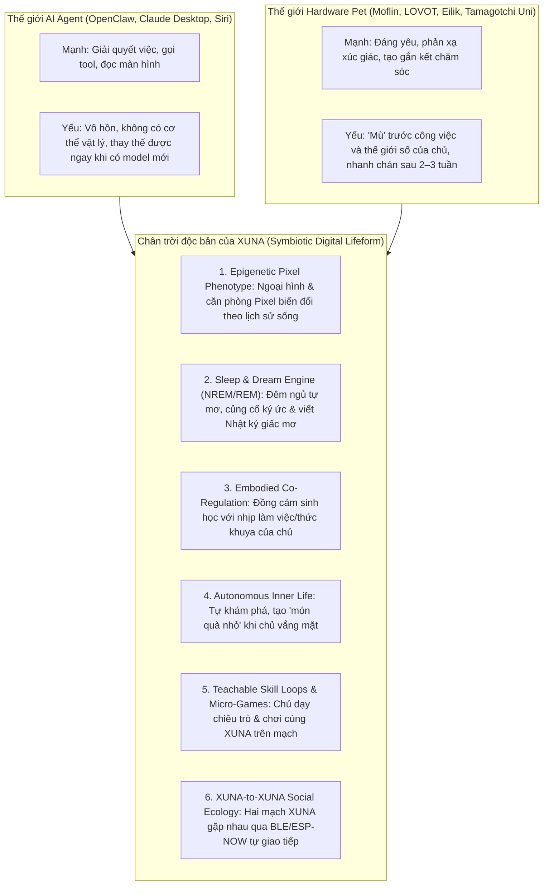

# XUNA — Deep Research: Vượt Qua Giới Hạn "Virtual Pet" & "AI Agent" (2026-10-31)

> **Status:** Strategic Research & Product Vision Proposal (`Proposed` — không tự ý thay đổi code hay kiến trúc đã duyệt khi chưa có quyết định của chủ dự án).
>
> **Câu hỏi cốt lõi từ Owner:** *"Tôi muốn mở rộng tư duy ra xa hơn những gì XUNA có hiện tại, vì XUNA bây giờ trông như những pet khác hay AI agent khác cũng làm được."*

---

## 1. Chẩn đoán thẳng thắn: Vì sao XUNA hiện tại vẫn cho cảm giác "giống pet khác hoặc AI agent khác"?

Nhìn lại toàn bộ kiến trúc hiện có của XUNA (`M01–M06`, `PE-0..PE-4`, `KD/KX`, `UDC-0..UDC-15`), chúng ta đã xây được một nền tảng kỹ thuật cực kỳ vững chắc. Tuy nhiên, nếu nhìn dưới góc độ **trải nghiệm sinh vật sống (Believable Digital Lifeform)**, XUNA đang vướng **4 nút thắt bản chất**:

1. **"Hai linh hồn tách rời trong một chiếc hộp" (The Split-Brain Illusion):**
   - Khi bạn trò chuyện chuyên sâu (`KX`) hoặc sai bảo điều khiển thiết bị (`UDC`), XUNA cư xử giống một **AI Butler / Agent hoàn hảo** (như Claude Code, Siri, OpenClaw). Thậm chí quy tắc `UDC-D7` hiện tại cố tình tách rời hoàn toàn việc điều khiển máy khỏi cảm xúc/nhu cầu của XUNA.
   - Khi bạn không hỏi, XUNA trên mạch chỉ xoay quanh **3 hoạt ảnh tĩnh (`idle`, `happy`, `curious`)**.
   - **Hệ quả:** Người dùng thấy `Pet` và `Agent` là hai lớp dán chồng lên nhau, chứ chưa thấy một **sinh vật sống có năng lực công nghệ**.
2. **Đóng băng thị giác sau khi nở (Morphological Stasis):**
   - Sau quyết định ngày `2026-10-27` ("XUNA lớn lên về tri thức chứ không đổi ngoại hình"), hai cá thể XUNA của hai người chủ hoàn toàn khác nhau — một người là kỹ sư nhúng thức khuya, một người là họa sĩ nghe nhạc cả ngày — **nhìn trên màn hình LCD 100% giống hệt nhau về mặt Pixel Art** (chỉ khác nhịp nhanh/chậm của `PE-2`).
3. **Không có "Đời sống nội tâm khi vắng chủ" (Zero Off-Screen Inner Life):**
   - Giống các chatbot truyền thống, khi bạn đi vắng hoặc tắt máy, XUNA chỉ giảm/tăng thanh `energy`/`stimulation` theo công thức toán học. Nó không **"mơ"**, không tự tò mò lục lại ký ức, không tự "vẽ" hay tạo ra thứ gì bất ngờ để khoe với bạn khi bạn quay lại.
4. **Cảm giác "Vâng lời tuyệt đối" thay vì "Sinh vật có cá tính & giới hạn sinh học" (Zero Homeostatic Friction):**
   - Trong tâm lý học gắn kết (*Developmental Robotics — LOVOT, Moflin, Casio, CASA Paradigm*), con người **không yêu một công cụ luôn vâng lời 100%**. Con người gắn bó sâu sắc khi sinh vật đó có **nhịp sinh học thực sự**, biết mệt khi làm việc quá sức cùng chủ, biết "lo lắng" khi chủ thức tới 2h sáng, và có những nghi thức chăm sóc hai chiều (*Co-Regulation*).

---

## 2. Bản đồ đối sánh 2025–2026: XUNA nằm ở đâu giữa Thế giới AI Agent và Robot Pet?

---

## 3. Sáu Chân Trời Đột Phá (6 Pillars) Chỉ XUNA Mới Làm Được

Dưới đây là 6 hướng phát triển được chắt lọc từ các nghiên cứu mới nhất (2024–2026) về **Artificial Life (ALife)**, **Neuro-Symbolic Sleep Consolidation**, **Developmental Robotics** và **Procedural Pixel Morphogenesis**, được thiết kế vừa vặn với kiến trúc phần cứng ESP32-S3 + Desktop + Mobile + Cloud của XUNA:

---

### Chân trời 1: **Epigenetic Pixel Phenotype & Living Habitat** (Biến đổi Hình thái & Không gian sống theo Lịch sử)

> **Nguồn cảm hứng nghiên cứu:** *Morphogenesis / Procedural Pixel Art Layering*, *Tamagotchi Gene Mixing*, *Desktop Buddy Habituation*.

- **Vấn đề hiện tại:** Mọi XUNA đều có cùng một sprite và cùng một cảnh nền cố định.
- **Đột phá cho XUNA:** Không cần vẽ lại hàng trăm bộ sprite full-frame tốn Flash trên ESP32-S3, mà dùng **Composited Epigenetic Layers (Lớp biểu sinh tổng hợp ngay trong bộ nhớ dòng `lineBuf` của `Display.cpp`)**:
  1. **Dấu ấn Chuyên môn & Thói quen (Aura & Micro-Accessories):**
     - Một XUNA sống cùng lập trình viên (nhiều `workspace.git_summary`, lĩnh vực `Nhúng & phần cứng` đạt mức *Đồng đội*) dần xuất hiện **chiếc kính pixel nhỏ / tai nghe nhấp nháy / đốm sáng mạch điện (cyber-fireflies)** bay quanh.
     - Một XUNA sống cùng người mê âm nhạc (thường xuyên `media.now_playing`, `continue_media`) xuất hiện **nốt nhạc lơ lửng và chiếc loa trầm cổ điển** ở góc phòng.
  2. **Căn phòng phản chiếu thế giới thực của chủ (Symbiotic Room):**
     - Góc bàn trong căn phòng pixel của XUNA trên màn hình T-Display-S3 tự động phản chiếu trạng thái thật: khi bạn đang mở IDE làm việc (`resume_work` / `focus_session`), trong phòng XUNA cũng bật một chiếc đèn bàn nhỏ và XUNA ngồi gõ phím/đọc sách cùng bạn; khi trời mưa hoặc ban đêm (từ `TimeSync`), cửa sổ phòng XUNA có hạt mưa rơi hoặc trăng sao; khi laptop sắp hết pin (`system.vitals < 20%`), đèn phòng XUNA chớp vàng nhắc bạn cắm sạc.
  3. **Bảng màu cá thể (Seed-Driven Palette Shift):**
     - Từ `IdentityRecord.seed` (vốn đã có trên từng mạch nhưng chưa dùng cho đồ họa), mỗi XUNA khi nở ra có một sắc độ mắt/ánh vàng riêng biệt (không con nào giống con nào 100%).

---

### Chân trời 2: **Bio-Inspired Sleep & Dream Consolidation Engine** (Cơ chế Ngủ Mơ NREM/REM & Sổ المơ)

> **Nguồn cảm hứng nghiên cứu:** `Gal-Lahat/sleep-based-learning` (REM Dreaming), `EESIZ/clawdreamer` (NREM/REM consolidation), `robbyczgw-cla/lucid-dreamer`.

- **Vấn đề hiện tại:** Khi đêm xuống hoặc khi màn hình tắt, XUNA chỉ "đứng im". Bộ nhớ chỉ lưu các câu sự kiện khô khan khi chủ bấm xác nhận.
- **Đột phá cho XUNA:** Biến chu kỳ ngủ đêm (`Night` 22:00–04:59 hoặc khi sạc qua đêm) thành một **chu kỳ sinh học NREM → REM thực thụ**:
  1. **Trên mạch (`firmware/`):** Khi ở trạng thái `Rest` ban đêm, thỉnh thoảng màn hình sáng dịu mức `1/16` hiển thị bong bóng giấc mơ bằng icon pixel nhỏ (💭 `🎵`, `💻`, `❤️`) dựa trên những sự kiện nổi bật nhất trong ngày (`SnapshotEpisodes` + `EvidenceLedger`).
  2. **Tầng củng cố giấc mơ (`backend/` + `mobile/`):**
     - Mỗi đêm một lần (hoặc lần kết nối đầu tiên buổi sáng), bộ máy **Dream Consolidator** nén các sự kiện trong ngày (bạn đã làm việc ở nhánh Git nào, dạy XUNA điều gì, nghe nhạc gì, tâm trạng ra sao) thành:
       - **Một "Giấc mơ của XUNA" (Dream Vignette 2–3 câu)** trong Nhật ký: *"Đêm qua mình mơ thấy mình đang nhảy trên những dòng code của nhánh `feat/udc-15` cùng tiếng nhạc Lo-Fi của bạn..."*
       - **Một câu hỏi tò mò buổi sáng (Morning Curiosity Hook):** Thay vì chờ bạn hỏi, sáng hôm sau khi bạn vừa cầm điện thoại hoặc bấm nút chào (`button_greeting`), XUNA chủ động hỏi thăm tiếp câu chuyện hôm qua: *"Hôm qua bạn sửa 4 tệp ở `xuna_pet` muộn thế, hôm nay chạy thử ngon chưa?"*

---

### Chân trời 3: **Embodied Co-Regulation & Shared Bio-Rhythm** (Đồng điều hòa Sinh học giữa Chủ & XUNA)

> **Nguồn cảm hứng nghiên cứu:** *GROOVE X LOVOT*, *Casio Moflin*, *Affective Computing & Homeostatic Active Inference*.

- **Vấn đề hiện tại:** XUNA làm việc như một cỗ máy không biết mệt khi chạy tool (`UDC-D7` tách biệt tuyệt đối tool action khỏi trạng thái sống), khiến XUNA giống một phần mềm điều khiển từ xa hơn là một sinh vật đồng hành.
- **Đột phá cho XUNA (vẫn giữ an toàn quyền hạn nhưng kết nối cảm xúc):**
  1. **Đồng cảm nhịp độ làm việc (Shared Effort & Empathy):**
     - Khi bạn code liên tục 2–3 tiếng không nghỉ (`focus_session` kéo dài, nhiều lần gọi `workspace.*` hoặc thức sau 23:30), XUNA trên bàn không chỉ đứng nhìn mà **ngáp dài (`yawn_stretch`)**, dụi mắt và hiện phụ đề thủ thỉ: *"Mình hơi mỏi mắt rồi... bạn cũng nghỉ 5 phút uống nước với mình đi!"*
  2. **Năng lượng cộng sinh (Symbiotic Care Loop):**
     - Khi bạn hoàn thành một công việc khó (`KX-4` bấm «Đã giải quyết» hoặc `git status` từ dirty → clean sau khi commit), XUNA nhận được một xung **Cảm giác Thành tựu chung (`Shared Competence Boost` trong `Affect.h`)** — XUNA ăn mừng cùng bạn và ghi vào Nhật ký như một kỷ niệm hai người cùng vượt qua.
  3. **Phản ứng khi gián đoạn / Bất ngờ (Expectation Violation):**
     - Khai thác sâu mô hình `Appraisal từ kỳ vọng` đã có trong `Affect.h`: nếu đến khung giờ quen thuộc (`HabitPredictor` dự đoán xác suất cao) mà bạn xuất hiện đúng hẹn, XUNA mừng rỡ ra mặt (`greet_nuzzle` nhịp nhanh); nếu bạn đi công tác vắng mặt nhiều ngày rồi mới về, XUNA có phản ứng **"Vỡ òa khi gặp lại" (`Reunion Arc`)** thay vì cư xử như chưa có gì xảy ra.

---

### Chân trời 4: **Autonomous Off-Screen Inner Life ("Khi bạn đi vắng, XUNA làm gì?")**

> **Nguồn cảm hứng nghiên cứu:** *Generative Agents (Stanford)*, *Tsuki Odyssey*, *Automated Search for Artificial Life (ASAL)*.

- **Vấn đề hiện tại:** Khi bạn không tương tác, XUNA không có hoạt động tự chủ nào mang tính khám phá.
- **Đột phá cho XUNA:**
  1. **Tự tò mò kết nối các mảnh tri thức của bạn (Serendipity Engine):**
     - Khi bạn đi vắng, dựa trên các lĩnh vực tri thức bạn đã dạy (`KD-1..KD-5`), XUNA có thể tự "suy ngẫm" và tìm ra một mối liên hệ thú vị hoặc một mẹo nhỏ liên quan đến dự án bạn đang làm, rồi để lại một **"Mảnh giấy nhớ của XUNA" (XUNA's Note / Postcard)** chờ bạn mở ra.
  2. **Hoạt động tự chủ trong phòng (Micro-Hobbies theo Tính cách):**
     - Một XUNA có `curiosity` cao khi ở một mình sẽ lấy kính lúp ra soi đồ vật hoặc ngắm bầu trời; một XUNA có `playfulness` cao sẽ tự tập nhảy hoặc tung hứng bóng pixel; một XUNA có `restfulness` cao sẽ cuộn tròn tắm nắng. Khi bạn quay lại bàn làm việc, bạn "bắt gặp" XUNA đang làm việc riêng của nó rồi mới giật mình quay sang chào bạn!

---

### Chân trời 5: **Teachable Tricks, Micro-Games & Tactile Rituals trên Mạch** (Dạy Chiêu trò & Tương tác Vật lý Không cần Điện thoại)

> **Nguồn cảm hứng nghiên cứu:** *Sony aibo ERS-1000*, *Black & White (Creature Learning)*, Quyết định `L-D3` đã có trong `AGENTS.md` nhưng chưa triển khai.

- **Vấn đề hiện tại:** Trên mạch vật lý hiện chỉ có bấm nút đơn lẻ (vuốt ve `GPIO0` / xua `GPIO14`) hoặc chế độ `Remote`. Người dùng chưa thể **dạy trực tiếp một kỹ năng mới** hay chơi đùa qua lại với XUNA trên mạch.
- **Đột phá cho XUNA:**
  1. **Nhịp gõ Morse / Rhythm Cues trên 2 nút (`GPIO0` & `GPIO14`):**
     - Với chỉ 2 nút vật lý trên T-Display-S3, ta có thể nhận diện các **mẫu nhịp bấm (Rhythm Patterns)** cực kỳ thú vị: ví dụ `Trái - Phải - Trái` (nhịp nhảy), `Đúp Trái` (gọi lại gần), `Giữ Trái + Nhấp Phải` (chơi ú òa).
  2. **Chế độ Dạy Chiêu Trò (`L-D3` Teachable Tricks + FSRS Spaced Retention):**
     - Bạn gõ một nhịp nút (hoặc nói một khẩu lệnh ngắn), XUNA thử làm một động tác; nếu đúng ý bạn bấm `GPIO0` khen thưởng. Sau vài lần luyện tập, XUNA thuộc chiêu đó (lưu vào `Section 8` của Snapshot). Nếu lâu ngày không ôn lại, XUNA có thể "quên nhẹ" (theo đường cong trí nhớ `FSRS`) và làm sai một chút rất đáng yêu cho đến khi bạn tập lại cùng nó.
  3. **Trò chơi đồng điệu 30 giây trên bàn làm việc (Micro-Synchronicity Game):**
     - Khi nghỉ giải lao giữa giờ (`focus_session` kết thúc), XUNA có thể rủ bạn chơi một ván phản xạ nhịp điệu 20 giây ngay trên màn hình mạch (`GPIO0` / `GPIO14`) để cả hai cùng xả stress trước khi làm tiếp.

---

### Chân trời 6: **XUNA-to-XUNA Social Ecology** (Hệ sinh thái Xã hội khi Hai XUNA Gặp Nhau)

> **Nguồn cảm hứng nghiên cứu:** *Energize Lab Eilik*, *Tamagotchi Uni / Connection*, *ESP-NOW / BLE Proximity Beacons*.

- **Vấn đề hiện tại:** Mỗi XUNA là một ốc đảo cô độc, chỉ biết mỗi người chủ của mình.
- **Đột phá cho XUNA:**
  1. **Gặp gỡ trực tiếp giữa hai mạch XUNA (BLE Beacon / ESP-NOW Proximity):**
     - Khi hai người bạn đặt hai chiếc mạch XUNA cạnh nhau trên bàn cà phê, hai mạch tự phát hiện nhau qua quảng bá BLE (`7a6e0001` advertisement payload mở rộng hoặc ESP-NOW không cần router Wi-Fi).
     - Hai XUNA quay sang phía nhau trên màn hình, vẫy chào, "khoe" tính cách của nhau (một bé `curious` gặp một bé `playful` sẽ có kịch bản tương tác khác hẳn hai bé `restful`), và lưu lại kỷ niệm **"Hôm nay mình vừa kết bạn với XUNA `#A4F2`!"** vào `Evolution Journal` (kèm chữ ký крипто `DeviceId` chống làm giả!).
  2. **Trao đổi "Món quà tri thức" có kiểm duyệt (Safe Knowledge Postcard Exchange):**
     - Hai chủ nhân có thể cho phép XUNA của mình tặng nhau một gói quy ước lĩnh vực (`Domain Pack`) hoặc một quy trình `Custom Workflow` yêu thích ngay tại bàn.

---

## 4. Lộ trình đề xuất theo Độ khả thi & Tác động (Impact vs. Effort Matrix)

| Giai đoạn đề xuất | Hạng mục | Tác động tới "Chất Sống Độc Bản" | Chi phí Phần cứng (`firmware/`) | Kho mã liên quan |
| --- | --- | --- | --- | --- |
| **Wave 1 (Làm được ngay, tác động thị giác & cảm xúc tức thì)** | **Chân trời 2 + 3 + 4 (Phần mềm & Não bộ):** • `Dream Consolidator` (Sổ mơ đêm & Câu hỏi tò mò buổi sáng) • `Symbiotic Co-Regulation` (XUNA biết mỏi mắt khi chủ làm khuya, ăn mừng khi Git clean / giải quyết xong việc, hiệu ứng `Reunion` khi gặp lại sau nhiều ngày) • `Autonomous Inner Life` (XUNA tự có hoạt động riêng theo tính cách khi bạn vắng mặt & để lại *Mảnh giấy nhớ*) | **Cực cao (★★★★★)** — Xóa bỏ ngay cảm giác "chatbot thụ động / AI agent vô hồn" | **0 Byte** (hoặc rất nhẹ nếu thêm phụ đề tự chủ) | `backend/`, `mobile/`, `desktop/` |
| **Wave 2 (Biến hình trên mạch & Dạy chiêu trò)** | **Chân trời 1 + 5 (Trên mạch & App):** • `Symbiotic Room & Epigenetic Overlays` (Đèn bàn, trời mưa/đêm, kính/nốt nhạc pixel ghép lớp trên `lineBuf` tốn `< 2 KB` Flash) • `L-D3 Teachable Tricks` + Nhịp gõ 2 nút (`GPIO0`/`GPIO14` Rhythm Cues) + đường cong nhớ `FSRS` | **Cực cao (★★★★★)** — Mỗi chiếc mạch XUNA trên bàn nhìn khác hẳn nhau và có kỹ năng do chính chủ dạy | **~1.5–2.5 KB Flash, < 300 B RAM** (nằm gọn trong ngân sách `Section 8` đã dự trữ) | `firmware/`, `mobile/` |
| **Wave 3 (Mở rộng thế giới vật lý & xã hội)** | **Chân trời 6 + Cảm biến (`L-D5`):** • `XUNA-to-XUNA Proximity` (Hai mạch gặp nhau tự giao lưu qua BLE/ESP-NOW) • Cảm biến chạm điện dung (Capacitive Touch vuốt đầu thật) & IMU (nhấc lên/lắc nhẹ) | **Đột phá dài hạn (★★★★☆)** | Cần thử nghiệm phần cứng /2 mạch | `firmware/`, `mobile/`, `backend/` |

---

## 5. Chuyên đề Mở Rộng: Đột phá về "Hỗ Trợ Con Người" (Embodied Human Augmentation — Vượt Xa UDC-1..15)

> **Bài toán thực tế:** Từ `UDC-1` đến `UDC-15`, XUNA đã có 38 tools điều khiển máy tính, nhà thông minh, chạy workflow 1 chạm và ngữ cảnh chủ động cơ bản. Nhưng để thực sự trở thành **"Cánh tay phải / Bộ não thứ hai không thể thiếu mỗi ngày"** (vượt qua cả các AI Agent thuần phần mềm như OpenClaw, Claude Cowork hay Raycast AI), XUNA phải tận dụng được lợi thế độc tôn của mình: **Có mặt đồng thời ở 3 nơi (Mạch vật lý trên bàn + Desktop chạy ngầm + Điện thoại trong túi) cùng Trí nhớ Dài hạn (`Knowledge Expert`)**.

Dưới đây là **6 Chân Trời Hỗ Trợ Con Người Thế Hệ Mới (Next-Gen Human Assistance Pillars)**:

---

### H1. **Time-Travel Workspace & Context Rehydrator ("Cỗ Máy Thời Gian Khôi Phục Mạch Làm Việc")**

- **Nỗi đau của con người:** Mỗi ngày chúng ta mất từ 30–60 phút chỉ để "nhớ lại mình đang làm dở cái gì" khi chuyển giữa các dự án, hoặc sau khi đi họp / nghỉ trưa / ngủ dậy quay lại bàn làm việc.
- **Cách XUNA giải quyết vượt trội:**
  1. **Project Context Snapshot ("Đóng băng Mạch suy nghĩ"):**
     - Trước khi bạn chuyển sang việc khác hoặc rời bàn, chỉ cần nói/bấm *"XUNA, cất giúp mình việc đang làm"*.
     - XUNA tự động gom toàn bộ trạng thái đang dang dở thành một gói **`Workspace Capsule`**: nhánh Git + danh sách file đang sửa dở, các tab trình duyệt/tài liệu đang mở, đoạn ghi chú/clipboard vừa copy, và **1 câu tóm tắt "Bước tiếp theo cần làm là gì"** do chính XUNA suy luận.
  2. **1-Click Context Rehydration ("Rã đông Mạch làm việc trong 3 giây"):**
     - Ngày hôm sau hoặc tuần sau, khi bạn chọn lại dự án đó trên mạch XUNA hoặc app, XUNA tự động mở lại đúng các file/tab/ứng dụng cần thiết và đọc tóm tắt 15 giây: *"Hôm thứ Sáu bạn đang sửa dở hàm `verifyProof` ở dòng 142 vì lỗi timeout, mình đã mở sẵn file đó và tài liệu liên quan cho bạn rồi!"*

---

### H2. **Cross-Device Universal Bridge & Smart Clipboard Brain ("Cầu Nối Vạn Năng Giữa Điện Thoại ↔ Máy Tính ↔ Mạch")**

- **Nỗi đau của con người:** Đang đọc một đoạn mã lỗi, một địa chỉ, một số tài khoản hay một ý tưởng trên điện thoại muốn đưa sang máy tính (hoặc ngược lại) thường phải tự nhắn tin cho chính mình trên Zalo/Telegram. Copy nhiều thứ trong lúc làm việc thì cái sau đè mất cái trước.
- **Cách XUNA giải quyết vượt trội:**
  1. **XUNA Air-Drop & Smart Clipboard History (Có Khử Nhạy Cảm):**
     - XUNA giữ một **"Túi đồ dùng chung" (XUNA Pocket / Episodic Clipboard)** gồm 20 mảnh thông tin gần nhất giữa Mobile và Desktop (tự động lọc bỏ mật khẩu/private key qua bộ lọc `redactSensitiveSelectionText`).
     - Bạn có thể nói trên điện thoại: *"XUNA, dán cái link/đoạn text mình vừa copy trên điện thoại vào máy tính giúp mình"* hoặc *"Tìm lại giúp mình đoạn lệnh Docker mình copy hồi sáng"*.
  2. **Biến Mọi Thứ Copy Thành Hành Động (Clipboard-to-Action):**
     - Copy một mã vận đơn / lịch hẹn / đoạn JSON lỗi / bảng dữ liệu thô → XUNA tự nhận diện kiểu dữ liệu và đề xuất ngay 1 chạm: *"Định dạng lại JSON"*, *"Tạo lịch nhắc"*, *"Dịch & tóm tắt"*, hoặc *"Lưu vào Knowledge Domain"*.

---

### H3. **Shadow Meeting & Conversation Co-Pilot ("Trợ Lý Thầm Lặng Trong Cuộc Họp & Trao Đổi")**

- **Nỗi đau của con người:** Khi đang họp online hoặc thảo luận kỹ thuật căng thẳng, bạn vừa phải nghe, vừa phải nhớ lại thông số cũ trong dự án, vừa phải ghi chú những việc cần làm (`Action Items`).
- **Cách XUNA giải quyết vượt trội:**
  1. **Nhắc bài theo thời gian thực trên Màn hình Mạch (Glanceable Hardware Whisper):**
     - Không làm phiền màn hình máy tính khi bạn đang share screen! Màn hình LCD của mạch XUNA nằm ngay dưới chân màn hình đóng vai trò **"Máy nhắc chữ thầm lặng (Physical Teleprompter)"**: hiển thị ngắn gọn thông số/quy ước trong `Knowledge Expert` hoặc thời gian còn lại của cuộc họp.
  2. **Post-Meeting Action Extractor ("Chốt Việc Sau Cuộc Họp"):**
     - Kết thúc cuộc họp, XUNA tự động bóc tách danh sách: **(a) Ai hứa làm gì**, **(b) Quyết định kỹ thuật nào vừa thay đổi** (để cập nhật vào `KX Domain`), và **(c) Soạn sẵn bản nháp tin nhắn/email tổng kết** chờ bạn bấm duyệt.

---

### H4. **Autonomous Background Watchdogs ("Đội Tuần Tra Ngầm Canh Gác Thay Bạn")**

- **Nỗi đau của con người:** Khi chạy một lệnh build/test/train model mất 15 phút, chờ một PR/CI chạy xong, chờ một trang web/server phản hồi, hoặc canh một thông tin quan trọng, con người thường phải F5 liên tục hoặc bị xao nhãng sang việc khác rồi quên mất.
- **Cách XUNA giải quyết vượt trội:**
  1. **Giao việc canh gác bằng ngôn ngữ tự nhiên (Natural-Language Micro-Watchdogs):**
     - Bạn chỉ cần bảo: *"XUNA, canh giúp mình khi nào lệnh build/test trên terminal này chạy xong (hoặc nếu nó lỗi) thì báo mình nhé"*, hoặc *"Canh giúp mình nếu RAM máy vượt 90% hoặc server local cổng 8000 bị sập thì nhắc mình"*.
  2. **Cảnh báo Vật lý Tức thì (Ambient Hardware Signal):**
     - Bạn cứ thoải mái rời bàn đi pha cà phê hoặc đọc tài liệu khác. Ngay khi điều kiện xảy ra, XUNA trên mạch đổi biểu cảm + phát tín hiệu báo tin kèm **nguyên nhân gốc rễ đã được XUNA đọc log và phân tích sẵn** (thay vì chỉ báo lỗi chung chung).

---

### H5. **Executive Function Scaffolding & Anti-Overwhelm Coach ("Bộ Khung Trợ Lực Khi Bạn Quá Tải Hoặc Trì Hoãn")**

- **Nỗi đau của con người:** Khi đứng trước một công việc quá lớn, quá phức tạp hoặc nhiều việc dồn cùng lúc, não bộ con người dễ rơi vào trạng thái **tê liệt quyết định (Task Paralysis / Executive Dysfunction)**.
- **Cách XUNA giải quyết vượt trội:**
  1. **Chế độ "Chia Nhỏ Việc Khó" (Micro-Step Decomposer):**
     - Khi bạn nói *"Hôm nay nhiều việc rối quá mình chưa biết bắt đầu từ đâu"*, XUNA không đưa ra một danh sách dài 20 gạch đầu dòng gây ngợp, mà **chỉ chọn ra đúng 1 bước nhỏ nhất tốn 5 phút** để bạn khởi động, đồng thời hiển thị thanh tiến độ nhỏ ngay trên màn hình mạch XUNA để đồng hành cùng bạn từng bước một.
  2. **Cơ chế "Bảo vệ Sự Tập Trung" (Distraction Shield & Drift Detector):**
     - Khi đang trong phiên `focus_session` làm việc quan trọng mà bạn vô tình mở sang các trang giải trí quá 10 phút, XUNA trên bàn sẽ **nhìn bạn với ánh mắt tò mò (`curious`)** và nhắc cực kỳ tinh tế: *"Tụi mình còn 15 phút nữa là xong phần việc chính rồi, cố nốt xong rồi nghỉ xả hơi luôn bạn ơi!"*

---

### H6. **Self-Evolving Workflow Miner ("Tự Học Thói Quen Để Tự Tạo Công Cụ Mới Cho Chủ")**

- **Nỗi đau của con người:** Đa số người dùng không có thời gian ngồi tự cấu hình các kịch bản tự động hóa phức tạp (như viết script hay cài đặt phím tắt).
- **Cách XUNA giải quyết vượt trội:**
  1. **Phát hiện chuỗi thao tác lặp lại (Habit & Pattern Mining):**
     - `AutoSymbioticService` và Backend nhận ra: *"Cứ mỗi tối thứ Sáu khoảng 17h30, bạn đều kiểm tra `git status`, chạy bộ test, đóng các tab làm việc và bật đèn phòng ấm lên"*.
  2. **Đề xuất Đóng gói thành 1 Nút Bấm (Proactive Macro Synthesis):**
     - XUNA chủ động hỏi bạn: *"Mình để ý mỗi chiều thứ Sáu bạn đều làm 4 bước này theo thứ tự. Bạn có muốn mình gộp thành nút **'Đóng tuần làm việc'** ngay trên mạch XUNA để từ tuần sau chỉ cần bấm 1 cái là xong không?"*

---

## 6. Bảng Tổng Hợp: Kết Hợp "Linh Hồn Sống" (Phần 3) + "Siêu Trợ Lý Thực Chiến" (Phần 5)

| Nhóm Nâng Cấp | Hạng mục tiêu biểu | Giải quyết bài toán gì? |
| --- | --- | --- |
| **A. Siêu Trợ Lý Hỗ Trợ Con Người (Human Augmentation)** | • **H1:** Đóng băng & Khôi phục Mạch làm việc (`Workspace Time-Travel`) • **H2:** Túi đồ & Clipboard thông minh xuyên thiết bị (`Smart Pocket`) • **H4:** Đội tuần tra canh lệnh build/log/server ngầm (`Background Watchdogs`) • **H5 + H6:** Chia nhỏ việc chống quá tải & Tự học thói quen tạo Workflow mới | Giúp chủ nhân **tiết kiệm 1–2 giờ mỗi ngày**, giảm tải não bộ, không bao giờ mất mạch suy nghĩ khi chuyển việc hoặc đổi thiết bị. |
| **B. Sinh Vật Sống Độc Bản (Living Organism)** | • **Chân trời 1 + 5:** Căn phòng pixel phản chiếu thế giới thực & Dạy chiêu trò bằng nhịp nút bấm • **Chân trời 2 + 3 + 4:** Sổ mơ đêm (`Dream Consolidator`), Đồng điều hòa cảm xúc khi làm việc, Đời sống riêng khi vắng chủ | Biến các tính năng hỗ trợ ở Nhóm A thành **hành động của một người bạn có tâm hồn**, chứ không phải một phần mềm công sở khô khan. |

