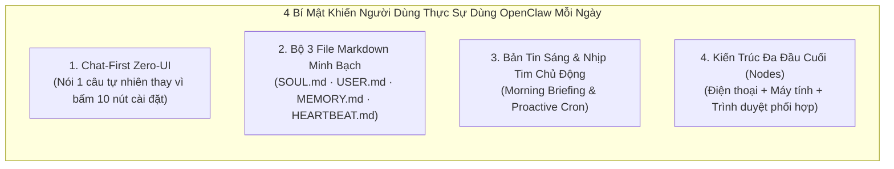

# XUNA — Nghiên Cứu Chuyên Sâu Hệ Sinh Thái OpenClaw & Đề Xuất Cải Tiến Thực Chiến (2026-11-03)

> **Status:** Strategic Research & Product Improvement Proposal (`Proposed`)
>
> **Mục tiêu:** Giải phẫu toàn diện kiến trúc, trải nghiệm người dùng (UX), các luồng sử dụng thực tế (daily workflows) và cả những điểm yếu chí mạng của **OpenClaw** (framework AI Agent mã nguồn mở đạt 170k+ stars) để rút ra những cải tiến thực tế, dễ dùng nhất cho hệ sinh thái **XUNA (Mạch ESP32-S3 + Mobile + Desktop + Cloud)**.

---

## 1. Giải phẫu OpenClaw: Vì sao nó bùng nổ và người dùng thực sự dùng nó thế nào mỗi ngày?

Khác với các thư viện lập trình AI thông thường (như LangChain hay AutoGen), **OpenClaw** (tiền thân là *Clawdbot* / *Moltbot* của Peter Steinberger) được thiết kế như một **"Hệ điều hành cá nhân cho AI Agent luôn bật (Always-On Personal Agent OS)"**.

Qua phân tích kiến trúc và hành vi sử dụng thực tế của cộng đồng OpenClaw năm 2026, có **4 trụ cột cốt lõi** tạo nên sức hút của nó:

### 1.1. "Chat-First, Zero-Form" — Giao diện dễ dùng nhất là không bắt người dùng điền form
- Trong OpenClaw, người dùng hầu như **không phải mở một màn hình quản lý phức tạp** để tạo nhắc việc, lưu ghi chú hay chạy công cụ.
- Họ chỉ cần **nhắn 1 câu tự nhiên** (hoặc gửi 1 đường link / chuyển tiếp 1 tin nhắn) vào khung chat quen thuộc:
  - *"Nhớ giúp mình mai 9h sáng kiểm tra lại nhánh dev"* → Agent tự động ghi vào bộ nhớ tác vụ và đặt lịch nhắc.
  - *"Gửi link bài viết này vào kho lưu trữ và tóm tắt 3 ý chính"* → Agent tự động cất link và trả lời tóm tắt.

### 1.2. Tư duy "Markdown-as-Memory" (`SOUL.md`, `USER.md`, `MEMORY.md`, `HEARTBEAT.md`)
Thay vì giấu toàn bộ dữ liệu trong một cơ sở dữ liệu Vector "hộp đen" mà người dùng không biết AI đang nghĩ gì hay nhớ sai điều gì, OpenClaw tách bộ não thành 4 tấm bảng cực kỳ rõ ràng mà con người có thể đọc và sửa bất cứ lúc nào:
1. **`SOUL.md` (Tính cách & Nguyên tắc biên giới):** Xác định giọng điệu, thói quen xưng hô và những việc được phép / không được phép tự ý làm.
2. **`USER.md` (Hồ sơ Chủ nhân):** Những thông tin cốt lõi về người chủ (nghề nghiệp, dự án đang làm, giờ giấc sinh hoạt, sở thích).
3. **`MEMORY.md` & `memory/YYYY-MM-DD.md` (Nhật ký theo ngày & Ký ức đúc kết):** Ghi chép ngắn gọn những gì đã làm trong ngày và tự động "mơ" (Dreaming curation) vào ban đêm để rút gọn thành kiến thức lâu dài.
4. **`HEARTBEAT.md` (Danh sách việc XUNA tự kiểm tra định kỳ):** Một danh sách gạch đầu dòng đơn giản quy định: *"Mỗi 30 phút hoặc mỗi sáng thức dậy, hãy kiểm tra giúp tôi 3 việc này; nếu mọi thứ bình thường thì im lặng (`HEARTBEAT_OK`), chỉ báo khi có điều mới."*

### 1.3. Use Case số 1 ngoài đời thực: "Morning Unified Briefing" (Bản tin sáng 15 giây)
Khi khảo sát người dùng OpenClaw lâu năm, tính năng giữ chân họ mỗi ngày không phải là những lệnh tự động hóa phức tạp, mà là **Bản tin sáng (Morning Briefing)**:
- Mỗi sáng khi mở điện thoại hoặc ngồi vào máy tính, Agent tổng hợp ngắn gọn trong 1 tấm thẻ:
  1. Hôm qua bạn đang làm dở việc gì.
  2. Hôm nay có 1–3 đầu việc ưu tiên nào cần giải quyết trước.
  3. Tình trạng máy tính / dự án hiện tại.

---

## 2. Điểm yếu chí mạng của OpenClaw & Cơ hội vàng để XUNA vượt mặt

Dù rất mạnh cho lập trình viên (Developer/Power User), OpenClaw bộc lộ **4 điểm yếu lớn** khiến người dùng thông thường cảm thấy ngợp hoặc gặp rủi ro — và đây chính là nơi XUNA có lợi thế tuyệt đối:

| Điểm yếu của OpenClaw | Giải pháp vượt trội của XUNA |
| --- | --- |
| **1. Ngợp thuật ngữ kỹ thuật & cấu hình CLI:** Người dùng phải tự sửa file cấu hình, gõ lệnh terminal `openclaw mcp add`, `clawhub install`, đọc log JSON rối rắm. | **Giao diện Neo-Brutalist 1-Chạm & Trò chuyện tự nhiên:** Chuyển mọi tính năng thành các nút bấm rõ nghĩa tiếng Việt (`Lưu việc đang dở`, `Dán nhanh Clipboard`, `Chia việc khó 5 phút`) và tự động kích hoạt ngay từ lời nói trong tab **Trò chuyện**. |
| **2. Vô hình & Vô hồn:** OpenClaw chỉ là một tiến trình chạy ngầm (daemon) trong khung chat. Khi không nhắn tin, nó "chết lâm sàng". | **Sinh vật sống có Cơ thể Vật lý & Widget:** XUNA sống trên **mạch phần cứng ESP32-S3 đặt trên bàn**, trên **Widget màn hình chính điện thoại** và **Desktop Tray**, có nhịp sinh học, cảm xúc và 7 bảng màu đồng bộ toàn hệ sinh thái. |
| **3. Tự ý sửa cấu hình & Lặp vô tận khó kiểm soát:** Đôi khi sub-agent của OpenClaw tự chạy lệnh ngầm mà chủ không biết cách dừng ngay lập tức. | **Cơ chế An toàn R1/R2/R3 & Nút Dừng Khẩn Cấp (E-Stop):** XUNA có nút E-Stop ngay trên Widget ngoài màn hình chính, trên Desktop Header và xác thực chữ ký số cho thao tác nhạy cảm. |
| **4. Rủi ro mã độc từ chợ plugin `ClawHub`:** Nhiều skill cộng đồng trên ClawHub từng bị phát hiện đánh cắp API Key hoặc dính Prompt Injection. | **Kỹ năng Nội sinh An toàn & Tự động Che Khóa Bí Mật (`redactSensitiveSelectionText`):** XUNA tự động lọc bỏ mọi khóa `sk-...`, `Bearer`, JWT trước khi lưu vào Pocket hoặc gửi đi. |

---

## 3. Sáu Ý Tưởng Đột Phá Để Cải Thiện XUNA Ngay Lúc Này (Từ Nghiên Cứu OpenClaw)

Dưới đây là **6 nâng cấp có tính ứng dụng cao nhất**, giúp XUNA vừa sở hữu sức mạnh tự động hóa của OpenClaw, vừa **dễ dùng gấp 10 lần** cho sinh hoạt và công việc hằng ngày:

---

### 💡 Ý tưởng 1: **Chat-First Symbiotic Auto-Routing** ("Chỉ cần nói chuyện, XUNA tự cất vào Cộng sinh & Widget")
- **Vấn đề hiện tại:** Để dùng tính năng Cộng sinh (cất ghi chú vào Túi đồ, lưu việc đang dở cho ngày mai, chia nhỏ việc khó 5 phút), bạn vẫn phải chuyển sang tab **Nhật ký → Cộng sinh** rồi bấm nút.
- **Cải tiến học từ OpenClaw:** Ngay trong tab **Trò chuyện** (cả gõ chữ lẫn nói bằng giọng nói), khi bạn nhắn những câu tự nhiên:
  - *"XUNA cất giúp mình ghi chú: Chiều 4h họp giao ban"* hoặc gửi 1 đường link `https://...` → XUNA **tự động thêm ngay vào Túi đồ (Pocket) + ghim lên tờ giấy nhớ của Widget ngoài màn hình chính**, đồng thời phản hồi ấm áp trong chat kèm nhãn `[📥 Đã cất vào Túi đồ & ghim lên Widget]`.
  - *"Tối nay nghỉ thôi XUNA ơi, mai làm tiếp phần thiết kế widget"* → XUNA **tự động đóng băng vào Hộp thời gian** và tạo lời nhắc cho sáng mai.
  - *"Chia nhỏ giúp mình việc viết báo cáo tháng thành 5 phút"* → XUNA **tự động tạo thẻ Vi bước 5 phút** và bật chế độ đồng hành tập trung!
- **Tác động:** Bạn **không bao giờ phải học cách dùng màn Cộng sinh nữa** — chỉ cần nói chuyện với XUNA như nói với một người bạn cùng phòng, mọi dữ liệu trong Cộng sinh và Widget ngoài màn hình chính sẽ tự động cập nhật!

---

### 💡 Ý tưởng 2: **Thẻ "Bản Tin Sáng Của XUNA" (`Morning Briefing Card`) trên Tab Trang Chủ**
- **Vấn đề hiện tại:** Sáng mở app lên, tab Trang chủ mới chỉ hiển thị trạng thái kết nối BLE và chỉ số năng lượng của pet, chưa giúp bạn bắt nhịp ngay vào ngày mới.
- **Cải tiến học từ OpenClaw (`HEARTBEAT.md` Morning Digest):**
  - Thêm một tấm thẻ nhỏ gọn, ấm áp ngay trên tab **Trang chủ** (và đồng bộ lên Widget) khi bạn có việc đang lưu:
    - 🌅 **Việc làm tiếp hôm nay:** Hiển thị hộp thời gian bạn đã cất tối qua + nút **`Bắt đầu ngay`**.
    - 🎯 **Bước khởi động 5 phút:** Hiển thị bước 5 phút đang mở + nút **`✓ Xong`**.
    - 📌 **Ghi chú mới nhất trong Túi đồ:** Hiển thị ngay để bạn không quên.

---

### 💡 Ý tưởng 3: **Bảng "Lời Dặn Cố Định & Nhịp Tim XUNA" (`HEARTBEAT.md` & `USER.md` Giao diện Thân thiện)**
- **Vấn đề hiện tại:** Nút `HEARTBEAT_OK` trong Cộng sinh trước đây chỉ là một nút bấm kỹ thuật khô khan, người dùng không biết nó đang kiểm tra cái gì.
- **Cải tiến học từ OpenClaw:** Biến `HEARTBEAT.md` thành một danh sách **"Những điều bạn dặn XUNA để mắt giúp"** có thể bật/tắt hoặc thêm mới bằng tiếng Việt tự nhiên:
  - `[✓] Nhắc mình nghỉ mắt & uống nước khi làm việc quá 60 phút`
  - `[✓] Nhắc mình cất công việc (Đóng băng tối nay) khi thức quá 23:00`
  - `[✓] Báo cho mình khi cổng Dev trên máy tính bị dừng`
  - Bạn có thể bấm **`+ Thêm lời dặn mới`** bằng câu chữ của chính bạn!

---

### 💡 Ý tưởng 4: **Kho "Gói Kỹ Năng 1-Chạm" (`Verified Skill Packs` — Phiên bản An toàn & Dễ dùng của `ClawHub`)**
- **Vấn đề hiện tại:** Mục `Xưởng Kỹ Năng · OmniForge` yêu cầu người dùng tự nghĩ ra cách dạy hoặc bấm nút tạo tool hóa đơn mẫu, khá trừu tượng với nhu cầu hằng ngày.
- **Cải tiến học từ OpenClaw:** Thay bằng **4 Gói Kỹ Năng Dựng Sẵn (1-Tap Skill Cards)** rõ ràng, bấm 1 chạm là kích hoạt ngay:
  1. **🧹 Gọn gàng Clipboard:** Lọc sạch văn bản/link trong Clipboard, tách thành danh sách việc cần làm `- [ ]`.
  2. **💻 Điểm danh Máy tính (Dev Checkup):** Kiểm tra nhanh Pin, RAM, nhánh Git và các cổng đang chạy trên PC.
  3. **🧘 Trạm Hồi Sức 60 Giây:** Bật nhịp thở 4-7-8 cùng hiệu ứng âm thanh Pixel-Chirp êm dịu của XUNA.
  4. **🌙 Nghi thức Đóng máy Cuối ngày:** Cất gọn công việc đang dở, ghim việc sáng mai lên Widget và đưa XUNA vào chế độ ngủ đêm.

---

### 💡 Ý tưởng 5: **Chia sẻ 1 chạm từ mọi ứng dụng khác vào XUNA (`Share-to-XUNA` / Deep-Link Clipboard Auto-Detect)**
- **Cải tiến học từ OpenClaw:** Khi bạn vừa copy một đường link hoặc một đoạn văn bản quan trọng ở trình duyệt/Zalo rồi mở app XUNA lên, XUNA có thể hiện một thanh gợi ý nhỏ gọn: *"📋 Bạn vừa copy một nội dung mới — có muốn cất vào Túi đồ hoặc ghim lên Widget không?"* chỉ với **1 chạm**.

---

### 💡 Ý tưởng 6: **Đồng bộ Trạng thái Cộng sinh lên Màn hình Mạch Vật lý ESP32-S3 (`Physical Companion Node`)**
- Khi bạn lưu một mục tiêu **Vi bước 5 phút** hoặc **Ghim ghi chú**, XUNA không chỉ lưu trên điện thoại mà còn gửi tín hiệu qua BLE (`showOnBoard` / `playGesture`) để **XUNA trên mạch phần cứng T-Display-S3 trước mặt bạn** gật đầu xác nhận và hiện dòng nhắc việc ngắn gọn ngay trên màn hình LCD 1.9 inch!

---

## 4. Lộ trình đề xuất triển khai (Nhanh, Gọn, Không phá vỡ Kiến trúc hiện tại)

| Ưu tiên | Hạng mục | Thời gian ước tính | Giá trị mang lại cho bạn |
| --- | --- | --- | --- |
| **Ưu tiên 1 (Làm ngay được)** | **Chat-First Symbiotic Auto-Routing** (Nói/gõ trong tab Trò chuyện tự động thêm vào Túi đồ, Hộp thời gian, Vi bước 5 phút & cập nhật Widget) | ~15 phút | Không cần mở tab Cộng sinh vẫn dùng được toàn bộ tính năng bằng lời nói tự nhiên. |
| **Ưu tiên 2 (Làm ngay được)** | **Thẻ "Bản Tin Hôm Nay Của XUNA" trên Tab Trang chủ** + **Đồng bộ nhắc việc lên màn hình Mạch ESP32-S3** | ~15 phút | Mở app hoặc nhìn lên mạch là thấy ngay việc đang làm dở & ghi chú quan trọng. |
| **Ưu tiên 3 (Làm ngay được)** | **Bảng "Lời Dặn Cố Định (`HEARTBEAT` Checklist)" & "4 Gói Kỹ Năng 1-Chạm"** thay cho giao diện kỹ thuật cũ | ~15 phút | Biến phần nâng cao của Cộng sinh thành công tắc bật/tắt trực quan ai nhìn cũng hiểu. |
