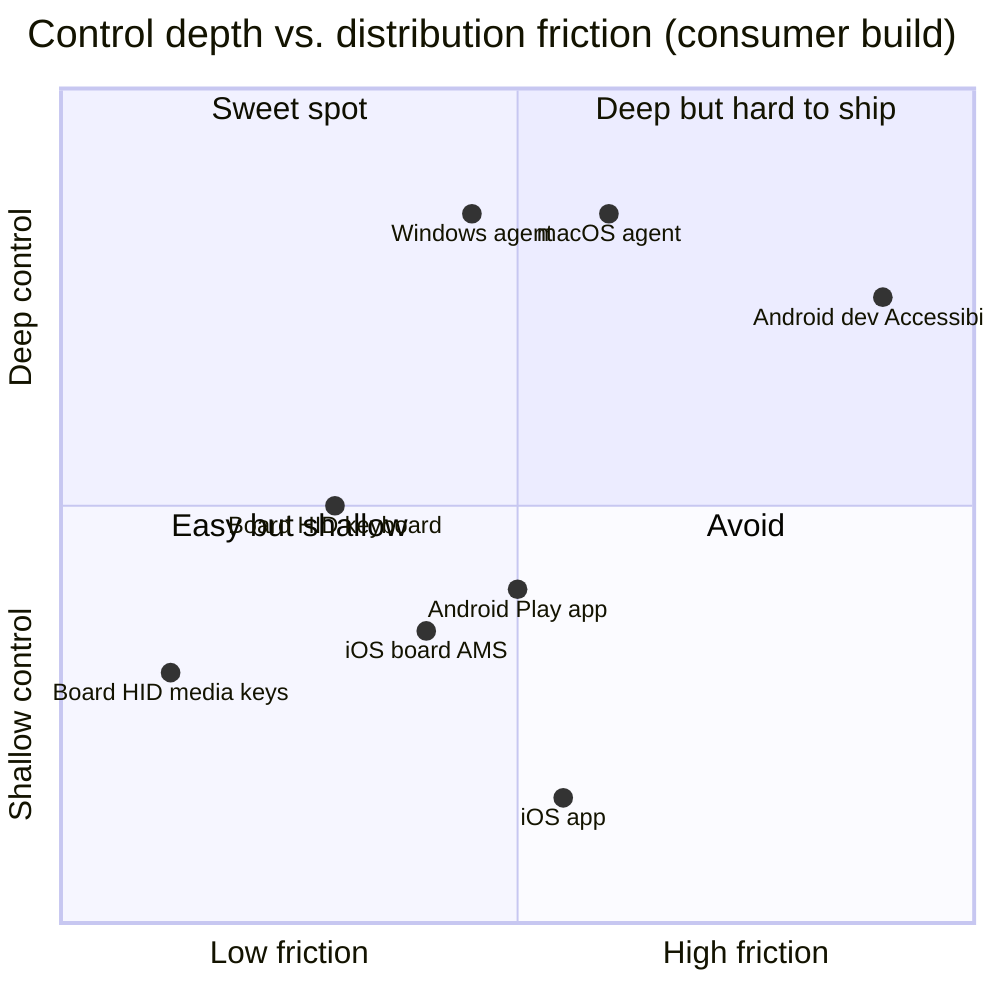

# XUNA Platform Capability Matrix (2026-10-30)

Status: **research only**. Sources are listed in [research §2](XUNA_UNIVERSAL_DEVICE_CONTROL_RESEARCH.md#2-platform-research) and in the [open-source review](XUNA_DEVICE_CONTROL_OPEN_SOURCE_REVIEW.md).

**Marks:**

- Feasibility:
  - ✅ feasible for a consumer product
  - 🟡 conditional (permission, policy, version or app-specific)
  - 🔴 not possible or not allowed
- **†** means the claim comes from platform documentation knowledge but was not re-opened from a primary source in this review. Each † must be re-checked in the milestone design session.
- Reliability: **H** high · **M** medium · **L** low.

**Paths:**

- **HID**: the XUNA board as a Bluetooth LE keyboard, consumer-control or mouse device. Blind, needs no software on the host.
- **Agent**: the XUNA Desktop Agent.
- **App**: the XUNA Flutter app with native code on that phone.
- **Board-GATT**: the board as a GATT client of an iOS accessory service (AMS/ANCS).

## 1. macOS (Agent: signed, notarized Developer ID app outside the Mac App Store)

| # | Capability | Path / API | Feasibility | Permission | Restrictions | Reliability |
|---|---|---|---|---|---|---|
| 1 | Media control | HID consumer keys; Agent: system-defined media key events via CGEvent †, AppleScript to Music/Spotify † | ✅ | HID: none. Agent: Accessibility (event posting) †, Automation per target app † | MediaRemote is a private framework, reported to be restricted to entitled processes since macOS 15.4 † (do not use). Reading "now playing" generally is limited † | H (HID), M (agent) |
| 2 | App launching | `NSWorkspace` open application/URL †; `open -b` † | ✅ | None | Only owner-allowlisted bundle IDs | H |
| 3 | Keyboard/mouse | HID keyboard/mouse; Agent: CGEvent post / postToPid | ✅ | Accessibility (`AXIsProcessTrustedWithOptions`) | Secure input fields (passwords) block synthetic keystrokes †; HID text depends on the host keyboard layout | M |
| 4 | Screen observation | ScreenCaptureKit (`SCShareableContent`, `SCScreenshotManager` macOS 14+) | 🟡 | Screen Recording (`NSScreenCaptureUsageDescription`) | Periodic re-confirmation prompts on recent macOS reported, **UNVERIFIED**; privacy indicator | H |
| 5 | UI inspection | AXUIElement tree | ✅ | Accessibility | Apps with poor AX support; `kAXErrorCannotComplete` on unresponsive apps → timeouts needed | M |
| 6 | Notifications | Post own notifications ✅; read other apps' notifications 🔴 (no public API †) | 🟡 | Notification permission (own) | — | H (own) |
| 7 | File operations | `NSWorkspace` reveal/open; file APIs within owner-chosen folders | 🟡 | Files & Folders / Full Disk Access prompts for protected locations † | Keep to owner-chosen roots; never Full Disk Access | H |
| 8 | System automation | `shortcuts run "<name>"` CLI (macOS 12+) † for owner-built Shortcuts; AppleScript/Apple Events | ✅ | Automation (Apple Events) per target app † | Workflows must be registered on the host; no arbitrary script source | H |
| 9 | AI multi-step workflows | Computer-use driver (Cua Driver / Peekaboo-style) over AX + capture | 🟡 | Accessibility + Screen Recording | Prompt injection; slow; needs approvals | M–L |
| 10 | Background operation | Login item / LaunchAgent in the user session † | ✅ | Login item approval (System Settings) † | Not a LaunchDaemon (no GUI session); App Nap/sleep | H |

## 2. Windows 10/11 (Agent: per-user, medium-integrity, Authenticode-signed process)

| # | Capability | Path / API | Feasibility | Permission | Restrictions | Reliability |
|---|---|---|---|---|---|---|
| 1 | Media control | HID consumer keys; Agent: Global System Media Transport Controls session manager † (list/control other apps' media sessions); `SendInput` media virtual keys | ✅ | None | Apps that do not publish SMTC sessions only react to media keys † | H |
| 2 | App launching | `ShellExecuteEx`; `shell:AppsFolder\<AUMID>` for Store apps † | ✅ | None | Allowlisted apps only; elevated apps trigger UAC, which XUNA never automates | H |
| 3 | Keyboard/mouse | HID; Agent: `SendInput` | ✅ | None | **UIPI:** input only to windows at equal or lower integrity, and **a block is silent**, so verify the effect. `SendInput` does not reset key state | M |
| 4 | Screen observation | Windows.Graphics.Capture; DXGI Desktop Duplication; PrintWindow | ✅ | Capture-access consent for borderless capture on Win11 † | Capture border/indicator †; DRM content black | H |
| 5 | UI inspection | UI Automation (Invoke/Value/Scroll patterns) | ✅ | None at medium IL | **Cannot access elevated or system-IL UI** without `uiAccess` (signed, Program Files, manifest; Microsoft says only for assistive tech). XUNA does not request it | M |
| 6 | Notifications | Post own toasts ✅; read others via `UserNotificationListener` † | 🟡 | User notification-access consent † | Treat as U6 content | M |
| 7 | File operations | Shell APIs within owner-chosen folders | 🟡 | None (user rights) | Keep to owner roots; Controlled Folder Access may block † | H |
| 8 | System automation | Owner-registered shortcuts/scripts/flows; Power Automate Desktop URL launch † | 🟡 | Varies | **No PowerShell tool.** Workflows registered locally as fixed entries | M |
| 9 | AI multi-step workflows | Cua Driver / UIA + capture | 🟡 | None beyond the above | Chromium/Electron/WPF often need real cursor input; injection risk | M–L |
| 10 | Background operation | Run at login in the user session | ✅ | None | **Services run in Session 0 and cannot drive the desktop** †; never automate the UAC/secure desktop (system IL only) | H |

## 3. Android (App: Flutter + Kotlin; Play build vs dev flavour)

| # | Capability | Path / API | Feasibility | Permission | Restrictions | Reliability |
|---|---|---|---|---|---|---|
| 1 | Media control | `MediaSessionManager.getActiveSessions(listener)` → `MediaController`; HID consumer keys | ✅ | **Notification access** (enabled NotificationListenerService), or the privileged `MEDIA_CONTENT_CONTROL` | Apps without a MediaSession are not reachable | H |
| 2 | App launching | Intents / deep links † | 🟡 | `<queries>` package visibility (Android 11+) †; Play restricts `QUERY_ALL_PACKAGES` † | **Background activity-start limits** (Android 10+) †. A `CompanionDeviceManager` association is listed as an exemption † (verify in UDC-5) | M |
| 3 | Keyboard/mouse | HID from the board ✅; AccessibilityService `dispatchGesture` (API 24) 🟡; phone-as-HID `BluetoothHidDevice` (API 28) | 🟡 | Accessibility (dev flavour only) | **Play prohibits Accessibility functionality that "autonomously initiate[s], plan[s], and execute[s] actions"**; human-defined static scripts are allowed with prominent disclosure + declaration form | M |
| 4 | Screen observation | MediaProjection † (user consent each session); `AccessibilityService.takeScreenshot` (API 30) | 🟡 | MediaProjection consent †; Accessibility capability | `mediaProjection` FGS type; cannot start from BOOT_COMPLETED on Android 15 | M |
| 5 | UI inspection | `getRootInActiveWindow()` (Accessibility) | 🟡 dev flavour only | Accessibility with window-content capability | Same Play policy as #3 | M |
| 6 | Notifications | NotificationListenerService | ✅ | `BIND_NOTIFICATION_LISTENER_SERVICE` + user-granted access | Content is U6; Play disclosure † | H |
| 7 | File operations | Storage Access Framework (user-picked) † | 🟡 | Per-document grants | No `MANAGE_EXTERNAL_STORAGE` | H |
| 8 | System automation | `performGlobalAction` (back/home/recents; `GLOBAL_ACTION_MEDIA_PLAY_PAUSE` only API 36); intents to settings screens † | 🟡 | Accessibility for global actions | Same Play policy | M |
| 9 | AI multi-step workflows | Accessibility-driven agent | 🔴 Play / 🟡 sideload dev | Accessibility | Prohibited on Play for autonomous control; ADB/uiautomator2/scrcpy are developer-only | L |
| 10 | Background operation | Foreground service type `connectedDevice` (API 34+ needs a type, `FOREGROUND_SERVICE_CONNECTED_DEVICE` + e.g. `BLUETOOTH_CONNECT`); CompanionDeviceService presence † | 🟡 | FGS permission + Play declaration | OEM battery killers; Doze | M |

## 4. iOS (App: Flutter + Swift, App Store)

| # | Capability | Path / API | Feasibility | Permission | Restrictions | Reliability |
|---|---|---|---|---|---|---|
| 1 | Media control | **Board-GATT AMS** (control media apps, read state); HID consumer keys (third-party claims, **UNVERIFIED** officially); App: `MPMusicPlayerController.systemMusicPlayer` for Apple Music only †; `MPRemoteCommandCenter` is for the app's own playback | 🟡 | Bonding with the board (AMS/ANCS encryption requirements UNVERIFIED) | No app API to control other apps' playback | M |
| 2 | App launching | URL schemes / universal links (foreground only †) | 🟡 | None | The target app must support a URL; the app must be in the foreground | M |
| 3 | Keyboard/mouse | HID from the board: keyboard pairs in Settings → Bluetooth; pointer needs **AssistiveTouch** | 🟡 | Owner enables AssistiveTouch for pointer | No app-level input injection | M |
| 4 | Screen observation | 🔴 for other apps (ReplayKit broadcast extension needs explicit user start †) | 🔴 | — | — | — |
| 5 | UI inspection | 🔴 | 🔴 | — | No API to read other apps' UI | — |
| 6 | Notifications | App 🔴 (no access to other apps' notifications); **Board-GATT ANCS** 🟡 | 🟡 | Bonding; consent U6 | Accessory-only service | M |
| 7 | File operations | Own sandbox + Files picker (user-picked) | 🟡 | Per-file grants | — | H |
| 8 | System automation | **App Intents** expose the app's own actions to Siri, Shortcuts, Spotlight and the Action button; the owner composes Shortcuts | 🟡 | User builds/runs Shortcuts | App Intents need iOS 16+ (app minimum is 15.0 → availability checks) †; an app cannot silently run the owner's Shortcuts † | M |
| 9 | AI multi-step workflows | Only via owner-built Shortcuts that call XUNA intents | 🔴 (autonomous) / 🟡 (owner-composed) | — | App Review 2.5.1 public APIs only; 2.5.11 intents only for what the app handles | L |
| 10 | Background operation | `UIBackgroundModes` `bluetooth-central` (scan must name service UUIDs); `retrieveConnectedPeripherals` attaches to the board while iOS holds its HID link | 🟡 | Bluetooth permission | Suspension; background advertising hides local name; App Review 2.5.4 | M |

## 5. Board-as-HID compatibility (all hosts)

| Host | Keyboard | Consumer (media) | Mouse/pointer | Notes |
|---|---|---|---|---|
| macOS | ✅ † | ✅ † | ✅ † | "Keyboard Setup Assistant" may appear for a new keyboard † |
| Windows 10/11 | ✅ † | ✅ † | ✅ † | Windows caches the report descriptor; changing it needs re-pairing (HijelHID note) |
| Android | ✅ † | ✅ † | ✅ † | — |
| iPhone/iPad | ✅ (third-party BLE keyboards per HijelHID/pilot) | Claimed by pilot, **UNVERIFIED** | ✅ with AssistiveTouch | Stale bonds need per-peer delete (HijelHID) |

HOGP requirements that apply everywhere:

- The HID device is a GAP peripheral and must be bondable.
- **All HID characteristics require an encrypted link** (§7.1).
- When disconnected, a bonded "normally connectable" device advertises connectably (§3.1.7).
- Composite devices may use several HID service instances (§2.5).
- Multi-host switching is a design choice, not a spec feature.

## 6. Cross-platform summary

- **Desktop** (macOS, Windows) supports everything on the list behind OS permissions. The limits are UAC/elevation on Windows, TCC prompts and secure input on macOS, and prompt injection on both.
- **Android** is deep technically but **policy-limited**. The Play build gets media, notifications and intents; autonomous UI control is a dev-flavour feature only.
- **iOS** is **hardware-led**. The board (HID, AMS, ANCS) reaches further than the app; the app is limited to its own intents, URLs and confirmations.
