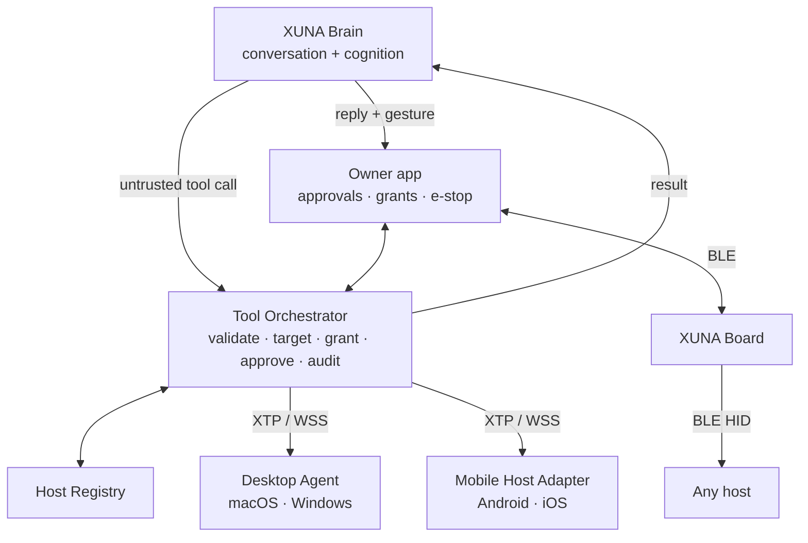

# XUNA Universal Device Control — Research (2026-10-30)

Status: **research and planning.** The owner decided all open items on 2026-10-30 ([roadmap §3](../roadmap/XUNA_UNIVERSAL_DEVICE_CONTROL_ROADMAP.md#3-owner-decisions-2026-10-30)): every recommendation was accepted except UDC-D6, where the model may route board media keys with one confirmation per press. No code, dependency, firmware or protocol change was made.

Question (owner, 2026-10-30): with what XUNA has today, how could one XUNA (one Brain, one memory, one identity) safely discover and act on macOS, Windows, Android and iOS, with Linux later?

Document set:

| Document | Content |
|---|---|
| This file | Findings, scenarios, strategy comparison, final recommendation |
| [Platform capability matrix](XUNA_PLATFORM_CAPABILITY_MATRIX.md) | 4 OS × 10 capabilities, plus board-as-HID compatibility |
| [Open-source review](XUNA_DEVICE_CONTROL_OPEN_SOURCE_REVIEW.md) | 25+ repositories, licenses, activity, verdicts |
| [Architecture](../architecture/XUNA_UNIVERSAL_DEVICE_CONTROL_ARCHITECTURE.md) | Components, XTP, MCP placement, targeting, integration, decisions to revise |
| [Security](../architecture/XUNA_DEVICE_CONTROL_SECURITY.md) | Risk tiers, enrollment, threats UDC-T1…T16, e-stop, audit, privacy |
| [Roadmap](../roadmap/XUNA_UNIVERSAL_DEVICE_CONTROL_ROADMAP.md) | UDC-0…UDC-10 with acceptance criteria and open decisions UDC-D1…D11 |

## 1. What XUNA has today (inspected, not assumed)

**No earlier "Apple Device Control" research exists in the repository** (searched `docs/`, PROCESS, PLAN, CHANGELOG). This set is the first device-control research, so nothing earlier needed revising.

| Component | Implemented | Planned / gated | Reusable for device control |
|---|---|---|---|
| Firmware (ESP32-S3, Arduino core 2.0.14 on `espressif32@6.5.0`) | Bluedroid BLE custom service (`7a6e00xx`), capability bytes, two buttons with full gesture map, expression (Track A preview, subtitles), device key (ECDSA P-256) | Wi-Fi/WSS device-direct (DC-2+ host-tested, **E14 not run**) | HID service on the same stack; expression path for action feedback; device-proof pattern |
| Mobile (Flutter 3.32.8) | BLE client (`flutter_blue_plus`), QR scanner, Firebase Auth, voice V1, chat/expert UI | — | Owner console (enrollment via QR, approvals, e-stop). **No native code or platform channels yet** |
| Backend (FastAPI modular monolith) | `cognition` with `ToolSpec`/`ToolCallRequested` (**adapter only, unused**), `conversation` (gestures, expert mode), `transport` (device WSS gateway, session hub), `identity` (P-256 proofs), `audit`, `consent`, `knowledge` (conventions, bond level) | Public hosting (D19), final provider (D11a) | Orchestrator and registry can be built on these modules with additive changes |
| Cloud/Brain rules | Device authority; model output untrusted; **"a device action is never a model tool"** | — | Must be clarified for host actions (architecture §9 R1) |

What does **not** exist and must not be assumed: any desktop software, any host registry, any HID code, BLE pairing/bonding, any Android/iOS native integration, any tool-using conversation turn.

**Product fit.** AGENTS.md's product test asks whether a feature makes XUNA more believable as a learning, growing physical lifeform. Device control passes that test only if it stays *embodied*:

- XUNA physically pressing a key (HID) passes.
- Reacting to outcomes with its own expressions passes.
- Learning the owner's digital habits as owner-confirmed conventions passes.
- A generic remote-desktop agent does not pass. The design keeps the pet visible in every flow, and the roadmap is a separate track (UDC-D1).

## 2. Platform research

Detailed tables: [capability matrix](XUNA_PLATFORM_CAPABILITY_MATRIX.md). The key facts:

### macOS

- The agent must be a **signed, notarized app outside the Mac App Store** (sandboxed apps cannot drive other apps). Privacy grants (Accessibility, Screen Recording, Automation) attach to that app's identity.
- **APIs:**
  - AXUIElement for UI inspection, after `AXIsProcessTrustedWithOptions`. Calls can fail with `kAXErrorCannotComplete` on unresponsive apps.
  - ScreenCaptureKit for capture, which needs `NSScreenCaptureUsageDescription`. `SCScreenshotManager` (macOS 14+) captures single frames.
  - CGEvent for input.
- Owner workflows: **Shortcuts via `shortcuts run`** † are the cleanest pattern. The owner builds the workflow; XUNA can only run it by name.
- Avoid MediaRemote (a private framework, reported restricted since 15.4 †). For media, use board HID or media-key events.

### Windows 10/11

- **APIs:** UI Automation, `SendInput`, Windows.Graphics.Capture, and Global System Media Transport Controls † for media.
- **Hard boundaries:**
  - **UIPI** limits input to windows at the agent's integrity level or lower, and fails *silently*.
  - UIA cannot reach elevated UI without `uiAccess`, which Microsoft reserves for assistive tech. XUNA does not request it.
  - The UAC secure desktop is system-IL only.
  - Services run in Session 0 † and cannot drive the desktop, so the agent is a per-user login process.
- No PowerShell tool. The most popular Windows MCP server enables PowerShell/registry tools and telemetry by default, which is the reason XUNA wraps rather than exposes such servers.

### Android

- **Consumer-safe:**
  - Media control through `MediaSessionManager.getActiveSessions` with an enabled NotificationListenerService.
  - Notifications through the same listener.
  - Intents/deep links.
  - Foreground service type `connectedDevice` on Android 14+.
  - `CompanionDeviceManager` association with the board †.
- **Policy-limited:** AccessibilityService can dispatch gestures, inspect windows and take screenshots. However, Google Play now **explicitly prohibits Accessibility functionality that lets an app "autonomously initiate, plan, and execute actions or decisions"**. LLM-driven phone control is therefore a sideload/dev-flavour feature only. Human-defined static scripts are allowed with prominent in-app disclosure and a declaration form.
- **Developer-only:** ADB, scrcpy and uiautomator2 require Developer options/USB debugging. They are test tools, never product paths.

### iOS

- **What the app can do:**
  - Expose its own actions via App Intents (Siri, Shortcuts, Spotlight, Action button).
  - Open URLs.
  - Keep a BLE link in the background (`bluetooth-central`, scanning by service UUID).
  - Attach to the board while iOS holds its HID link (`retrieveConnectedPeripherals`).
- **What the app cannot do:** read other apps' notifications, inspect or drive other apps' UI, or control other apps' playback (except Apple Music †).
- **The board can do more than the app:**
  - As a HID device: keyboard, and pointer with AssistiveTouch.
  - As a GATT client of Apple's accessory services: **AMS** (control media apps, read playing state) and **ANCS** (notifications).
- **Unrestricted iPhone UI automation is not possible** for a third-party product and is not claimed.

### Linux (future)

AT-SPI for UI and XTEST/libei for input are used by Cua Driver and munim-computer-use. Wayland compositors restrict global input and capture by design (portal-based) †. Linux would reuse the Desktop Agent core with a third provider set.

## 3. Open-source findings (summary)

Full review: [open-source review](XUNA_DEVICE_CONTROL_OPEN_SOURCE_REVIEW.md).

- **ADOPT:**
  - **Cua Driver** (trycua/cua, MIT) as the later computer-use provider, in `bounded` mode, pinned, without its AGPL perception extension.
  - **ESP-IDF `esp_hid_device`** (CC0) report descriptors and security setup.
  - The **MCP 2026-07-28** spec as the shape for tool descriptors and the stdio provider interface.
  - **NimBLE-Arduino 2.5.x**, only if the BLE stack migration is chosen (UDC-D8).
- **ADAPT:**
  - munim-computer-use (fail-closed allow/ask/block policy, step validation).
  - zavora computer-use-mcp (approval ledger, tool profiles).
  - Peekaboo (macOS permissions and capture).
  - HijelHID (bonding and iOS bond quirks).
  - Mystfit CompositeHID (only with SC/MITM fixed).
- **REFERENCE ONLY:** scrcpy, uiautomator2, mobile-mcp, Appium (QA tools); Windows-MCP, UFO, the Anthropic computer-use demo; pilot, T-vK and the NullYing HID code (no license).
- **REJECT:**
  - heaventree/cua-desktop-ai (dead fork).
  - sandraschi/windows-computer-use-mcp (keylogger, unauthenticated HTTP, security docs that do not match the code).
  - nut.js and automation-mcp (stale).

**Lesson:** the reviewed ESP32 HID projects mostly use Just Works pairing, unencrypted control characteristics and borrowed vendor IDs, and several have no license. XUNA should write a small HID module of its own.

## 4. Unified architecture (summary)

Full design: [architecture](../architecture/XUNA_UNIVERSAL_DEVICE_CONTROL_ARCHITECTURE.md).

- **One Brain** decides *what* to propose.
- **One deterministic orchestrator** decides *whether* it may run.
- **Each host re-checks** locally.
- **The board** expresses the outcome and is itself a universal, blind input device.
- **MCP:** not in the Brain; inside the Desktop Agent as the interface to an embedded computer-use driver (stdio); never as an inbound network endpoint. XTP uses MCP method names and shapes wherever they fit (UDC-D10).

## 5. Device-to-device orchestration scenarios

| Scenario | Feasible? | Path | Notes |
|---|---|---|---|
| XUNA controls a Mac and a Windows PC | ✅ | Two enrolled Desktop Agents | Target resolution by alias/capability; never broadcast |
| XUNA controls Android and iPhone within limits | 🟡 | Android: app adapter (media, intents). iPhone: board HID/AMS + App Intents | iPhone UI automation is not possible |
| Transfer a workflow desktop ↔ mobile | 🟡 | URL hand-off and "continue media on X" only | Generic app-state transfer is not feasible |
| Choose the right device by capability | ✅ | Registry manifests + targeting algorithm | Ask when ambiguous |
| Control media across paired devices | ✅ | Agent (GSMTC/MediaController), HID or AMS | "Pause everything" is a list of single-host actions with one confirmation |
| Physical button triggers an approved desktop workflow | ✅ (after UDC-2/UDC-7) | Board → app → orchestrator → agent; or HID for media | R1/R2 workflows only; needs a new gesture (UDC-D3) |
| Results shown as emotion | ✅ | Existing reply-gesture + subtitle path | Expression only (UDC-D7) |
| Selected multi-step desktop tasks | 🟡 | Computer use (UDC-8) | Approvals, budgets, injection tests |
| Local operation without cloud | 🟡 | Board HID (fully offline); LAN app ↔ agent for R1 tools (UDC-7) | Natural-language planning needs the Brain. Offline means buttons and app controls, not conversation |

**Preventing wrong-device actions:**

- explicit alias or a single eligible host;
- a 5-minute conversational "last target" that never crosses conversations;
- no fallback to another host;
- the alias in every approval and board subtitle;
- one HID host connected at a time, shown on the board screen.

## 6. Security (summary)

Full design: [security](../architecture/XUNA_DEVICE_CONTROL_SECURITY.md).

- **Four gates:** model proposes → orchestrator checks → owner approves (R2+) → host re-checks.
- **Risk tiers:** R0 observe-meta, R1 reversible, R2 visible, R3 consequential, R4 forbidden. R4 tools do not exist (no shell, script, credentials, security settings or elevation).
- **Enrollment:** QR plus 6-digit comparison, with keys pinned. Revocation is immediate.
- **BLE:** LE Secure Connections with numeric comparison on the board, and encryption on every HID and control characteristic. **Today's unauthenticated board command channel must be secured before any keyboard HID.**
- **New consent classes:** U5 `host_screen` and U6 `host_notifications`, default off, never stored.
- **Stopping and logging:** emergency stop from the agent, app and board; a dead-man switch for computer use; content-free audit.

## 7. Implementation strategies

| Criterion | A. Swift + C#/.NET native agents | B. Rust core + native adapters | C. Python/Node agents | D. Adapt an existing computer-use MCP server | **E. Hybrid: shared protocol + native capability providers** (Flutter desktop shell, native providers, embedded driver later) |
|---|---|---|---|---|---|
| Development speed | Medium: two full codebases | Slow: new language for the team | **Fast** for prototypes | Fast to demo | Medium: Dart reuse from mobile; small native providers |
| Reliability | High (native APIs) | High | Medium: coordinate-based libraries, DPI issues | Varies; best-in-class for computer use (Cua) | High for MVP tools; Cua for computer use |
| Security | Good, but the policy engine is duplicated in two languages | Good; one policy core | Weak distribution story; TCC attributes grants to the interpreter | Poor defaults (shell/registry/telemetry/HTTP) unless wrapped | **Good**: one policy core, narrow native surface, driver wrapped behind policy |
| Performance | Best | Best | Adequate | Good | Good (actions are I/O-bound) |
| Distribution | Native installers; signing per OS | Same as A plus FFI packaging | Hard: bundling, antivirus false positives, notarization of an interpreter | Depends on upstream | Flutter desktop builds plus signing per OS; driver binary bundled |
| Maintainability | Two policy engines drift | One core; small team cost of Rust | Fragile dependencies | Upstream churn, single maintainers | **One Dart policy/protocol core shared with mobile** |
| Fit with XUNA team/stack | New C#/Swift agent code | New language | Matches backend | Not ours to steer | Matches mobile (Flutter, Clean Architecture, GetX) |

**Recommendation:**

- **MVP: E** — Flutter desktop shell (tray, enrollment, consent, policy, XTP client) with thin Swift/C++ providers for media, app launch, URL and workflow tools. Windows first, macOS second. Plus board HID media keys, which need no agent at all.
- **Long term: E + D-as-provider** — embed a pinned Cua Driver (MCP stdio, bounded mode) for computer use. Split permission-heavy providers into least-privilege helpers where an OS demands it. Add the LAN offline mode and a Linux agent. Revisit B (Rust core) only if Flutter desktop proves unsuitable for an always-running tray agent; this is a known risk to test early in UDC-3.
- **C (Python)** is acceptable only for throwaway protocol experiments on the dev machine.

## 8. Roadmap (summary)

Full plan: [roadmap](../roadmap/XUNA_UNIVERSAL_DEVICE_CONTROL_ROADMAP.md).

UDC-0 decisions → **UDC-1 board HID media keys** → UDC-2 secure board channel + keyboard HID → UDC-3 registry + XTP + Desktop Agent (Windows → macOS) → UDC-4 Brain tool calling → UDC-5 Android → UDC-6 iOS → UDC-7 multi-host, e-stop, LAN offline → UDC-8 computer use → UDC-9 cross-device → UDC-10 learning.

How this differs from the requested order:

- Security comes before keyboard HID.
- The two desktop OSes start from one agent.
- The registry and permissions come before Brain tools.
- iOS is narrowed, because the board already covers most iPhone control.

## 9. Final recommendation

1. **Overall architecture:** one Brain (the existing backend) proposes tool calls. A deterministic Tool Orchestrator with a Host Registry validates, targets, asks for approval and audits. Host Agents (desktop) and the Flutter app (mobile) execute and re-check under local policy. The board is both a universal blind input device (BLE HID) and the expressive face of every outcome.
2. **Open source to reuse or learn from:** see §3. Use Cua Driver, ESP-IDF HID descriptors and the MCP spec; borrow patterns from munim-computer-use, zavora computer-use-mcp, Peekaboo and HijelHID; keep scrcpy/uiautomator2/Appium for testing only.
3. **Most realistic MVP:**
   - XUNA as a **BLE media remote** for all four OSes (no host software, works offline).
   - A **Windows + macOS Desktop Agent with five tool families**: media, allowlisted app launch, https URL, owner-registered workflow, status.
   - The agent is called from voice/chat through the Brain with confirmations, and XUNA reacts to the result.
4. **Limits of each OS:**
   - macOS: TCC permissions per app, secure input, no public "now playing" control.
   - Windows: UIPI/UAC boundaries with silent input failures; services cannot touch the desktop.
   - Android: Play bans autonomous Accessibility control, and background launch is restricted.
   - iOS: no control of other apps from an app at all; only the board (HID/AMS/ANCS) and owner-built Shortcuts reach further.
5. **Shared:**
   - XTP schemas and fixtures, the tool catalog and risk tiers.
   - The orchestrator, registry, approvals and audit.
   - The agent core (Dart) and the targeting/approval UX.
   - The board HID descriptor and pairing UX.
6. **Platform-specific:**
   - Input injection, screen capture, UI inspection, media control and app launch.
   - Permission detection and onboarding.
   - Packaging, signing and autostart.
   - Android/iOS native adapters.
7. **Is MCP necessary?** **No** for the MVP. It is useful inside the Desktop Agent as the stdio interface to an embedded computer-use driver, and XTP borrows its shapes so a bridge stays cheap. Never expose an inbound MCP endpoint on a host.
8. **Integration with Brain, Memory and Learning:**
   - Results return to the model as tool messages.
   - The board shows expression only.
   - Host aliases, defaults and confirmed workflows become owner-confirmed conventions (KX-4).
   - Routine learning can *suggest*, never execute.
   - Bond level changes how often XUNA offers help, never what it may do.
   - Personality shapes wording, never permission.
9. **First proof-of-concept experiment — "XUNA presses Play" (UDC-1):**
   - **Build:** an experimental firmware env adds a HID consumer-control service on the current Bluedroid stack, with an ESP-IDF CC0 report map, LE Secure Connections and numeric comparison on the LCD. Leave the custom service untouched.
   - **Test:** on macOS, Windows 11, Android and iPhone, pair, then send Play/Pause and Volume ± 20 times each from a board gesture. Do this while the XUNA app stays connected over the custom service.
   - **Measure:** pairing success, reconnect after reboot, the app's command round-trip, loop gap p99, the internal heap minimum (also with `xuna_net` Wi-Fi), and resets over 30 minutes.
   - **Pass:** 20/20 actions per OS, the app unaffected, loop gap p99 ≤ 50 ms, the heap within the E14 threshold, zero resets.
   - **Why first:** this answers the biggest unknowns (dual BLE roles on Bluedroid, bonding beside the unauthenticated custom service, RAM next to TLS, iOS behaviour). It needs no backend, app or desktop code, and it is the most "embodied" form of the feature. It can share a board session with E14.
10. **Open decisions requiring approval** (details in the roadmap §3 and architecture §9):
    - **Revisions to existing rules (architecture §9):**
      - R1: host actions as a model-tool class, which amends backend AGENTS §1.4.
      - R2: a UDC track on the roadmap.
      - R3: a `HostId` principal.
      - R4: a host-session ADR with downlink.
      - R5: consent classes U5 and U6.
      - R6: authenticate the BLE command channel.
      - R7: the button/gesture map.
      - R8: a new `desktop/` submodule.
    - **UDC-D1:** start UDC-0/1 now in parallel?
    - **UDC-D2:** numeric-comparison pairing.
    - **UDC-D3:** remote-mode gesture.
    - **UDC-D4:** Flutter desktop agent.
    - **UDC-D5:** Play-safe Android.
    - **UDC-D6:** no HID routing from the model in the MVP.
    - **UDC-D7:** outcomes are expression only.
    - **UDC-D8:** Bluedroid vs NimBLE.
    - **UDC-D9:** AMS spike.
    - **UDC-D10:** MCP-shaped XTP.
    - **UDC-D11:** computer-use driver.

## 10. Sources (opened during this review)

**Apple:**

- [AXIsProcessTrustedWithOptions](https://developer.apple.com/documentation/applicationservices/1459186-axisprocesstrustedwithoptions)
- [AXUIElement.h](https://developer.apple.com/documentation/applicationservices/axuielement_h)
- [ScreenCaptureKit](https://developer.apple.com/documentation/screencapturekit)
- [UIBackgroundModes](https://developer.apple.com/documentation/bundleresources/information-property-list/uibackgroundmodes)
- [scanForPeripherals](https://developer.apple.com/documentation/corebluetooth/cbcentralmanager/scanforperipherals(withservices:options:))
- [retrieveConnectedPeripherals](https://developer.apple.com/documentation/corebluetooth/cbcentralmanager/retrieveconnectedperipherals(withservices:))
- [App Intents](https://developer.apple.com/documentation/appintents)
- [MPRemoteCommandCenter](https://developer.apple.com/documentation/mediaplayer/mpremotecommandcenter)
- [ANCS](https://developer.apple.com/library/archive/documentation/CoreBluetooth/Reference/AppleNotificationCenterServiceSpecification/Introduction/Introduction.html)
- [AMS](https://developer.apple.com/library/archive/documentation/CoreBluetooth/Reference/AppleMediaService_Reference/Introduction/Introduction.html)
- [App Review Guidelines](https://developer.apple.com/app-store/review/guidelines/)
- [Bluetooth pointer with AssistiveTouch](https://support.apple.com/en-us/111775)

**Microsoft:**

- [SendInput](https://learn.microsoft.com/en-us/windows/win32/api/winuser/nf-winuser-sendinput)
- [UI Automation security overview](https://learn.microsoft.com/en-us/windows/win32/winauto/uiauto-securityoverview)

**Android / Google:**

- [AccessibilityService](https://developer.android.com/reference/android/accessibilityservice/AccessibilityService)
- [Play AccessibilityService policy](https://support.google.com/googleplay/android-developer/answer/10964491)
- [NotificationListenerService](https://developer.android.com/reference/android/service/notification/NotificationListenerService)
- [MediaSessionManager](https://developer.android.com/reference/android/media/session/MediaSessionManager)
- [Foreground service types](https://developer.android.com/develop/background-work/services/fgs/service-types)
- [BluetoothHidDevice](https://developer.android.com/reference/android/bluetooth/BluetoothHidDevice)
- [adb](https://developer.android.com/tools/adb)
- [UI Automator](https://developer.android.com/training/testing/other-components/ui-automator)

**Bluetooth SIG:**

- [HOGP 1.1](https://www.bluetooth.com/specifications/specs/html/?src=hogp-v1-1_1755558551/HOGP_v1.1/out/en/index-en.html)

**MCP:**

- [Transports](https://modelcontextprotocol.io/specification/latest/basic/transports)
- [Authorization](https://modelcontextprotocol.io/specification/latest/basic/authorization)

Repository links and the files read for each project are in the [open-source review](XUNA_DEVICE_CONTROL_OPEN_SOURCE_REVIEW.md). Claims marked † come from platform knowledge not re-opened in this review and must be re-checked in the relevant milestone's design session.
