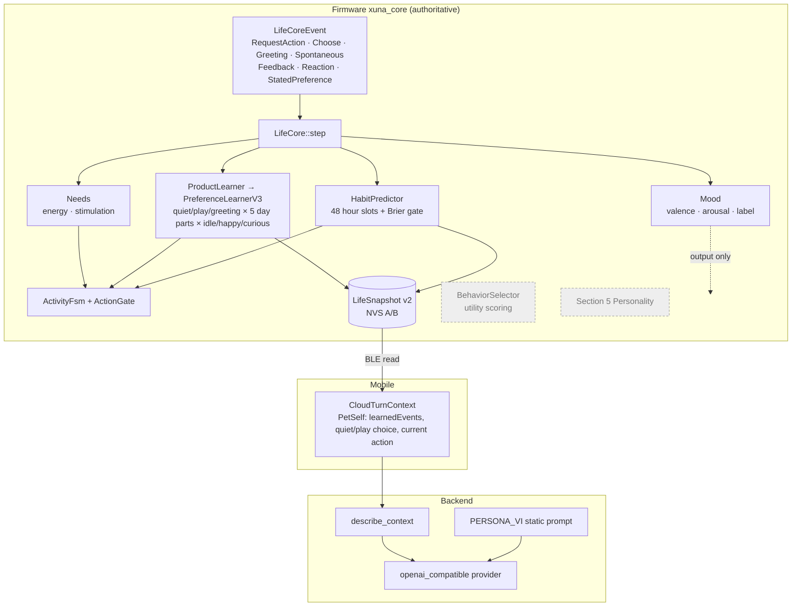
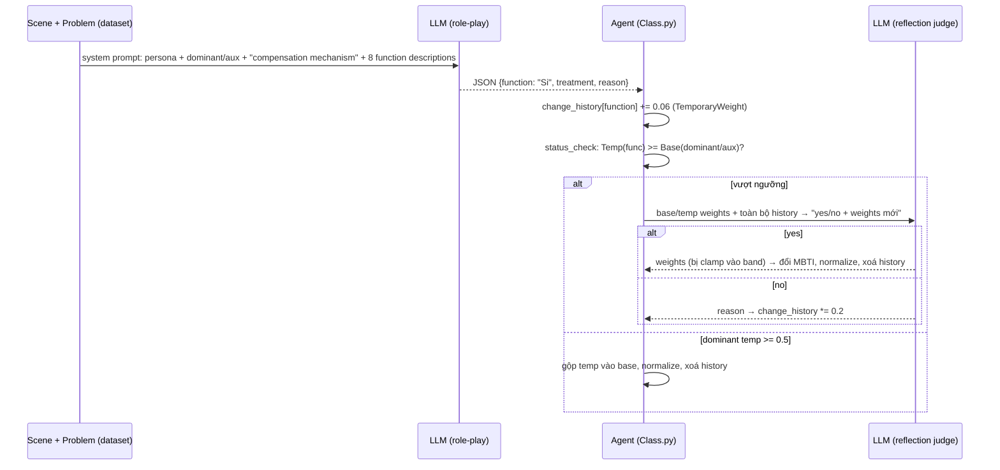
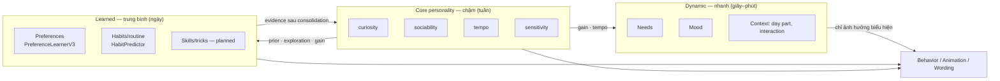
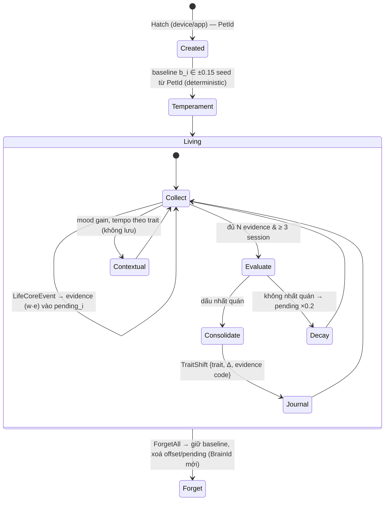
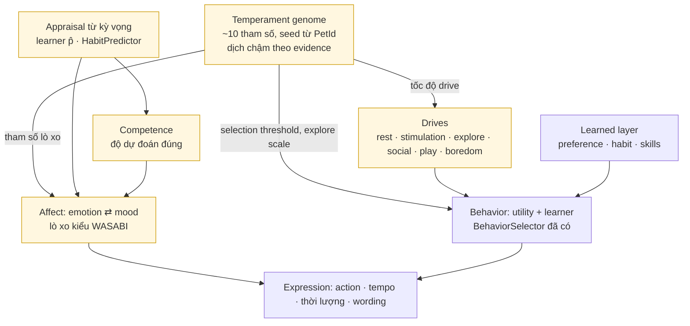
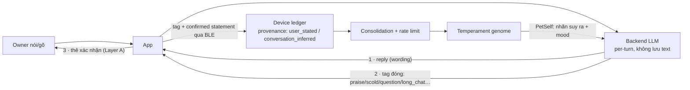

# XUNA — Đánh giá Personality Evolution & JPAF (2026-10-23)

> **Trạng thái:** Research / **Proposed**. Không có thay đổi code, dependency hay schema nào. Mọi đề xuất ở đây cần owner duyệt trước khi triển khai.
>
> **Nhãn bằng chứng:** **[V]** VERIFIED — đã xác nhận trong code/paper · **[I]** INFERRED — suy luận kiến trúc hợp lý · **[P]** PROPOSED — đề xuất mới · **[U]** UNKNOWN — cần điều tra thêm.
>
> **Phạm vi đã đọc:** `AGENTS.md`, `PROCESS.md`, `CHANGELOG.md`, Digital Life spec, implementation plan, learning upgrade plan; firmware `xuna_core` (LifeCore, Needs/Mood, BehaviorSelector, PreferenceLearnerV3, ProductLearner, HabitPredictor, SnapshotCodec, EventTypes), backend `conversation.application.chat_turn`, mobile `cloud_turn_context`. JPAF: clone `agent-topia/evolving_personality` @ `b135db5` (đọc toàn bộ ~1.8k dòng Python, dữ liệu kịch bản, kết quả), paper arXiv 2601.10025v1 (bản HTML). Không cài đặt và không chạy JPAF (cần API key LLM trả phí).

---

## 1. Executive Summary

1. **XUNA hiện chưa có Personality System.** [V] Trong code chỉ có chỗ giữ chỗ: `SectionId::Personality = 5 // reserved: M06` ([SnapshotCodec.h:49](../../firmware/lib/xuna_core/include/xuna/persist/SnapshotCodec.h#L49)) và event `TraitUnlocked` 0x70 ([EventTypes.h:29](../../firmware/lib/xuna_core/include/xuna/event/EventTypes.h#L29)). Không có trait, temperament, vector hay update rule nào chạy trên board.
2. **Phần làm XUNA khác nhau giữa các cá thể hiện nay là learning, không phải personality** [V]: preference learner v3 (discounted Beta + UCB, theo context × day part, có provenance), routine learning `HabitPredictor` (có Brier gate) và ring 8 episode. Phần này **trưởng thành, deterministic, có test, có persist, có explanation** — đây là nền móng tốt nhất để xây personality.
3. **"Personality" mới gần đây là ở tầng LLM expression, không phải state** [V]: `PERSONA_VI` là một prompt tĩnh *giống nhau cho mọi XUNA* ("ấm áp, tò mò và thông minh"), cộng với `PetSelf` đưa preference đã học từ device vào prompt ([chat_turn.py:29](../../backend/src/xuna_backend/modules/conversation/application/chat_turn.py#L29), [chat_turn.py:119](../../backend/src/xuna_backend/modules/conversation/application/chat_turn.py#L119)). Mood (valence/arousal + 5 label có hysteresis) được tính trong `LifeCore` nhưng **không ảnh hưởng hành vi** và không được hiển thị; `BehaviorSelector` (utility scoring) **chỉ có test, không được wire** vào production.
4. **JPAF không phải một framework có thể tích hợp.** [V] Đó là bộ script thí nghiệm nghiên cứu: 1 class `Agent` 386 dòng, mọi quyết định (chọn "function" nào được dùng, có đổi type hay không) đều do **LLM tự gán nhãn và tự phán quyết**; không persistence, không test, không seed, dùng `eval()` trên output LLM. Paper là preprint chưa peer-review; các con số "100%" có tính vòng lặp (kịch bản được thiết kế cho function X, LLM gắn nhãn X) và tự mâu thuẫn với bảng của chính paper.
5. **Thứ JPAF thật sự đáng học** [V→P] là 4 cơ chế cấu trúc nhỏ: (a) tách **BaseWeight** (ổn định) và **TemporaryWeight** (bộ tích luỹ ngắn hạn); (b) **band ràng buộc** giữ cấu trúc nhất quán; (c) **reflection chỉ khi vượt ngưỡng** thay vì drift liên tục; (d) **decay ×0.2** bộ tích luỹ khi reflection từ chối + change log có lý do. Cả 4 có thể làm **deterministic, không cần LLM**, trong C++11 trên ESP32.
6. **Khuyến nghị: Option B — JPAF-inspired extension** [P]: một module nhỏ `TraitModel` trong `xuna_core`, 3–4 trait dimensional (không MBTI, không Jungian), evidence lấy từ các sự kiện **đã có** (rating, stated, reaction, prediction error của learner, drive reduction), consolidation deterministic có rate limit, persist ở section 5 đã reserved, kiểm chứng bằng Life Lab hiện có. **Reject** tích hợp trực tiếp JPAF. Personality trong roadmap thuộc **M06**; bắt đầu sớm hơn cần quyết định của owner (§16).

---

## 2. Current XUNA Codebase Findings

### 2.1 Bản đồ module thật sự (không phải theo spec)



Nét đứt = có trong code/spec nhưng **không chạy trong production**.

### 2.2 Ma trận mức độ hiện thực

| Thành phần | Trạng thái | Bằng chứng |
|---|---|---|
| Identity (PetId, DeviceId, BrainId, Identity V2) | **Implemented + board** | `identity/*`, AGENTS §3 [V] |
| Needs (energy, stimulation) | **Implemented, board trial** | [Needs.h:10](../../firmware/lib/xuna_core/include/xuna/life/Needs.h#L10), [LifeFeel.h](../../firmware/lib/xuna_core/include/xuna/life/LifeFeel.h); reset ở mỗi cold boot ([LifeCore.h:143](../../firmware/lib/xuna_core/include/xuna/life/LifeCore.h#L143)) [V] |
| Mood | **Implemented nhưng không được dùng** | [Needs.h:129](../../firmware/lib/xuna_core/include/xuna/life/Needs.h#L129); chỉ `sim/life_timeline.cpp` đọc `out.mood` [V] |
| Behavior decision | **Implemented**: learner quyết định, FSM/Gate lọc | [LifeCore.h:320](../../firmware/lib/xuna_core/include/xuna/life/LifeCore.h#L320) [V] |
| Utility scoring (`BehaviorSelector`) | **Experimental / không wire** | chỉ `test_action_policy` dùng [V] |
| Preference learning | **Implemented + board + Life Lab** | [PreferenceLearnerV3.h:20](../../firmware/lib/xuna_core/include/xuna/learning/PreferenceLearnerV3.h#L20) [V] |
| Habit / routine | **Implemented (firmware), app chưa hiển thị** | [HabitPredictor.h](../../firmware/lib/xuna_core/include/xuna/learning/HabitPredictor.h), [record](../roadmap/routine-learning-2026-10-20.md) [V] |
| Memory | **Partial**: ring 8 episode v1; memory store là M05b | `SnapshotEpisodes` [V] |
| Explainability ("tại sao") | **Implemented** cho preference | `ExplanationCodec`, `LearnerV3Explanation` [V] |
| Conversation (Layer A + LLM) | **Implemented, phone** | `chat_turn.py`, S39 extractor [V] |
| Personality | **Reserved / documented only** | section 5, spec §5.3, plan §7.5 [V] |
| Motivation | **Không có** ngoài needs [V] | — |
| Relationships | **Không có** (chỉ 1 owner, habit là gần nhất) [V] | — |
| Skills / tricks | **Planned** (L-D3, section 8 reserved) [V] | — |
| Growth stage / Evolution / Journal | **Planned M06** [V] | `TraitUnlocked`, section 3 reserved |

### 2.3 Sai lệch giữa tài liệu và code

| Tài liệu nói | Code thật | Mức |
|---|---|---|
| AGENTS §5: firmware có "mood, limited personality/preferences" | Có preference; mood không tác động; personality = 0 [V] | Trung bình |
| Spec §9: utility score có `personalityBias` + `currentNeedBias` | Production dùng learner + gate; `BehaviorSelector` không wire [V] | Trung bình |
| Plan §7.5: Personality `6 × i16 Q1.14, zero until M06` | Chỉ có ID section, không có codec [V] | Nhỏ (đúng là "reserved") |
| Spec §5.3: 6 candidate trait | Chưa trait nào được validate overlap — đúng như spec yêu cầu [V] | — |
| Persona LLM "tò mò, ấm áp" | Cùng một chuỗi cho mọi pet → không phải cá tính riêng [V] | **Quan trọng cho vision** |
| Learning upgrade gap 4: "No visible formation arc early" | Vẫn đúng [V] | — |

---

## 3. Existing Personality Architecture — trả lời 16 câu hỏi audit

| # | Câu hỏi | Trả lời | Nhãn |
|---|---|---|---|
| 1 | Personality biểu diễn thế nào? | Chưa có. Gần nhất: `SelectorWeights {novelty 2, energyNeed 1, arousal 1, valence 1}` — hằng số toàn cục, không wire | [V] |
| 2 | Có dimension nào? | Không. Spec đề xuất `curiosity, sociability, energyStyle, boldness, sensitivity, routineAffinity` | [V] |
| 3 | Categorical / continuous? | Plan dự kiến continuous Q1.14 | [V] |
| 4 | Trait ổn định vs state tạm? | Có tách **state** (Needs, Mood, transient, không persist mood) — nhưng chưa có trait | [V] |
| 5 | Mỗi XUNA có profile riêng? | Có *learned profile* riêng (preference cells, habit slots) theo PetId; không có personality profile | [V] |
| 6 | Khởi tạo thế nào? | Preference bắt đầu từ prior đều; không có temperament seed | [V] |
| 7 | Có evolve? | Preference/habit có; personality không | [V] |
| 8 | Event trigger? | Feedback (rating), Reaction (GPIO trong 10 s, w=0.3), StatedPreference (w=0.5, cap 2), owner session (habit) | [V] |
| 9 | Personality ↔ emotion? | Không. Mood chỉ phụ thuộc needs + feedback signal tức thời | [V] |
| 10 | ↔ memory? | Không | [V] |
| 11 | ↔ conversation? | Preference đã học được đưa vào prompt; persona tĩnh | [V] |
| 12 | ↔ animation? | Learner chọn action → VisualIntent; không có "style" | [V] |
| 13 | Persist? | Learner/habit/episodes persist (commit-first A/B); mood không | [V] |
| 14 | Deterministic / LLM? | Toàn bộ device deterministic (PCG32 seed, golden vectors, ESP32 parity bit-identical). LLM chỉ phrasing | [V] |
| 15 | Safeguard chống bất ổn? | **Có, cho learning**: discount γ, cap stated mass, reaction weight thấp, 120 s expiry, Brier gate chống "random owner", D6 tắt implicit feedback, H4 "owner evidence wins" | [V] |
| 16 | Reflection/consolidation? | Không có. Có *migration* v1→v3 với cap mass, không phải reflection | [V] |

**Điểm mạnh hiện có** [V]: event-sourced + deterministic; Life Lab (OwnerModel, scenarios, golden vectors, parity ESP32); snapshot sectioned có version + required bit + migration; provenance theo nguồn (rating/stated/reaction); explanation codec; nguyên tắc cloud không được đổi trait (plan §22 H4, ADR-0008).

**Hạn chế kỹ thuật** [V/I]: chỉ 3 action (idle/happy/curious) và 2 nút → không gian biểu hiện hẹp ("input poverty" đã ghi trong learning upgrade §4.6); mood không được dùng; không có experience log bền vững (LittleFS dời sang S32) nên chưa có chỗ cho personality history dài; needs reset khi boot.

**Thiếu test/validation** [V]: không có test nào cho diversity/collapse của personality (spec §5.3 yêu cầu); chưa có metric "individual differentiation" trong Life Lab; chưa đo mood có hợp lý không ngoài timeline sim.

---

## 4. JPAF Repository Research

### 4.1 Thông tin repo [V]

| Mục | Kết quả |
|---|---|
| Nội dung | 2 thư mục script: `Personality_test` (trả lời bộ câu hỏi MBTI-70/93) và `Personality_changes` (thí nghiệm "evolution"); dữ liệu JSON + kết quả + Excel |
| Code | ~1.8k dòng Python; lõi là `Personality_changes/Class.py` (386 dòng) |
| Dependency | `openai`, `python-dotenv`, `requests`, `tqdm`; cần API GPT-4 / Qwen / Llama |
| License | MIT, **thêm ngày 2026-10-21** (trước đó không có license) |
| Bảo trì | Code chỉ có **1 commit** (2026-01-14); các commit sau chỉ là README, issue template, license |
| Test | Không có unit test |
| Persistence | Không có — state nằm trong RAM của 1 lần chạy script |
| Bảo mật | `eval()` trên chuỗi do LLM trả về (`Personality_changes/util.py:59`, `Personality_test/util.py:11,25`) → code injection nếu chạy với provider không tin cậy |
| Persona | 16 type gán tên **diễn viên thật** (ví dụ INTJ → "Kathy Bates") |

### 4.2 Paper [V]

"Structured Personality Control and Adaptation for LLM Agents", arXiv 2601.10025 **v1, preprint cs.AI, không có venue peer-review**. Tự mô tả là *"preliminary structured assessment"*. Không có mục Limitations, không có human evaluation, không có thí nghiệm multi-session.

---

## 5. JPAF Algorithms and Mechanisms (đối chiếu paper ↔ code)

### 5.1 Biểu diễn

- 8 Jungian function `Ti Te Fi Fe Ni Ne Si Se`, mỗi function có **BaseWeight**, tổng = 1 [V].
- Band (paper Eq. 1–3, B = 0.06, A = 0.30): dominant ∈ (0.30, 1], auxiliary ∈ (0.06, 0.30], 6 function còn lại ∈ (0, 0.06] [V].
- Type = cặp (dominant, auxiliary) → tra bảng `function_to_mbti` ra 1 trong 16 MBTI [V]. Tức là **output cuối là categorical** dù weight liên tục.

### 5.2 Vòng đời thích nghi (code thật)



| Câu hỏi §3.2 | Thực tế trong JPAF | Nhãn |
|---|---|---|
| 1. Trigger? | Mỗi câu hỏi trong dataset | [V] |
| 2. Experience biểu diễn thế nào? | Văn bản scene + problem; "experience" = function LLM **tự khai** đã dùng | [V] |
| 3. Diễn giải tương tác? | LLM tự gắn nhãn function (không có bộ phân loại độc lập) | [V] |
| 4. Quyết định update? | Cộng cố định Δw = 0.06 cho function được khai | [V] |
| 5. Độ lớn update? | Cố định 0.06/lần; khi reflection "yes", LLM đề xuất weight mới, code clamp vào band | [V] |
| 6. Ngắn hạn vs dài hạn? | Temp (change_history) vs Base (weight) — **ý tưởng tốt nhất của JPAF** | [V] |
| 7. Chống drift? | Band clamp + decay ×0.2 khi LLM nói "no". **Không** có rate limit theo thời gian, không cần evidence đa dạng | [V] |
| 8. Đổi hẳn tính cách? | **Có, rất nhanh**: kết quả GPT ghi `INFJ->ESFP` sau 15 câu kịch bản Se; `INFP->ISFP->ESFP` trong 1 chuỗi | [V] |
| 9. Reflection? | 1 LLM call với toàn bộ history, trả yes/no + weights | [V] |
| 10. Giải thích được? | Có `reason` văn bản do LLM viết — **không kiểm chứng được** | [V] |
| 11. Tái lập/test? | Không: temperature 0.6, không seed, không lưu state | [V] |
| 12. Cần LLM mỗi lần? | **Có** — 1 call/tương tác + 1 call/reflection, có retry vô hạn khi JSON lỗi | [V] |

Lỗi/điểm lạ trong code [V]: `norm_weight()` xoá `self.history` → reflection sau đó mất ngữ cảnh; `reflection2` không kiểm `rsp is None` trước khi đọc; `reflection4` chọn ngẫu nhiên aux khi LLM trả sai; số Δw khác nhau giữa `util.py` (0.06) và `data_deal/util.py` (0.08).

### 5.3 Chất lượng nghiên cứu

| Claim | Thực tế | Nhãn |
|---|---|---|
| "100% MBTI alignment accuracy (all models)" | Bảng của chính paper có ô < 100% (vd. GPT, MBTI-93, INFJ chiều SN 84.62%); chỉ số DAG có giá trị âm (GPT EI −1.13%, TF −2.81%) | [V] mâu thuẫn |
| "Type Activation Accuracy > 90%" (GPT/Qwen) | TAA = tỉ lệ LLM gắn nhãn đúng function X cho kịch bản **được viết để gợi X** (8 bộ × 3 scene × 5 câu = 15 câu/bộ). Đo khả năng LLM phân loại văn bản, không đo personality | [V] vòng lặp |
| "Personality Evolution Accuracy 100%" | Paper gọi là PSA: tỉ lệ tái cấu trúc "hợp lệ theo lý thuyết". Tính hợp lệ phần lớn **được code bảo đảm** (bảng `function_to_mbti`, `main_to_aux`, clamp) | [V] gần như tautology |
| "Long-term evolution" | Chỉ 1 chuỗi 15 câu liên tục, không multi-session, không có thời gian | [V] chưa chứng minh |
| Baseline | Exp1: prompt chỉ ghi MBTI type. Exp2: **không có baseline** | [V] |
| Human evaluation | Không | [V] |

**Giá trị khoa học của MBTI/Jung** [I]: MBTI có độ tin cậy test–retest và validity dự đoán thấp so với Big Five; các function Jungian không phải construct đo lường được đã kiểm chứng. Là *công cụ mô hình hoá tính toán*, 8 function vẫn có thể hữu ích cho NPC hội thoại văn bản — nhưng XUNA không có hành vi nào phân biệt được `Ni` với `Ti` trên màn hình pixel với 3 action. Với XUNA, construct không **observable** = vi phạm điều kiện 1 của spec §5.3.

---

## 6. XUNA vs JPAF Comparison

| Capability | Current XUNA | JPAF | Gap | Recommendation |
|---|---|---|---|---|
| Personality representation | Không có (section 5 reserved) | 8 weight + band → 16 type | XUNA thiếu cả cấu trúc | **ADAPT** ý tưởng base/temp + band; **REJECT** 8 function/MBTI |
| Personality dimensions | Spec có 6 candidate chưa validate | 8 Jungian function | — | **IMPROVE** spec: 3–4 trait observable (§7) |
| Initial generation | Prior đều, không seed | Chọn 1 trong 16 type cố định + tên diễn viên | — | **PROPOSED**: temperament nhỏ seed từ PetId; **REJECT** type preset |
| Short-term adaptation | Mood (không dùng), needs | TemporaryWeight +0.06 | XUNA có state nhưng không nối | **IMPROVE**: wire mood vào expression; **ADAPT** temp accumulator |
| Long-term evolution | Chỉ preference/habit | LLM reflection khi vượt ngưỡng | Thiếu hoàn toàn | **ADAPT** threshold consolidation, deterministic |
| Personality stability | Safeguard mạnh cho learning | Band + decay; đổi type sau ~15 sự kiện | JPAF yếu hơn spec XUNA | **KEEP** nguyên tắc XUNA; thêm rate limit + evidence spread |
| Reflection | Không | LLM yes/no | — | **ADAPT** dạng *deterministic consolidation*; **REJECT** LLM làm thẩm phán |
| Experience-based learning | Có, nhiều nguồn có trọng số | LLM tự khai function | XUNA tốt hơn hẳn | **KEEP** |
| Emotion integration | Mood tách, chưa dùng | Không có | Cả hai thiếu | **PROPOSED**: trait điều chỉnh gain của mood |
| Memory integration | Episodes ring 8 | Chat history trong RAM | — | **DEFER** tới M05b memory store |
| Behavioral influence | Learner + gate | Chỉ đổi văn phong LLM | — | **PROPOSED**: trait chỉ đổi prior/exploration/tempo, không đè preference |
| Individual differentiation | Có qua preference/habit | 16 class | — | **IMPROVE**: đo được bằng Life Lab |
| Explainability | Explanation codec cho preference | `reason` do LLM viết | XUNA tốt hơn | **KEEP** + mở rộng cho trait (evidence code, không văn bản tự do) |
| Persistence | Commit-first A/B, versioned | Không | — | **KEEP**; dùng section 5 |
| Testing | 240+ host test, golden, ESP32 parity | Không | — | **KEEP**; thêm diversity/collapse test |
| Offline / local-first | Đầy đủ | Bắt buộc LLM | JPAF vi phạm D21 H1 | **REJECT** runtime JPAF |
| Provider independence | State trên device | Personality phụ thuộc phán quyết LLM | — | **KEEP** |
| Chi phí | 0 token cho learning | ≥ 1 LLM call/tương tác | — | **KEEP** |
| License / bảo mật | — | MIT; `eval()` | — | Không reuse code, chỉ ý tưởng (ADR-0001) |

---

## 7. Multidimensional Personality Assessment

### 7.1 Ba tầng, không trộn lẫn



### 7.2 So sánh mô hình

| Mô hình | Ưu | Nhược với XUNA | Kết luận |
|---|---|---|---|
| Jungian 8 function / MBTI | Dễ kể chuyện | Không observable với pixel pet; categorical; validity thấp | **REJECT** |
| Big Five (OCEAN) | Validity tốt nhất ở người | Conscientiousness, Agreeableness không có hành vi tương ứng cho pet 3 action | **Dùng làm bản đồ kiểm tra overlap**, không dùng làm schema |
| Big Five facets / HEXACO | Chi tiết hơn | Quá nhiều chiều so với dữ liệu; Honesty-Humility vô nghĩa cho pet | **REJECT** |
| Animal temperament (boldness–shyness, activity, sociability, exploration) | Gần artificial-life nhất, observable | Cần sensor cho boldness | **Cơ sở chính** [I] |
| Custom artificial-life traits | Khớp hành vi XUNA | Phải tự validate | **Chọn** — ánh xạ về Big Five/animal temperament để kiểm overlap |

### 7.3 Kiểm tra trùng lặp 6 candidate của spec

| Candidate | Construct tương ứng | Trùng với | Đề xuất |
|---|---|---|---|
| `curiosity` | Openness / exploration | ngược chiều `routineAffinity` | **Giữ** |
| `sociability` | Extraversion (social) | một phần `energyStyle` | **Giữ**, định nghĩa = hướng về owner |
| `energyStyle` | Extraversion (activity) | `sociability`; dễ lẫn với needs.energy | **Giữ dưới tên `tempo`**, chỉ đổi nhịp biểu hiện, không đổi needs |
| `boldness` | (−)Neuroticism / shyness | `sensitivity` | **DEFER** tới M07 (cần sensor/startle) |
| `sensitivity` | Neuroticism / emotional reactivity | `boldness` | **Giữ** (hoặc gộp boldness vào đây) — cần quyết định sản phẩm vì liên quan "pet buồn" |
| `routineAffinity` | Conscientiousness-order | **HabitPredictor đã học routine của owner**; ngược chiều curiosity | **REJECT làm trait**; để là learned habit |

**Kết quả:** 3–4 trait độc lập tương đối, mỗi trait có đầu ra quan sát được ngay với phần cứng hiện có. Mục tiêu là **diversity có ý nghĩa**, không phải số biến: 4 trait liên tục × preference cells (15 context × 3 action) × habit slots đã tạo ra không gian cá thể rất lớn [I].

### 7.4 Đặc tả trait đề xuất [P]

| Trait | Đầu ra hành vi (bounded) | Evidence nâng/hạ | Không được |
|---|---|---|---|
| `curiosity` | hệ số UCB bonus × (1 ± 0.5); xác suất spontaneous curious; độ sớm anticipation | Prediction error dương khi XUNA *khám phá* (decision.explore) và được thưởng; âm khi khám phá bị shoo | Đếm số lần curious (vòng lặp tự củng cố) |
| `sociability` | prior của `button_greeting`; thời lượng happy khi owner đến; độ ấm của wording | Pet/rating dương trong greeting, owner session đều (habit gain) | Phạt khi owner vắng (AGENTS §6: không phạt downtime) |
| `tempo` | tốc độ frame ±15%, ngưỡng rest ±5% | Mức stimulation trung bình trong owner session (play dày → tempo cao; owner yên tĩnh → thấp) | Đổi needs decay (đó là instinct) |
| `sensitivity` | gain valence của mood với feedback; thời gian hồi mood | Tỉ lệ episode Overwhelmed; tần suất shoo | Làm XUNA "trầm cảm" vĩnh viễn — cần sàn và quyết định sản phẩm |

---

## 8. Long-Term Evolution Assessment

### 8.1 Nguồn phát triển và cách phân loại

| Nguồn | Là experience thật? | Personality | Preference | Habit | Mood | Ghi chú |
|---|---|---|---|---|---|---|
| Owner rating / reaction / stated | **Có** (user_feedback/stated) | evidence (sau consolidation) | trực tiếp | — | tức thời | Đã có trọng số 1 / 0.3 / 0.5 |
| Owner session (đến/đi) | **Có** (device_observed) | sociability | — | trực tiếp | stimulation | Đã có |
| Drive reduction (L-D4) | **Có** (device_observed) | tempo, sensitivity (trọng số thấp) | riêng, không là owner feedback | — | — | Giữ tách như L-D4 |
| Spontaneous action của XUNA | **Không** là evidence tự thân | **0** | chỉ khi owner phản hồi | — | — | Chống self-loop |
| Scheduled consolidation | **Không** phải experience | chỉ *tổng hợp* evidence có sẵn | — | — | — | Không tạo evidence |
| Thời gian trôi / vắng owner | **Không** | **0** | (discount chỉ áp lên cell được rate) | decay theo ngày | needs | Không phạt downtime |
| LLM interpretation | **Không** | **0** trực tiếp | chỉ qua xác nhận của owner (Layer A) | — | — | H4, D17 |
| Sensor (M07) | Có, sau validation | boldness… | — | — | — | DEFER |
| Developmental stage (M06) | Gate theo evidence | có thể nới rate limit | — | — | — | DEFER, D13/D15 |

### 8.2 Chống feedback loop tự củng cố [P]

1. **Chỉ evidence có owner hoặc thế giới thật** mới vào bộ tích luỹ; hành động do trait đẩy lên không tự thành evidence.
2. **Exposure-normalized evidence:** dùng *prediction error* `r − p̂` (learner đã lưu `predictedQ16` lúc choose trong `V3Decision`) thay vì đếm. Trait làm XUNA curious nhiều hơn → p̂ cũng phản ánh điều đó → không tự phồng [I].
3. **Evidence spread:** consolidation chỉ khi evidence đến từ ≥ 3 owner session khác nhau (một buổi "spam" nút không đủ).
4. **Sign consistency:** nếu < 2/3 session cùng dấu → không đổi, decay bộ tích luỹ ×0.2 (đúng nhánh "no" của JPAF nhưng deterministic).
5. **Random-owner gate:** như Brier gate của HabitPredictor — owner ngẫu nhiên không được tạo ra personality.
6. **Rate limit tuyệt đối:** |Δoffset| ≤ 0.03 mỗi consolidation; đi hết dải cần ≥ ~20 lần consolidation hợp lệ.
7. **Trait không đè preference:** trait chỉ đổi prior/exploration/expression; sau k rating, lựa chọn phải giống nhau bất kể trait (test bắt buộc).

---

## 9. Recommended Architecture — Personality Evolution V2 [P]

### 9.1 Lifecycle



| Bước | Hiện có? |
|---|---|
| 1. Tạo XUNA | **Có** (Hatch, PetId, D7) [V] |
| 2. Temperament ban đầu | Không [V] |
| 3. Thu thập experience | **Có** cho learning (events, provenance) [V] |
| 4. Contextual adaptation | Một phần: mood/needs có nhưng không tác động [V] |
| 5. Đánh giá experience quan trọng | Không cho personality; learner có cho preference [V] |
| 6. Reflection/consolidation | Không [V] |
| 7. Long-term evolution | Không [V] |
| 8. Thay đổi biểu hiện | Có qua preference; không qua personality [V] |
| 9. Lưu lịch sử | Episodes ring 8; journal là M06 [V] |

### 9.2 Công thức [P] (deterministic, fixed-point như learner)

```text
effective_i = clamp(baseline_i + offset_i, −1, +1)          // trait dùng cho biểu hiện
pending_i  += w_source · e                                    // e ∈ [−1, 1], w: rating 1.0, stated 0.5, reaction 0.3, device_observed 0.1, self 0
pending_i   = clamp(pending_i, ±P_max)
khi n_i ≥ N_min và sessions_i ≥ 3:
    nếu agree_i ≥ 2/3:  offset_i += clamp(η · pending_i / n_i, ±0.03);  pending_i = 0;  journal
    ngược lại:          pending_i *= 0.2
offset_i ∈ [−0.6, +0.6]      // tính cách có thể thay đổi rõ, nhưng chỉ qua nhiều tuần
```

Tham số (`N_min`, `η`, `P_max`, ±0.15, ±0.6, 0.03) đều **[P]**, chọn bằng Life Lab như E10.

---

## 10. Data Model Changes [P]

Snapshot hiện ~554 B / budget 1536 B mỗi slot [V] ([SnapshotCodec.h:107](../../firmware/lib/xuna_core/include/xuna/persist/SnapshotCodec.h#L107)) → còn chỗ.

**Section 5 `Personality` v1 (optional, ~80 B):**

| Field | Kiểu | Ghi chú |
|---|---|---|
| `traitSetVersion` | u8 | đổi bộ trait → migration riêng |
| per trait × 4: `baseline` | i16 Q1.14 | bất biến sau hatch |
| `offset` | i16 Q1.14 | long-term |
| `pending` | i16 Q1.14 | JPAF TemporaryWeight analogue |
| `evidenceN` | u16 | effective count |
| `sessionMask/agree` | u8 + u8 | spread & sign consistency |
| journal ring × 4 | {traitId u8, Δ i8, reasonCode u8, activeSeconds u32} | lịch sử ngắn tới khi có LittleFS log (S32) |

- Thay đổi so với plan §7.5 (`6 × i16`) → cần cập nhật plan sau khi duyệt.
- Optional section: firmware cũ bỏ qua và **ghi đè mất** khi rollback [I] — cân nhắc đánh dấu required (firmware cũ → TooNew, read-only) hoặc chấp nhận mất trait khi rollback. **Quyết định cần owner.**
- Quan hệ với owner (trust/affinity) là state **riêng**, không gộp vào trait `sociability` (Addendum A ý 4); Phase 1 một owner nên chỉ chừa chỗ, chưa thêm field.
- Event mới (0x7x, Evolution category): `TraitConsolidated` — idempotent theo EventId như `TraitUnlocked`.
- Backend: **không cần bảng mới** tới khi có projection CLD-14+; trait là device data, projection read-only.
- Mobile: entity `PetTraits` đọc qua BLE (characteristic read-only mới hoặc mở rộng explanation READ).
- Không cần database hay ngôn ngữ mới.

---

## 11. Integration Strategy [P]

| Thành phần | Tích hợp | Ràng buộc |
|---|---|---|
| Firmware `LifeCore` | Gọi `TraitModel::observe(output)` sau mỗi `step`; consolidation tại owner-session end | Pure C++11, không alloc, host test + ESP32 parity |
| Learner (`ProductLearner`) | Trait chỉ scale UCB bonus và prior cell rỗng | Không đổi mass owner (giống H4) |
| Mood | `sensitivity` đổi gain valence; mood bắt đầu ảnh hưởng expression | Wire mood trước (đang không dùng) |
| Animation | `tempo` → frame period; VisualIntent không đổi | Đo render budget trên board |
| Conversation (backend) | `PetSelf` thêm trait dưới dạng **từ đóng** (vd. `curiosity: high`); `describe_context` thay câu cứng "tò mò" trong `PERSONA_VI` | LLM chỉ wording; không bao giờ ghi trait |
| Provider switch | Trait sống trên device → đổi provider chỉ đổi văn phong, không đổi identity | Test so sánh prompt context bit-identical |
| Mobile | Thẻ "Tính cách" + journal ("Xuna tò mò hơn vì 5 buổi bạn thích khi nó khám phá") | Lời giải thích sinh từ reasonCode, không từ LLM |
| Cloud | Projection/backup; suggestion E15 **không** được đổi trait | ADR-0008, plan §22 H4 |
| ESP32 | Toàn bộ trait logic chạy local (vài chục byte, O(4) mỗi step) | Không cần cloud |

---

## 12. Testing and Evaluation Plan [P]

Chạy trong **Life Lab hiện có** (OwnerModel, LifeScenarios, golden vectors, `xuna_parity`) — lợi thế lớn: deterministic, có replay [V].

**So sánh:** A = XUNA hiện tại (chỉ learning) · B = A + TraitModel (Option B) · C = B + LLM reflection (để đo chi phí/độ ổn định so với B, chỉ trong lab).

| Kịch bản | Metric khách quan | Ngưỡng đề xuất |
|---|---|---|
| 2 XUNA cùng seed, owner khác nhau (spec Scenario A) | Khoảng cách trait L2 sau 30 ngày sim; JS divergence phân bố action | ≥ 3× khoảng cách do seed khác, cùng owner |
| 2 XUNA seed khác, cùng owner | Khoảng cách trait | Nhỏ hơn kịch bản trên (experience > destiny) |
| 1 XUNA, môi trường khác (sáng vs tối) | Trait + preference theo day part | Preference khác, trait chỉ khác nếu evidence khác |
| Positive lặp lại | Δ trait/ngày | ≤ rate limit; không bão hoà ở ±1 |
| Negative lặp lại | Sàn valence/sensitivity | Không vượt sàn; hồi phục khi hết |
| Một sự kiện cực đoan | Δ trait | = 0 trước consolidation |
| Mâu thuẫn xen kẽ | Biên độ dao động | ≈ 0 (decay ×0.2) |
| Không tương tác dài | Δ trait | **= 0** |
| Owner ngẫu nhiên / noisy | Trait drift | ≈ 0 (random-owner gate) |
| Đổi preference của owner (reversal) | Số rating để preference đảo; Δ trait | Preference đảo như E10; trait chậm hơn ≥ 5× |
| Self-loop (owner im lặng) | Trait | **= 0** |
| Trait không đè learning | Lựa chọn sau k=3 rating | Giống nhau ở mọi trait |
| Reboot / restore | Snapshot SHA-256, trait | Bit-identical; không double-apply |
| ESP32 parity | Output host vs board | Bit-identical (như S21) |
| Đổi LLM provider | Prompt context; LLM-judge nhất quán văn phong | Context identical; judge là **chủ quan** |
| Chi phí | Token LLM cho evolution; latency `step()` | B: 0 token, Δp99 < 50 µs; C: đo để so |

**Giới hạn của đánh giá chủ quan** [I]: "cảm thấy có cá tính" dễ bị **hiệu ứng Barnum** — mô tả mơ hồ do LLM viết sẽ khiến bất kỳ trait nào cũng có vẻ đúng. Vì vậy metric chính phải là hành vi đo được; khảo sát owner chỉ là phụ (vd. blind test: owner đoán XUNA nào là của mình từ đoạn hành vi).

---

## 13. Technical Risks

| Rủi ro | Mức | Giảm thiểu |
|---|---|---|
| **Input poverty**: 3 action, 2 nút → trait khó nhìn thấy | Cao | Ưu tiên trait có đầu ra hiện có (tempo, exploration); kết hợp với art mới/tricks (L-D3) |
| Trait che mất preference learning | Cao | Test "trait không đè learning"; chỉ prior/exploration |
| Self-reinforcing loop | Cao | §8.2 |
| Tham số không có dữ liệu thật | Trung bình | Life Lab trước, board trial sau, giữ [P] |
| Rollback firmware mất trait | Trung bình | Quyết định required/optional section |
| Chưa có log bền (LittleFS S32) → history ngắn | Trung bình | Journal ring 4 trong snapshot tới S32 |
| `sensitivity` gây trải nghiệm tiêu cực | Trung bình | Sàn, hồi phục, quyết định sản phẩm |
| Marketing overclaim "AI personality" | Trung bình | AGENTS §6: gọi đúng là rule-based consolidation có evidence |
| Lệch roadmap (personality là M06) | Trung bình | Quyết định owner (§16 Q1) |
| Nếu dùng JPAF: LLM bắt buộc, `eval()`, chi phí, drift nhanh | Cao | Reject Option A |

---

## 14. Implementation Roadmap

### 14.1 Decision matrix

| Tiêu chí (trọng số) | A — Direct JPAF | B — JPAF-inspired extension | C — Custom engine mới |
|---|---|---|---|
| Hợp kiến trúc local-first, device authoritative (5) | 0 — cần LLM mỗi tương tác | 5 | 4 |
| Tận dụng code hiện có (4) | 0 — Python, khác stack | 5 — LifeCore, learner, Life Lab, snapshot | 3 — dựng lại nhiều |
| Ổn định / chống drift (4) | 1 | 5 | 4 |
| Tái lập / test được (4) | 0 | 5 | 4 |
| Chi phí vận hành (3) | 1 | 5 | 5 |
| Effort (3) | 2 — phải viết lại hết | 4 — S–M | 2 — L |
| Bảo trì dài hạn (3) | 1 — repo gần như bất động | 5 | 4 |
| Diversity hành vi (3) | 2 — 16 class | 4 | 4 |
| **Tổng có trọng số (tối đa 145)** | **22** | **139** | **109** |

**Khuyến nghị: Option B.** C không được biện minh vì XUNA đã có mọi tầng nền (event, learner, persistence, explanation, lab); một "engine" riêng sẽ trùng lặp. Thực chất B = một module `TraitModel` + 4 cơ chế mượn từ JPAF.

### 14.2 Các phase

| Phase | Objective | Scope / module bị ảnh hưởng | Thay đổi đề xuất | Dependencies | Acceptance | Rủi ro | Độ phức tạp |
|---|---|---|---|---|---|---|---|
| **0 — Baseline** | Đo "individuality" hiện tại | `lab/*`, `sim/*` (chỉ lab) | Metric differentiation/stability cho A; owner zoo mở rộng (noisy, sparse, reversal) | Life Lab hiện có | Báo cáo số liệu A cho mọi kịch bản §12 | Thấp | S |
| **1 — PoC** | Chứng minh B khác A có ý nghĩa | `xuna_core/personality/TraitModel.h` (lab-only, như `LearningShadow`) | 2 trait (`curiosity`, `tempo`), evidence từ `LifeCoreStepOutput`, consolidation; **không** đổi snapshot/BLE | Phase 0 | Kịch bản Scenario A/self-loop/no-interaction/random-owner đạt ngưỡng §12; native + ASan pass | Trait không quan sát được | M |
| **2 — Adaptation** | Nối dynamic layer | `Needs.h` (Mood), `LifeCore` (shadow), animation | Wire mood vào expression; mood có inertia + decay về baseline (Addendum A ý 2); trait điều chỉnh decay/inertia của mood (ý 1); cue mapper state + trait → tempo/thời lượng reaction (ý 3); shadow trên board (không ảnh hưởng quyết định) | Phase 1; art/render budget | Board shadow log; render ±20 % budget; owner thấy khác biệt tempo | Mood flicker, render | M |
| **3 — Long-term + persist** | Trait sống qua reboot | `SnapshotCodec` section 5, `Migrations`, `ExplanationCodec`, BLE characteristic | Codec v1, migration pet hiện tại, journal ring, READ trait + reason | Phase 2; quyết định required/optional | Golden vectors; reboot/restore bit-identical; ESP32 parity; NVS backup trước upload | Rollback, migration | M |
| **4 — Behavior/emotion/conversation** | Trait thành hành vi thật | `ProductLearner` (UCB scale, prior), backend `PetSelf`/`describe_context`, mobile thẻ Tính cách | Bật ảnh hưởng hành vi; persona sinh từ trait | Phase 3; app + backend release | Test "trait không đè learning"; prompt context identical khi đổi provider; app hiển thị lý do | Che preference | M |
| **5 — Long-term evaluation** | Kiểm chứng với owner thật | Board trial nhiều tuần | Tinh chỉnh tham số [P] → Approved | Phase 4 | Owner nhận ra cá tính XUNA của mình (blind test); không drift bất thường | Ít dữ liệu (1 owner) | M (thời gian dài) |

Mỗi phase tuân thủ session discipline hiện có: NVS backup trước upload, golden/parity, ghi record trong `docs/roadmap/`.

---

## 15. Final Recommendation — trả lời 6 câu hỏi

1. **Personality system hiện tại tiến bộ tới đâu?** Bằng 0 ở tầng personality [V]. Nhưng nền learning (preference v3 + habit + provenance + explanation + Life Lab + snapshot versioned) thuộc loại **mạnh và kỷ luật hơn hầu hết dự án pet AI**, và chính là chỗ cá thể hoá thật đang diễn ra.
2. **JPAF có gì XUNA chưa có?** Chỉ 4 pattern cấu trúc: base/temporary weight, band, threshold reflection, decay + change log [V]. Phần còn lại (LLM tự khai, LLM phán quyết, MBTI) XUNA không nên có.
3. **JPAF có giúp personality phong phú, đa dạng, nhất quán hơn?** Không trực tiếp: nó *thu hẹp* về 16 class và đổi type sau ~15 sự kiện đồng dạng [V]. Pattern của nó, áp lên trait dimensional của XUNA, thì có giúp [I].
4. **Phát triển qua experience tích luỹ thế nào?** Evidence ledger từ sự kiện thật (owner, device_observed), exposure-normalized, consolidation có spread + rate limit; thời gian, reflection và LLM không bao giờ là evidence (§8) [P].
5. **Tích hợp, adapt hay tự xây?** **Adapt (Option B)**. Reject runtime JPAF; không reuse code (chỉ ý tưởng, ghi nguồn theo ADR-0001).
6. **Đường nâng cấp an toàn nhất?** Phase 0 → 1 hoàn toàn trong Life Lab (không đụng board/BLE/snapshot), shadow trên board ở Phase 2, chỉ persist ở Phase 3, chỉ ảnh hưởng quyết định ở Phase 4 — mỗi bước có gate đo được và có thể dừng.

---

## 16. Open Questions Requiring Product Decisions

| # | Câu hỏi | Lựa chọn | Đề xuất |
|---|---|---|---|
| Q1 | Khi nào bắt đầu? | (a) Phase 0–1 ngay, chỉ lab, song song V1 voice · (b) chờ M05b memory · (c) chờ M06 / checkpoint S42a | **(a)** — không đụng board, trả lời gap "no formation arc early" |
| Q2 | Bộ trait | (a) 4: curiosity, sociability, tempo, sensitivity · (b) 3 (bỏ sensitivity) · (c) 6 theo spec | **(a)**, PoC chỉ 2 |
| Q3 | Temperament ban đầu | (a) seed nhỏ ±0.15 từ PetId · (b) mọi XUNA bắt đầu như nhau | **(a)** |
| Q4 | Pet hiện tại (PetId `d945…`) | (a) baseline từ PetId, offset 0 · (b) bootstrap offset từ evidence learner đã có | **(a)** — không bịa lịch sử |
| Q5 | Personality được đổi lựa chọn hành vi? | (a) chỉ prior/exploration/biểu hiện · (b) cả bias điểm số | **(a)** |
| Q6 | Cadence consolidation | (a) theo evidence + session (chạy cả khi không có trusted time) · (b) theo ngày trusted | **(a)** |
| Q7 | `sensitivity` âm có được làm XUNA "dè dặt" lâu dài? | (a) có, với sàn + hồi phục · (b) không, chỉ mood tạm | Cần owner — vấn đề trải nghiệm |
| Q8 | Section 5 khi rollback firmware | (a) required (firmware cũ read-only) · (b) optional (mất trait khi rollback) | **(a)** sau Phase 3 |
| Q9 | App hiển thị trait thế nào | (a) chữ + lý do · (b) thanh số · (c) ẩn, chỉ Journal | **(a)** |

---

## Addendum A — Blaniel (owner hỏi 2026-10-23)

Repo `Lucas-Dono/blaniel` @ `8d390b1` (clone chỉ đọc, không cài/chạy). Mục đích: xem có áp dụng được cho personality/emotion của XUNA không.

**Là gì** [V]: một nền tảng web "AI companion" Next.js 16 + TypeScript, ~99k dòng / 884 file, PostgreSQL (80+ Prisma model) + Redis + S3, LLM Gemini (orchestrator) + Venice (writer) + OpenAI embeddings, kèm billing (Stripe/Paddle/MercadoPago), Minecraft mod, NSFW gating. 5 commit (public dump 2026-04-08/09), MIT, 18 file test.

**Claim vs code** [V]:

| Claim README | Code thật |
|---|---|
| "Big Five, 30 facets… agents evolve over time" | Big Five chủ yếu là **cấu hình tĩnh** khi tạo agent. Drift duy nhất: `openness += 0.1` khi LLM chấm `novelty > 0.8`, chỉ ở mỗi cuộc hội thoại thứ 10, trần +5/100 cả đời; các trait khác là comment "can be added similarly" (`lib/emotional-system/modules/growth/character-growth.ts`) |
| "8-phase cognitive appraisal (OCC)" | Appraisal và emotion generation là **LLM trả JSON** (`appraisal/engine.ts`, `emotion/generator.ts`); deep path ~2.5 s, nhiều LLM call mỗi tin nhắn |
| "Symbolic bonds" | Trust +0.02 / −0.05 mỗi tin nhắn theo phán đoán của LLM, không rate limit theo thời gian; bond có decay và "scarcity" |
| "13 psychological behavior profiles" | Gồm yandere, BPD, NPD-codependency — prompt template (`behavior-system/prompts/*`) |

**Không áp dụng trực tiếp** [V/I]: khác stack (TS/Next vs C++11 + FastAPI); state nằm trên server, LLM quyết định cảm xúc → trái device-authoritative, local-first (D21 H1), ADR-0008; cơ chế bond decay/scarcity và profile bệnh lý trái AGENTS §9 ("never claim XUNA emotionally needs the owner or penalize disengagement").

**Ý tưởng đáng lấy (rule-based, rẻ, hợp ESP32)** [P]:

1. **Trait → emotion dynamics** (`emotion/decay.ts` `calculateDecayRate`, `calculateDynamicInertia`): trait điều chỉnh tốc độ hồi và quán tính của cảm xúc. Khớp đúng `sensitivity`/`tempo` ở §7.4. Hiện `Mood::update` của XUNA tính lại tức thì từ needs + signal mỗi step, chỉ có hysteresis ở label [V] ([Needs.h:129](../../firmware/lib/xuna_core/include/xuna/life/Needs.h#L129)).
2. **Mood có inertia và decay về baseline riêng của từng pet** (PAD, `updateMoodWithInertia`): baseline valence/arousal suy ra từ trait → hai XUNA cùng hoàn cảnh có "khí chất" khác nhau mà không cần thêm trait.
3. **Behavioral cues mapper** (`response/behavioral-cues.ts`): ánh xạ state + trait → tham số biểu hiện (pacing, verbosity, tone). Với XUNA: tốc độ animation, thời lượng reaction, độ dài/giọng câu trả lời trong `describe_context`.
4. **Tách relationship khỏi personality** (trust/affinity riêng, theo từng user): giữ "quan hệ với owner" là state riêng, không trộn vào trait `sociability`. Phase 1 chỉ có một owner → chỉ cần chừa chỗ trong data model.

**Bỏ**: OCC/Plutchik qua LLM mỗi tin nhắn, 8 + 24 emotion (3 action không biểu hiện nổi), Dark Triad, profile bệnh lý, bond scarcity/decay, vector memory server-side.

**Ảnh hưởng tới khuyến nghị**: không đổi — vẫn Option B. Ý 1–3 bổ sung vào Phase 2 (§14.2), ý 4 vào data model (§10). Chỉ mượn ý tưởng, không copy code (ADR-0001), ghi nguồn.

---

## Addendum B — Mở rộng: tính cách phong phú hơn (owner hỏi 2026-10-23)

Owner thấy 4 trait còn hạn chế. Giới hạn thật nằm ở **băng thông biểu hiện** (3 action, 2 nút), không phải ở số trait: thêm trait mà không thêm hành vi thì không nhìn thấy được. Vì vậy mình tìm các repo có cơ chế làm **ít tham số sinh ra nhiều hành vi khác nhau**. Các repo dưới đây đều được clone vào scratchpad và chỉ đọc, không cài đặt hay chạy.

| Repo | Là gì | License | Học | Bỏ |
|---|---|---|---|---|
| `jesperls/qs-vpets` @ `39b0ddd` | Desktop pet (QML/JS) | MIT | Trait điều chỉnh **tốc độ tăng của drive** (rest, explore, social, play, boredom, comfort); mood nhanh + happiness chậm (2 thang thời gian); jitter cá thể seed từ tên; happiness có diminishing returns; softmax trên utility | Drift đếm **chính hành vi của pet** (`adventures > 5 → curiosity+`) = vòng tự củng cố; `TRAIT_DECAY 0.98`/30 phút làm phần đã học tan trong khoảng 1 ngày; trait chọn từ preset |
| `openc2e/openc2e` @ `dfcd46f` | Engine mở cho Creatures | LGPL-2.1 | Tính cách **nổi lên từ gen**: half-life hoá chất, ngưỡng/gain receptor, tốc độ phản ứng; drive là "hoá chất"; reward/punish củng cố học | Mô phỏng sinh hoá 256 chất + mạng nơ-ron quá nặng; chỉ lấy ý tưởng (không đụng code LGPL hay dữ liệu game có bản quyền) |
| `CBA2011/WASABIEngine` @ `c1dbd5f` | Affect simulation C++ | LGPL-3.0 | **Emotion và mood là hai lò xo nối nhau** (`EmotionDynamics::update`): emotion bật lên rồi về 0, kéo mood qua `slope`, mood hồi về `prevalence`, có boredom; vài tham số (tension, mass, slope, prevalence) chính là khí chất; số học rất nhẹ | GUI/Qt, mapping PAD → emotion label đầy đủ |
| `broekens/gamygdala` @ `145ba78` | Emotion engine OCC cho game (JS) | MIT | Cảm xúc **rule-based từ goal + likelihood**: hope/fear khi chưa chắc, satisfaction/disappointment/relief khi kết quả trái hoặc đúng kỳ vọng (`evaluateInternalEmotion`); decay hàm mũ | Emotion xã hội nhiều agent (XUNA chỉ có một owner) |
| `joschabach/micropsi2` @ `74a2642` | Kiến trúc Psi (Dörner) | MIT | **Emotion là modulator** (`DoernerianEmotionalModulators`): *competence* = độ dự đoán được của sự kiện, activation, selection threshold (độ "bám" việc đang làm), securing rate (hay ngó quanh) | Node net/Theano, phần lớn là "experimental" theo chính docstring |
| `joonspk-research/generative_agents` | Generative Agents (Stanford) | Apache-2.0 | Reflection **kích hoạt theo tổng importance** (`importance_trigger_max = 150`) thay vì theo giờ; insight lưu kèm con trỏ tới bằng chứng | Reflection bằng LLM (chỉ được phép là tuỳ chọn ở cloud, viết lời Journal từ evidence code) |

Không dùng: `kercre123/victor` (source Anki Vector **bị leak**, không có license; không đọc code). FAtiMA (C#, Apache-2.0) và HumanoidAgents (LLM-centric) chưa đọc sâu. Không tìm thấy repo của tama96.

### B.1 Kiến trúc đề xuất mở rộng [P]



- **Temperament genome** (Creatures, qs-vpets, WASABI): khoảng 10 tham số liên tục, ví dụ: tốc độ tăng explore/social/play/boredom, gain của emotion, quán tính mood, baseline mood (`prevalence`), selection threshold, hệ số khám phá. Mỗi pet có một bộ riêng (seed từ PetId). Bộ này chỉ dịch dần qua consolidation (§9.2) với các chốt chống vòng lặp ở §8.2. Đây là bài học trực tiếp từ lỗi của qs-vpets.
- **Drives**: mở rộng `Needs` từ 2 lên khoảng 6 drive; `BehaviorSelector` (đã có, chưa wire) chấm điểm theo drive cộng preference đã học. Drive `social` **không tích luỹ thành buồn** khi owner vắng (AGENTS §9): bão hoà rồi tự lắng.
- **Cảm xúc từ kỳ vọng** (GAMYGDALA, MicroPsi): XUNA đã có sẵn dự đoán (`predictedQ16`, `HabitPredictor`). Đúng kỳ vọng → satisfaction; bất ngờ tốt → joy; được dự đoán là thích nhưng bị shoo → disappointment nhẹ, ngắn. **Competence** tăng khi dự đoán đúng → XUNA tự tin hơn mà không cần sensor. Ý này cũng gắn được vào hành trình lớn lên ở M06.
- **Nhãn tính cách** ("ham chơi", "nhút nhát"…) **suy ra từ genome** để app/LLM hiển thị, chứ không phải preset đầu vào.
- **Consolidation** kích hoạt theo tổng importance của evidence (Generative Agents), deterministic trên device.

### B.2 Ảnh hưởng tới roadmap

Phase 1 đổi thành PoC trong Life Lab gồm genome + 4–6 drive + affect lò xo + appraisal từ kỳ vọng (vẫn lab-only, không đụng snapshot/BLE). Độ phức tạp tăng từ M lên **M–L**. Hành vi hiện rõ hơn nữa khi có thêm 2–4 animation (D5: action thứ 4 cần art mới và quyết định riêng).

---

## Addendum C — Engine trên device vs phát triển qua giao tiếp (cloud) (owner hỏi 2026-10-23)

"Phát triển tính cách qua giao tiếp" có ba nghĩa, mỗi nghĩa có kết luận khác nhau:

| Nghĩa | Ví dụ | Kết luận |
|---|---|---|
| (a) **LLM là nơi chứa tính cách** | Tóm tắt hội thoại thành "ghi chú tính cách" rồi đưa vào prompt; LLM tự quyết XUNA đã thay đổi | **Reject làm nguồn sự thật**: trái H2/H4 (cloud không ghi device state, không đổi trait), mất khi đổi provider, drift nhanh (JPAF đổi type sau 15 prompt), dễ bị owner "nói" cho thành tính cách khác, cần lưu text (H6 U3 mặc định không lưu) |
| (b) **Giao tiếp là một nguồn evidence** | Owner khen/chê, hỏi han, câu nói đã xác nhận → evidence có provenance | **Accept**, đi vào cùng ledger và consolidation trên device |
| (c) **LLM là kênh biểu hiện** | Persona sinh từ genome + mood + nhãn suy ra | **Accept**, đã có trong Phase 4 |

| Tiêu chí | Engine trên device (Addendum B) | Tính cách qua LLM (nghĩa a) |
|---|---|---|
| Hoạt động offline / không cloud | Có (H1) | Không |
| Giữ identity khi đổi provider | Có | Không (personality nằm trong prompt/LLM) |
| Ổn định, chống drift | Rate limit, evidence spread, test được | Phụ thuộc LLM; JPAF/Blaniel cho thấy drift nhanh hoặc chỉ là bề ngoài |
| Độ giàu tín hiệu | Thấp–trung bình (nút, thời gian, kỳ vọng) | **Cao** (lời nói, giọng, chủ đề) |
| Độ tin cậy tín hiệu | Cao (sự kiện thật) | Thấp–trung bình (LLM diễn giải, sycophancy) |
| Hiện ra ở đâu | Hành vi trên màn hình + chat | Chủ yếu trong chat |
| Riêng tư | Dữ liệu ở device | Cần U3; muốn tích luỹ phải lưu text (cần consent mới) |
| Chi phí | 0 token | Token mỗi lượt + reflection |
| Giải thích được | Evidence code → Journal | Lời LLM tự viết, khó kiểm |

**Kết hợp (đề xuất) [P]:** device là nơi duy nhất *quyết định* tính cách; giao tiếp **cung cấp evidence** và **thể hiện** tính cách.



- **Câu nói đã xác nhận** ("Xuna thích khám phá nhỉ?" → owner bấm xác nhận) = `user_stated`, trọng số như stated preference (0.5, có cap), đúng D6 hiện tại.
- **Tag LLM tự suy ra** (owner khen, owner hỏi nhiều, chat dài) là *implicit feedback*. **D6 hiện đang tắt** loại này → chỉ bật khi owner duyệt sửa D6, với trọng số thấp (≤ device_observed), cap theo ngày, chỉ áp cho temperament chứ không áp cho preference.
- **Cloud consolidation (O1 / E15)** chỉ được gửi *evidence bundle* có provenance `cloud_inferred` (H5), **không gửi delta lên genome** (H4). Device vẫn áp rate limit như mọi nguồn khác.
- **Chống "nói cho thành"**: owner nói "mày là con mèo lười" không đặt trait; nhiều nhất chỉ tạo một evidence `user_stated` đã bị cap.
- **Biểu hiện**: `PetSelf` gửi nhãn suy ra + mood (closed set) → `describe_context`; thay câu cố định "tò mò" trong `PERSONA_VI`. Đây là phần owner thấy sớm nhất trong chat.

**Thứ tự:** nền tảng device (Phase 0–1) → biểu hiện qua LLM (cần trait tồn tại trước) → evidence từ giao tiếp (cần extractor tag ở backend, BLE opcode và quyết định về D6).

---

## Sources

- JPAF repository: https://github.com/agent-topia/evolving_personality (commit `b135db5`; code file `Personality_changes/Class.py`, `util.py`, `prompt.py`, `change_test.py`, `data/question_with_scene.json`, `data_deal/*_result.txt`)
- Blaniel: https://github.com/Lucas-Dono/blaniel (commit `8d390b1`; `lib/emotional-system/modules/growth/character-growth.ts`, `emotion/decay.ts`, `appraisal/engine.ts`, `response/behavioral-cues.ts`, `lib/bonds/bond-progression-service.ts`)
- Addendum B: https://github.com/jesperls/qs-vpets · https://github.com/openc2e/openc2e · https://github.com/CBA2011/WASABIEngine · https://github.com/broekens/gamygdala · https://github.com/joschabach/micropsi2 · https://github.com/joonspk-research/generative_agents
- Paper: Wang et al., *Structured Personality Control and Adaptation for LLM Agents*, arXiv:2601.10025v1 (2026-01-15), https://arxiv.org/abs/2601.10025
- XUNA: [Digital Life spec §5, §8.6, §9, §10](../product/XUNA_DIGITAL_LIFE_SPEC.md), [Implementation plan §7.5, §22](../architecture/XUNA_IMPLEMENTATION_PLAN.md), [Learning upgrade](../architecture/XUNA_LEARNING_COMPETITIVE_UPGRADE.md), [ADR-0001](../decisions/ADR-0001-reference-reuse-policy.md), [ADR-0008](../decisions/ADR-0008-cloud-brain-authority-and-identity.md)
