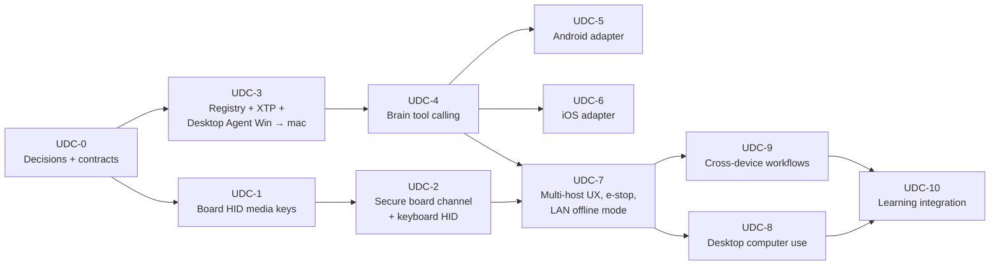

# XUNA Universal Device Control — Roadmap (Proposed)

Date: 2026-10-30. **Status: track Approved by the owner 2026-10-30 for UDC-0 and UDC-1 only** (UDC-D1); UDC-2…UDC-10 remain Proposed. This is a separate track (`UDC`) outside M01–M07. Owner decisions: §3. Architecture: [architecture](../architecture/XUNA_UNIVERSAL_DEVICE_CONTROL_ARCHITECTURE.md) · [security](../architecture/XUNA_DEVICE_CONTROL_SECURITY.md) · [research](../research/XUNA_UNIVERSAL_DEVICE_CONTROL_RESEARCH.md).

## 1. Order and why it differs from the requested list

Requested: HID PoC → macOS/Windows basic control → unified agent → Brain tools → Android → iOS → multi-device discovery/permissions → computer use → cross-device → learning.

Proposed changes:

1. **Security of the board's BLE channel moves before keyboard HID**, because today any phone in range can write to the board's command characteristic (UDC-T8/T9).
2. **macOS/Windows "basic control" and the "unified agent" merge**: building two separate agents first and unifying later duplicates the policy engine, which is the security-critical part.
3. **Registry, enrollment and permissions move before Brain tool calling**: a tool must never reach a host that has no grant model.
4. **iOS shrinks**: most iPhone control is already delivered by HID in UDC-1; the iOS milestone is Shortcuts/App Intents and approvals.
5. **Computer use comes after a stable tool set**, behind a consent class and an injection test set.

Detailed, coding-agent-ready plans for every milestone: [device-control/](device-control/README.md).

Complexity scale: **S** ≈ 1 session, **M** ≈ 2–3, **L** ≈ 4–6, **XL** ≈ 7+. Estimates are planning guesses, not commitments.

## 2. Milestones

### UDC-0 — Decisions, contracts and ADRs (docs only)

- **Dependencies:** owner reading of this set.
- **Repository changes:** ADR-0012 (host actions as a class; amends backend AGENTS §1.4 scope), ADR-0013 (host identity `HostId`, host sessions with downlink), XTP v1 contract draft in `docs/architecture/`, threat model update (UDC-T1…T16), consent U5/U6 proposal.
- **Tasks:** resolve the open decisions in §3 needed for UDC-1…UDC-4.
- **Risks:** scope creep into a parallel product; mitigated by UDC-D1.
- **Acceptance:** owner decisions on R1–R8 and UDC-D1…D11 (**done 2026-10-30**, §3); ADR-0012/0013, XTP draft and threat-model update written.
- **Testing:** none (docs).
- **Complexity:** S.

### UDC-1 — ESP32-S3 BLE HID proof of concept (media keys only)

- **Dependencies:** UDC-0 (UDC-D2 pairing model, UDC-D3 gesture); ideally run in the same board session as E14 to share setup time.
- **Repository changes (firmware):** experimental env `xuna_hid` (off by default); HID-over-GATT service with a **consumer control** report (Play/Pause, Next, Previous, Volume ±, Mute) using the Arduino core's bundled `BLEHIDDevice` / `BLESecurity` on the current Bluedroid stack, with the report map taken from the CC0 ESP-IDF `esp_hid_device` example; LE Secure Connections with numeric comparison on the LCD (button confirms); XUNA's own PnP ID; HID service started after the custom service is created (ordering pitfall seen in `pilot`); one bonded host connected at a time; status line showing the host. No change to the default build. The NimBLE migration is **not** part of this PoC; UDC-1 results feed decision UDC-D8.
- **Tasks:**
  1. Dual connection: app (custom service) + HID host at the same time on Bluedroid.
  2. Bonding persistence across reboot; forget-host.
  3. Remote-mode gesture → media key; local expression only.
  4. Measure RAM (internal heap minimum), loop gap, render time, BLE command round-trip with and without the HID service, with and without Wi-Fi (`xuna_net`).
- **Risks:** Bluedroid multi-connection limits in the Arduino build; bonding/encryption interfering with the app's unauthenticated service (iOS may prompt for pairing when an encrypted characteristic exists); host-specific HID quirks (macOS "Keyboard Setup Assistant", Windows driver caching of the report map after descriptor changes); RAM next to the TLS buffers.
- **Acceptance:** on each of macOS, Windows 11, Android and iPhone: pairing with passkey, Play/Pause and Volume work 20/20; reconnect after board reboot without re-pairing; the app stays connected and its commands still pass; loop gap p99 ≤ 50 ms; internal heap minimum within the E14 threshold when combined with Wi-Fi; zero resets in 30 min.
- **Testing:** native tests for the HID report encoder; board session with a checklist per OS; results in `docs/roadmap/device-control/UDC-1-results-<date>.md`.
- **Complexity:** M.

### UDC-2 — Authenticated board channel and keyboard HID

- **Dependencies:** UDC-1 PASS; owner decision on the app ↔ board pairing UX.
- **Repository changes:** firmware (encrypted characteristics for control opcodes, owner-bound session using the existing device proof), mobile (pairing flow, capability bit), protocol docs.
- **Tasks:** LE Secure Connections bonding with the app; keyboard report (text from the app only, R3, rate-limited, visible cue on the screen); new capability bits; regression of the S01 byte-compat replay.
- **Risks:** pairing UX friction on iOS/Android; breaking older apps (keep additive and capability-gated).
- **Acceptance:** an unbonded phone cannot trigger any HID output (tested); keyboard text typed into a test editor on all four OSes matches 100 % for ASCII and Vietnamese-capable path documented (HID sends key codes, so Vietnamese depends on the host's input method — recorded as a limitation).
- **Testing:** native + board + negative tests with a second phone.
- **Complexity:** M.

### UDC-3 — Host Registry, XTP v1 and the Desktop Agent (Windows first, then macOS)

- **Dependencies:** UDC-0 (R3, R4, R8 decisions); owner approval of the agent stack (UDC-D4) and new dependencies.
- **Repository changes:** new submodule `desktop/` (`xthao28/xuna_desktop`); backend module `hosts` (registry, enrollment, sessions; reuses `transport` session hub and P-256 verifier); shared XTP schema fixtures; mobile enrollment screen (QR + 6-digit check).
- **Tasks:** enrollment/revocation; outbound WSS session with proof; capability manifest; tools `host.status`, `media.play_pause/next/previous/volume_set/now_playing`, `app.launch` (allowlist), `url.open` (https + domain allowlist), `workflow.run` (owner-registered: macOS Shortcuts by name; Windows registered `.lnk`/AUMID or Power Automate flow — design session decides); local tray, local audit, e-stop hotkey; code signing plan.
- **Risks:** macOS TCC permission onboarding; Windows SmartScreen without a signing certificate; Flutter desktop tray/background behaviour (if UDC-D4 = Flutter); maintaining two native provider sets.
- **Acceptance:** an enrolled Windows PC and Mac each execute every MVP tool from a backend test client with correct structured results; revocation closes the session ≤ 5 s; missing OS permission returns `needs_permission`; no tool runs without a grant (negative tests); the agent survives sleep/wake and network loss with automatic reconnect.
- **Testing:** backend `scripts/check.sh` (unit, API, postgres); agent unit tests for policy and frame parsing (fuzz); XTP conformance fixtures shared by backend and agent; manual matrix on both OSes.
- **Complexity:** XL.

### UDC-4 — Brain tool calling

- **Dependencies:** UDC-3; R1 approved.
- **Repository changes:** backend `actions` module (orchestrator, targeting, approvals, audit actions), `conversation` passes filtered tools and handles `ToolCallRequested` → `Role.TOOL` loop (max 3 tool rounds per turn); mobile approval sheet, action history, stop button; deterministic status → reply-gesture mapping.
- **Tasks:** tool catalog filtering; target resolution (architecture §7); approval binding; model → board media-key route with per-press confirmation (UDC-D6, requires UDC-2); timeouts/cancel; Vietnamese prompts for confirmation; benchmark tool-call accuracy with the current provider(s) on a Vietnamese command set (≥ 100 utterances).
- **Risks:** tool-call quality of the temporary/free-tier providers (D11a open); latency on top of voice V1 targets; wrong-host actions.
- **Acceptance:** ≥ 95 % correct tool + target on the command set with ≤ 1 % wrong-host actions and **0 % unapproved R2+**; ambiguous requests ask instead of guessing in ≥ 95 % of ambiguous cases; p50 added latency ≤ 1.5 s for R1 actions on LAN.
- **Testing:** table-driven orchestrator tests with fake LLM tool calls; offline benchmark script (like `text_benchmark.py`); end-to-end on LAN with one PC.
- **Complexity:** L.

### UDC-5 — Android adapter

- **Dependencies:** UDC-4; owner decision on Play vs sideload distribution (UDC-D5); applicationId changed from `com.example.xuna_mobile` before any store release.
- **Repository changes:** mobile Kotlin platform channel(s): MediaController via NotificationListener access, intents/deep links, `CompanionDeviceManager` association with the board; Dart `HostAdapter` interface shared with the console.
- **Tasks:** phone as a host in the registry; tools `media.*`, `app.launch` (via `<queries>`-declared packages), `url.open`; disclosure screens; foreground-service type review for Android 14+.
- **Risks:** background activity start limits; OEM battery killers; Play policy review.
- **Acceptance:** media control of Spotify/YouTube Music/local player from a voice request while the app is backgrounded with the board connected; app launch of an allowlisted app; all disclosures shown before permission prompts.
- **Testing:** instrumented tests on one Android device; uiautomator2/scrcpy used **only** as test tools.
- **Complexity:** L.

### UDC-6 — iOS adapter

- **Dependencies:** UDC-4.
- **Repository changes:** mobile Swift: App Intents exposing XUNA actions ("Hỏi XUNA", "Dừng mọi thao tác"), URL handling, approvals via notifications.
- **Tasks:** document what is impossible (other apps' UI, notifications, playback except Apple Music via `MPMusicPlayerController.systemMusicPlayer`); let the owner chain Shortcuts that call XUNA intents; HID (UDC-1/2) remains the iPhone control path.
- **Risks:** App Review scrutiny of background BLE; expectations mismatch.
- **Acceptance:** the owner can run a Shortcut that asks XUNA something and get a result; approval prompts work from a notification; the app never claims capabilities the manifest marks unsupported.
- **Testing:** device test on the owner's iPhone (iOS 15+ target; App Intents need iOS 16+ — handled by availability checks).
- **Complexity:** M.

### UDC-7 — Multi-host targeting, permissions UX, emergency stop, LAN offline mode

- **Dependencies:** UDC-2, UDC-4.
- **Repository changes:** backend grants model and conventions link; mobile grants/hosts screens; agent LAN mode (mDNS discovery, mutual auth); firmware e-stop gesture.
- **Tasks:** per-family grants with expiry; "approve for this conversation"; e-stop from app/board/agent; LAN-direct app ↔ agent when the backend is unreachable (R1 tools only).
- **Acceptance:** with two PCs and one phone online, 0 wrong-host actions in a 50-request scripted test; e-stop halts all hosts ≤ 1 s on LAN; with the backend stopped, R1 media works app → agent over LAN.
- **Complexity:** L.

### UDC-8 — Desktop computer use (Windows first)

- **Dependencies:** UDC-7; consent U5 approved; a provider with vision + tool use chosen (D11a).
- **Tasks:** embed the chosen driver (UDC-D11) as an MCP-stdio child under XUNA policy, exposing only allowed tools; observe → act loop with UI tree first (UIA/AX), screenshot fallback; verify the effect after every input (SendInput fails silently under UIPI); per-step approval for R3; step and time budgets; injection test set; password-field redaction; app/domain allowlist per goal.
- **Acceptance:** 10 scripted tasks (e.g. "mở file báo cáo mới nhất trong thư mục X", "tạo sự kiện lịch") succeed ≥ 80 % with zero unapproved R3 actions and zero actions outside the allowlist across the injection set.
- **Complexity:** XL.

### UDC-9 — Cross-device workflows

- **Dependencies:** UDC-5/6/7.
- **Tasks:** URL hand-off desktop ↔ phone; "continue media on X"; physical-button-triggered owner workflows (R1/R2 only).
- **Acceptance:** each hand-off works on the supported pairs with a single confirmation; failures report which step and host failed.
- **Complexity:** M.

### UDC-10 — Learning and personalization

- **Dependencies:** UDC-9; KX conventions; routine learning.
- **Tasks:** owner-confirmed defaults ("nhạc → Mac") as conventions; routine-based suggestions with confirmation; bond level affects offer frequency only.
- **Acceptance:** two owners' histories produce different, explainable suggestions; no suggestion executes without confirmation; deleting a convention changes targeting immediately.
- **Complexity:** M.

## 3. Owner decisions (2026-10-30)

All 19 items were answered by the owner on 2026-10-30 (R2 is folded into UDC-D1 and R7 into UDC-D3). **Approved** here means the direction and contract choices; each milestone still needs its own session, and code, dependencies and board uploads keep their normal gates. All picks match the recommendation except **UDC-D6**.

| ID | Question | Decision |
|---|---|---|
| UDC-D1 (+R2) | Start the track? | **Approved: in parallel now, UDC-0 and UDC-1 only.** Later milestones need a new go-ahead |
| R1 | Host actions vs backend AGENTS §1.4 | **Approved: host actions are a separate class**, proposed by the model and run only through the `actions` orchestrator + owner approval + host re-check. Amended by UDC-D6 for board media keys |
| UDC-D4 | Desktop Agent stack | **Approved: Flutter desktop + thin native providers** (Swift macOS, C++ Windows) |
| R8 | Agent repository | **Approved: new submodule `desktop/` → `xthao28/xuna_desktop`** (created in UDC-3, not before) |
| UDC-D2 | HID pairing | **Approved: LE Secure Connections, numeric comparison on the board** (passkey fallback; never Just Works) |
| UDC-D8 | BLE stack | **Approved: stay on Bluedroid for UDC-1**; NimBLE migration decided later with UDC-1 + E14 RAM data |
| UDC-D3 (+R7) | Board gesture | **Approved: a "Remote" scene** entered from the existing scene hold; inside it buttons are media keys/stop, outside it D6 reaction learning is unchanged |
| R6 | Secure the board channel | **Approved: before keyboard HID** (UDC-2). UDC-1 is media keys only |
| R3 + R4 | `HostId`; host-session ADR | **Approved both**; ADR-0012/0013 written in UDC-0. The board session (ADR-0010) stays up-only |
| UDC-D10 | XTP envelope | **Approved: MCP-shaped** (MCP method names/results over outbound WSS + XUNA handshake and stop); no MCP SDK yet |
| R5 | Consent classes | **Approved: U5 `host_screen` and U6 `host_notifications`**, default off, never stored server-side |
| UDC-D6 | Model → board HID | **Approved (differs from the recommendation): allowed with owner confirmation for every single press, media keys only** (no keyboard text from the model). Route: orchestrator → app → authenticated BLE → board. Not reachable before UDC-4 |
| UDC-D7 | Outcomes and mood | **Approved: expression only** |
| UDC-D5 | Android distribution | **Approved: Play-safe main build + sideload dev flavour** (Accessibility only in the dev flavour) |
| UDC-D9 | iPhone AMS | **Approved: AMS spike after UDC-1**; ANCS later under U6 |
| UDC-D11 | Computer-use driver | **Approved: Cua Driver (MIT)**, pinned, `bounded` mode, no AGPL perception extension; re-checked at UDC-8 start |
