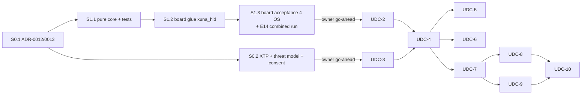

# Universal Device Control (UDC) — Implementation Plan

Date: 2026-10-30. Owner decisions: [roadmap §3](../XUNA_UNIVERSAL_DEVICE_CONTROL_ROADMAP.md#3-owner-decisions-2026-10-30).

**Status:**

- **UDC-0 is Done (2026-10-30).**
- **UDC-1 (S1.1 + S1.2) and UDC-2 (S2.1 + S2.2 + S2.3) are Implemented and host-verified (2026-10-30); physical board/phone acceptance (S1.3 / S2.4) is pending.**
- **UDC-3 (S3.1–S3.7) is Implemented and verified across `desktop/`, `backend/`, and `mobile/` (2026-10-30; [UDC-3-results-2026-10-30.md](UDC-3-results-2026-10-30.md)); native `.exe`/`.app` LAN acceptance is pending.**
- **UDC-4 (S4.1–S4.6) is Implemented and verified across `backend/` and `mobile/` (2026-10-30; [UDC-4-results-2026-10-30.md](UDC-4-results-2026-10-30.md)); live LLM + LAN acceptance is pending.**
- **UDC-5 (S5.1–S5.5) is Implemented and verified across `mobile/` and `backend/` (2026-10-30; [UDC-5-results-2026-10-30.md](UDC-5-results-2026-10-30.md), [UDC-5-play-declarations.md](UDC-5-play-declarations.md)); physical Android device acceptance is pending.**
- **UDC-6 (S6.1–S6.3) is Implemented and verified across `mobile/`, `backend/`, and `firmware/` (2026-10-30; [UDC-6-results-2026-10-30.md](UDC-6-results-2026-10-30.md)); physical iPhone + board acceptance is pending.**
- UDC-7…UDC-10 are planned in full here; each needs an owner go-ahead before work starts.

This folder is written so that **any coding agent or engineer** (including a model other than the one that wrote it) can execute a milestone without extra context. Every milestone file follows the same layout:

1. Goal
2. Gate
3. Read first
4. Scope / out of scope
5. Design
6. Files
7. Tasks
8. Tests
9. Acceptance
10. Risks
11. References
12. Handoff
13. Brief for a coding agent

| File | Milestone | Status |
|---|---|---|
| [UDC-0-decision-records.md](UDC-0-decision-records.md) | ADRs, contracts, threat model, consent classes (docs only) | **Done 2026-10-30** |
| [UDC-1-hid-poc.md](UDC-1-hid-poc.md) | "XUNA bấm Play": BLE HID media keys on the board | **S1.1 + S1.2 Done 2026-10-30; S1.3 board acceptance pending** |
| [UDC-2-secure-channel.md](UDC-2-secure-channel.md) | Authenticated app ↔ board channel, HID management, media-key opcode | **S2.1 + S2.2 + S2.3 Done 2026-10-30; S2.4 board + phones acceptance pending** |
| [UDC-3-desktop-agent.md](UDC-3-desktop-agent.md) | Host Registry, XTP v1, Desktop Agent (Windows → macOS) | **S3.1–S3.7 Done 2026-10-30 ([results](UDC-3-results-2026-10-30.md)); native LAN run pending** |
| [UDC-4-brain-tools.md](UDC-4-brain-tools.md) | Brain tool calling, orchestrator, approvals | **S4.1–S4.6 Done 2026-10-30 ([results](UDC-4-results-2026-10-30.md)); live LLM + LAN run pending** |
| [UDC-5-android.md](UDC-5-android.md) | Android Mobile Host Adapter | **S5.1–S5.5 Done 2026-10-30 ([results](UDC-5-results-2026-10-30.md), [Play declarations](UDC-5-play-declarations.md)); physical Android run pending** |
| [UDC-6-ios.md](UDC-6-ios.md) | iOS adapter + AMS spike | **S6.1–S6.3 Done 2026-10-30 ([results](UDC-6-results-2026-10-30.md)); physical iPhone + board run pending** |
| [UDC-7-multihost.md](UDC-7-multihost.md) | Multi-host UX, grants, emergency stop, LAN offline mode | **S7.1–S7.5 Done 2026-10-31 ([results](UDC-7-results-2026-10-31.md)); physical multi-host LAN + board run pending** |
| [UDC-8-computer-use.md](UDC-8-computer-use.md) | Desktop computer use with Cua Driver | Proposed |
| [UDC-9-10-workflows-learning.md](UDC-9-10-workflows-learning.md) | Cross-device workflows; learning and personalization | Proposed |

Background (read once): [research](../../research/XUNA_UNIVERSAL_DEVICE_CONTROL_RESEARCH.md) · [architecture](../../architecture/XUNA_UNIVERSAL_DEVICE_CONTROL_ARCHITECTURE.md) · [security](../../architecture/XUNA_DEVICE_CONTROL_SECURITY.md) · [capability matrix](../../research/XUNA_PLATFORM_CAPABILITY_MATRIX.md) · [open-source review](../../research/XUNA_DEVICE_CONTROL_OPEN_SOURCE_REVIEW.md).

## 1. Rules every session follows

1. **Read before coding.** Required reading, in order:
   - [AGENTS.md](../../../AGENTS.md)
   - [PROCESS.md](../../../PROCESS.md)
   - this README
   - the milestone file
   - the repository's own rules:
     - [firmware](../../../firmware): AGENTS §8, and `tools/check_core_purity.py` keeps `lib/xuna_core` free of Arduino/ESP headers.
     - [mobile/AGENTS.md](../../../mobile/AGENTS.md) and [mobile/docs/FEATURE_TEMPLATE.md](../../../mobile/docs/FEATURE_TEMPLATE.md).
     - [backend/AGENTS.md](../../../backend/AGENTS.md) and [backend/docs/ARCHITECTURE.md](../../../backend/docs/ARCHITECTURE.md).
2. **Start the session with a short Vietnamese summary** for the owner: purpose, scope, and whether a board/phone is needed (AGENTS §10).
3. **Only the named session.** Do not start the next milestone, and do not "prepare" later code.
4. **Submodules are separate repositories.** `firmware/`, `mobile/`, `backend/` and the future `desktop/` are separate repos. Commit inside the child first, then bump the pointer in `xuna_pet`. Commit only when the owner asks.
5. **Dependencies:** no new dependency without owner approval. The approval request includes license, last release and maintenance status. Pin exact versions.
6. **Third-party code:**
   - Never copy code from repositories without a license: `pilot`, `T-vK/ESP32-BLE-Keyboard`, `wakwak-koba/ESP32-NimBLE-Keyboard`, the author files of `NullYing/ESP32-BLE-Keyboard-Mouse`.
   - Never copy AGPL code: the droidrun Portal, the Cua perception extension (OmniParser).
   - From MIT/Apache-2.0 projects, **re-implement from the documented pattern**. Copy only when the owner approves, keeping the license header (and NOTICE for Apache-2.0).
   - CC0/Unlicense material (ESP-IDF HID examples) may be copied, with a source comment.
   - [ADR-0001](../../decisions/ADR-0001-reference-reuse-policy.md) applies.
7. **Security invariants (never relax them in code):**
   - no shell/PowerShell/AppleScript-source/eval tool;
   - nothing runs elevated, and no `uiAccess`;
   - no Accessibility in the Play build;
   - the model never sends keyboard text or pointer reports to the board;
   - every R2+ action needs an owner approval bound to its arguments;
   - logs are content-free.
8. **Device authority:** host actions never change the board's needs, drives, personality, learning or snapshot (UDC-D7). Board feedback is expression only: the Track A preview and subtitles.
9. **Backward compatibility:**
   - BLE additions are additive and gated by capability bits.
   - Backend turn features are gated by a client capability flag.
   - Old apps and old firmware keep working.
10. **Definition of Done per repository:**
    - Firmware:
      - `pio test -d firmware -e native` PASS;
      - `pio run -d firmware -e xuna_t_display_s3` PASS (purity check included);
      - plus the milestone's own env.
    - Mobile: `fvm dart format lib test`, `fvm flutter analyze --no-pub` (0 issues), `fvm flutter test --no-pub` PASS.
    - Backend: `backend/scripts/check.sh` PASS, with `XUNA_TEST_DATABASE_URL` set when the database is touched.
    - Desktop: as defined in UDC-3 S3.1.
11. **Handoff after meaningful work:**
    - Update the milestone file's status line and PROCESS.md.
    - Add a short owner-facing CHANGELOG entry.
    - Write results files in `docs/roadmap/device-control/` (`UDC-<n>-results-<date>.md`).
    - Report in Vietnamese: files, commands, results, **what was not run**, risks, next step.

## 2. ID register

Reserve IDs here before using them; never reuse an ID. Normative definitions live in:

- Firmware BLE protocol: [XUNA_IMPLEMENTATION_PLAN.md §14.1](../../architecture/XUNA_IMPLEMENTATION_PLAN.md#141-compatibility)
- Host actions & board actuation exceptions: [ADR-0012](../../decisions/ADR-0012-host-actions.md)
- Host identity (`HostId`), proof domain & sessions: [ADR-0013](../../decisions/ADR-0013-host-identity-and-sessions.md)
- XTP v1 wire contract & tool schemas: [XUNA_XTP_V1_CONTRACT.md](../../architecture/XUNA_XTP_V1_CONTRACT.md)
- Consent classes U5/U6: [XUNA_CLOUD_IMPLEMENTATION_PLAN.md §6](../../architecture/XUNA_CLOUD_IMPLEMENTATION_PLAN.md#6-privacy-and-retention-baseline-d23) and [ADR-0009](../../decisions/ADR-0009-cloud-platform-sequencing-and-privacy.md)
- Threat model T20–T35: [XUNA_CLOUD_THREAT_MODEL.md §3](../../architecture/XUNA_CLOUD_THREAT_MODEL.md#3-threats-stride-and-mitigations)

### 2.1 Firmware BLE (custom service `7a6e0001-8c44-4db6-9f61-2b7d5300a101`)

| Item | Value | Milestone | Notes |
|---|---|---|---|
| Opcodes in use | 1 animation · 2 suggest · 3 feedback · 4 forget · 5 TimeSync · 6 StatedPreference · 7 Hatch · 8 ConversationSignal · 9 PersonalityControl · 10 Knowledge · 11 DisplaySettings | existing | `lib/xuna_core/include/xuna/BleProtocol.h`, mobile `DeviceProtocol` |
| **Opcode 12 `HidConsumer`** | 8 bytes `[1, 12, requestId u32 LE, arg, source]`. `arg` usage index 1..7. `source`: 1 = app button, 2 = brain-approved (UDC-D6) | UDC-2 | Results: `kOk`, `kInvalidArgument` (bad arg/source), `kNotReady` (no HID host connected or channel not authenticated), `kBusy` (rate limit) |
| **Opcode 13 `HidHosts`** | 8 bytes. `arg`: 1 = forget slot (`source` = slot), 2 = forget all, 3 = allow pairing window 60 s | UDC-2 | Board shows a confirmation on screen for forget-all |
| Characteristics in use | `0002` caps … `0014` routine (`0011`/`0012` only in `XUNA_NET`) | existing | `firmware/include/BleManager.h` |
| **Characteristic `7a6e0015` HID Hosts V1** | read + notify, 16 bytes (UDC-2 §5.2) | UDC-2 | Bond list projection, no addresses |
| Capability byte 5 | bits 0–2 in use (routine = bit 2) | existing | byte 5 is `0x07` today |
| **Capability byte 5 bit 3 (`0x08`)** | HID consumer service present | UDC-1 (set only in `xuna_hid`) | |
| **Capability byte 5 bit 4 (`0x10`)** | Opcode 12 + 13 + characteristic `0015` | UDC-2 | |
| **Capability byte 5 bit 5 (`0x20`)** | Authenticated control channel (bonded app session) | UDC-2 | |
| **Capability byte 5 bit 6 (`0x40`)** | Remote events: status notification kind 3 `remoteEvent` on `7a6e0004` (arg 1 = stop, 2 = workflow slot 1, 3 = workflow slot 2) | UDC-7 (stop) / UDC-9 (workflows) | Verify the app's status decoder tolerates the new kind first |
| **Capability byte 5 bit 7 (`0x80`)** | AMS client present on the board | UDC-6 (spike env only) | |
| **Opcode 13 `arg = 4`** | Set the Remote layout: `source` 0 = Media, 1 = Workflows | UDC-9 | NVS `xuna_hid/layout` |
| Result codes | 0 ok · 1 version · 2 length · 3 opcode · 4 argument · 5 busy · 6 conflict · 7 not ready · 8 expired | existing | `V1LifeCoreAdapter::Result` |

**Consumer usage index → HID usage (Usage Page 0x0C):**

| Index | Usage | Code |
|---|---|---|
| 1 | Play/Pause | 0xCD |
| 2 | Scan Next | 0xB5 |
| 3 | Scan Previous | 0xB6 |
| 4 | Volume Increment | 0xE9 |
| 5 | Volume Decrement | 0xEA |
| 6 | Mute | 0xE2 |
| 7 | Stop | 0xB7 |

### 2.2 Backend

| Item | Value | Milestone |
|---|---|---|
| ADRs | **ADR-0012** host actions as a model-tool class (amends backend AGENTS §1.4) · **ADR-0013** host identity (`HostId`) and host sessions | UDC-0 |
| Modules | `hosts` (registry, enrollment, sessions, grants) · `actions` (orchestrator, approvals) | UDC-3 / UDC-4 |
| Migrations | next free numbers after `0012_knowledge_documents.py`: `0013_hosts`, `0014_host_grants`, `0015_action_approvals` (renumber if others land first) | UDC-3 / UDC-4 |
| Consent classes | `host_screen` (U5), `host_notifications` (U6) added to `ConsentClass` | UDC-0 records; code in UDC-5/UDC-8 |
| Audit actions | `host.enrolled`, `host.enroll_rejected`, `host.revoked`, `host.connected`, `host.rejected`, `host.grant_changed`, `host.tool_invoked`, `host.tool_denied`, `host.approval_granted`, `host.approval_rejected`, `host.stopped`, `board.hid_requested` | UDC-3 / UDC-4 / UDC-7 |
| Proof purpose | Host proof uses its own domain `b"xuna.host.proof.v1\x00"` (not `ProofPurpose`, which is device-only) | UDC-3 |
| Routes | `GET /v1/hosts/connect` (WebSocket) · `POST /v1/hosts` (claim enrollment) · `POST /v1/hosts/{hostId}/confirm` · `GET /v1/hosts` · `DELETE /v1/hosts/{hostId}` · `PUT /v1/hosts/{hostId}/grants` (UDC-3) · `POST /v1/actions/approvals/{approvalId}` · `POST /v1/actions/{invocationId}/result` (UDC-4) · `POST /v1/hosts/self/challenge` · `POST /v1/hosts/self` (UDC-5) · `POST /v1/actions/stop` (UDC-7) · `POST /v1/actions/sessions/{id}/heartbeat` (UDC-8) · `POST /v1/actions/workflow-trigger` (UDC-9) | UDC-3…UDC-9 |
| Turn events | `action_pending`, `board_hid_request`, `action_result` (UDC-4) · `local_action_request` (UDC-5) · `progress` for computer-use sessions (UDC-8) | UDC-4…UDC-8 |
| Turn capability flag | `TurnBody.clientCapabilities: ["host_actions_v1", "board_hid_v1"]`; tools are offered only when present | UDC-4 |

### 2.3 Desktop / XTP

| Item | Value |
|---|---|
| Repository | `desktop/` submodule → `xthao28/xuna_desktop` (created in UDC-3 S3.1) |
| Enrollment URI | `xuna-host://enroll?v=1&c=<code b64url 16 B>&k=<pubkey fingerprint b64url 16 B>&n=<hostname, ≤ 32 chars>` |
| XTP version | `xtp/1`, JSON-RPC 2.0, MCP-shaped (`tools/list`, `tools/call`, `notifications/cancelled`, `notifications/progress`, `ping`) + `xuna/*` methods |
| Tool names | `media.play_pause`, `media.next`, `media.previous`, `media.volume_set`, `media.now_playing`, `app.launch`, `app.list_allowed`, `url.open`, `workflow.run`, `workflow.list`, `host.status`, `host.notify` (UDC-3); `screen.*`, `ui.*`, `input.*` (UDC-8) |

## 3. Reference index (third-party)

What to take from each project, by milestone. Licenses were verified on 2026-10-30 ([open-source review](../../research/XUNA_DEVICE_CONTROL_OPEN_SOURCE_REVIEW.md)). Re-check the license before any copy.

| Project (license) | Files / docs to read | Take | Do not take | Used in |
|---|---|---|---|---|
| [espressif/esp-idf `esp_hid_device`](https://github.com/espressif/esp-idf/tree/master/examples/bluetooth/esp_hid_device) (Unlicense OR CC0-1.0) | `main/esp_hid_device_main.c` (`mediaReportMap`, consumer usage table); `main/esp_hid_gap.c` (SMP parameters and comments on IO capabilities) | Report descriptor bytes and usage codes (may copy, with a source comment); the security parameter choice | IDF glue (`esp_hidd` API); XUNA uses the Arduino `BLEHIDDevice` | UDC-1 |
| Arduino-ESP32 core 2.0.14 BLE library (Apache-2.0, already in the build) | `~/.platformio/packages/framework-arduinoespressif32/libraries/BLE/src/BLEHIDDevice.h/.cpp`, `BLESecurity.h`, `BLEDevice.cpp` (GAP handler, line ~199 `ESP_GAP_BLE_NC_REQ_EVT`), `BLECharacteristic.cpp` (`notify()` sends to **all** peers, line ~523), `BLEServer.h` (`getGattsIf()` is private) | `BLEHIDDevice` services; `BLESecurity` auth mode and IO cap; `BLEDevice::setCustomGapHandler` / `setCustomGattsHandler` | `BLESecurityCallbacks::onConfirmPIN` for button confirmation (it runs synchronously in the BT task) | UDC-1, UDC-2 |
| [ethandgoodhart/pilot](https://github.com/ethandgoodhart/pilot) (**no license: read only**) | `esp32-pilot.ino` around L347–369 | The lesson: create other services **before** `hid->startServices()`, or iOS stops recognising HID | Any code. Its unencrypted UART write and Just Works pairing are anti-patterns | UDC-1 |
| [HijelHub/HijelHID_BLEMouse](https://github.com/HijelHub/HijelHID_BLEMouse) (Apache-2.0) | `src/HijelHID_BLEMouse.cpp` (`clearBonds()`), `README.md` (Windows descriptor cache, iOS AssistiveTouch) | Per-peer `deleteBond` instead of delete-all; re-pair after any descriptor change | Its Apple vendor ID in PnP | UDC-1, UDC-2 |
| [T-vK/ESP32-BLE-Keyboard](https://github.com/T-vK/ESP32-BLE-Keyboard) (**no license: read only**) | `BleKeyboard.cpp` | How `BLEHIDDevice` is wired on Bluedroid (core 2.x) | Code | UDC-1 |
| [h2zero/NimBLE-Arduino](https://github.com/h2zero/NimBLE-Arduino) (Apache-2.0) | `src/NimBLEHIDDevice.h`, `src/nimconfig.h` | Only if UDC-D8 later chooses migration (pin 2.5.x) | 3.0-dev | UDC-D8 |
| [Apple AMS](https://developer.apple.com/library/archive/documentation/CoreBluetooth/Reference/AppleMediaService_Reference/Introduction/Introduction.html) / [ANCS](https://developer.apple.com/library/archive/documentation/CoreBluetooth/Reference/AppleNotificationCenterServiceSpecification/Introduction/Introduction.html) specs | Whole spec | Service/characteristic UUIDs, command IDs, entity/attribute model | — | UDC-6 |
| [munimtechnologies/munim-computer-use](https://github.com/munimtechnologies/munim-computer-use) (Apache-2.0) | `windows-linux/src/policy.rs`, `macos/Sources/Policy.swift`, `windows-linux/src/secure_desktop.rs`, `scripts/check-tool-parity.mjs` | Fail-closed allow/ask/block policy file (an invalid file blocks everything); a statement of the UAC boundary; CI that checks tool schemas are identical across platforms | Live dependency (8 weeks old, single maintainer) | UDC-3, UDC-8 |
| [zavora-ai/computer-use-mcp](https://github.com/zavora-ai/computer-use-mcp) (MIT) | `src/approval-ledger.ts`, `src/authority.ts`, `src/http.ts`, path jail (`fs-jail.ts`, path UNVERIFIED), `SECURITY.md` | Single-use approvals with TTL; approval token in `_meta` that the model never sees; profile tiers (unlisted tools are uncallable); loopback-only HTTP with Host/Origin checks; realpath + symlink path containment | `full` profile tools (`run_script`, registry, process kill) | UDC-3, UDC-4, UDC-7 |
| [trycua/cua](https://github.com/trycua/cua) Cua Driver (MIT; **perception extension AGPL**) | `libs/cua-driver/README.md` (permission modes, embedding, TCC "responsible app identity") | The computer-use provider over MCP stdio in `bounded` mode, pinned release | Perception extension (OmniParser, AGPL); `unrestricted` mode; deprecated `cuabot` | UDC-8 |
| [openclaw/Peekaboo](https://github.com/openclaw/Peekaboo) (MIT) | Permission onboarding and ScreenCaptureKit capture code (browse `Apps/` and the core package) | macOS permission UX and capture patterns | — | UDC-3 (macOS), UDC-8 |
| [microsoft/UFO](https://github.com/microsoft/UFO) (MIT) | `ufo/automator/ui_control/inspector.py`, `app_apis/shell/shell_client.py`, `tests/security/` | UIA inspection patterns; allow-list + regex-block style for owner workflows; security test ideas | Shell client itself | UDC-3, UDC-8 |
| [CursorTouch/Windows-MCP](https://github.com/CursorTouch/Windows-MCP) (MIT) | `__main__.py` (auth options), `tools/control_policy.py` | Examples of what must not be default (PowerShell, Registry, telemetry on) | Defaults | UDC-8 |
| [anthropics/claude-quickstarts](https://github.com/anthropics/claude-quickstarts) computer-use-demo (MIT) | `computer-use-demo/computer_use_demo/tools/computer.py`, README cautions | Agent loop shape, screenshot scaling, VM advice | X11/xdotool driver | UDC-8 |
| [modelcontextprotocol spec 2026-07-28](https://modelcontextprotocol.io/specification/latest) | Basic → transports, lifecycle, utilities (cancellation, progress, ping); Server → tools; Authorization | Method names, `Tool` / `CallToolResult` shapes, `_meta`, cancellation semantics | Streamable HTTP inbound server on hosts | UDC-3, UDC-8 |
| [openatx/uiautomator2](https://github.com/openatx/uiautomator2) (MIT), [Genymobile/scrcpy](https://github.com/Genymobile/scrcpy) (Apache-2.0), [mobile-next/mobile-mcp](https://github.com/mobile-next/mobile-mcp) (Apache-2.0), [appium](https://github.com/appium/appium) (Apache-2.0) | READMEs | **Testing only**: drive and record the XUNA Android app in QA | Shipping any of them | UDC-5 |
| [droidrun](https://github.com/droidrun/droidrun) (MIT) + Portal (**AGPL**) | Manifest of `mobilerun-portal` | An example of the permission set **not** to request | Portal code | UDC-5 |

**Official platform documents** (cite them in code comments where a constraint comes from them):

- Bluetooth: [HOGP 1.1](https://www.bluetooth.com/specifications/specs/html/?src=hogp-v1-1_1755558551/HOGP_v1.1/out/en/index-en.html).
- Microsoft: [SendInput](https://learn.microsoft.com/en-us/windows/win32/api/winuser/nf-winuser-sendinput), [UIA security](https://learn.microsoft.com/en-us/windows/win32/winauto/uiauto-securityoverview).
- Apple: [AX trust](https://developer.apple.com/documentation/applicationservices/1459186-axisprocesstrustedwithoptions), [ScreenCaptureKit](https://developer.apple.com/documentation/screencapturekit), [App Intents](https://developer.apple.com/documentation/appintents), [CoreBluetooth background](https://developer.apple.com/documentation/bundleresources/information-property-list/uibackgroundmodes), [retrieveConnectedPeripherals](https://developer.apple.com/documentation/corebluetooth/cbcentralmanager/retrieveconnectedperipherals(withservices:)), [App Review](https://developer.apple.com/app-store/review/guidelines/).
- Android / Google: [AccessibilityService](https://developer.android.com/reference/android/accessibilityservice/AccessibilityService), [Play Accessibility policy](https://support.google.com/googleplay/android-developer/answer/10964491), [MediaSessionManager](https://developer.android.com/reference/android/media/session/MediaSessionManager), [NotificationListenerService](https://developer.android.com/reference/android/service/notification/NotificationListenerService), [FGS types](https://developer.android.com/develop/background-work/services/fgs/service-types).

## 4. Sequence and gates

UDC-3 does not depend on UDC-1/2. With owner approval it may run in parallel after UDC-0.
