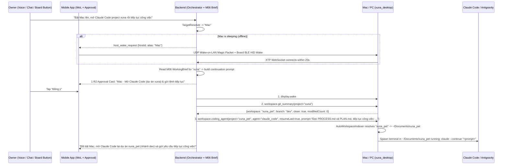

# UDC-11 — Zero-Config App/Project Discovery, Smart Host Wake & "Claude Code / Antigravity" Auto-Prompt Workflow

Status: **Implemented & Verified (`S11.1` → `S11.3`, 2026-10-31; [UDC-11-results-2026-10-31.md](UDC-11-results-2026-10-31.md)); live multi-host LAN wake & desktop coding-agent trial pending.** Complexity: **M (3 sessions: `S11.1` → `S11.3`)**. Repositories: `desktop/` (`xuna_xtp` + agent), `backend/`, `mobile/`, `firmware/` (BLE HID wake reuse).

---

## 1. Goal

Make natural commands like:

> ***"Bật Mac lên, tìm project xuna rồi mở Claude Code (hoặc Antigravity) nhắc nó tiếp tục công việc"***
> *(or *"Mở Figma / Docker / Notion trên PC lên"* — without ever pre-configuring app lists or project paths!)*

work out-of-the-box with **Zero Manual Configuration** while preserving XUNA's security guarantees:

1. **Zero-Config Installed App & CLI Auto-Discovery (`AutoAppScanner`):**
   - `xuna_desktop` automatically scans installed macOS (`/Applications`, `~/Applications`) and Windows (Start Menu `.lnk`, Registry `App Paths`) applications plus developer CLIs (`claude`, `agy`, `code`, `cursor`, `codex`) at startup.
   - The owner **never** has to manually configure an allowlist of apps before asking XUNA to open them; safety is enforced by the **`R2` phone approval card** showing the exact resolved application name (`"Mac · Mở ứng dụng Claude Code tại dự án xuna_pet"`).
2. **Zero-Config Project / Git Repo Auto-Discovery (`AutoWorkspaceIndexer`):**
   - `xuna_desktop` automatically indexes recent projects from:
     - **Claude Code history** (`~/.claude.json` `projects` keys),
     - **Antigravity / VS Code / Cursor recent workspaces** (`globalStorage/storage.json`), and
     - **Shallow Git repository scan** (depth 1–3 under `~/Documents`, `~/Projects`, `~/Developer`, `~/Repos`, `~/Desktop`, `~/work` for directories containing `.git`, `AGENTS.md`, or `CLAUDE.md`).
   - Saying *"project xuna"* or *"dự án pet"* fuzzy-matches the local index on the PC/Mac automatically — **zero manual path configuration required**, and raw filesystem paths stay on the PC/Mac.
3. **Smart Host Wake (`Wake-on-LAN` + `BLE HID Wake` + `display.wake` + 20 s Reconnect Wait):**
   - Wakes a sleeping Mac/PC over local Wi-Fi (UDP Magic Packet) and/or BLE HID, waits up to 20 s for `xuna_desktop` to connect, and lights up the screen (`display.wake`).
4. **Autonomous Coding Agent Handoff (`workspace.coding_agent` + `resume_work`):**
   - Launches **Claude Code** (`claude -c "<continuation prompt>"` in a visible Terminal / iTerm2 / Windows Terminal window rooted at the discovered project folder) or **Antigravity / Cursor / VS Code** (`agy` / `cursor` / `code` at the project folder + optional prompt handoff).
   - Automatically builds the continuation prompt from the owner's voice instruction + `M06` `WorkingBrief` + live `workspace.git_summary` (`branch`, `modifiedCount`), so **Claude Code immediately resumes the session and starts working**!

---

## 2. Gate

- `UDC-3`, `UDC-4`, `UDC-7`, `UDC-9`, `UDC-10` and `M06` (`KX-3` `WorkingBrief`) Done on host (all **Done** as of 2026-10-31).
- Owner go-ahead for `UDC-11`.

---

## 3. Read first

- [README.md](README.md) · [UDC-3-desktop-agent.md](UDC-3-desktop-agent.md) · [UDC-8-computer-use.md](UDC-8-computer-use.md) · [UDC-9-10-workflows-learning.md](UDC-9-10-workflows-learning.md)
- [knowledge-expert-plan-2026-10-29.md](../knowledge/knowledge-expert-plan-2026-10-29.md) (`WorkingBrief` schema & use cases)
- [XUNA_DEVICE_CONTROL_SECURITY.md](../../architecture/XUNA_DEVICE_CONTROL_SECURITY.md)

---

## 4. Scope / out of scope

### In scope
- **S11.1 — Smart Host Wake & Reconnect (`Wake-on-LAN` + `BLE HID Wake` + `display.wake` + 20 s Reconnect Wait):**
  - Local-only Wake-on-LAN (WoL) UDP Magic Packet sender on `mobile/` (`102-byte` payload `6×0xFF + 16×MAC`) + BLE HID wake pulse when the board is bonded to the target host.
  - Bounded `wait_for_host_online(host_id, timeout_s=20.0)` in backend `Orchestrator` / `WorkflowPlanRunner`.
  - Deterministic `display.wake` (`R1`, `ToolFamily.app`) tool on `xuna_xtp` & `desktop/` (`caffeinate -u -t 2` on macOS; `SetThreadExecutionState(ES_DISPLAY_REQUIRED)` + zero-delta `SendInput` on Windows).
- **S11.2 — Zero-Config App & Project Auto-Discovery (`AutoAppScanner` + `AutoWorkspaceIndexer` + `workspace.open` + `workspace.git_summary`):**
  - **`AutoAppScanner` (`desktop/`):** Discovers installed GUI applications (macOS `/Applications` & `~/Applications`; Windows Start Menu & `App Paths`) and developer CLIs (`claude`, `agy`, `code`, `cursor`, `codex`) without manual setup, while still blocking hard-denied system/security binaries (`cmd`, `powershell`, `regedit`, password managers, banking apps).
  - **`AutoWorkspaceIndexer` (`desktop/`):** Auto-discovers Git repositories and recent projects from `~/.claude.json`, Antigravity/VS Code/Cursor `storage.json`, and shallow scan (depth ≤ 3) of standard project directories (`~/Documents`, `~/Projects`, `~/Developer`, `~/Repos`, `~/Desktop`). Supports fuzzy matching by project name (`workspace.find_and_open`).
  - **`workspace.open` (`R2`):** Fuzzy-matches `project` query against `AutoWorkspaceIndexer` and opens it in `antigravity`, `vscode`, `cursor`, or system file manager (`runInShell: false`).
  - **`workspace.git_summary` (`R1`):** Runs read-only `git -C <resolvedPath> status --porcelain -b` (`runInShell: false`, 3 s timeout) and returns `{workspace, branch, clean, modifiedCount, untrackedCount}`.
- **S11.3 — `workspace.coding_agent` (Claude Code / Antigravity Prompt Handoff) & `resume_work` / `wrap_up_work` Composite Workflows:**
  - **`workspace.coding_agent` (`R2`, `ToolFamily.app`):**
    - Input: `{"project": string, "agent": "claude_code" | "antigravity" | "cursor" | "codex", "resumeLast": bool, "prompt": string}`.
    - Resolves `project` via `AutoWorkspaceIndexer`.
    - For **`claude_code`**: spawns a visible terminal window (`Terminal.app` / `iTerm.app` on macOS, `wt.exe` / console on Windows) with working directory set to the resolved project path and executes the discovered `claude` binary directly with fixed argv:
      - If `resumeLast == true` and `prompt` is non-empty: `claude --continue "<prompt>"` (resumes the latest Claude Code session in that repo and sends the prompt immediately!).
      - If `resumeLast == true` and `prompt` is empty: `claude --continue`.
      - If `resumeLast == false`: `claude "<prompt>"`.
    - For **`antigravity` / `cursor` / `vscode`**: opens the project folder in the IDE (`agy <path>` / `cursor <path>` / `code <path>`) and copies/injects `prompt` so the IDE agent is ready with the continuation instructions.
  - **`resume_work` composite workflow (`WorkflowPlanRunner`):**
    1. Wake sleeping host if offline (`WoL` + `BLE HID` + wait ≤ 20 s).
    2. Request **one** `R2` approval showing `{host}`, `{agent}`, `{project}`, and a preview of the continuation prompt.
    3. `display.wake` → `workspace.git_summary(project)` → `workspace.coding_agent(project, agent, resumeLast=true, prompt=synthesizedPrompt)` where `synthesizedPrompt` combines the owner's instruction + `M06` `WorkingBrief` (`goal`, `nextStep`) + live Git state.
  - **`wrap_up_work` composite workflow (`WorkflowPlanRunner`):**
    1. `workspace.git_summary(project)` (warns if uncommitted files remain) + `media.play_pause(pause)` + drafts an updated `M06` `WorkingBrief` candidate.

### Out of scope
- Free-form arbitrary shell command execution (`bash -c`, `powershell -Command`) — `workspace.coding_agent` invokes only the verified `claude` / `codex` / `agy` / `cursor` / `code` executable with a strict argument array (`runInShell: false`).
- Automatic `--dangerously-skip-permissions` flag on Claude Code (never passed; Claude Code retains its own normal safety prompts on the desktop).

---

## 5. Design

### 5.1 End-to-End Flow: *"Bật Mac lên, mở Claude Code ở project xuna rồi tiếp tục công việc"*

### 5.2 Zero-Config Discovery Engines on `xuna_desktop` (`S11.2`)

1. **`AutoAppScanner`:**
   - **macOS:** Scans `/Applications/*.app`, `/System/Applications/*.app`, `~/Applications/*.app` (extracting bundle name & executable) + checks CLI paths (`/opt/homebrew/bin`, `/usr/local/bin`, `~/.local/bin`, `~/.npm-global/bin`) for `claude`, `codex`, `agy`, `cursor`, `code`.
   - **Windows:** Scans Start Menu `.lnk` entries (`%ProgramData%\Microsoft\Windows\Start Menu\Programs`, `%AppData%\Microsoft\Windows\Start Menu\Programs`), Registry `App Paths`, and `%LOCALAPPDATA%\Programs` / `%APPDATA%\npm` for `claude.cmd`/`claude.exe`, `agy.cmd`, `cursor.cmd`, `code.cmd`.
   - **Hard Deny Filter:** Reuses `isHardDeniedAppOrProcess` from `xuna_xtp` so raw shells (`cmd`, `powershell`, `bash`, `zsh`), registry editors, password managers, and banking apps can never be launched through `app.launch`.
2. **`AutoWorkspaceIndexer`:**
   - Reads project roots automatically from:
     - `~/.claude.json` (`projects` map keys — every folder where the owner has ever used Claude Code!),
     - `%APPDATA%` / `~/Library/Application Support` for `Antigravity`, `Code`, and `Cursor` (`User/globalStorage/storage.json` → `backupWorkspaces.folders` / `profileAssociations.workspaces`),
     - Shallow filesystem scan (depth `1..3`) of `~/Documents`, `~/Projects`, `~/Developer`, `~/Repos`, `~/Desktop`, `~/work` for folders containing `.git/`, `AGENTS.md`, or `CLAUDE.md`.
   - Ranking & Fuzzy Match (`resolveProject(String query)`):
     - Exact basename match (`"xuna_pet"`) → prefix/substring match (`"xuna"` matches `"xuna_pet"`) → token overlap, sorted by most recently modified `.git/HEAD` or `PROCESS.md`!
   - Privacy invariant: Only the matched **basename/alias** (`"xuna_pet"`) is returned in XTP responses; the full path (`C:\Users\Thao\Documents\xuna_pet`) never leaves `xuna_desktop`.

### 5.3 Tool Contracts (`S11.2` & `S11.3`)

| Tool name | Family | Risk | Observes | Reversible | Input schema | Output schema |
| --- | --- | --- | --- | --- | --- | --- |
| `display.wake` | `app` | `R1` | `false` | `true` | `{}` | `{"status": "ok"}` |
| `app.launch` *(upgraded)* | `app` | `R2` | `false` | `true` | `{"app": string (1..64, canonical ID or fuzzy app name discovered by AutoAppScanner)}` | `{"status": "ok", "app": string, "resolvedName": string}` |
| `workspace.open` | `app` | `R2` | `false` | `true` | `{"project": string (1..64), "ide": "antigravity" \| "vscode" \| "cursor" \| "auto"}` | `{"status": "ok", "workspace": string, "ide": string}` |
| `workspace.git_summary` | `app` | `R1` | `true` | `true` | `{"project": string (1..64)}` | `{"status": "ok", "workspace": string, "branch": string, "clean": bool, "modifiedCount": int, "untrackedCount": int}` |
| `workspace.coding_agent` | `app` | `R2` | `false` | `false` | `{"project": string (1..64), "agent": "claude_code" \| "antigravity" \| "cursor" \| "codex" \| "auto", "resumeLast": bool, "prompt": string (0..500)}` | `{"status": "ok", "workspace": string, "agent": string, "resumed": bool, "promptSent": bool}` |

---

## 6. Files

| Repository | Files to create / modify |
| --- | --- |
| `desktop/packages/xuna_xtp` | `lib/src/tools/tool_catalog.dart` (`display.wake`, `workspace.open`, `workspace.git_summary`, `workspace.coding_agent`, `isValidWorkspaceQuery`, `isSafeAgentPrompt`), `test/xuna_xtp_test.dart` |
| `desktop/` | `lib/features/discovery/auto_app_scanner.dart` (Zero-config OS app & CLI scanner), `lib/features/discovery/auto_workspace_indexer.dart` (`~/.claude.json`, IDE `storage.json`, `.git` shallow scanner & fuzzy matcher), `lib/features/tools/host_tool_dispatcher.dart`, `windows/runner/xuna_host_plugin.cpp`, `macos/Runner/XunaHostPlugin.swift`, `test/discovery_and_coding_agent_test.dart` |
| `backend/` | `src/xuna_backend/modules/actions/application/catalog.py`, `src/xuna_backend/modules/actions/domain/entities.py` (`HostWakeRequestEvent`), `src/xuna_backend/modules/actions/application/workflows.py` (`resume_work`, `wrap_up_work`, `wait_for_host_online`), `src/xuna_backend/modules/actions/application/orchestrator.py`, `tests/unit/test_udc11_dev_workspace.py` |
| `mobile/` | `lib/features/hosts/data/data_source/wol_magic_packet_sender.dart`, `lib/features/actions/domain/entity/host_wake_request.dart`, `lib/features/home/presentation/service/home_actions_service.dart`, `lib/features/home/presentation/widgets/home_remote_control_card.dart`, `test/features/actions/actions_test.dart` |

---

## 7. Tasks

| Session | Tasks |
| --- | --- |
| **S11.1** | **Smart Host Wake & Reconnect:** 1. Add `display.wake` (`R1`) to `xuna_xtp`, `desktop/`, and `backend/catalog.py`. 2. Implement `WolMagicPacketSender` (`buildMagicPacket` 102-byte UDP broadcast) in `mobile/` + `HostWakeRequestEvent` handler. 3. Add bounded `wait_for_host_online(timeout_s=20.0)` in `backend/` `Orchestrator` and `WorkflowPlanRunner`. |
| **S11.2** | **Zero-Config App & Project Auto-Discovery (`AutoAppScanner` + `AutoWorkspaceIndexer`):** 1. Build `AutoAppScanner` in `desktop/` to discover installed macOS/Windows apps and `claude`/`agy`/`cursor`/`code`/`codex` binaries automatically while enforcing `isHardDeniedAppOrProcess`. 2. Build `AutoWorkspaceIndexer` in `desktop/` reading `~/.claude.json`, Antigravity/VS Code/Cursor `storage.json`, and shallow `.git` directories with fuzzy project matching. 3. Implement `workspace.open` (`R2`) and `workspace.git_summary` (`R1`, `runInShell: false`, zero path logging). |
| **S11.3** | **Claude Code / Antigravity Handoff (`workspace.coding_agent`) & `resume_work` / `wrap_up_work` Workflows:** 1. Implement `workspace.coding_agent` (`R2`) in `xuna_xtp`, `desktop/`, and `backend/` (spawns `claude --continue "<prompt>"` or opens Antigravity/Cursor at the matched project folder with prompt handoff). 2. Implement `resume_work` and `wrap_up_work` templates in `WorkflowPlanRunner` bridging `M06` `WorkingBrief` + `workspace.git_summary` + `workspace.coding_agent`. 3. Add preset workflow options on `mobile/` (`HomeRemoteControlCard`) and full unit/integration tests across all repositories. |

---

## 8. Tests

- **Zero-Config Discovery (`S11.2`):**
  - `AutoWorkspaceIndexer` parses simulated `~/.claude.json` and VS Code / Antigravity `storage.json` + temp `.git` directories; fuzzy query `"xuna"` resolves to `"xuna_pet"` (most recently active) and rejects path traversal (`"../etc"`).
  - `AutoAppScanner` resolves installed apps by fuzzy name (`"antigravity"`, `"claude"`, `"figma"`) and blocks hard-denied binaries (`"powershell"`, `"cmd"`, `"1password"`).
- **Claude Code / Antigravity Handoff (`S11.3`):**
  - `workspace.coding_agent(project="xuna", agent="claude_code", resumeLast=true, prompt="Tiếp tục làm UDC-11")` resolves `"xuna"` → `xuna_pet`, constructs exact argv `["--continue", "Tiếp tục làm UDC-11"]` in working directory `.../xuna_pet` with `runInShell: false`, and logs `0` paths or prompts.
- **Smart Wake & End-to-End `resume_work` (`S11.1` + `S11.3`):**
  - Sleeping host receives `HostWakeRequestEvent` → WoL packet built (`102 bytes`) → host comes online within timeout → single `R2` approval → executes `display.wake` + `workspace.git_summary` + `workspace.coding_agent` and returns `M06` `WorkingBrief` standup summary.

---

## 9. Acceptance

- **Zero pre-configuration:** On a fresh run of `xuna_desktop`, the owner does **not** need to type any app paths or project paths into settings.
- Saying *"Bật Mac lên, mở Claude Code (hoặc Antigravity) ở project xuna rồi tiếp tục công việc"*:
  1. Wakes the Mac if sleeping and turns on the display.
  2. Automatically finds the `xuna_pet` project folder on the Mac.
  3. Asks for **1** `R2` confirmation on the phone (`"Mac · Mở Claude Code (xuna_pet) và tiếp tục công việc"`).
  4. Launches Claude Code (`claude --continue "<prompt>"`) or Antigravity in `xuna_pet` with the continuation prompt derived from the owner's voice + `M06` `WorkingBrief` + live Git branch status.
- `0` arbitrary shell evaluations; `0` raw filesystem paths leaked to logs.
