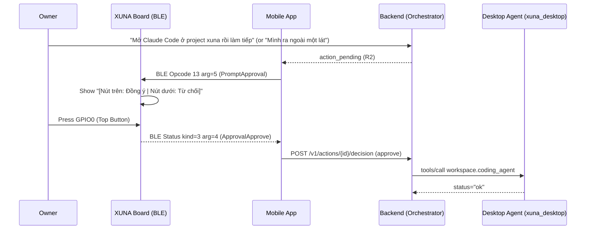

# UDC-12 — Physical Board `R2` Approval, Bidirectional Task/Selection Bridge, Zero-Config MCP Bridge, Teachable Custom Workflows & Focus/Presence Co-Pilot

Status: **Implemented (`S12.1` → `S12.5` Done on host 2026-10-31; [UDC-12-results-2026-10-31.md](UDC-12-results-2026-10-31.md); live hardware/LAN acceptance pending)**. Complexity: **L (5 sessions: `S12.1` → `S12.5`)**. Repositories: `firmware/`, `desktop/` (`xuna_xtp` + agent), `backend/`, `mobile/`.

---

## 1. Goal

Turn XUNA from a one-way command executor into a **bidirectional, context-aware Desk Co-Pilot**:

1. **Physical Board `R2` Approval (`S12.1`):**
   - When an `R2` action awaits confirmation and the board is on the desk, the owner can press **Top Button (`GPIO0`) = Approve** or **Bottom Button (`GPIO14`) = Reject** directly on the XUNA device without picking up the phone (`R3` remains strictly phone-signed).
2. **Bidirectional Desktop → XUNA Bridge (`S12.2`):**
   - **`selection.read` (`R1`):** Read selected/copied text (`<= 1200` chars) with automatic secret/token redaction (`sk-...`, `ghp_...`, `AIza...`, Bearer tokens, passwords) so the owner can highlight an error log or code snippet on PC/Mac and ask *"Xuna ơi giải thích đoạn này"*.
   - **`host.lock_screen` (`R1`):** Lock the Windows (`LockWorkStation`) or macOS (`pmset displaysleepnow`) screen when stepping away.
   - **`workspace.watch_task` (`R1`):** Inspect or watch a running Claude Code / build / test task in a discovered project and notify XUNA (`"✓ Mac: Claude xong việc!"` with `bounce_play` or `"✗ Mac: Build lỗi"` with `look_around`).
3. **Zero-Config Local MCP Server Bridge (`S12.3`):**
   - **`AutoMcpBridge` (`desktop/`):** Automatically discovers MCP servers already configured in `~/.claude.json`, `claude_desktop_config.json`, or `.cursor/mcp.json` / Antigravity config (never exposing env vars or API keys) and exposes `mcp.list_servers` (`R1`) + `mcp.call` (`R2`).
4. **Teachable Custom Workflows (`S12.4`):**
   - Allow the owner to teach XUNA named multi-step workflows in natural language (*"Khi mình nói 'Vào ca sáng' thì bật Mac, mở Antigravity ở project xuna và mở nhạc"*), confirm once, and run them by voice or from board buttons 1 & 2.
5. **Focus Co-Pilot & Away-Guard Workflows (`S12.5`):**
   - **`focus_session` (`R1`):** Starts a bounded Deep Work / Pomodoro timer (`15..120` min) with optional focus audio and end-of-session `yawn_stretch` + Git progress check.
   - **`away_guard` (`R1`):** Pauses active media across devices and locks the PC/Mac screen (`host.lock_screen`) when the owner steps away (*"Mình ra ngoài một lát"*).

---

## 2. Gate

- `UDC-0` through `UDC-11` and `M06` Done on host (all **Done** as of 2026-10-31).
- Owner go-ahead for `UDC-12` (confirmed 2026-10-31).

---

## 3. Read first

- [README.md](README.md) · [UDC-9-10-workflows-learning.md](UDC-9-10-workflows-learning.md) · [UDC-11-dev-workspace-resume.md](UDC-11-dev-workspace-resume.md)
- [XUNA_DEVICE_CONTROL_SECURITY.md](../../architecture/XUNA_DEVICE_CONTROL_SECURITY.md)

---

## 4. Scope / out of scope

### In scope
- **`S12.1` (Physical Board `R2` Approval):**
  - `firmware/`: `HidHostsArg::PromptApproval = 5`, `HidHostsArg::CancelApproval = 6`, `RemoteEventCode::ApprovalApprove = 4` (`GPIO0` short press), `RemoteEventCode::ApprovalReject = 5` (`GPIO14` short press) in `BleProtocol.h` & `RemoteMode.h`.
  - `mobile/`: `ProtocolCodec` encode/decode for board approval prompt and events; `HomeActionsService` auto-prompts connected board on `R2` pending action and resolves on button press (`R3` excluded).
- **`S12.2` (Bidirectional Desktop Bridge — `selection.read`, `host.lock_screen`, `workspace.watch_task`):**
  - `xuna_xtp` & `desktop/`: tool schemas, secret redactor (`redactSensitiveTokens`), `SelectionReadTool`, `HostLockScreenTool`, `WorkspaceWatchTaskTool`, native `lockScreen` & `clipboardReadText` in `XunaHostChannel`.
  - `backend/`: catalog & summary support for `selection.read`, `host.lock_screen`, `workspace.watch_task`.
- **`S12.3` (Zero-Config Local MCP Bridge — `AutoMcpBridge`, `mcp.list_servers`, `mcp.call`):**
  - `desktop/`: `AutoMcpBridge` scanning `~/.claude.json`, Claude Desktop config, and Cursor/Antigravity `mcp.json` (stripping all `env` secrets on wire); `McpListServersTool` (`R1`) and `McpCallTool` (`R2`).
  - `xuna_xtp` & `backend/`: schemas, policy, and catalog wiring for `mcp.list_servers` and `mcp.call`.
- **`S12.4` (Teachable Custom Workflows):**
  - `backend/` & `mobile/`: `CustomWorkflowStep`, `CustomWorkflowDefinition`, `InMemoryCustomWorkflowStore`, `extract_custom_workflow_candidate`, and `WorkflowTemplate.CUSTOM_WORKFLOW` (`custom_workflow`) in `CompositeWorkflowRunner`.
- **`S12.5` (Focus Co-Pilot & Away-Guard Workflows):**
  - `backend/` & `mobile/`: `WorkflowTemplate.FOCUS_SESSION` (`focus_session`) and `WorkflowTemplate.AWAY_GUARD` (`away_guard`) in `CompositeWorkflowRunner` + mobile presets and focus timer state in `HomeActionsService`.

### Out of scope
- Physical board approval for `R3` actions (`R3` must always be signed by the phone's P-256 key).
- Exposing MCP server environment variables or credentials over XTP or to the LLM.

---

## 5. Design

---

## 6. Files

- `firmware/lib/xuna_core/include/xuna/BleProtocol.h`
- `firmware/lib/xuna_core/include/xuna/RemoteMode.h`
- `firmware/test/test_remote_mode/test_remote_mode.cpp`
- `desktop/packages/xuna_xtp/lib/src/schemas.dart`
- `desktop/packages/xuna_xtp/lib/src/policy.dart`
- `desktop/lib/core/channel/xuna_host_channel.dart`
- `desktop/lib/core/channel/fake_xuna_host_channel.dart`
- `desktop/lib/features/discovery/auto_mcp_bridge.dart`
- `desktop/lib/features/tools/host_tool_dispatcher.dart`
- `desktop/windows/runner/xuna_host_plugin.cpp`
- `desktop/macos/Runner/XunaHostPlugin.swift`
- `backend/src/xuna_backend/modules/actions/domain/tool_names.py`
- `backend/src/xuna_backend/modules/actions/domain/entities.py`
- `backend/src/xuna_backend/modules/actions/application/catalog.py`
- `backend/src/xuna_backend/modules/actions/application/workflows.py`
- `backend/src/xuna_backend/modules/hosts/domain/entities.py`
- `mobile/lib/features/device/data/protocol/protocol_codec.dart`
- `mobile/lib/features/home/presentation/service/home_actions_service.dart`

---

## 7. Tasks (`S12.1` → `S12.5`)

1. **`S12.1`:** Implement `HidHostsArg::PromptApproval (5)` / `CancelApproval (6)` and `RemoteEventCode::ApprovalApprove (4)` / `ApprovalReject (5)` in `firmware/` (`xuna_core`) and `mobile/`, with unit tests proving `R2` can be approved/rejected from the board while `R3` cannot.
2. **`S12.2`:** Implement `selection.read` (with secret redaction), `host.lock_screen`, and `workspace.watch_task` in `xuna_xtp`, `desktop/`, and `backend/`.
3. **`S12.3`:** Implement `AutoMcpBridge` (`mcp.list_servers` `R1`, `mcp.call` `R2`) in `desktop/`, `xuna_xtp`, and `backend/`.
4. **`S12.4`:** Implement `CustomWorkflowDefinition`, `InMemoryCustomWorkflowStore`, and `custom_workflow` execution in `backend/` and `mobile/`.
5. **`S12.5`:** Implement `focus_session` and `away_guard` composite workflows in `backend/` and `mobile/`.

---

## 8. Tests

- `firmware/`: `pio test -d firmware -e native` (including `test_remote_mode` covering `PromptApproval`, `ApprovalApprove`, `ApprovalReject`).
- `desktop/packages/xuna_xtp`: `fvm dart analyze` & `fvm dart test`.
- `desktop/`: `fvm flutter analyze --no-pub` & `fvm flutter test --no-pub` covering `SelectionReadTool` secret redaction, `HostLockScreenTool`, `WorkspaceWatchTaskTool`, and `AutoMcpBridge`.
- `backend/`: `ruff check`, `mypy src`, and `pytest -q` (`tests/unit/test_udc12_desk_copilot.py`).
- `mobile/`: `fvm flutter analyze --no-pub` & `fvm flutter test --no-pub test/features/actions/actions_test.dart`.

---

## 9. Acceptance

- Pressing `GPIO0` on the board during an active `R2` approval prompt approves the action; pressing `GPIO14` rejects it; `R3` actions never trigger a board-only approval.
- `selection.read` redacts API keys (`sk-...`, `ghp_...`, `AIza...`, Bearer tokens) before returning text and logs zero content.
- `AutoMcpBridge` discovers configured MCP servers from `~/.claude.json` / `mcp.json` without exposing `env` values.
- `custom_workflow`, `focus_session`, and `away_guard` execute deterministically and pass all automated tests.
