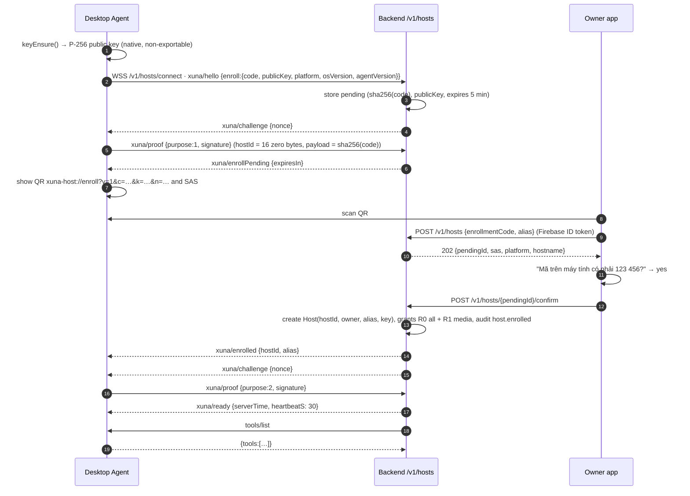

# UDC-3 — Host Registry, XTP v1 and the Desktop Agent (Windows → macOS)

Status: **Proposed** — needs an owner go-ahead and dependency approvals. Complexity: XL (7 sessions). Repositories: backend, mobile, **new** `desktop/` (`xthao28/xuna_desktop`).

## 1. Goal

A Windows PC and a Mac each run the **XUNA Desktop** tray app. The owner enrolls them from the phone. The backend can call a small, safe tool set on them over an authenticated outbound WebSocket and gets structured results:

- media;
- allowlisted app launch;
- https URL on allowlisted domains;
- owner-registered workflows;
- status.

There is no model involvement yet: UDC-4 connects the Brain.

## 2. Gate

- UDC-0 Done: ADR-0012/0013 and the XTP contract.
- Owner go-ahead.
- The owner creates the GitHub repository `xthao28/xuna_desktop`.
- Dependency approvals (§5.6.2).
- UDC-1/2 are **not** prerequisites.

## 3. Read first

- [README](README.md): rules, ID register, reference index.
- `docs/architecture/XUNA_XTP_V1_CONTRACT.md` (from UDC-0). This file's §5.2–§5.4 is the source it was made from.
- Backend:
  - [AGENTS.md](../../../backend/AGENTS.md) (layering, invariants, Definition of Done);
  - `backend/docs/ARCHITECTURE.md` (contracts and fixtures);
  - `src/xuna_backend/modules/transport/` (`api/device_socket.py` WebSocket handler pattern, `application/device_frames.py` strict frames, `application/device_gateway.py` proof + consent checks, `infrastructure/session_hub.py`);
  - `modules/identity/domain/device_proof.py` (proof message layout to mirror);
  - `modules/identity/infrastructure/p256.py` (verifier to reuse);
  - `modules/audit/domain/event.py` (`AuditAction`, code-only metadata);
  - `main.py` (router registration and `app.state` ports);
  - `migrations/versions/0012_knowledge_documents.py` (latest revision).
- Mobile:
  - [mobile/AGENTS.md](../../../mobile/AGENTS.md), [FEATURE_TEMPLATE.md](../../../mobile/docs/FEATURE_TEMPLATE.md);
  - `lib/features/pairing/` (QR scanning with `mobile_scanner`);
  - `lib/features/account/data/repository/cloud_repository_impl.dart` (authenticated backend calls).
- References:
  - munim `windows-linux/src/policy.rs` and `macos/Sources/Policy.swift` (fail-closed policy file);
  - zavora `src/approval-ledger.ts` and `src/authority.ts`;
  - Peekaboo permission onboarding;
  - UFO `ufo/automator/ui_control/inspector.py` (later, UDC-8);
  - MCP spec 2026-07-28: tools, cancellation, progress, ping.

## 4. Scope

**In scope:**

- Backend `hosts` module: enrollment, sessions, manifests, grants, revocation, dev invocation script.
- XTP v1.
- The `xuna_xtp` pure-Dart package.
- Desktop Agent: tray, enrollment, session, local policy, local audit, e-stop hotkey, Windows and macOS providers for the MVP tools, dev packaging.
- Mobile: enroll a host, list hosts, toggle grants, revoke.

**Out of scope:**

- LLM tool calling and approvals UI (UDC-4).
- Phones as hosts (UDC-5/6).
- LAN mode (UDC-7).
- Screen/UI/input tools (UDC-8).
- Production code-signing purchase (an owner decision; dev builds are unsigned).

## 5. Design

### 5.1 Enrollment



- `code`: 16 random bytes, base64url, shown only in the QR.
- `k`: the first 16 bytes of `sha256(publicKey)`, base64url. The app sends it with the claim, and the backend checks it against the pending key.
- SAS: as in ADR-0013 (`sha256(b"xuna.host.sas.v1" + code + publicKey)`, first 4 bytes big-endian, mod 1,000,000, 6 digits). The agent computes it locally and shows it as soon as the QR is shown, so no server round trip is needed.
- **Rejections:**
  - expired or unknown code → `404 not_found`;
  - fingerprint mismatch → `409 conflict`, audit `host.enroll_rejected`;
  - more than 5 claims per minute per owner → `429`.
- **Reconnect:** `xuna/hello {hostId}` → challenge → proof purpose 2 → ready. Unknown or revoked `hostId` → close with `unauthorized`; the agent wipes its local state and returns to enrollment.

### 5.2 XTP v1 wire contract

- Transport: WSS text frames, UTF-8 JSON, ≤ 64 KiB per frame. **JSON-RPC 2.0**, method names follow MCP where an MCP equivalent exists.
- Handshake requests from the agent (before `ready`):
  - `xuna/hello`;
  - `xuna/proof`.
- Notifications from the backend: `xuna/challenge`, `xuna/enrollPending`, `xuna/enrolled`, `xuna/ready`.

**After `ready`:**

| Method | Direction | Kind | Params | Result |
|---|---|---|---|---|
| `tools/list` | backend → agent | request | `{}` | `{tools: Tool[]}` (MCP `Tool` + `_meta["xuna/policy"]`) |
| `tools/call` | backend → agent | request | `{name, arguments, _meta: {"xuna/invocationId", "xuna/deadlineMs", "xuna/approval"?}}` | MCP `CallToolResult` + `_meta["xuna/status"]`, `_meta["xuna/durationMs"]` |
| `notifications/cancelled` | backend → agent | notification | `{requestId, reason}` | — |
| `notifications/progress` | agent → backend | notification | `{progressToken, progress, total?, message?}` (message is code-like, never content) | — |
| `notifications/tools/list_changed` | agent → backend | notification | `{}`; the backend re-runs `tools/list` | — |
| `xuna/stop` | either | notification | `{reason: "owner_app" \| "owner_host" \| "owner_board" \| "revoked"}` | — |
| `ping` | either | request | `{}` | `{}` |

**Example `tools/call`:**

```json
{"jsonrpc":"2.0","id":17,"method":"tools/call","params":{
  "name":"app.launch","arguments":{"id":"vscode"},
  "_meta":{"xuna/invocationId":"5f3c…","xuna/deadlineMs":10000,
           "xuna/approval":{"approvalId":"a1b2…","argsSha256":"…","expiresAt":"2026-11-02T10:00:30Z"}}}}
```

**Example result:**

```json
{"jsonrpc":"2.0","id":17,"result":{
  "content":[{"type":"text","text":"opened"}],
  "structuredContent":{"id":"vscode"},
  "isError":false,
  "_meta":{"xuna/status":"ok","xuna/durationMs":420}}}
```

**Canonical args hash:**

- `argsSha256 = sha256(canonical_json(arguments))`.
- Canonical JSON means: keys sorted, no insignificant whitespace, UTF-8, integers without exponent, no floats (all MVP arguments are integers/strings).
- The agent recomputes it and refuses a mismatch with `xuna/status = "denied"` and `errorCode = "approval_mismatch"`.

### 5.3 MVP tool catalog (descriptors returned by `tools/list`)

| Name | Input schema | Output (`structuredContent`) | Risk | Windows provider | macOS provider |
|---|---|---|---|---|---|
| `media.play_pause` | `{}` | `{state: "playing"\|"paused"\|"unknown"}` | R1 | GSMTC current session `TryTogglePlayPauseAsync`; fallback `SendInput` `VK_MEDIA_PLAY_PAUSE` | System-defined media key event via `CGEvent` (`NX_KEYTYPE_PLAY`) †; fallback AppleScript to an allowlisted player |
| `media.next` / `media.previous` | `{}` | `{}` | R1 | GSMTC `TrySkipNext/PreviousAsync`; fallback VK keys | `NX_KEYTYPE_NEXT` / `NX_KEYTYPE_PREVIOUS` † |
| `media.volume_set` | `{level: int 0..100}` | `{level}` | R1 | Core Audio `IAudioEndpointVolume::SetMasterVolumeLevelScalar` | CoreAudio default output `VirtualMainVolume` † |
| `media.now_playing` | `{}` | `{state, title?, artist?, app?}` (strings ≤ 120) | R0 | GSMTC `TryGetMediaPropertiesAsync` | AppleScript to allowlisted players only (Automation permission); else `state: "unknown"` |
| `app.list_allowed` | `{}` | `{apps: [{id, name}]}` | R0 | local policy | local policy |
| `app.launch` | `{id: ^[a-z0-9_.-]{1,64}$}` | `{id}` | R2 | `ShellExecuteExW` (exe) or `IApplicationActivationManager::ActivateApplication` (AUMID) | `NSWorkspace.openApplication(at:configuration:)` by bundle id |
| `url.open` | `{url: string ≤ 2048}` | `{host}` | R2 | Validate, then `ShellExecuteExW(L"open")` | Validate, then `NSWorkspace.open(_:)` |
| `workflow.list` | `{}` | `{workflows: [{id, name, risk}]}` | R0 | local policy | local policy |
| `workflow.run` | `{id: ^[a-z0-9_.-]{1,64}$}` | `{id}` | per workflow (R1–R3) | Registered `.lnk` via `ShellExecuteExW`, no arguments | `/usr/bin/shortcuts run "<name>"` via `Process`, name from local policy only |
| `host.status` | `{}` | `{platform, osVersion, agentVersion, permissions: {…}}` | R0 | `RtlGetVersion` | `ProcessInfo.operatingSystemVersion`, AX/automation preflight |
| `host.notify` | `{title ≤ 40, body ≤ 120}` | `{}` | R1 | Tray balloon (if the tray plugin supports it; otherwise omit from the manifest) | `UNUserNotificationCenter` |

**URL validation (agent):**

- scheme `https` only;
- no userinfo;
- the host must exactly match, or be a subdomain of, an allowlisted domain;
- IDN converted to punycode before matching;
- reject IP literals and `localhost`.

†: re-check in S3.6 (macOS permission behaviour).

**Status codes (`_meta["xuna/status"]`):**

- `ok`;
- `denied` (local policy or grant);
- `needs_permission` (OS permission missing; `errorCode` names it);
- `invalid_args`;
- `unsupported`;
- `failed`;
- `timeout`;
- `cancelled`.

JSON-RPC errors are only for protocol faults: `-32600`/`-32601`/`-32602`.

### 5.4 Backend `hosts` module (`backend/src/xuna_backend/modules/hosts/`)

| Layer | Content |
|---|---|
| `domain/` | `HostId` (UUID wrapper), `HostAlias` (1..24 chars, letters/digits/space/`-`/`_`; Vietnamese letters allowed), `HostPlatform` (`windows`, `macos`, `android`, `ios`, `linux`), `HostStatus` (`active`, `revoked`), `Host`, `PendingEnrollment`, `RiskTier` (`R0`..`R4`), `ToolFamily` (`media`, `app`, `url`, `workflow`, `host`, `screen`, `ui`, `input`, `files`), `ToolDescriptor` (validates name `^[a-z]+\.[a-z_]+$`, risk, family; rejects any name in `FORBIDDEN_TOOLS = {"shell.exec","powershell.run","script.run",…}` and any family not in `ToolFamily`), `Manifest`, `Grant`, `host_proof_message()`, `sas()`, `canonical_json()`, `args_sha256()` |
| `application/` | Ports `HostRepository`, `EnrollmentRepository`, `HostSessionHub` (`send_request(host_id, method, params, timeout) -> dict`, `notify(...)`, `is_online(host_id)`); reuse `SignatureVerifier`, `AuditLog`. Use cases: `start_enrollment`, `claim_enrollment`, `confirm_enrollment`, `open_host_session`, `touch_host_session`, `close_host_session`, `record_manifest`, `list_hosts`, `revoke_host`, `set_grants`, `invoke_tool` (dev/test path: grant check + dispatch + audit; UDC-4 wraps it with approvals). Pydantic schemas with `extra="forbid", strict=True, frozen=True` |
| `infrastructure/` | Tables `hosts`, `host_enrollments`, `host_grants`, `host_manifests` (JSONB with `schema_version`); `InMemoryHostSessionHub` (JSON-RPC id correlation, per-call timeout, cancel on timeout, single live session per host) |
| `api/` | `host_socket.py` (`/v1/hosts/connect`, modelled on `transport/api/device_socket.py`: strict frames, close codes `unauthorized`, `unsupported_protocol`, `rate_limited`, `duplicate_session`); `routes.py` (`POST /v1/hosts`, `POST /v1/hosts/{id}/confirm`, `GET /v1/hosts`, `DELETE /v1/hosts/{id}`, `PUT /v1/hosts/{id}/grants`) with `Idempotency-Key` on mutations, owner-scoped 404s |
| `wiring.py` + `main.py` | Register the router and the session hub on `app.state` |
| Migrations | `0013_hosts.py` (hosts, enrollments, manifests), `0014_host_grants.py`; working `downgrade()` |
| Audit | `host.enrolled`, `host.enroll_rejected`, `host.connected`, `host.rejected`, `host.revoked`, `host.grant_changed`, `host.tool_invoked`, `host.tool_denied`. Metadata: tool name, risk, status, duration, platform; **never arguments** |
| Fixtures | `tests/fixtures/xtp/`: golden `sas` vector, golden host proof vector (key, nonce, hostId, message hex, signature), sample frames for every method. The desktop repo copies them (contract fixtures rule in backend ARCHITECTURE) |
| Dev script | `backend/scripts/host_tool_call.py --host <alias> --tool media.play_pause --args '{}'`. It uses the owner token and calls `invoke_tool` through a dev-only route enabled by `XUNA_DEV_HOST_TOOLS=1`; never enabled in production config |

**Tests:**

- domain table tests: aliases, descriptor validation, forbidden names, SAS and proof vectors, canonical JSON;
- use-case tests with fakes: enrollment happy path; expired code; fingerprint mismatch; duplicate session; revoke during a live session; grant denies R2 without grant;
- API tests with `TestClient`, including the WebSocket handshake through to `ready` and `tools/list`;
- postgres repository tests;
- migration round-trip.

### 5.5 Mobile (enrollment and host management)

- New feature `lib/features/hosts/` (domain/data/presentation per FEATURE_TEMPLATE):
  - entities `Host`, `HostGrant`;
  - repository over the backend routes;
  - use cases `ClaimHostUseCase`, `ConfirmHostUseCase`, `ListHostsUseCase`, `RevokeHostUseCase`, `SetHostGrantsUseCase`.
- Screens:
  - **"Máy tính của bạn"** list: alias, platform icon, online dot, last seen;
  - **"Thêm máy tính"**: scan QR (reuse the `mobile_scanner` setup from `features/pairing`), enter alias, show SAS → "Khớp / Không khớp";
  - host detail: family toggles media/app/url/workflow with risk labels, "Gỡ máy này".
- Strings vi/en. Tests: mapper/codec, repository with a fake Dio, widget test of the SAS confirm step.

### 5.6 Desktop Agent (`desktop/` → `xthao28/xuna_desktop`)

#### 5.6.1 Repository layout

```text
xuna_desktop/
├── AGENTS.md                  # rules (copy the structure of mobile/AGENTS.md; desktop specifics below)
├── .fvmrc                     # Flutter 3.32.8 (D14)
├── pubspec.yaml
├── packages/xuna_xtp/         # pure Dart: frames, schemas, canonical JSON, SAS, proof message, policy evaluator
│   ├── lib/…
│   └── test/…                 # uses copies of backend tests/fixtures/xtp
├── lib/
│   ├── main.dart              # tray-only app start, single-instance guard
│   ├── core/                  # config paths, logging (content-free), errors, DI (GetX like mobile)
│   └── features/
│       ├── enrollment/        # QR + SAS screen, local state (hostId)
│       ├── session/           # WSS client, handshake, reconnect with backoff (1,2,4…60 s + jitter), heartbeat
│       ├── policy/            # host-policy.json load/validate (fail-closed), settings UI
│       ├── tools/             # registry, dispatcher (deadline, cancel), one class per tool
│       ├── audit/             # rotating JSONL, 30 days, viewer
│       ├── stop/              # global hotkey, tray "Dừng XUNA", suspended state
│       └── permissions/       # OS permission status + onboarding screens
├── macos/Runner/              # Swift providers + XunaHostPlugin.swift
├── windows/runner/            # C++ providers + xuna_host_plugin.cpp
└── test/
```

#### 5.6.2 Dependencies (owner approval needed; verify license and latest release in S3.1)

| Package | Use |
|---|---|
| `tray_manager` | Tray/menu-bar icon and menu |
| `window_manager` | Show/hide the settings window |
| `launch_at_startup` | Start at login (HKCU Run / login item) |
| `hotkey_manager` | E-stop global hotkey |
| `web_socket_channel` | WSS client |
| `qr_flutter` | Render the enrollment QR |
| `path_provider` | App support paths |
| `get` | Same state/DI as mobile |

Licenses are expected to be MIT/BSD but must be checked. No other dependency.

#### 5.6.3 Native channel `xuna/host` (one MethodChannel; every call has a 10 s native timeout)

| Method | Args | Returns | Errors |
|---|---|---|---|
| `keyEnsure` | — | `{publicKey: b64 (65 B uncompressed)}` | `failed` |
| `keySign` | `{message: b64}` | `{signature: b64 (64 B r‖s)}` | `failed` |
| `media` | `{cmd: play_pause\|next\|previous}` | `{state}` | `needs_permission`, `unsupported`, `failed` |
| `volumeSet` | `{level}` | `{level}` | `failed` |
| `nowPlaying` | `{players: [ids]}` | `{state, title?, artist?, app?}` | `needs_permission` |
| `appLaunch` | `{kind: exe\|aumid\|bundle, target}` | `{}` | `failed` |
| `urlOpen` | `{url}` (already validated in Dart) | `{}` | `failed` |
| `workflowRun` | `{kind: lnk\|shortcut, target}` | `{}` | `failed` |
| `permissions` | — | `{accessibility?, automation?: {bundle: state}, notifications?}` | — |
| `requestPermission` | `{kind}` | `{state}` | — |
| `hostInfo` | — | `{platform, osVersion}` | — |

**Key storage:**

- Windows: CNG `NCryptCreatePersistedKey` with `MS_PLATFORM_CRYPTO_PROVIDER` (TPM) and a fallback to `MS_KEY_STORAGE_PROVIDER`; `NCRYPT_ECDSA_P256_ALGORITHM`; export policy none; `NCryptSignHash` returns raw r‖s.
- macOS: `SecKeyCreateRandomKey` with `kSecAttrKeyTypeECSECPrimeRandom` 256, Secure Enclave token when available, else a non-extractable keychain key. `SecKeyCreateSignature(.ecdsaSignatureMessageX962SHA256)` returns **DER**, so convert it to raw r‖s (32+32, left-padded).
- Golden-vector test against the backend fixture: a sign/verify round trip using a test-only software key in Dart. Native signing is checked on the machine in S3.5/S3.6.

#### 5.6.4 Local policy file

Location:

- Windows: `%APPDATA%\XUNA\host-policy.json`.
- macOS: `~/Library/Application Support/XUNA/host-policy.json`.

The file is user-only (Windows ACL owner only / macOS 0600). It is edited only from the agent's settings window.

```json
{
  "schemaVersion": 1,
  "families": {"media": "allow", "app": "allow", "url": "allow", "workflow": "allow"},
  "apps": [{"id": "vscode", "name": "VS Code", "kind": "exe", "target": "C:\\Users\\…\\Code.exe", "risk": "R2"}],
  "urlDomains": ["github.com", "jira.example.com"],
  "workflows": [{"id": "focus", "name": "Chế độ tập trung", "kind": "shortcut", "target": "Focus Mode", "risk": "R1"}],
  "players": ["spotify", "music"]
}
```

- **Fail-closed** (munim pattern): a missing, unreadable or invalid file → every tool except `host.status` returns `denied` and the tray shows "Cấu hình lỗi".
- `families.*` is `allow` or `block`. Backend grants are a second, independent gate.
- Risk: an app or workflow's `risk` may be raised by the owner but never lowered below the tool's default (`app.launch` R2).
- A change to the file → `notifications/tools/list_changed`.

#### 5.6.5 Execution rules in the agent

1. Check `invocationId` is unique; repeated id → return the cached result (idempotency).
2. Validate arguments against the tool schema → `invalid_args`.
3. Local policy → `denied`.
4. If the tool risk is ≥ R2: an approval must be present, unexpired, and bound to `argsSha256` and this `hostId`. Otherwise `denied`. In UDC-3 the dev script sends a dev approval; in UDC-4 the orchestrator does.
5. Not suspended by e-stop → otherwise `denied` (`errorCode = "stopped"`).
6. Run the provider with the deadline; `notifications/cancelled` aborts at the next safe point.
7. Show a toast "XUNA: đã mở VS Code" (tool + target name only).
8. Write the local audit line `{ts, invocationId, tool, status, durationMs}`.

#### 5.6.6 Packaging

- **Windows:** unsigned dev build (Inno Setup or a zip) in UDC-3. Signing (Authenticode, certificate choice) is an owner decision before distribution. Per-user install under `%LOCALAPPDATA%`; start at login via HKCU Run. **Never a Windows service** (Session 0 cannot drive the desktop).
- **macOS:**
  - In both `DebugProfile.entitlements` and `Release.entitlements`: set `com.apple.security.app-sandbox` = false (the Flutter template enables the sandbox, which blocks controlling other apps) and keep `com.apple.security.network.client`.
  - Info.plist: `LSUIElement` = true; add `NSAppleEventsUsageDescription`.
  - Hardened runtime with the `com.apple.security.automation.apple-events` entitlement.
  - Developer ID + notarization before distribution (owner account).

## 6. Sessions

| Session | Repo | Content | Acceptance |
|---|---|---|---|
| S3.1 | root + desktop | Owner creates the repo; add submodule `desktop/`; `AGENTS.md`, `.fvmrc`, dependency approval; `packages/xuna_xtp` (frames, canonical JSON, SAS, proof message, policy evaluator) with tests against copied fixtures | `dart test packages/xuna_xtp` PASS; fixtures byte-match the backend |
| S3.2 | backend | `hosts` module per §5.4, migrations 0013/0014, WebSocket, routes, audit, fixtures, dev script | `scripts/check.sh` PASS incl. postgres; WebSocket test reaches `ready` + `tools/list` with a fake agent |
| S3.3 | mobile | `features/hosts` per §5.5 | analyze 0, tests PASS; enroll flow works against a local backend with a fake agent script |
| S3.4 | desktop | Core: tray, single instance, enrollment UI, session client, policy, dispatcher, audit, e-stop, permissions screen; a fake provider for tests | Unit tests PASS; a fuzz test of frame parsing (1,000 random/mutated frames, no crash, all rejected or handled) |
| S3.5 | desktop (Windows) | Windows providers + key provider + dev installer; run against the backend on the LAN | §7 rows on Windows |
| S3.6 | desktop (macOS) | Swift providers + key provider + entitlements; permission onboarding; dev build run on the owner's Mac | §7 rows on macOS |
| S3.7 | all | Hardening: sleep/wake, network loss, revoke during call, duplicate session, policy file corruption, conformance re-run; `UDC-3-results-<date>.md` | All §7 rows PASS |

## 7. Acceptance

| Check | Expected |
|---|---|
| Enrollment | QR + SAS on Windows and macOS; wrong SAS ("Không khớp") cancels; expired code refused |
| Every MVP tool | Correct `structuredContent` and `xuna/status = ok` via the dev script, on both OSes (or `unsupported` with a reason, e.g. `now_playing` for a player that isn't allowlisted) |
| Grants | R2 tool without grant → `denied`; with grant but without approval → `denied`; with a dev approval → ok |
| Approval binding | Changing one argument after approval → `denied` (`approval_mismatch`) |
| Local policy | A corrupted file → everything except `host.status` denied; restore → recovers with `list_changed` |
| OS permission | macOS without Accessibility/Automation → `needs_permission`, never a crash |
| Revocation | Revoke in the app → session closed ≤ 5 s, agent back to enrollment |
| Resilience | Sleep/wake and Wi-Fi off/on → reconnect ≤ 60 s after the network returns; no duplicate execution of an in-flight call |
| E-stop | Hotkey → in-flight call cancelled, new calls `denied (stopped)` until re-enabled from the tray |
| Logs | Agent and backend logs contain no arguments, URLs, titles or app paths (grep test) |

## 8. Risks

| Risk | Mitigation |
|---|---|
| Flutter desktop tray apps are less mature | S3.4 is the first spike: if tray/background behaviour fails on either OS, stop and bring options (native shell + Dart core via FFI, or a Swift/C# shell) to the owner |
| C++/WinRT setup in the Flutter Windows runner | Prove GSMTC in a minimal plugin first in S3.5; fallback media keys via `SendInput` |
| macOS permission prompts confuse the owner | Permission screen with one step per permission, re-checked on focus (Peekaboo pattern) |
| SmartScreen and Gatekeeper warnings on unsigned builds | Dev only; signing is an owner decision before sharing |
| Backend on the LAN only (D19 open) | Same as DC-D8: LAN dev environment; public hosting stays open |

## 9. References

- munim `policy.rs` / `Policy.swift` (fail-closed policy).
- zavora `approval-ledger.ts` (single-use approvals), `authority.ts`.
- MCP spec 2026-07-28 (method names, `Tool`, `CallToolResult`, cancellation, progress, ping).
- Peekaboo (macOS permission UX).
- Microsoft docs: SendInput (UIPI silent failures), UIA security.
- Apple docs: AX trust, App Sandbox.
- See the [README reference index](README.md#3-reference-index-third-party).

## 10. Handoff

- Results file.
- PROCESS/CHANGELOG.
- Root AGENTS.md §2 repository topology: add `desktop/`.
- [docs/roadmap/README.md](../README.md): link this folder.

## 11. Brief for a coding agent

> Multi-repo milestone. Do the sessions strictly in order (S3.1 → S3.7) and stop after each one for review.
>
> Read `docs/roadmap/device-control/README.md`, this file, `docs/architecture/XUNA_XTP_V1_CONTRACT.md`, and each repository's AGENTS.md.
>
> **Backend:** follow backend/AGENTS.md layering exactly (domain → application → infrastructure → api → wiring → migration → tests) and run `scripts/check.sh`.
>
> **Desktop:** Flutter 3.32.8 via fvm, GetX like mobile, a pure-Dart `packages/xuna_xtp`, and native providers only behind the `xuna/host` MethodChannel table in §5.6.3.
>
> Hard rules:
> - no shell/PowerShell/AppleScript-source tool;
> - URL validation per §5.3;
> - a fail-closed policy file;
> - arguments never logged;
> - the agent never runs elevated and is never a service.
>
> Ask the owner before adding any dependency not listed in §5.6.2.
>
> Report in Vietnamese per session.
