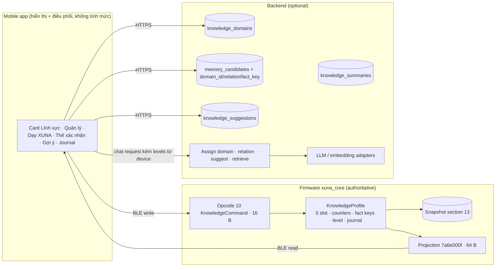

# XUNA Knowledge Domains — kế hoạch triển khai M06 (2026-10-27)

> **Trạng thái:** hướng đi owner-approved 2026-10-27: phương án A, *lĩnh vực mở, chủ tự đặt, XUNA gợi ý thêm*. Mọi con số, ngưỡng, tên và layout byte có ký hiệu **[P]** là Proposed. Chúng chỉ thành chính thức khi owner chốt (§12) hoặc session tương ứng đo xong.
> **Nghiên cứu nền:** [knowledge-domains-research-2026-10-27.md](../../research/knowledge-domains-research-2026-10-27.md). Repo tham khảo cho từng phần ở §11.
> **KD-0** (dọn code giai đoạn trưởng thành cũ) đã xong: mobile `d221476`, firmware `1cc59dd`.
> **Q1–Q7 đã chốt 2026-10-27** (§12).
> **KD-1** (lõi Knowledge trên thiết bị) đã xong: `KnowledgeProfile`, `KnowledgeCodec` (section 13), `KnowledgeProjection` (64 B), Life Lab dual-history scenario, 15/15 tests `test_knowledge` PASS, 340/340 native suite PASS.
> **KD-2** (Protocol + board + mobile integration) đã xong: Opcode 10 (sub-ops 1..7), characteristic `7a6e000f`, capability byte 3 bit 4, events 0x63..0x65, ClockModel day index, SnapshotCodec section 13 (budget 1536 B duy trì an toàn), LifeCore + V1LifeCoreAdapter commit-first; golden generator tạo mobile fixture `knowledge_v1.json` (11 steps); mobile entities, use cases, models, mappers, codec, BleDataSourceImpl, Simulator; toàn bộ test 343/343 firmware native PASS, 258/258 mobile flutter test PASS, flutter analyze sạch 0 issues.
> **KD-3** (Backend lõi) đã xong: module `knowledge` backend (domain entities, pure stdlib Vietnamese lexical matcher & normalizer, application use cases/schemas/ports, infrastructure models/repositories, RFC 9457 API routes), tích hợp `CandidateType.KNOWLEDGE` với `fact_key`, cập nhật memory use cases/schemas (`retag`, `confirm` với `domain_id`), cập nhật conversation `TurnContext` & chat prompt, migration Alembic 0009, wiring trong `main.py`; toàn bộ 196 test pytest PASS, ruff check/format PASS, mypy PASS, clean architecture boundaries PASS.
> **KD-5** (Mobile UI & Orchestration) đã xong: mobile entities, mappers, remote data source, repository, 13 use cases, orchestration flows (`CreateDomainFlow`, `DeleteDomainFlow`, `CommitKnowledge`, `RetagKnowledgeFlow`), đồng bộ locale tiếng Việt (`vi_VN.json` & `locales.g.dart`), widgets (`HomeKnowledgeCard`, `HomeKnowledgeManageSheet`, `HomeTeachKnowledgeSheet`, `HomeKnowledgeSuggestionBanner`, `HomeCandidateCard`), controller & journal tab integration; 269/269 flutter test PASS (100%), analyze sạch 0 issues.

## 0. Dành cho người (hoặc model) sẽ code

Đọc theo thứ tự sau trước khi sửa code:

1. Toàn bộ plan này.
2. [AGENTS.md](../../../AGENTS.md).
3. Quy tắc riêng của repo con:
   - [mobile/AGENTS.md](../../../mobile/AGENTS.md) và [FEATURE_TEMPLATE](../../../mobile/docs/FEATURE_TEMPLATE.md);
   - [backend/AGENTS.md](../../../backend/AGENTS.md) và [ARCHITECTURE](../../../backend/docs/ARCHITECTURE.md);
   - quy ước của firmware trong `firmware/lib/xuna_core`.
4. Mục mới nhất của [PROCESS.md](../../../PROCESS.md).

Quy tắc khi làm:

- **Mỗi session một phạm vi.** Không làm trước session sau.
- **Thiết bị là nơi quyết định mức.** App và cloud không tự tính mức, kể cả khi trông "đơn giản" (đây là bài học từ review M06 cũ).
- **Output của LLM là dữ liệu không tin cậy.** Mọi kiến thức phải được chủ xác nhận và thiết bị commit bền vững thì mới được tính (backend AGENTS §1.3).
- **Protocol chỉ được mở rộng thêm.** Firmware cũ vẫn phải chạy, và mọi thay đổi khung lệnh phải kèm test ở mức byte trên cả hai phía.
- **Không copy code từ repo AGPL** (SillyTavern, KoboldAI). Chỉ học ý tưởng.
- **Kiểm tra bắt buộc trước khi báo xong:**
  - Firmware: `pio test -e native -f <suite>`.
  - Mobile: `fvm flutter analyze` và `fvm flutter test`.
  - Backend: `scripts/check.sh` với `XUNA_TEST_DATABASE_URL`.
- **Báo cáo:** nói rõ những gì *chưa* chạy (board, điện thoại).

## 1. Quyết định

| ID | Quyết định | Trạng thái |
|---|---|---|
| K-D1 | Không có giai đoạn hình ảnh sau khi nở; chỉ giữ trứng → nở (D7) | Approved 2026-10-27 |
| K-D2 | M06 = hiểu biết theo lĩnh vực chủ quan tâm, sâu dần theo kiến thức chủ dạy và xác nhận; thay cho D13 | Approved 2026-10-27 |
| K-D3 | **Lĩnh vực mở:** chủ tự đặt tên bất kỳ và có mô tả ngắn. App chỉ hiện ví dụ gợi ý, không có danh mục cố định | Approved 2026-10-27 (option A) |
| K-D4 | **XUNA gợi ý lĩnh vực mới** khi kiến thức "chưa phân loại" gom đủ thành nhóm. Mỗi pet có tối đa một gợi ý đang chờ. Nếu gợi ý gần với một lĩnh vực đã có thì đề xuất "thêm vào *X*" thay vì tạo mới. Chỉ tạo khi chủ đồng ý | Approved 2026-10-27 (option A) |
| K-D5 | Thiết bị giữ phần có thẩm quyền: **ô lĩnh vực** (slot 0–4), trạng thái, số kiến thức, số ngày dạy, mức và journal. Cloud giữ tên, mô tả, nội dung kiến thức và bản tóm tắt | [P] |
| K-D6 | Mức chỉ dựa trên bằng chứng kiểm tra lại được: số kiến thức đã commit và số ngày dạy khác nhau. Mức không tự giảm theo thời gian; chỉ giảm khi chủ xoá kiến thức hoặc xoá lĩnh vực | [P] (research §3.9) |
| K-D7 | Mỗi kiến thức thuộc đúng **một** lĩnh vực chính, hoặc vào mục "chưa phân loại" | [P] (research §3.3, takeaway companion #3) |

## 2. Lời hứa trung thực (copy, UI, prompt)

- **Nói:** "XUNA nhớ những gì bạn dạy về *Nấu ăn* (12 điều, 4 ngày)."
- **Không nói:** "XUNA thông minh hơn", "XUNA tự học", "IQ", hay "87% thành thạo".
- Mỗi mức có thể bấm vào để xem danh sách kiến thức làm nên mức đó. Journal ghi lại mọi lần mức thay đổi kèm lý do.
- **Prompt:** LLM chỉ được trình bày kiến thức chủ đã dạy *như điều chủ đã dạy*. Nếu chủ hỏi ngoài phạm vi đó, XUNA nói rằng nó chưa được dạy điều này, rồi mới trả lời bằng kiến thức chung, có ghi rõ.
- **Offline:** XUNA vẫn biết mình có mấy lĩnh vực và ở mức nào (đọc từ thiết bị), nhưng tên lĩnh vực và nội dung kiến thức cần cloud. App ghi rõ "cần kết nối để xem nội dung".

## 3. Khái niệm

| Thuật ngữ | Nghĩa |
|---|---|
| **Domain** (lĩnh vực) | Một chủ đề chủ quan tâm, gồm tên (≤ 40 ký tự [P]) và mô tả (≤ 160 ký tự [P], LLM viết sẵn, chủ sửa được). Gắn với một **slot** trên thiết bị (0–4) |
| **Slot state** | `empty` (0), `active` (1), `resting` (2, đang nghỉ: không nhận kiến thức mới và không vào prompt, nhưng giữ nguyên bằng chứng) |
| **Knowledge item** | Một điều chủ dạy, tối đa 280 ký tự [P]. Là `MemoryCandidate` với `candidate_type = knowledge`, đi qua luồng: chờ chủ xác nhận → chờ thiết bị commit → đã xác nhận |
| **Unsorted** | Kiến thức đã xác nhận nhưng chưa thuộc lĩnh vực nào (`domain_id = null`). Vẫn dùng được trong chat, nhưng không tính vào mức lĩnh vực nào |
| **fact key** | `u32` sinh tất định từ `candidate_id`: 4 byte đầu của `sha256(candidate_id.bytes)`, little-endian. Thiết bị dùng nó để chống đếm trùng và để gỡ bằng chứng |
| **Teaching day** | Một ngày địa phương có thời gian tin cậy, trong đó slot nhận được ít nhất một bằng chứng. Nếu đồng hồ chưa tin cậy, bằng chứng vẫn được đếm nhưng ngày thì không (không bịa thời gian, AGENTS §6) |
| **Level** | 0 Mới nghe qua, 1 Biết chút ít, 2 Biết khá, 3 Biết nhiều [P tên]. Thiết bị tự tính |
| **Suggestion** | Đề xuất của cloud, gồm `new_domain` (tên, mô tả, các kiến thức thuộc nhóm) hoặc `add_to_domain` (lĩnh vực đích, các kiến thức thuộc nhóm) |

**Quy tắc mức [P]:**

- Ngưỡng số kiến thức `F = {3, 10, 25}`, ngưỡng số ngày dạy `D = {1, 3, 5}`.
- `level = số chỉ số i ∈ {0,1,2} thoả facts ≥ F[i] và days ≥ D[i]`.
- Hai điều kiện phải cùng đạt, nên không thể dạy dồn một buổi để lên mức cao.

**Giới hạn [P]:**

- Tối đa 5 slot; tối đa 32 fact key cho mỗi slot (mức cao nhất cần 25).
- Mỗi pet có tối đa 1 gợi ý đang chờ.
- Chỉ đề xuất lĩnh vực mới khi có ít nhất 4 kiến thức chưa phân loại thuộc cùng một nhóm.

## 4. Kiến trúc



## 5. Firmware (`firmware/lib/xuna_core`)

### 5.1 Model — `include/xuna/knowledge/KnowledgeProfile.h` (mới)

```cpp
enum class SlotState : uint8_t { Empty = 0, Active = 1, Resting = 2 };
struct KnowledgeSlot {
  SlotState state = SlotState::Empty;
  uint8_t level = 0;          // 0..3, derived, never set from outside
  uint8_t keyCount = 0;       // 0..kMaxKeys; == counted facts
  uint8_t days = 0;           // distinct teaching days, saturating at 255
  uint16_t lastDay = 0;       // local day index since 2020-01-01; 0 = none
  uint32_t keys[kMaxKeys];    // fact keys, insertion order
};
struct KnowledgeJournalEntry { uint16_t seq; uint8_t slot; uint8_t level; uint8_t reason; uint8_t facts; uint8_t days; };
class KnowledgeProfile {
 public:
  static constexpr uint8_t kSlots = 5, kMaxKeys = 32, kJournal = 4;   // [P]
  enum class Result : uint8_t { Ok, Duplicate, NotFound, SlotBusy, SlotEmpty, SlotResting, Full, Invalid };
  Result open(uint8_t slot);                         // Empty -> Active
  Result setState(uint8_t slot, SlotState s);        // Active <-> Resting
  Result clear(uint8_t slot);                        // any -> Empty, drops keys, journals reason Cleared
  Result add(uint8_t slot, uint32_t key, uint16_t trustedDay /*0 = untrusted*/);
  Result remove(uint8_t slot, uint32_t key);
  Result move(uint8_t from, uint8_t to, uint32_t key, uint16_t trustedDay);
  const KnowledgeSlot& slot(uint8_t i) const;
  // level recomputed inside add/remove/clear; journal entry on every change
};
```

- `add` trên slot `Resting` trả về `SlotResting`, trên slot `Empty` trả về `SlotEmpty`. Key đã có thì trả `Duplicate` mà **không đổi trạng thái**: đây là điều kiện để thao tác idempotent, nên gửi lại an toàn. Khi đủ 32 key thì trả `Full`.
- `add` tăng `days` khi `trustedDay != 0 && trustedDay != lastDay`.
- `remove` không giảm `days`. Số ngày đã dạy là sự thật lịch sử; bằng chứng về nội dung thì giảm theo `keyCount`.
- `reason`: 1 = có thêm bằng chứng, 2 = gỡ bằng chứng, 3 = xoá slot, 4 = chuyển kiến thức sang slot khác. `seq` là bộ đếm tăng dần, quay vòng ở 16 bit.
- Phần này là code thuần, không có I/O, chạy được trong Life Lab. Kiểm tra tính thuần bằng `tools/check_core_purity.py`.

### 5.2 Snapshot — `SectionId::Knowledge = 13` (optional, version 1) [P]

- Thêm `Knowledge = 13` vào `persist/SnapshotCodec.h`. Comment trong `SectionId` ghi rõ ngày, theo cách các section khác đang ghi.
- Codec nằm ở `include/xuna/knowledge/KnowledgeCodec.h`, viết theo mẫu `PersonalityCodec`: có `kMaxSize`, kiểm tra hợp lệ **trước khi** thay đổi dữ liệu, và có kết quả lỗi có kiểu.
- Layout (little-endian):
  - Phần đầu: `u8 slotCount = 5, u8 maxKeys = 32, u16 journalSeq`.
  - Mỗi slot: `u8 state, u8 level, u8 keyCount, u8 days, u16 lastDay, u32 keys[keyCount]`.
  - Journal: `kJournal × 8 B`.
- Kích thước tối đa: 4 + 5 × (6 + 128) + 32 = **706 B**. Nếu đo ở KD-1 thấy tổng snapshot vượt ngân sách NVS, hạ `keys` xuống `u16`. Khi đó tối đa là 386 B, và ghi lại xác suất trùng key.
- Khi load phải kiểm tra:
  - `level` đọc vào phải khớp với mức tính lại; nếu không khớp thì trả `Corrupt`;
  - key không trùng trong cùng slot;
  - `keyCount ≤ 32`;
  - `state ≤ 2`.
- Section này là optional: firmware cũ không hiểu section 13 thì bỏ qua và dùng profile rỗng.
- Thêm `Migrations` không cần, vì đây là section mới.

### 5.3 BLE projection — characteristic `7a6e000f` (Read), 64 B [P]

| Offset | Trường |
|---|---|
| 0 | `u8 version = 1` |
| 1 | `u8 size = 64` |
| 2 | `u8 flags` (bit 0 = đồng hồ đang tin cậy) |
| 3 | `u8 slotCount = 5` |
| 4 | `u16 journalSeq` |
| 6 | `u16 reserved = 0` |
| 8 | 5 slot × 8 B: `u8 state, u8 level, u8 facts, u8 days, u16 lastDay, u16 reserved = 0` |
| 48 | 4 journal × 4 B, mới nhất trước: `u16 seq, u8 slot, u8 level<<4 \| reason` |

- Đây là projection chỉ để đọc, giống `PersonalityProjection`. Viết ở `include/xuna/knowledge/KnowledgeProjection.h`.
- Không chứa tên lĩnh vực. Tên do cloud giữ và app ghép theo slot.
- Handle budget trong `include/BleManager.h`: hiện có 10 characteristic, tức 22 handle. Thêm 1 thì thành 24, vẫn dưới 32. Cập nhật comment ở đó.

### 5.4 Opcode 10 `KnowledgeCommand`, 16 B, capability byte 3 bit 4 [P]

| Byte | Trường |
|---|---|
| 0 | version = 1 |
| 1 | opcode = 10 |
| 2–5 | request id `u32` (≠ 0) |
| 6 | `arg` = sub-op |
| 7 | source = 0 |
| 8 | `slot` |
| 9 | `slot2` (chỉ dùng cho move, các trường hợp khác = 0) |
| 10–11 | reserved = 0 |
| 12–15 | fact key `u32` (open, state, clear: = 0) |

| arg | Sub-op | Ràng buộc |
|---|---|---|
| 1 | Open slot | `slot < 5`, key = 0 |
| 2 | Set active | key = 0 |
| 3 | Set resting | key = 0 |
| 4 | Clear slot (thao tác phá huỷ) | key = 0; app phải hỏi xác nhận |
| 5 | Add evidence | key ≠ 0 |
| 6 | Remove evidence | key ≠ 0 |
| 7 | Move evidence | `slot2 < 5`, `slot2 ≠ slot`, key ≠ 0 |

- **Parse:** trong `BleProtocol.h::parseCommand`, thêm cờ `knowledge`. Kích thước 16 B được chấp nhận khi `timeSync` hoặc `knowledge` bật. Lỗi định dạng dùng `error 4`. Khi cờ tắt thì opcode 10 trả `error 3`, như mọi opcode chưa biết.
- **Áp lệnh:** theo đúng thứ tự §9.5 của implementation plan (như opcode 6 và 9): kiểm tra hợp lệ → staging bản sao → commit snapshot → mới áp vào bộ nhớ → báo kết quả qua status notify, dùng mã kết quả hiện có.
- **Nhận kết quả:** app đọc lại `7a6e000f` sau mỗi lệnh để biết trạng thái mới, và đọc `7a6e000c` để lấy `snapshotGeneration` phục vụ bước commit lên cloud.
- **Ngày dạy:** lấy từ watermark thời gian tin cậy (`SnapshotClock`, cộng `tzOffsetMin`). Không tin cậy thì `trustedDay = 0`.
- **Capability:** bit 4 của byte 3 (`0x10`). Giá trị trong `BleManager` đổi từ `0x0f` thành `0x1f`. Thêm hằng số tương ứng vào `DeviceProtocol` của mobile.
- **Sự kiện** (`event/EventTypes.h`, nhóm Growth):
  - `0x63 KnowledgeSlotChanged`
  - `0x64 KnowledgeEvidenceChanged`
  - `0x65 KnowledgeLevelChanged` (snapshot + journal)
  - `0x60` và `0x61` (giai đoạn cũ) giữ nguyên số. Chỉ ghi comment "obsolete 2026-10-27, never reuse".
- **ForgetAll (D9):** xoá luôn profile kiến thức, tức mọi slot về `Empty` và key bị xoá. Cần ghi điều này vào D9.

### 5.5 Đưa lên board

- Nối `KnowledgeProfile` vào trạng thái của LifeCore hoặc ProductLearner, ở đúng nơi personality đang được giữ.
- Đọc và ghi section 13 qua `SnapshotStore`.
- Board: phase 1 không hiển thị gì. Nếu owner chọn Q6 = có thì vẽ chấm mức trên card trạng thái; không vẽ tên (font không đủ chữ).

## 6. Backend (`backend/src/xuna_backend/modules/knowledge`, module mới)

Cấu trúc theo [backend ARCHITECTURE](../../../backend/docs/ARCHITECTURE.md): `domain/ → application/ → infrastructure/ → api/`, nối dây, migration, rồi test. Quy tắc import do `tests/test_architecture.py` kiểm tra.

### 6.1 Dữ liệu — migration `0009_knowledge_domains` [P]

| Bảng/cột | Nội dung |
|---|---|
| `knowledge_domains` | `domain_id uuid pk`, `owner_id fk`, `pet_id fk`, `device_slot smallint null` (0–4), `name varchar(40)`, `description varchar(160)`, `status` (`pending_device`, `active`, `resting`, `deleted`), `origin` (`owner`, `suggestion`), `embedding jsonb null`, `created_at`, `updated_at`. Unique `(pet_id, device_slot)` khi `status ≠ deleted`. Kiểm tra trong use case: tối đa 5 domain chưa xoá |
| `knowledge_suggestions` | `suggestion_id`, `owner_id`, `pet_id`, `kind` (`new_domain`, `add_to_domain`), `proposed_name`, `proposed_description`, `target_domain_id null`, `member_candidate_ids jsonb`, `status` (`pending`, `accepted`, `dismissed`, `expired`), `created_at`, `decided_at`. Partial unique index: một `pending` cho mỗi `pet_id` |
| `knowledge_summaries` | `domain_id pk`, `text varchar(400)`, `source_candidate_ids jsonb`, `generated_at`, `stale bool` |
| `memory_candidates` (cột mới) | `domain_id uuid null` (fk, SET NULL), `relation varchar(16) null` (`new`, `refines`, `contradicts`), `related_candidate_id uuid null`, `fact_key bigint null`, `embedding jsonb null` |
| `CandidateType` | Thêm `KNOWLEDGE = "knowledge"`, nội dung `{"text": str}`. `FACT` vẫn chỉ dùng cho thông tin cá nhân của chủ |

- Vector lưu dạng mảng float trong `jsonb`. Mỗi pet chỉ vài trăm mục nên tính cosine bằng Python là đủ, không cần pgvector. Khi nào cần mới viết ADR.
- Export và backup (`modules/exports`, `modules/backups`) phải có domain và knowledge. Xoá thì dùng tombstone hiện có.

### 6.2 API (`/v1`) [P]

| Method | Path | Mục đích |
|---|---|---|
| GET | `/pets/{petId}/knowledge-domains` | Danh sách domain gồm tên, mô tả, slot, status. Mức **không** lấy từ đây mà đọc từ thiết bị |
| POST | `/pets/{petId}/knowledge-domains` | `{name, description?, deviceSlot}`. Tạo với `pending_device`; nếu thiếu mô tả thì LLM viết |
| PATCH | `/knowledge-domains/{id}` | `action`: `device_ack{generation}`, `rename{name}`, `describe{description}`, `rest`, `activate`, `delete{keepKnowledge: bool}` |
| POST | `/pets/{petId}/knowledge` | `{text, domainId?}`. Tạo candidate `knowledge` và trả về `{candidate, proposedDomainId, relation, relatedCandidate}` |
| PATCH | `/memory-candidates/{id}` | Endpoint có sẵn. `confirm` nhận thêm `domainId?` (chủ đổi lĩnh vực trên thẻ). `commit` với candidate `knowledge` bắt buộc domain đã có slot. Thêm action `retag{domainId}` |
| GET / PATCH | `/pets/{petId}/knowledge-suggestions`, `/knowledge-suggestions/{id}` | `accept{name?, description?, deviceSlot?}` hoặc `dismiss` |

- **Consent:** câu hỏi mở Q1. Mặc định [P] là các route ghi nội dung yêu cầu `RequireConsent(ConsentClass.CONVERSATION_TEXT)` (U3), vì văn bản được gửi cho LLM. Kiến thức đã xác nhận được lưu theo quy tắc D23 cho confirmed facts: sửa được, xuất được, xoá được.
- **Ghi audit** cho create, delete và accept, theo mẫu `AuditAction.MEMORY_CANDIDATE_*`.

### 6.3 Thuật toán

1. **Chuẩn hoá tiếng Việt cho so khớp từ:**
   - NFC, chữ thường;
   - giữ một bản có dấu và một bản bỏ dấu;
   - tách âm tiết theo khoảng trắng và dấu câu, rồi tạo thêm bigram âm tiết (vì từ tiếng Việt thường có nhiều âm tiết).

   Chỉ dùng stdlib. Không dùng `underthesea` (GPL-3.0).
2. **Gán lĩnh vực** (theo chế độ zero-shot của BERTopic):
   - `score(item, domain)` = cosine nếu có embedding; nếu không thì điểm BM25-lite trên tên, mô tả và các kiến thức của domain.
   - Chọn domain có điểm cao nhất nếu `score ≥ τ_assign`. Mặc định [P]: cosine 0.55, hoặc lexical chuẩn hoá 0.35. Nếu không đạt thì để `null` (chưa phân loại).
   - Kết quả chỉ là *đề xuất*; chủ thấy nó trên thẻ và sửa được.
3. **Quan hệ với kiến thức cũ** (theo mem0 paper ADD/UPDATE/DELETE/NOOP):
   - Lấy top 5 kiến thức đã xác nhận giống nhất trong cùng domain.
   - Nếu `sim ≥ 0.9` thì coi là gần như trùng: trả `relation = refines` và gợi ý chủ gộp lại.
   - Nếu giống trung bình, gọi LLM với JSON schema `{relation: new|refines|contradicts, relatedId}`. Output được kiểm tra hợp lệ như mọi đầu vào khác.
   - `contradicts` chỉ dùng để hiển thị cảnh báo. Kiến thức cũ **không bị xoá tự động**; khi chủ xác nhận thay thế thì kiến thức cũ chuyển `DELETED` kèm tombstone. Đây là cách "invalidate, không xoá ngầm" của Graphiti.
4. **Gợi ý lĩnh vực:**
   - Chạy sau mỗi lần commit một kiến thức chưa phân loại.
   - Điều kiện: có ít nhất 4 kiến thức chưa phân loại và chưa có gợi ý nào đang chờ.
   - Gom nhóm: single-link theo similarity ≥ 0.6 [P], hoặc nhờ LLM chia nhóm nếu không có embedding. Lấy nhóm lớn nhất nếu có từ 4 mục trở lên.
   - LLM đặt tên (≤ 40 ký tự) và viết mô tả.
   - **Chặn trùng:** nếu similarity với một domain đã có ≥ 0.75 thì gợi ý `add_to_domain`.
   - Nếu đã đủ 5 domain đang hoạt động thì chỉ gợi ý `add_to_domain`, hoặc không gợi ý gì.
   - Gợi ý tự hết hạn sau 14 ngày [P].
   - Chạy dưới dạng background task (FastAPI `BackgroundTasks` hoặc job hiện có), không chạy trong request chat.
5. **Tóm tắt domain:**
   - Chỉ tạo khi domain có ít nhất 5 kiến thức đã xác nhận. LLM viết tối đa 400 ký tự, **chỉ từ những kiến thức đó**.
   - Đặt `stale = true` mỗi khi domain có thêm, bớt hoặc đổi kiến thức. Tạo lại ở background.
   - Bản tóm tắt là dữ liệu dẫn xuất, không bao giờ thành fact.
6. **Đưa kiến thức vào chat** (`conversation/application/chat_turn.py`, `TurnContext`):
   - Request chat từ app mang thêm `knowledge: [{slot, level, state}]` đọc từ thiết bị, cùng chỗ với `PetSelf`. Cloud không tự lưu mức.
   - Chọn domain đang được nói tới: chấm điểm câu của chủ với các domain `active`. Nếu `≥ τ_turn` (0.45 cosine / 0.3 lexical [P]) thì chọn domain cao nhất; không thì chọn tối đa 2 domain có điểm cao.
   - Ngân sách giữ trần 10 mục như hiện có:
     - ≤ 2 fact cá nhân, ưu tiên tên chủ;
     - ≤ 1 bản tóm tắt domain;
     - còn lại là kiến thức của domain đang nói, xếp theo `sim × 0.6 + độ mới × 0.25 + số lần nhắc × 0.15` [P] (cách cân của LangMem).
   - Câu nhắc trong prompt (tiếng Việt), giọng điệu theo mức:
     - "Đây là những điều chủ đã dạy XUNA về «{name}» (mức {levelWord}). Dùng chúng như điều chủ dạy; điều gì không có ở đây thì nói là XUNA chưa được dạy."
     - Mức 0–1: hỏi lại, tò mò. Mức 2–3: nhắc lại, giải thích, gợi ý.
7. **Trích kiến thức từ chat** (tuỳ chọn, Q3):
   - Sau khi trả lời, LLM được hỏi với JSON schema `{knowledge: string ≤ 280, domainHint?: string} | null`, chỉ dựa trên câu của chủ.
   - Lọc bằng các quy tắc an toàn hiện có trong `candidate_extractor.py` (mật khẩu, mã cửa, chuyện phiếm, câu hỏi).
   - Mỗi lượt tối đa một candidate, ở trạng thái chờ chủ xác nhận. Bộ trích regex hiện tại giữ nguyên cho fact cá nhân.
8. **Embedding** (tuỳ chọn, Q4):
   - Thêm `Capability.EMBEDDING` vào `cognition/domain/types.py`, và endpoint `/v1/embeddings` vào `cognition/infrastructure/openai_compatible.py`. Endpoint này chạy được với OpenAI, Ollama, vLLM và LM Studio.
   - Cấu hình `XUNA_EMBEDDING_*`, mặc định tắt: khi đó chỉ dùng so khớp từ.
   - Chọn nhà cung cấp theo D11a / CLD-13.

## 7. Mobile

### 7.1 Feature `device` (thiết bị)

- **Domain:**
  - `entity/knowledge_profile.dart`: `KnowledgeProfile{slots, journal, timeTrusted}`, `KnowledgeSlot{slot, state, level, facts, days}`, `KnowledgeJournalEntry`.
  - Các enum `KnowledgeSlotState`, `KnowledgeLevel`.
  - Use case: `ReadKnowledgeProfileUseCase`, `OpenKnowledgeSlotUseCase`, `SetKnowledgeSlotStateUseCase`, `ClearKnowledgeSlotUseCase`, `AddKnowledgeEvidenceUseCase`, `RemoveKnowledgeEvidenceUseCase`, `MoveKnowledgeEvidenceUseCase`.
  - Getter `supportsKnowledge`.
- **Data:**
  - `ProtocolCodec.decodeKnowledge` cho 64 B. Kiểm tra mọi trường như `decodeLifecycle`; sai thì ném `FormatException`.
  - `encodeKnowledgeCommand` cho 16 B.
  - Model `KnowledgeProfileModel`, mapper (enum ánh xạ bằng `switch` tường minh).
  - `DeviceBleDataSourceImpl`: `_knowledge = 15` (characteristic `7a6e000f`) và capability bit 4.
  - Simulator: `simulator_device_ble_data_source.dart` có profile giả, luôn được gắn nhãn simulator.
- **Fixture byte dùng chung:** `mobile/test/fixtures/firmware/knowledge_v1.json`, sinh từ test firmware theo cách `learning_v1.json` đang làm, kèm hướng dẫn cập nhật.

### 7.2 Feature `account` (cloud)

- Entity: `KnowledgeDomain`, `KnowledgeSuggestion`. `MemoryCandidate` thêm `domainId`, `relation`, `relatedCandidateId` và loại `knowledge`.
- Endpoint mới trong `CloudRemoteDataSource`, kèm model, mapper và use case: `ReadKnowledgeDomainsUseCase`, `CreateKnowledgeDomainUseCase`, `UpdateKnowledgeDomainUseCase`, `TeachKnowledgeUseCase`, `ReadKnowledgeSuggestionsUseCase`, `DecideKnowledgeSuggestionUseCase`.

### 7.3 Điều phối (use case, không đặt trong controller)

- **`CommitKnowledgeUseCase`:**
  1. Cloud `confirm{domainId}`.
  2. Thiết bị `add(slot, factKey)`.
  3. Đọc `snapshotGeneration` từ characteristic identity.
  4. Cloud `commit{generation}`.

  Nếu thiết bị đang offline, candidate ở lại `awaiting_device_commit` và được thử lại khi kết nối. Thử lại là an toàn vì `add` idempotent theo `factKey` (trả `Duplicate` nếu đã có), và mỗi lần thử vẫn đi qua `CommandCache` với cùng request id (mobile AGENTS §6.3).
- **`CreateDomainUseCase`:**
  1. Đọc profile từ thiết bị và chọn slot trống nhỏ nhất.
  2. Cloud tạo domain với `pending_device`.
  3. Thiết bị `open(slot)`.
  4. Cloud `device_ack`.

  Nếu thiết bị từ chối thì cloud xoá bản ghi đang chờ.
- **`DeleteDomainUseCase`:**
  1. Hiện `nav.showConfirmDialog` ("không thể hoàn tác").
  2. Thiết bị `clear(slot)`.
  3. Cloud `delete{keepKnowledge}`.

  Nếu giữ kiến thức (`keepKnowledge = true`) thì kiến thức chuyển về chưa phân loại.
- **Retag** (chủ chuyển một kiến thức sang domain khác): thiết bị `move`, sau đó cloud `retag`.

### 7.4 Giao diện (feature `home`, có thể tách feature `knowledge` nếu vượt ~200 dòng mỗi trang)

- **`HomeKnowledgeCard`** (thay placeholder ở KD-0):
  - Tối đa 5 dòng: tên lĩnh vực (lấy từ cloud), 3 chấm mức, "12 điều · 4 ngày" (lấy từ thiết bị).
  - Nút "Dạy XUNA".
  - Khi offline hoặc chưa đăng nhập: hiện "Ô 1 · mức 2", kèm dòng "cần kết nối để xem tên".
- **Màn quản lý lĩnh vực:** tạo (tên, mô tả gợi ý, ví dụ mẫu như "Nấu ăn", "Tiếng Anh"... dưới dạng chip, không phải danh mục), đổi tên, cho nghỉ hoặc bật lại, xoá (có xác nhận).
- **"Dạy XUNA":** ô nhập tối đa 280 ký tự và chọn lĩnh vực ("Tự chọn giúp tôi" là lựa chọn mặc định).
- **Thẻ xác nhận** (mở rộng thẻ hiện có):
  - Chip lĩnh vực bấm để đổi.
  - Nhãn quan hệ "mới", "bổ sung cho…", "mâu thuẫn với…" kèm nội dung kiến thức liên quan.
- **Banner gợi ý:** "Có vẻ bạn hay dạy XUNA về *X*. Tạo lĩnh vực?" hoặc "Thêm 4 điều này vào *Y*?", với các nút Đồng ý / Đổi tên / Bỏ qua.
- **Journal:** dòng "XUNA biết khá về *Nấu ăn* — vì bạn đã dạy 10 điều trong 3 ngày". Bấm vào để xem danh sách kiến thức.
- **Locale:** viết trong mục `home` (hoặc `knowledge`) của `vi_VN.json`, giữ `locales.g.dart` đồng bộ.
- **Base widget:** dùng `AppInkCard`, `AppTag`, `AppPillButton`… Mẫu UI nào lặp lại thì tách thành base widget (mobile AGENTS §5.4).

## 8. Các luồng chính (tóm tắt)

1. **Tạo lĩnh vực:** app → cloud (`pending_device`) → thiết bị `open` → cloud `device_ack` → card cập nhật.
2. **Dạy:** app `POST /knowledge` → thẻ xác nhận (lĩnh vực, quan hệ) → `CommitKnowledgeUseCase`. Thiết bị tính lại mức, nếu đổi thì ghi journal, app đọc lại projection.
3. **Từ chat** (nếu Q3 = có): candidate `knowledge` hiện trong danh sách chờ xác nhận như các candidate hiện có, rồi đi tiếp như luồng 2.
4. **Gợi ý:** cloud tạo gợi ý → banner → chấp nhận:
   - `new_domain`: chạy luồng 1, rồi retag hoặc thêm bằng chứng cho từng kiến thức trong nhóm (thiết bị `add`, cloud `retag`);
   - `add_to_domain`: thiết bị `add` cho từng kiến thức, cloud `retag`.
5. **Xoá kiến thức:** cloud `delete` (tombstone) và thiết bị `remove`. Mức có thể giảm; journal ghi reason = 2.
6. **Khôi phục hoặc thay thiết bị:**
   - Snapshot backup (CLD-2x) mang theo section 13.
   - Nếu thiết bị mới không có section 13, app đề xuất "đồng bộ lại bằng chứng từ cloud": gửi lại `open` và `add` cho mọi kiến thức đã commit. Thao tác idempotent; chủ phải xác nhận trước.

## 9. Các session

| Session | Phạm vi | File chính | Test / nghiệm thu | Cần |
|---|---|---|---|---|
| **KD-1** Core thiết bị | `KnowledgeProfile`, `KnowledgeCodec`, `KnowledgeProjection` (thuần) | `firmware/lib/xuna_core/include/xuna/knowledge/*.h`, `test/test_knowledge/test_main.cpp`, Life Lab scenario | Test dạng bảng: các ngưỡng, key trùng, gỡ, xoá slot, move, ngày tin cậy/không tin cậy, bão hoà, journal, codec round-trip, dữ liệu hỏng, phiên bản mới hơn, kích thước. **Life Lab:** hai lịch sử dạy → hai profile khác nhau, journal giải thích được. Đo ngân sách snapshot | Native |
| **KD-2** Protocol + board | Opcode 10, `7a6e000f`, capability, events, persist section 13, nối vào board. Mobile: codec, data source, simulator, use case thiết bị | `BleProtocol.h`, `BleManager.h`, `src/*`, `EventTypes.h`, `SnapshotCodec.h`; mobile `device/**`, `test/fixtures/firmware/knowledge_v1.json` | Firmware: test parse (đủ mọi trường hợp lỗi), apply/commit-before-ack, reboot giữ profile. Mobile: test codec với fixture byte, data source giả, use case. Board: tạo slot, add, reboot, đọc lại | Board + phone |
| **KD-3** Backend lõi | Module `knowledge`, migration 0009, API §6.2, `CandidateType.KNOWLEDGE`, `fact_key`, gán lĩnh vực (lexical), quan hệ, retrieval + ngân sách prompt, tóm tắt, export/backup | `backend/src/xuna_backend/modules/knowledge/**`, `memory/**`, `conversation/application/chat_turn.py`, `migrations/versions/0009_*.py`, `tests/**` | `scripts/check.sh` với DB: chuyển trạng thái, trần 5 domain, slot unique, consent, tombstone, độ dài và tiếng Việt, retrieval chọn đúng domain trên bộ fixture | DB |
| **KD-4** Backend gợi ý | Job gợi ý, chặn trùng, hết hạn; adapter embedding tuỳ chọn; trích kiến thức từ chat (nếu Q3) | `knowledge/application/suggest.py`, `cognition/**` | **Bộ đánh giá:** ≥ 60 kiến thức tiếng Việt thuộc 6 chủ đề cùng vài mục nhiễu (`tests/fixtures/knowledge_vi.json`). Báo độ chính xác gán lĩnh vực của lexical và embedding, và số gợi ý sai. Ngưỡng τ chốt theo số đo này | DB, provider (tuỳ chọn) |
| **KD-5** Mobile UI | Card, màn quản lý, Dạy XUNA, thẻ xác nhận, banner, Journal, điều phối §7.3 kèm thử lại | mobile `account/**`, `home/**` (hoặc `knowledge/**`), locale | **Đã xong trên máy tính:** Controller & fake repo tests (tạo, dạy, commit, offline, xoá), widget tests, 269/269 tests PASS, analyze 0 issues (commit `05a8b9b`). Sẵn sàng thử trên phone thật | Phone |
| **KD-6** Nghiệm thu M06 | Thử trên board và điện thoại thật | `docs/roadmap/knowledge/KD-6-acceptance-*.md` | Hai lịch sử (hai chủ hoặc hai pet): khác nhau về lĩnh vực, mức, câu trả lời khi hỏi cùng một câu và journal; giải thích được. Offline vẫn giữ mức. Xoá thì mức giảm đúng | Board + phone |
| KD-7 (tuỳ chọn) | Phụ kiện theo lĩnh vực (overlay 96×72 trên sprite gốc) | art brief riêng | — | Board + phone |

**Thứ tự:** KD-1 → KD-2 và KD-3 làm song song được → KD-4 → KD-5 → KD-6.

**Mỗi session phải cập nhật:** PROCESS.md, CHANGELOG.md (viết bằng ngôn ngữ người dùng) và mục "Trạng thái" ở đầu plan này.

## 10. Rủi ro

| Rủi ro | Giảm thiểu |
|---|---|
| Lĩnh vực mọc lan tràn hoặc trùng nhau | Trần 5, tối đa 1 gợi ý đang chờ, chặn trùng, gộp chỉ khi chủ đồng ý |
| Gán sai lĩnh vực vì tiếng Việt khó tách từ | Chủ sửa trên thẻ xác nhận; bộ đánh giá KD-4; dùng bigram âm tiết |
| Hiểu nhầm là "XUNA thông minh lên" | Lời hứa §2, nhãn UI, câu nhắc trong prompt |
| Snapshot vượt ngân sách NVS | Đo ở KD-1; phương án dự phòng là key `u16` |
| Projection dài hơn MTU mặc định | 64 B, cùng cỡ với personality vốn đã chạy. Nếu sau này dài hơn thì kiểm tra long read trên cả iOS và Android |
| Đếm trùng bằng chứng khi thử lại | `factKey` idempotent cùng `CommandCache` |
| Tốn chi phí LLM | Mỗi lượt chat chỉ làm phần rẻ. Gợi ý và tóm tắt chạy ở background, và chỉ khi dữ liệu thay đổi |

## 11. Repo và tài liệu tham khảo (dùng phần nào)

| Phần | Tham khảo | Học gì | License |
|---|---|---|---|
| Gán lĩnh vực kiểu zero-shot, mục chưa phân loại, chặn trùng | [BERTopic zero-shot](https://maartengr.github.io/BERTopic/getting_started/zeroshot/zeroshot.html), [merge_models](https://maartengr.github.io/BERTopic/getting_started/merge/merge.html), [online](https://maartengr.github.io/BERTopic/getting_started/online/online.html) | Có ngưỡng `zeroshot_min_similarity`; phần còn lại gom thành chủ đề mới; chỉ thêm chủ đề khi similarity < `min_similarity` | MIT |
| Lĩnh vực có mô tả, LLM gắn nhãn, ADD/UPDATE/DELETE/NOOP | [mem0](https://github.com/mem0ai/mem0), [custom categories](https://docs.mem0.ai/platform/features/custom-categories), [paper](https://arxiv.org/abs/2504.19413) | Mô tả là thứ làm cho gắn nhãn chạy được; so ứng viên với các mục giống nhất. **Không** theo chế độ ADD-only mới (dễ trùng) | Apache-2.0 |
| Khối có nhãn, mô tả và giới hạn cứng | [Letta memory blocks](https://docs.letta.com/guides/agents/memory-blocks), [repo](https://github.com/letta-ai/letta) | Mỗi bucket có mô tả và giới hạn ký tự | Apache-2.0 |
| Cộng đồng chủ đề tăng dần; vô hiệu hoá chứ không xoá | [Graphiti](https://github.com/getzep/graphiti), [communities](https://help.getzep.com/graphiti/core-concepts/communities) | Gán dần chủ đề cho mục mới; kiến thức mâu thuẫn bị vô hiệu hoá, vẫn còn lịch sử | Apache-2.0 |
| Mục do người dùng viết, quét gần đây, nhóm bao hàm, ngân sách token | [SillyTavern World Info](https://docs.sillytavern.app/usage/core-concepts/worldinfo/), [KoboldAI WI](https://github-wiki-see.page/m/KoboldAI/KoboldAI-Client/wiki/Memory,-Author's-Note-and-World-Info) | Người dùng làm chủ nội dung; tránh để các mục chồng nhau cùng kích hoạt; ngân sách lấp theo ưu tiên | **AGPL-3.0, chỉ học ý tưởng** |
| Memory được đưa vào prompt, cắt bớt theo cỡ | [xiaozhi-esp32-server `mem_local_short`](https://github.com/xinnan-tech/xiaozhi-esp32-server) | Bài học cần tránh: danh sách chủ đề do LLM viết lại liên tục bị trôi; cắt ở 900 ký tự | MIT |
| Collection và profile; cân nhắc khi recall | [LangMem conceptual guide](https://langchain-ai.github.io/langmem/concepts/conceptual_guide/) | Kiến thức là collection; recall theo similarity × độ quan trọng × độ mới | MIT |
| Ghi chú tự liên kết (để so sánh, không dùng) | [A-MEM](https://github.com/agiresearch/A-mem), [kimjammer/Neuro](https://github.com/kimjammer/Neuro) | Chủ đề tự hình thành không có nhãn: dễ trôi và khó cho chủ kiểm soát | MIT |
| Tóm tắt theo cộng đồng (để so sánh, quá nặng) | [Microsoft GraphRAG](https://github.com/microsoft/graphrag) | Tóm tắt theo chủ đề có ích, nhưng index đắt. Chỉ tóm tắt khi domain đổi | MIT |
| Ôn tập kiểu spaced repetition (tương lai) | [FSRS algorithm](https://github.com/open-spaced-repetition/awesome-fsrs/wiki/The-Algorithm) | Không dùng cho mức (vì sẽ phạt khi chủ vắng). Có thể dùng sau cho tính năng "ôn lại" | MIT |
| Embedding qua API kiểu OpenAI | [OpenAI embeddings API](https://platform.openai.com/docs/api-reference/embeddings), [Ollama embeddings](https://github.com/ollama/ollama/blob/main/docs/api.md) | Một endpoint `/v1/embeddings` cho cả cloud lẫn self-host | — |
| **Mẫu ngay trong repo** | `firmware/lib/xuna_core/include/xuna/personality/PersonalityCodec.h`, `PersonalityProjection.h`, `BleProtocol.h` (opcode 6/8/9), [PE-3 persistence](../personality/PE3-persistence-2026-10-24.md), `backend/.../memory/application/use_cases.py` (chuyển trạng thái candidate), `mobile/test/fixtures/firmware/learning_v1.json` (fixture vàng) | Copy cách làm, giữ phong cách | — |

## 12. Quyết định của owner (2026-10-27)

Cả 7 câu đều chọn phương án đề xuất. Các con số trong Q2 là **mặc định đã duyệt**: vẫn chỉnh được sau khi Life Lab (KD-1) hoặc bộ đánh giá (KD-4) đo xong, nhưng phải báo owner.

| ID | Câu hỏi | Quyết định | Ảnh hưởng |
|---|---|---|---|
| Q1 | Consent khi dạy | **Dùng U3 có sẵn** (`ConsentClass.CONVERSATION_TEXT`). Không tạo loại mới | §6.2: mọi route ghi nội dung khai báo `RequireConsent(ConsentClass.CONVERSATION_TEXT)` |
| Q2 | Các con số | **Giữ mặc định:** 5 slot; `F = {3, 10, 25}`, `D = {1, 3, 5}`; gợi ý khi có ≥ 4 kiến thức chưa phân loại cùng nhóm | §3, §5.1, §6.3.4 |
| Q3 | Trích kiến thức từ chat | **Có, kèm công tắc tắt**, mặc định bật. Mỗi lượt tối đa 1 đề xuất, luôn cần chủ xác nhận | §6.3.7 làm ở KD-4. Công tắc nằm ở app (KD-5) và được gửi kèm request chat |
| Q4 | Gán lĩnh vực / retrieval | **So khớp từ trước, đo rồi tính.** KD-3 chỉ dùng lexical. KD-4 dựng adapter embedding (mặc định tắt) và báo số đo trên bộ đánh giá; owner quyết có bật không (D11a) | §6.3.1–2, §6.3.6, §6.3.8 |
| Q5 | Xoá lĩnh vực | **Hỏi mỗi lần, mặc định giữ.** Hộp xác nhận chọn sẵn "Giữ kiến thức (chuyển về Chưa phân loại)"; lựa chọn còn lại là "Xoá cả kiến thức" (có tombstone, không hoàn tác) | §7.3 `DeleteDomainUseCase`: `keepKnowledge` mặc định `true` |
| Q6 | Hiện mức trên board | **Chưa, chỉ trên app.** Board không vẽ gì mới ở phase 1 | §5.5. Xem lại cùng lúc với KD-7 |
| Q7 | Tên các mức | **Mới nghe qua / Biết chút ít / Biết khá / Biết nhiều** (mức 0 → 3) | §3; locale ở KD-5; `levelWord` trong prompt (§6.3.6) |

## 13. Ngoài phạm vi

- Fine-tune hoặc huấn luyện model.
- XUNA tự tìm kiến thức trên internet.
- Lĩnh vực dùng chung giữa nhiều pet.
- Bài kiểm tra / quiz.
- Phụ kiện hình ảnh (để KD-7).
- Đồng bộ MQTT cho profile kiến thức. Phase 1 chỉ qua BLE; nếu cần đi qua MQTT thì xin owner sau.
