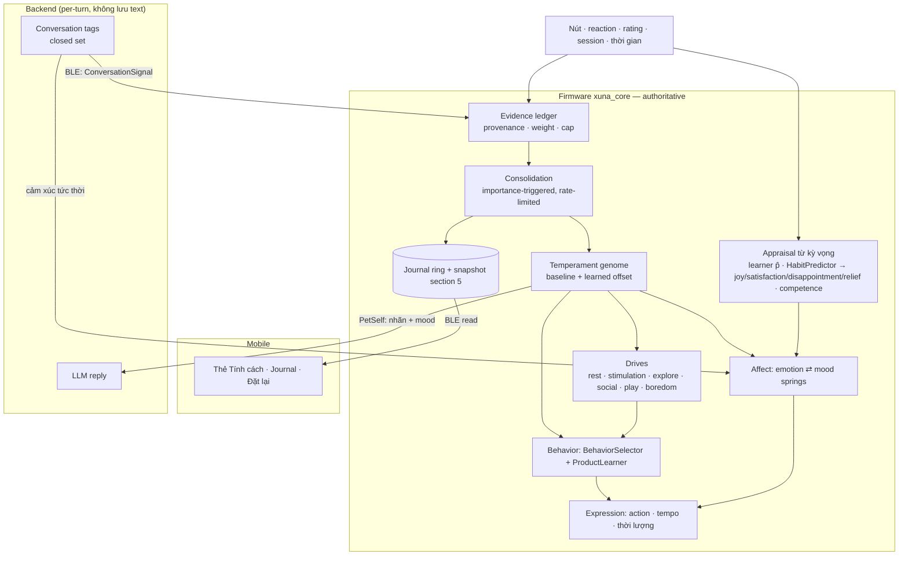

# XUNA Personality — kế hoạch triển khai (2026-10-23)

> Nguồn nghiên cứu: [personality-evolution-assessment-2026-10-23.md](../../research/personality-evolution-assessment-2026-10-23.md) (§7–§14, Addendum A–C).
> Trạng thái: **hướng đi owner-approved 2026-10-23**; mọi tham số, ngưỡng và tên trong plan này là **[P] Proposed** cho tới khi Life Lab và board trial đo xong.

## 1. Mục tiêu

Mỗi XUNA có **khí chất riêng** khi mới nở, rồi **dần thành một cá thể khác** tuỳ cách owner sống cùng nó: qua nút bấm, thói quen và cả trò chuyện. Tính cách phải:

- **nhìn thấy được** trên màn hình (khi nào, bao lâu, nhịp độ, hành động nào) và trong lời nói;
- **có nguyên nhân** (Journal: "vì sao Xuna thay đổi");
- **ổn định** (không đổi vì một sự kiện, không trôi theo thời gian, không tự củng cố);
- **sống trên device**: offline vẫn đủ; đổi LLM provider thì XUNA vẫn là chính nó.

## 2. Quyết định nền (owner 2026-10-23)

| ID | Quyết định | Trạng thái |
|---|---|---|
| P-D1 | **Kết hợp:** device là nơi **duy nhất** quyết định tính cách; giao tiếp (cloud) chỉ **cung cấp bằng chứng** và **thể hiện** tính cách. LLM không giữ tính cách trong prompt hay memory. H2/H4 giữ nguyên | Approved |
| P-D2 | **Mô hình mở rộng** (Addendum B): temperament genome (~10 tham số) → drives (~6) → affect emotion ⇄ mood kiểu lò xo → cảm xúc từ kỳ vọng + competence; nhãn tính cách được **suy ra**, không chọn preset | Approved (hướng); tham số [P] |
| P-D3 | **Bắt đầu ngay** PE-0/PE-1, chỉ trong Life Lab, song song với voice V1; không đụng board/snapshot/BLE cho tới gate G1. Personality vốn thuộc M06 → được đưa lên sớm theo yêu cầu owner | Approved |
| P-D4 | **Giao tiếp ảnh hưởng tính cách một cách tự nhiên, không cần thẻ xác nhận** ("cứ để cho nó tự nhiên"). Đây là **sửa D6 cho riêng tính cách**: tín hiệu chat do LLM suy ra được làm evidence *ngầm*. Chốt an toàn ở §6. Preference và fact vẫn theo D6/D17 hiện tại (câu nói vẫn cần xác nhận mới thành sở thích) — xem câu hỏi O4 | Approved (owner); chốt an toàn [P] |
| P-D5 | **Mặc định theo khuyến nghị:** khí chất ban đầu lệch nhẹ (±0.15) seed từ PetId; pet hiện tại (`d945…`) giữ baseline từ PetId, phần đã học bắt đầu từ 0 (không bịa lịch sử); tính cách chỉ đổi prior/mức khám phá/biểu hiện, **không đè preference đã học**; consolidation theo evidence + số buổi (chạy cả khi không có trusted time); app hiển thị bằng chữ kèm lý do | Accepted defaults, đổi được |

## 3. Kiến trúc mục tiêu (tóm tắt)

## 4. Lộ trình

Mỗi phase kết thúc bằng một **gate** có số liệu; owner xem và quyết định đi tiếp. Thứ tự tuân thủ session discipline hiện có: host test native (+ ASan trên Mac/WSL), ESP32 build, purity check, NVS backup trước mọi lần upload, ghi record trong `docs/roadmap/`.

### PE-0 — Đo nền (1–2 session, chỉ Life Lab) — **Xong 2026-10-23** ([báo cáo](../../research/PE0-baseline.md))

- **Mục tiêu:** biết hiện các XUNA khác nhau tới đâu *chỉ nhờ learning*, để có chuẩn so sánh.
- **Làm:** thêm owner model `Noisy`, `Sparse`, `Random`, `Teacher` (và `Alternating` cho kịch bản xen kẽ) vào `lab/OwnerModel.h`; runner `sim/personality_lab.cpp` chạy nhiều tuần mô phỏng (không bị giới hạn 64 lệnh của trace); metric: khoảng cách hành vi giữa 2 pet (JS divergence của phân bố action theo context), ổn định theo ngày, phản ứng khi owner im lặng.
- **Làm rõ khi bắt đầu (owner uỷ quyền 2026-10-23):** (1) runner chạy trên `BoardLab` và owner dạy bằng **reaction** (approve → pet GPIO0, không → shoo GPIO14, trong cửa sổ 10 s) như D6 revised, không dùng rating app; (2) các kịch bản §5 chỉ có ý nghĩa với trait (sự kiện cực đoan trước consolidation, trait không đè learning, spam chat, reboot giữ trait) ghi **N/A tới PE-1+**, còn lại đo ở tầng hành vi; (3) định nghĩa owner [P]: Noisy 0.6/0.4, Sparse phản ứng 5 %, Random 0.5 mọi action, Teacher luôn phản ứng 1/0; (4) owner TimeSync khi đến để các day part và context greeting đều được dùng.
- **Không làm:** thay đổi `xuna_core` production.
- **Xong khi:** báo cáo `docs/research/PE0-baseline.md` có số liệu cho mọi kịch bản ở §5 đo được ở tầng hành vi.
- **Kết quả chính:** learning tách owner rất rõ (104× ngưỡng §5 dòng 1), nhưng cùng owner thì XUNA giống hệt nhau tới từng bit (RNG `LifeCore` cố định = 1; `IdentityRecord.seed` có nhưng chưa dùng) và mỗi ô gần như chỉ một action (97,6 %). Đề xuất bổ sung §5 ở dưới.

### PE-1 — PoC mô hình tính cách (4–6 session, chỉ Life Lab) → **Gate G1**

Header mới, pure C++11, không alloc, lab-only như `LearningShadow`:

| Session | Module | Nội dung | Lấy ý từ |
|---|---|---|---|
| PE-1a | `xuna/personality/Temperament.h` + `EvidenceLedger.h` | Genome ~10 tham số Q1.14 (baseline + offset + pending; baseline seed từ `IdentityRecord.seed` [P], đã bền và có cho pet `d945…`); evidence có `source`, `weight`; consolidation khi đủ importance và ≥ 3 buổi khác nhau; nhất quán dấu ≥ 2/3, ngược lại pending ×0.2; |Δ| ≤ 0.03 mỗi lần; journal entry có reason code | JPAF, Generative Agents |
| PE-1b | `xuna/life/Drives.h` | Explore, social, play, boredom; tốc độ tăng do genome điều chỉnh; `social` bão hoà rồi tự lắng, không tích thành buồn; `Needs` giữ nguyên | qs-vpets, Creatures |
| PE-1c | `xuna/life/Affect.h` | Emotion ⇄ mood springs (tension, mass, slope, prevalence, boredom) với tham số từ genome; appraisal từ `predictedQ16` của learner và `HabitPredictor`; competence = độ dự đoán đúng (EMA) | WASABI, GAMYGDALA, MicroPsi |
| PE-1d | `sim/personality_lab.cpp` | Nối 1a–1c vào lab cùng `BehaviorSelector` (đã có, chưa wire) ở chế độ shadow; quét tham số; báo cáo | — |

- **Test:** `test/test_personality/`, `test/test_drives/`, `test/test_affect/`; golden vectors cho một vài lịch sử.
- **PE-1a xong 2026-10-23 (host, lab-only):** `xuna/personality/Temperament.h` + `EvidenceLedger.h`, 11 test (`test_personality`).
  - **Genome:** 10 trait (curiosity, sociability, playfulness, tempo, sensitivity, moodInertia, moodBaseline, persistence, boredom, restfulness). Baseline ±0.15 seed từ `IdentityRecord.seed`, offset ±0.6, ForgetAll giữ baseline.
  - **Nguồn bằng chứng và trọng số:** rating 1, stated 0.5, reaction 0.3, device 0.1, conversation 0.1, Self 0.
  - **Thêm so với §9.2 của research (tự quyết, [P]):**
    - Mỗi buổi chỉ đóng góp tối đa ±0.5 vào `pending` và `importance`. Với `importance` tối thiểu 1.5, nghĩa là cần ≥ 3 buổi mạnh.
    - Chốt nhất quán: |pending| ≥ importance/2.
    - Bước dịch = 0.03 × pending/importance.
    - Một buổi cực đoan, "2 buổi xấu + 1 buổi tốt" và owner xen kẽ đều không làm dịch trait (có test).
  - **Tín hiệu sớm cho PE-1d:** owner ngẫu nhiên (mỗi lần khen/chê 50/50, 60 buổi) vẫn dịch trung bình 0.031, tối đa 0.15; owner pet 80 % dịch +0.35. Cần quét `kMinSessions` và ngưỡng nhất quán ở PE-1d.
  - Owner chỉ khen 2/3 số lần thì không dịch (độ nhất quán 1/3), có thể quá bảo thủ.
- **PE-1b xong 2026-10-23:** `xuna/life/Drives.h` (explore, social, play, boredom; tốc độ theo genome; social bão hoà 2 h rồi lắng về 0; cập nhật theo phút, tách nhỏ = một lần). 8 test (`test_drives`).
- **PE-1c xong 2026-10-23:** `xuna/life/Affect.h` (emotion ⇄ mood lò xo, cảm xúc từ kỳ vọng, competence, sàn mood −0,5). 9 test (`test_affect`). **O1 theo mặc định uỷ quyền 2026-10-23 (đổi được):** sensitivity chỉ làm cảm xúc mạnh và lâu hơn; mood luôn hồi về mức nền; vắng chủ không gây buồn; không có bằng chứng nào đẩy sensitivity/mood baseline.
- **PE-1d xong 2026-10-23:** `xuna/lab/PersonalityShadow.h` + `sim/personality_lab.cpp` (shadow cạnh BoardLab, hành vi thật không đổi), 4 test shadow; `LedgerConfig` để quét tham số. Sociability đổi sang sai số dự đoán vì ±1 cố định tự phình. **Báo cáo G1:** [PE1-G1-report.md](../../research/PE1-G1-report.md).
  - **Đạt:** mọi chốt an toàn (vắng chủ, ngày tệ, im lặng, owner ngẫu nhiên, đảo sở thích, không đè learning).
  - **Chưa đạt:** tỉ lệ dòng 1 (0,49 ở ngày 30, 1,35 ở ngày 90), và khí chất bẩm sinh không nhìn thấy được qua lựa chọn action (JS 0).
  - **Owner quyết 2026-10-24: qua G1, phương án A cho cả G1-a…d** (ghi ở [PE-2 record](PE2-board-shadow-2026-10-24.md) §1).
- **Gate G1 (owner):** đạt các ngưỡng §5 trong lab; báo cáo nêu rõ những khác biệt nào **nhìn thấy được với 3 action hiện có** và khác biệt nào cần animation mới. — **Qua 2026-10-24.**

### PE-2 — Shadow trên board + biểu hiện (2–3 session) → **Gate G2** — **trên board 2026-10-24, Gate G2 chờ owner quan sát** ([record](PE2-board-shadow-2026-10-24.md))

- Wire `Temperament`/`Drives`/`Affect` vào `LifeCore` ở **shadow** (tính và log, chưa đổi quyết định hành vi).
- Biểu hiện an toàn đầu tiên: mood/tempo đổi tốc độ frame (±15 %) và thời lượng reaction qua `VisualIntent`/animation; đo render trong budget (M04: ±20 %).
- Status card (giữ GPIO0) thêm 1 dòng tâm trạng.
- Board: NVS backup → upload → owner quan sát vài ngày.
- **PE-2a xong 2026-10-24:**
  - `Personality` nằm trong `LifeCore`, seed từ identity, chỉ chạy shadow;
  - `Expression`: frame 100 ms ∓ 15 %, reaction 2400 ms ± 15 %;
  - dòng "tâm trạng" trên status card, log `persona`;
  - native/ASan 282/282, ESP32 build +824 B RAM.
  - Đã upload board cùng ngày: parity PASS, `step()` p99 tăng ≤ 15 µs.
- **PE-2b xong 2026-10-24 (owner chọn "chỉ theo khí chất"):** XUNA tự hành động sau 51–69 s yên tĩnh theo curiosity + playfulness (trước 60 s cố định). Drive bị loại vì gần như luôn đầy. Pet cùng owner giờ khác nhau 10,7 % về nhịp; §5 dòng 1 ngày 89 = 0,98 (theo dõi). [Record §8](PE2-board-shadow-2026-10-24.md).
- **Gate G2:** owner thấy nhịp và tâm trạng khác hợp lý; không flicker; `step()` p99 tăng < 50 µs.

### PE-3 — Lưu lâu dài (2–3 session) → **Gate G3** — **trên board 2026-10-24, kiểm tra reboot đạt; Gate G3 chờ owner xác nhận** ([record](PE3-persistence-2026-10-24.md))

- Snapshot section 5 `Personality` v1 (~80 B: genome baseline/offset/pending, evidence counters, journal ring 4 mục); chọn required/optional (câu hỏi O2); migration cho pet hiện tại.
- BLE: characteristic read-only cho trait + journal (dạng giống explanation `000b`); capability bit mới.
- Event `TraitConsolidated` (0x7x), idempotent theo EventId.
- **Gate G3:** golden vectors; reboot/restore bit-identical; `xuna_parity` trên ESP32 bit-identical; snapshot ≤ 1536 B.

### PE-4 — Tính cách thành hành vi + giao tiếp (4–6 session, 3 repo)

| Session | Repo | Nội dung |
|---|---|---|
| PE-4a | firmware | Bật ảnh hưởng thật: genome scale UCB bonus và prior ô chưa học; drives vào `BehaviorSelector` cho hành động tự phát; test "trait không đè learning". **Host xong 2026-10-24** ([record](PE4a-leaning-2026-10-24.md)): chỉ giữ "prior ô chưa học" (bốc theo trọng số khi hoà). UCB scale và drive đã thử trong lab và bỏ. **Gain A, trên board 2026-10-25** |
| PE-4b | backend + mobile | `PetSelf` thêm nhãn suy ra + mood (closed set); `describe_context` sinh giọng từ đó; bỏ chữ "tò mò" cố định khỏi `PERSONA_VI`; mobile `cloud_turn_context.dart` gửi field mới. **Host xong 2026-10-25:** `pet.personality` (11 nhãn) + `pet.mood` (6), mỗi nhãn có một câu chỉ giọng; "tò mò" bỏ khỏi `PERSONA_VI`; backend 145/145, mobile 198/198. Chưa thử với LLM thật / iPhone |
| PE-4c | backend + mobile + firmware | **Giao tiếp → tính cách, không xác nhận (P-D4):** mỗi lượt backend trả thêm 0–2 tag đóng (vd. `praise`, `scold`, `affection`, `playful`, `curious_question`, `long_chat`), lấy từ cùng LLM call (không gọi thêm) hoặc bộ phân loại rẻ; app chuyển qua BLE `ConversationSignal`; device: (1) cảm xúc tức thời qua `Affect`, (2) evidence `conversation_inferred` vào ledger với chốt §6 |
| PE-4d | mobile | Thẻ "Tính cách" (chữ + lý do), Journal, nút **"Đặt lại tính cách"** và **"Bỏ thay đổi gần nhất"**. **Thẻ chỉ đọc + journal đã làm 2026-10-24** (mobile, chưa build); hai nút còn chờ lệnh mới của firmware |

- **Xong khi:** đổi provider → context gửi LLM giống hệt; chat làm XUNA vui/buồn ngay lập tức nhưng tính cách chỉ dịch qua nhiều buổi; tất cả test cũ vẫn pass.

### PE-5 — Thử thật dài hạn (nhiều tuần)

- Owner sống cùng XUNA; thu metric local (không cần cloud); tinh chỉnh tham số [P] → Approved.
- **Xong khi:** owner nhận ra cá tính XUNA của mình; không có drift bất thường; Journal giải thích được mọi thay đổi.

### Track song song A — Animation mới (owner/art) — **4 variant trên board 2026-10-24** ([record](trackA-variants-2026-10-24.md))

Với 3 animation, tính cách chủ yếu thấy qua *khi nào / bao lâu / nhịp*. Đề xuất 2–4 animation (vd. chơi đùa, vươn vai, ngó quanh, rúc vào góc khi mệt). Theo D5, mỗi action mới cần art và một quyết định riêng. Nên có art trước PE-4a để drive `play`/`explore` có hành động riêng.

## 5. Tiêu chí đo (Life Lab, áp dụng từ PE-1)

| Kịch bản | Ngưỡng [P] |
|---|---|
| Cùng seed, owner khác nhau | **G1-b (2026-10-24):** ảnh hưởng của owner vượt khí chất bẩm sinh (tỉ lệ > 1) sau ≤ 3 tháng và tiếp tục tăng. Ngưỡng cũ "≥ 3× sau 30 ngày" bỏ. PE-2: 0,40 / 0,72 / 1,10 ở ngày 29 / 59 / 89 |
| Không tương tác dài | Δ tính cách = 0 |
| Owner ngẫu nhiên / noisy | Drift ≈ 0 |
| Một sự kiện cực đoan | Δ = 0 trước consolidation |
| Owner im lặng (self-loop) | Δ = 0 |
| Mâu thuẫn xen kẽ | Biên độ dao động ≈ 0 |
| Preference đảo (reversal) | Preference đảo như E10; tính cách chậm hơn ≥ 5× |
| Trait không đè learning | Sau 3 rating, lựa chọn giống nhau ở mọi genome |
| Spam chat khen/chê một buổi | Δ tính cách ≤ cap ngày; cảm xúc tức thời có, rồi hồi |
| Reboot / restore / ESP32 | Bit-identical |
| *(PE-0 đề xuất)* Cùng owner, khác `IdentityRecord.seed` | Khác biệt nhìn thấy được (JS hành vi hoặc thời điểm/nhịp ≥ 0,1); nền hôm nay = 0 |
| *(PE-0 đề xuất)* Đa dạng trong một ô | Entropy action > nền 0,09 bit, hoặc G1 nói thẳng là không thấy được với 3 action |

Nền PE-0 cho các dòng trên ([báo cáo](../../research/PE0-baseline.md) §3–§4): dòng 1 hiện đã đạt 104× chỉ nhờ learning, nên chỉ là chốt "không được làm hỏng"; learning đổi 75 % ô sau 3,6 ngày khi preference đảo, nên tính cách cần ≥ 18 ngày; owner ngẫu nhiên làm learning flip 1,97 ô/ngày, xen kẽ 2 ngày làm flip 3,17 ô/ngày.

## 6. Chốt an toàn cho giao tiếp không xác nhận (P-D4)

1. **Tag đóng**, không văn bản tự do; LLM không bao giờ gửi giá trị trait hay delta.
2. **Trọng số thấp** (≤ device_observed, khởi điểm 0.1) và **cap theo ngày** cho provenance `conversation_inferred`.
3. **Chỉ áp cho temperament**, không cho preference (D6 cho preference giữ nguyên).
4. **Cần nhiều buổi:** cùng quy tắc ≥ 3 buổi + nhất quán dấu như mọi nguồn.
5. **Chống "nói cho thành":** câu kiểu "mày là con mèo lười" chỉ là một tag yếu như mọi tag khác.
6. **Minh bạch sau, thay cho xác nhận trước:** Journal ghi "vì bạn hay khen khi trò chuyện"; owner có thể bỏ thay đổi gần nhất hoặc đặt lại.
7. **Riêng tư:** text vẫn không lưu (U3 per-call); device chỉ giữ bộ đếm tag. Tag đi qua consent U3 hiện có; nếu cần lớp consent riêng thì quyết ở PE-4c.
8. **Offline:** không có cloud thì chỉ mất nguồn evidence này; mọi thứ khác chạy đủ (H1).

## 7. Câu hỏi còn mở

| ID | Câu hỏi | Khi nào cần |
|---|---|---|
| O1 | Tính "nhạy cảm" có được làm XUNA dè dặt lâu dài không (có sàn và hồi phục), hay chỉ ảnh hưởng mood tạm? | Trước PE-1c — **mặc định theo uỷ quyền 2026-10-23: chỉ mood tạm** (đổi được) |
| O2 | Section 5 required (firmware cũ chỉ đọc) hay optional (mất trait khi rollback)? | Trước PE-3 — **optional (uỷ quyền 2026-10-24)** |
| O3 | Duyệt và vẽ animation mới nào (Track A)? | Trước PE-4a — **owner cung cấp sheet 4 animation 2026-10-24; gắn theo hướng A** |
| O4 | "Không xác nhận" có áp luôn cho **sở thích** học từ chat không? Plan hiện chỉ áp cho tính cách | Trước PE-4c |
| O5 | Tag hội thoại dùng consent U3 hiện có hay một lớp consent riêng? | PE-4c |

## 8. Rủi ro chính

- **Tính cách khó nhìn thấy** với 3 action → Track A, và gate G1 phải báo cáo thẳng.
- **Che mất learning** → test bắt buộc ở PE-1d/PE-4a.
- **Chat làm drift** (do bỏ xác nhận) → chốt §6, kịch bản spam ở §5.
- **Tham số chưa có dữ liệu thật** → giữ [P] tới PE-5.
- **Đổi snapshot** → PE-3 có NVS backup, golden vectors, migration test.
